<!--
来源：Thomas' Calculus，Chapter 11: Parametric Equations and Polar Coordinates，PDF 页 667-717。
整理规范：依据 pdf转md文件.md；正文逐段翻译并按原书结构整理；不收录各节练习、章末复习题及附加练习。
-->

# 第11章 参数方程与极坐标

**概述**　本章研究定义平面曲线的新方法。以往我们常把曲线看成某个函数或方程的图像；现在，我们采用一种更一般的观点，把曲线看成运动粒子的位置随时间改变时留下的轨迹。这样，粒子位置的两个坐标 $x$ 和 $y$ 都成为第三个变量 $t$ 的函数。

我们还将改变描述平面内点的方法，用极坐标代替直角坐标（笛卡儿坐标）。这两种新工具都适合描述行星、卫星以及在平面或空间中运动的抛射体。此外，本章还会复习抛物线、椭圆和双曲线的几何定义与标准方程。这些曲线统称为圆锥曲线，它们可以描述只受引力或电磁力作用的物体所经过的轨道。

## 11.1 平面曲线的参数表示

前面各章把曲线看成函数图像，或者看成含有两个变量 $x,y$ 的方程所确定的图形。现在引入另一种描述曲线的方法：把两个坐标都表示成第三个变量 $t$ 的函数。

### 参数方程

图 11.1 表示一个粒子在 $xy$ 平面内运动的轨迹。这条轨迹不能通过竖线检验，因此不能写成以 $x$ 为自变量的函数图像。不过，我们可以用一对方程

$$
x=f(t),\qquad y=g(t)
$$

来描述它，其中 $f$ 和 $g$ 是连续函数。在运动问题中，$t$ 通常表示时间。与单个函数方程相比，参数方程可以描述更一般的曲线；它不仅给出粒子经过的轨迹，还能指出任意时刻 $t$ 粒子所在的位置 $(x,y)=(f(t),g(t))$。

  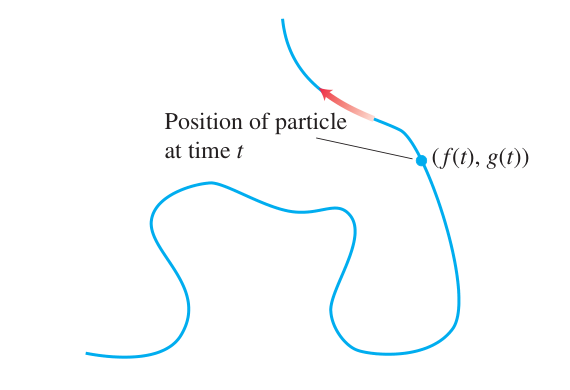
  
图 11.1　粒子在 $xy$ 平面内运动形成的曲线或轨迹不一定是某个函数或单个方程的图像。

  

    
定义　参数曲线

    
若在参数区间 $I$ 上，$x$ 和 $y$ 由

    

$$
x=f(t),\qquad y=g(t)
$$

    

    
给出，则这些方程所确定的点集 $(x,y)=(f(t),g(t))$ 称为一条<strong>参数曲线</strong>，这两个方程称为曲线的<strong>参数方程</strong>。变量 $t$ 称为曲线的<strong>参数</strong>，它的定义域 $I$ 称为<strong>参数区间</strong>。

  

若 $I$ 是闭区间 $a\le t\le b$，则 $(f(a),g(a))$ 是曲线的起点，$(f(b),g(b))$ 是曲线的终点。给出一组参数方程以及相应的参数区间，称为给曲线作了参数化；这两部分合起来称为曲线的一种参数表示。同一条曲线可以有不同的参数表示。

**例 1**　画出参数方程

$$
x=t^2,\qquad y=t+1,\qquad -\infty<t<\infty
$$

所确定的曲线。

**解**　先列出若干参数值及相应的坐标，再把所得各点平滑连接。每个 $t$ 都确定曲线上的一点。例如，$t=1$ 对应点 $(1,2)$。

  
表 11.1　$x=t^2$、$y=t+1$ 的若干取值

  

  <table style="display: table; width: auto; min-width: 360px; margin: 0; border-collapse: collapse; font-variant-numeric: tabular-nums;">
    <thead><tr style="background-color: #f3f3f3; border-bottom: 1px solid #777;"><th style="padding: 0.5em 1em; text-align:center;">$t$</th><th style="padding: 0.5em 1em; text-align:center;">$x$</th><th style="padding: 0.5em 1em; text-align:center;">$y$</th></tr></thead>
    <tbody>
      <tr style="border-bottom:1px solid #ddd;"><td style="padding:0.4em 1em;text-align:center;">$-3$</td><td style="padding:0.4em 1em;text-align:right;">9</td><td style="padding:0.4em 1em;text-align:right;">$-2$</td></tr>
      <tr style="border-bottom:1px solid #ddd;"><td style="padding:0.4em 1em;text-align:center;">$-2$</td><td style="padding:0.4em 1em;text-align:right;">4</td><td style="padding:0.4em 1em;text-align:right;">$-1$</td></tr>
      <tr style="border-bottom:1px solid #ddd;"><td style="padding:0.4em 1em;text-align:center;">$-1$</td><td style="padding:0.4em 1em;text-align:right;">1</td><td style="padding:0.4em 1em;text-align:right;">0</td></tr>
      <tr style="border-bottom:1px solid #ddd;"><td style="padding:0.4em 1em;text-align:center;">0</td><td style="padding:0.4em 1em;text-align:right;">0</td><td style="padding:0.4em 1em;text-align:right;">1</td></tr>
      <tr style="border-bottom:1px solid #ddd;"><td style="padding:0.4em 1em;text-align:center;">1</td><td style="padding:0.4em 1em;text-align:right;">1</td><td style="padding:0.4em 1em;text-align:right;">2</td></tr>
      <tr style="border-bottom:1px solid #ddd;"><td style="padding:0.4em 1em;text-align:center;">2</td><td style="padding:0.4em 1em;text-align:right;">4</td><td style="padding:0.4em 1em;text-align:right;">3</td></tr>
      <tr><td style="padding:0.4em 1em;text-align:center;">3</td><td style="padding:0.4em 1em;text-align:right;">9</td><td style="padding:0.4em 1em;text-align:right;">4</td></tr>
    </tbody>
  </table>
  

若把曲线看作运动粒子的轨迹，则图中的箭头表示 $t$ 增大时粒子的运动方向。表中相邻的参数间隔相等，但曲线上相邻点之间的弧长并不相等：粒子沿下支接近 $y$ 轴时逐渐减速，到达 $(0,1)$ 后沿上支运动时又逐渐加速。由于参数区间是全体实数，这条曲线没有起点和终点。

  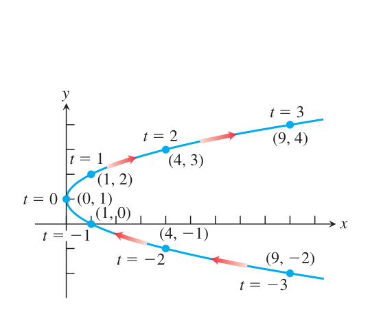
  
图 11.2　参数方程 $x=t^2$、$y=t+1$ 所确定的曲线（例 1）。

**例 2**　消去参数 $t$，用只含 $x,y$ 的代数方程说明例 1 中曲线的几何形状。

**解**　由 $y=t+1$ 得 $t=y-1$。代入 $x=t^2$：

$$
x=(y-1)^2=y^2-2y+1.
$$

因此曲线是一条开口向右、顶点为 $(0,1)$ 的抛物线。并非所有参数方程都能像这里一样容易地消去参数；有时消元十分困难，甚至不可能完成。

**例 3**　画出下列参数曲线：

$$
\text{(a) }x=\cos t,\quad y=\sin t,\quad 0\le t\le2\pi;
$$

$$
\text{(b) }x=a\cos t,\quad y=a\sin t,\quad 0\le t\le2\pi.
$$

**解**

**(a)** 因为

$$
x^2+y^2=\cos^2t+\sin^2t=1,
$$

曲线位于单位圆 $x^2+y^2=1$ 上。当 $t$ 从 $0$ 增加到 $2\pi$ 时，点 $(x,y)=(\cos t,\sin t)$ 从 $(1,0)$ 出发，沿逆时针方向把圆周完整走过一次。

  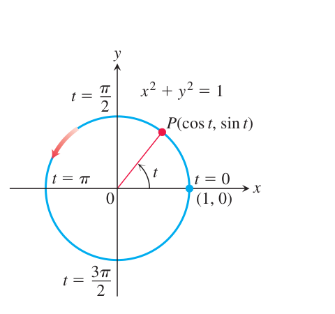
  
图 11.3　方程 $x=\cos t$、$y=\sin t$ 描述单位圆上的逆时针运动。

**(b)** 此时

$$
x^2+y^2=a^2\cos^2t+a^2\sin^2t=a^2.
$$

点从 $(a,0)$ 出发，逆时针绕圆 $x^2+y^2=a^2$ 一周，并在 $t=2\pi$ 时返回 $(a,0)$。图形是以原点为圆心、半径为 $|a|$ 的圆。

**例 4**　粒子的位置由

$$
x=\sqrt t,\qquad y=t,\qquad t\ge0
$$

给出。确定粒子的轨迹并说明其运动情况。

**解**　由 $x=\sqrt t$、$y=t$ 可得 $y=x^2$。不过，因为 $t\ge0$ 且 $x=\sqrt t\ge0$，轨迹不是整条抛物线，而只是右半支。粒子在 $t=0$ 时从原点出发，随着 $t$ 增大进入第一象限；参数区间是 $[0,\infty)$，因此有起点而没有终点。

  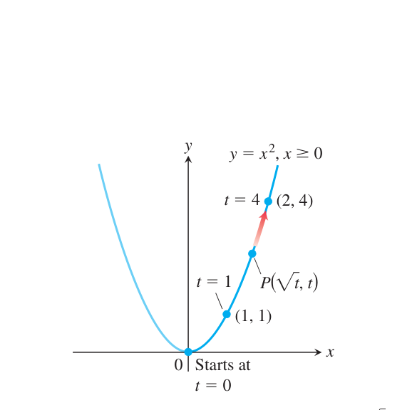
  
图 11.4　$x=\sqrt t$、$y=t$、$t\ge0$ 描述抛物线 $y=x^2$ 的右半支。

任意函数图像 $y=f(x)$ 都有一种自然参数表示：令 $x=t$、$y=f(t)$，参数的定义域与函数 $f$ 的定义域相同。

**例 5**　函数 $f(x)=x^2$ 的图像可以参数化为

$$
x=t,\qquad y=f(t)=t^2,\qquad -\infty<t<\infty.
$$

当 $t\ge0$ 时，它与例 4 描述相同的轨迹；允许 $t<0$ 后，曲线也包含抛物线的左半支，因此得到整条抛物线。该参数表示没有起点和终点。

  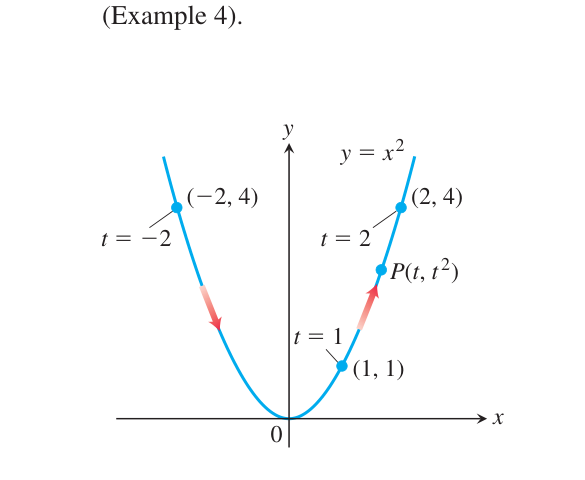
  
图 11.5　$x=t$、$y=t^2$、$-\infty<t<\infty$ 描述整条抛物线 $y=x^2$。

参数表示还说明运动粒子在何时到达曲线上的某个位置。在例 4 中，点 $(2,4)$ 对应 $t=4$；在例 5 中，同一点对应 $t=2$。研究两个运动物体是否碰撞时，仅有相同轨迹并不够；它们还必须在相应的参数值所代表的同一时刻到达同一位置。第 13 章讨论运动时还会回到这一点。

**例 6**　求过点 $(a,b)$、斜率为 $m$ 的直线的一组参数方程。

**解**　直线的直角坐标方程为 $y-b=m(x-a)$。令 $t=x-a$，便有

$$
x=a+t,\qquad y=b+mt,\qquad -\infty<t<\infty.
$$

这与令 $t=x$ 得到的自然参数表示不同，但两组方程描述的是同一条直线。

**例 7**　画出并识别点 $P(x,y)$ 的轨迹：

$$
x=t+\frac1t,\qquad y=t-\frac1t,\qquad t>0.
$$

**解**　两式相减、相加分别得到

$$
x-y=\frac2t,\qquad x+y=2t.
$$

相乘消去参数：

$$
\begin{equation}
(x-y)(x+y)=4,\qquad x^2-y^2=4.
\tag{1}
\end{equation}
$$

这是双曲线的标准方程。但是参数条件 $t>0$ 使 $x=t+1/t$ 始终为正，所以参数方程只给出双曲线的右支。较小的正参数对应第四象限中的点；随着 $t$ 增大，点向上运动，在 $t=1$ 时经过 $(2,0)$，然后进入第一象限。参数区间为 $(0,\infty)$，轨迹没有起点和终点。

  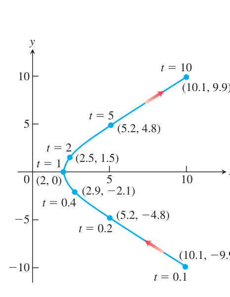
  
图 11.6　例 7 的曲线；图中显示的是 $0.1\le t\le10$ 的部分。

同一条双曲线右支还可以写成

$$
x=\sqrt{4+t^2},\qquad y=t,\qquad -\infty<t<\infty,
$$

或利用恒等式 $\sec^2t-\tan^2t=1$ 写成

$$
x=2\sec t,\qquad y=2\tan t,\qquad -\frac\pi2<t<\frac\pi2.
$$

后一组方程满足 $x^2-y^2=4$。当 $t$ 从 $-\pi/2$ 增加到 $\pi/2$ 时，$x$ 始终为正，而 $y$ 从 $-\infty$ 增加到 $\infty$，所以点完整走过双曲线的右支。

### 摆线

普通摆钟的摆锤沿圆弧运动时，摆动频率会随振幅改变：摆动范围越大，摆锤返回最低点所需的时间越长。如果能使摆锤沿摆线运动，就不会出现这一问题。1673 年，Christiaan Huygens 设计了一种摆锤沿摆线运动的钟。他用挡板约束悬挂摆锤的细线，使摆锤离开中点时细线逐渐绕在挡板上。

  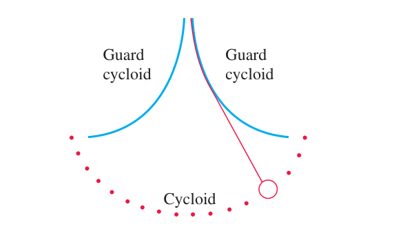
  
图 11.7　在惠更斯摆钟中，摆锤沿摆线运动，因此频率不依赖于振幅。

**例 8**　半径为 $a$ 的圆沿水平直线滚动。求圆周上一点 $P$ 所描出的轨迹的参数方程。这条轨迹称为摆线。

**解**　取滚动直线为 $x$ 轴，开始时令 $P$ 位于原点，并使圆向右滚动。以圆转过的弧度 $t$ 为参数。圆无滑动地滚动时，圆心的水平位移等于所滚过的弧长 $at$，所以圆心为 $C(at,a)$。

设从圆心指向 $P$ 的半径与正 $x$ 轴的夹角为 $u$。由图中几何关系 $t+u=3\pi/2$，所以

$$
u=\frac{3\pi}{2}-t,\qquad
\cos u=-\sin t,\qquad \sin u=-\cos t.
$$

于是

$$
x=at+a\cos u=at-a\sin t,
$$

$$
y=a+a\sin u=a-a\cos t.
$$

因此摆线的参数方程为

$$
\begin{equation}
x=a(t-\sin t),\qquad y=a(1-\cos t).
\tag{2}
\end{equation}
$$

  
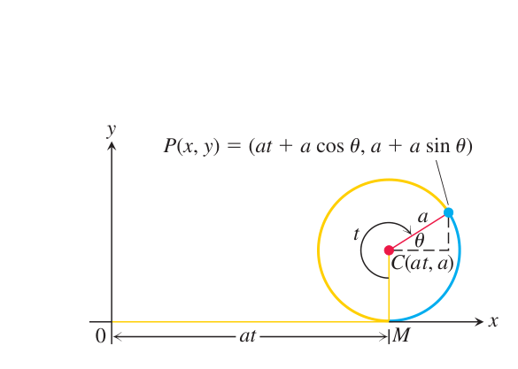
图 11.8　滚动圆转过角 $t$ 时点 $P(x,y)$ 的位置。

  
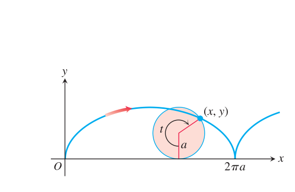
图 11.9　摆线 $x=a(t-\sin t)$、$y=a(1-\cos t)$。

### 最速降线与等时降线

把图 11.9 上下翻转后，式 (2) 仍然适用，得到图 11.10 所示的曲线。它具有两个重要的物理性质。

第一，在连接原点 $O$ 与第一拱最低点 $B$ 的所有光滑曲线中，无摩擦小珠仅受重力作用时，沿摆线从 $O$ 滑到 $B$ 所用的时间最短。因此摆线是这两点间的**最速降线**。第二，即使小珠不是从 $O$ 出发，而是从摆线上更靠近 $B$ 的任一点由静止释放，它到达 $B$ 所需的时间仍然相同。因此摆线也是**等时降线**。

  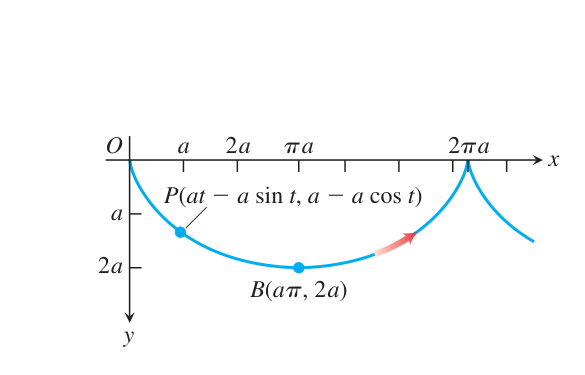
  
图 11.10　把摆线上下翻转；$y$ 轴向下表示重力方向，式 (2) 仍描述该曲线。

下面说明最速降线问题为什么会成为一个积分最小化问题。小珠开始时速度为零。重力从 $(0,0)$ 到 $(x,y)$ 所做的功为 $mgy$，它等于动能的增加：

$$
mgy=\frac12mv^2-\frac12m(0)^2.
$$

因此小珠到达 $(x,y)$ 时的速率是

$$
v=\sqrt{2gy}.
$$

若 $s$ 表示沿轨迹的弧长，$T$ 表示时间，则

$$
\frac{ds}{dT}=\sqrt{2gy},
$$

从而

$$
\begin{equation}
dT=\frac{ds}{\sqrt{2gy}}
=\frac{\sqrt{1+(dy/dx)^2}}{\sqrt{2gy}}\,dx.
\tag{3}
\end{equation}
$$

沿曲线 $y=f(x)$ 从 $O$ 到 $B(a\pi,2a)$ 所需的时间为

$$
\begin{equation}
T_f=\int_0^{a\pi}\sqrt{\frac{1+(dy/dx)^2}{2gy}}\,dx.
\tag{4}
\end{equation}
$$

求哪一条曲线使这个积分最小，属于变分法问题。直线 $OB$ 虽然路程最短，却不一定用时最少，因为开始时更陡的下降可以使小珠更快获得较大速度。变分法证明，连接 $O$、$B$ 的原摆线是唯一的最速降线。

  
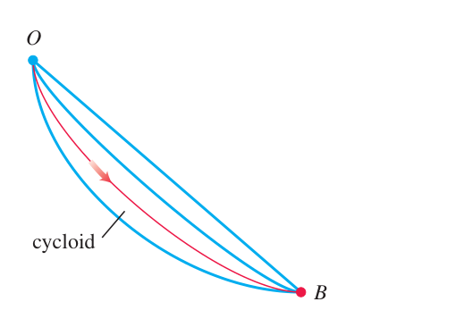
图 11.11　摆线是使无摩擦小珠从 $O$ 滑到 $B$ 的时间最短的唯一曲线。

  
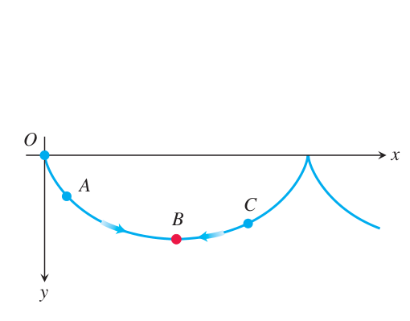
图 11.12　从 $O$、$A$、$C$ 同时释放的小珠会同时到达 $B$。

下一节将建立参数曲线的弧长微分 $ds$。把摆线的参数方程代入式 (3)，可得小珠从 $O$ 滑到 $B$ 的时间

$$
T=\pi\sqrt{\frac ag}.
$$

若从对应参数 $t_0>0$ 的较低位置释放，沿 $[t_0,\pi]$ 积分仍得到同一时间。这正是摆线的等时性，也是惠更斯摆钟的周期不依赖振幅的原因。

## 11.2 参数曲线的微积分

本节把微积分应用到参数曲线，求曲线的斜率、长度以及与曲线有关的面积。

### 切线与面积

若 $x=f(t)$ 和 $y=g(t)$ 在 $t$ 处都可微，就称参数曲线在 $t$ 处可微。在参数曲线上，如果 $y$ 还能看成 $x$ 的可微函数，则链式法则给出

$$
\frac{dy}{dt}=\frac{dy}{dx}\frac{dx}{dt}.
$$

当 $dx/dt\ne0$ 时，可除以 $dx/dt$ 得到斜率公式。

参数曲线的一阶导数

若有关导数都存在且 $dx/dt\ne0$，则

$$
\begin{equation}
\frac{dy}{dx}=\frac{dy/dt}{dx/dt}.
\tag{1}
\end{equation}
$$

如果参数方程还把 $y$ 定义为 $x$ 的二阶可微函数，则把 $y'=dy/dx$ 看成参数 $t$ 的函数，再应用式 (1)：

参数曲线的二阶导数

若 $dx/dt\ne0$ 且 $y'=dy/dx$，则

$$
\begin{equation}
\frac{d^2y}{dx^2}=\frac{d y'/dt}{dx/dt}.
\tag{2}
\end{equation}
$$

**例 1**　求曲线

$$
x=\sec t,\qquad y=\tan t,\qquad -\frac\pi2<t<\frac\pi2
$$

在 $t=\pi/4$、即点 $(\sqrt2,1)$ 处的切线。

**解**　曲线斜率为

$$
\frac{dy}{dx}=\frac{\sec^2t}{\sec t\tan t}=\frac{\sec t}{\tan t}.
$$

令 $t=\pi/4$：

$$
\left.\frac{dy}{dx}\right|_{t=\pi/4}=\frac{\sqrt2}{1}=\sqrt2.
$$

因此切线为

$$
y-1=\sqrt2(x-\sqrt2),\qquad y=\sqrt2x-1.
$$

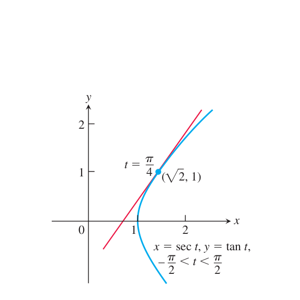
图 11.13　例 1 的曲线是双曲线 $x^2-y^2=1$ 的右支。

求 $d^2y/dx^2$ 时，可以按三步进行：先把 $y'=dy/dx$ 表示成 $t$ 的函数；再求 $dy'/dt$；最后除以 $dx/dt$。

**例 2**　若 $x=t-t^2$、$y=t-t^3$，把 $d^2y/dx^2$ 表示成 $t$ 的函数。

**解**　首先

$$
y'=\frac{dy/dt}{dx/dt}=\frac{1-3t^2}{1-2t}.
$$

再对 $t$ 求导：

$$
\frac{dy'}{dt}=\frac{2-6t+6t^2}{(1-2t)^2}.
$$

最后除以 $dx/dt=1-2t$：

$$
\frac{d^2y}{dx^2}=\frac{2-6t+6t^2}{(1-2t)^3}.
$$

**例 3**　求星形线

$$
x=\cos^3t,\qquad y=\sin^3t,\qquad 0\le t\le2\pi
$$

所围成的面积。

**解**　由对称性，所求面积是第一象限曲线下方面积的四倍。第一象限对应 $0\le t\le\pi/2$。由于 $dx=-3\cos^2t\sin t\,dt$，沿第一象限从 $(1,0)$ 到 $(0,1)$ 时 $x$ 递减，所以交换积分方向：

$$
\begin{aligned}
A&=4\int_0^1y\,dx
=4\int_0^{\pi/2}\sin^3t\,(3\cos^2t\sin t)\,dt\\
&=12\int_0^{\pi/2}\sin^4t\cos^2t\,dt
=\frac{3\pi}{8}.
\end{aligned}
$$

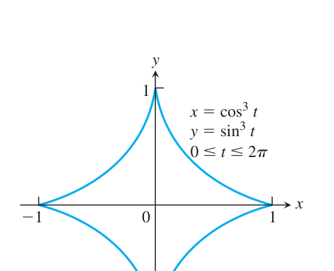
图 11.14　例 3 的星形线。

### 参数曲线的长度

设光滑曲线 $C$ 由

$$
x=f(t),\qquad y=g(t),\qquad a\le t\le b
$$

给出，其中 $f,g$ 在 $[a,b]$ 上具有连续的一阶导数，并且 $f'(t)$ 与 $g'(t)$ 不同时为零。把区间分割为

$$
a=t_0<t_1<\cdots<t_n=b,
$$

令 $P_k=(f(t_k),g(t_k))$，并用直线段连接相邻点。第 $k$ 条线段的长度为

$$
L_k=\sqrt{(\Delta x_k)^2+(\Delta y_k)^2}.
$$

由中值定理，存在 $t_k^*,t_k^{**}\in[t_{k-1},t_k]$，使得

$$
\Delta x_k=f'(t_k^*)\Delta t_k,\qquad
\Delta y_k=g'(t_k^{**})\Delta t_k.
$$

因此折线路径长度为

$$
\sum_{k=1}^nL_k
=\sum_{k=1}^n\sqrt{[f'(t_k^*)]^2+[g'(t_k^{**})]^2}\,\Delta t_k.
$$

当分割的范数趋于零时，这个和的极限是相应的定积分。

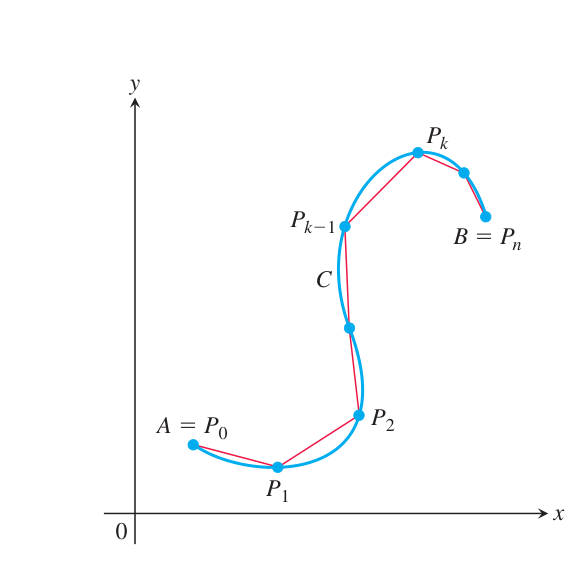
图 11.15　用相邻分点间的线段长度之和逼近光滑曲线 $C$ 的长度。

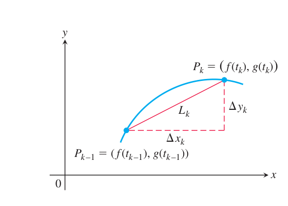
图 11.16　用长度 $L_k=\sqrt{(\Delta x_k)^2+(\Delta y_k)^2}$ 的线段逼近弧 $P_{k-1}P_k$。

定义　参数曲线的长度

若曲线 $C$ 由 $x=f(t)$、$y=g(t)$、$a\le t\le b$ 给出，$f',g'$ 连续且不同时为零，并且当 $t$ 从 $a$ 增加到 $b$ 时曲线恰好被走过一次，则

$$
\begin{equation}
L=\int_a^b\sqrt{[f'(t)]^2+[g'(t)]^2}\,dt
=\int_a^b\sqrt{\left(\frac{dx}{dt}\right)^2+\left(\frac{dy}{dt}\right)^2}\,dt.
\tag{3}
\end{equation}
$$

不同的参数表示会给出同一长度，但所选参数表示必须满足上述条件，特别是不能在积分区间内把曲线重复走过。

**例 4**　由定义求圆

$$
x=r\cos t,\qquad y=r\sin t,\qquad0\le t\le2\pi
$$

的周长。

**解**　因为 $dx/dt=-r\sin t$、$dy/dt=r\cos t$，所以

$$
\left(\frac{dx}{dt}\right)^2+\left(\frac{dy}{dt}\right)^2=r^2.
$$

圆在参数区间内恰好走过一次，故

$$
L=\int_0^{2\pi}r\,dt=2\pi r.
$$

**例 5**　求星形线 $x=\cos^3t$、$y=\sin^3t$ 的长度。

**解**　利用关于坐标轴的对称性，只需计算第一象限部分的长度再乘以 $4$。在 $0\le t\le\pi/2$ 上，

$$
\begin{aligned}
\sqrt{\left(\frac{dx}{dt}\right)^2+\left(\frac{dy}{dt}\right)^2}
&=\sqrt{9\cos^4t\sin^2t+9\sin^4t\cos^2t}\\
&=3\cos t\sin t.
\end{aligned}
$$

因此第一象限弧长为

$$
\int_0^{\pi/2}3\cos t\sin t\,dt=\frac32,
$$

整条星形线的长度为 $4(3/2)=6$。

**例 6**　求椭圆 $x^2/a^2+y^2/b^2=1$ 的周长，其中 $a>b>0$。

**解**　取参数方程 $x=a\sin t$、$y=b\cos t$。由对称性，

$$
P=4a\int_0^{\pi/2}\sqrt{1-e^2\sin^2t}\,dt,
\\qquad e=\sqrt{1-\frac{b^2}{a^2}}.
$$

这个积分不是初等积分，称为第二类完全椭圆积分。利用第 10.10 节的二项式级数，可写成

$$
P=2\pi a\left[1-left(\frac12\right)^2e^2
-\left(\frac{1\cdot3}{2\cdot4}\right)^2\frac{e^4}{3}
-\left(\frac{1\cdot3\cdot5}{2\cdot4\cdot6}\right)^2\frac{e^6}{5}-\cdots\right].
$$

因为 $e<1$，该级数收敛，可以用来把椭圆周长计算到任意所需精度。

函数图像 $y=f(x)$ 的弧长公式是式 (3) 的特殊情况。令 $x=t$、$y=f(t)$，则 $dx/dt=1$、$dy/dt=f'(t)$，从而

$$
L=\int_a^b\sqrt{1+[f'(x)]^2}\,dx,
$$

这与第 6.3 节的公式一致。

### 弧长微分

对参数曲线 $x=f(t)$、$y=g(t)$，定义从参数 $a$ 到 $t$ 的弧长函数

$$
s(t)=\int_a^t\sqrt{[f'(z)]^2+[g'(z)]^2}\,dz.
$$

由微积分基本定理，

$$
\frac{ds}{dt}=\sqrt{[f'(t)]^2+[g'(t)]^2}
=\sqrt{\left(\frac{dx}{dt}\right)^2+\left(\frac{dy}{dt}\right)^2}.
$$

所以

$$
\begin{equation}
ds=\sqrt{\left(\frac{dx}{dt}\right)^2+\left(\frac{dy}{dt}\right)^2}\,dt.
\tag{4}
\end{equation}
$$

常把它简写为 $ds=\sqrt{dx^2+dy^2}$。

**例 7**　求例 5 中星形线第一象限弧的质心。

**解**　取线密度 $\delta=1$。质量分布关于直线 $y=x$ 对称，因此 $\bar x=\bar y$。由例 5，

$$
dm=ds=3\cos t\sin t\,dt,\qquad0\le t\le\frac\pi2.
$$

曲线质量为

$$
M=\int_0^{\pi/2}3\cos t\sin t\,dt=\frac32.
$$

关于 $x$ 轴的矩为

$$
M_x=\int_0^{\pi/2}\sin^3t\,(3\cos t\sin t)\,dt
=3\int_0^{\pi/2}\sin^4t\cos t\,dt=\frac35.
$$

因此

$$
\bar y=\frac{M_x}{M}=\frac{3/5}{3/2}=\frac25,
$$

由对称性 $\bar x=2/5$，故质心为 $(2/5,2/5)$。

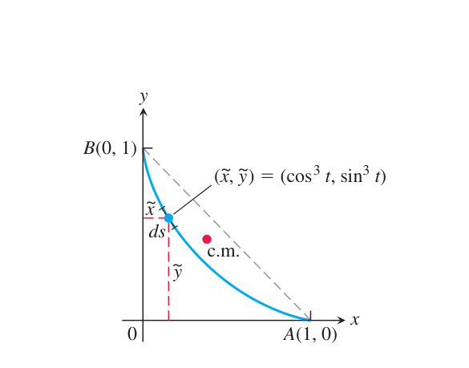
图 11.17　例 7 中星形线弧的质心。

**例 8**　求无摩擦小珠沿摆线

$$
x=a(t-\sin t),\qquad y=a(1-\cos t)
$$

从 $t=0$ 滑到 $t=\pi$ 所需的时间 $T_c$。

**解**　由 11.1 节式 (3)，

$$
T_c=\int_0^\pi\frac{ds}{\sqrt{2gy}}.
$$

摆线满足

$$
\frac{dx}{dt}=a(1-\cos t),\qquad \frac{dy}{dt}=a\sin t,
$$

故

$$
ds=a\sqrt{2-2\cos t}\,dt.
$$

又 $y=a(1-\cos t)$，因此

$$
T_c=\int_0^\pi
\sqrt{\frac{a^2(2-2\cos t)}{2ga(1-\cos t)}}\,dt
=\int_0^\pi\sqrt{\frac ag}\,dt
=\pi\sqrt{\frac ag}.
$$

### 旋转曲面的面积

第 6.4 节给出曲线绕坐标轴旋转时的曲面面积公式：绕 $x$ 轴为 $S=\int2\pi y\,ds$，绕 $y$ 轴为 $S=\int2\pi x\,ds$。结合参数曲线的弧长微分式 (4)，得到以下公式。

参数曲线生成的旋转曲面面积

若光滑曲线 $x=f(t)$、$y=g(t)$、$a\le t\le b$ 随 $t$ 增大恰好走过一次，则：

绕 $x$ 轴（$y\ge0$）：

$$
\begin{equation}
S=\int_a^b2\pi y\sqrt{\left(\frac{dx}{dt}\right)^2+\left(\frac{dy}{dt}\right)^2}\,dt.
\tag{5}
\end{equation}
$$

绕 $y$ 轴（$x\ge0$）：

$$
\begin{equation}
S=\int_a^b2\pi x\sqrt{\left(\frac{dx}{dt}\right)^2+\left(\frac{dy}{dt}\right)^2}\,dt.
\tag{6}
\end{equation}
$$

**例 9**　圆心为 $(0,1)$、半径为 $1$ 的圆可表示为

$$
x=\cos t,\qquad y=1+\sin t,\qquad0\le t\le2\pi.
$$

求它绕 $x$ 轴旋转生成的曲面面积。

**解**　因为

$$
\sqrt{(-\sin t)^2+(\cos t)^2}=1,
$$

所以

$$
S=\int_0^{2\pi}2\pi(1+\sin t)\,dt
=2\pi[t-\cos t]_0^{2\pi}=4\pi^2.
$$

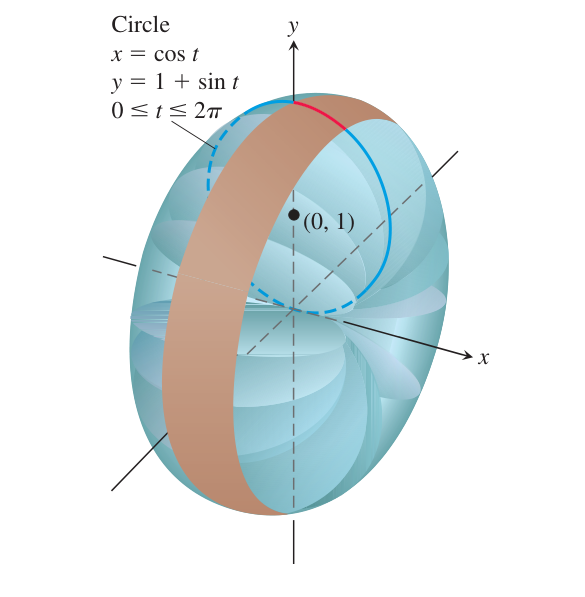
图 11.18　例 9 中参数曲线绕 $x$ 轴旋转所扫出的曲面。

## 11.3 极坐标

本节研究极坐标以及它与直角坐标的关系。极坐标不仅适合描述行星和卫星的轨道，在第 15 章计算许多重积分时也非常有用。

### 极坐标的定义

先固定一个原点 $O$，称为**极点**；再固定一条从 $O$ 出发的射线，称为**极轴**，通常取正 $x$ 轴作为极轴。平面内一点 $P$ 可以用一对极坐标 $(r,\theta)$ 定位：$r$ 是从 $O$ 到 $P$ 的有向距离，$\theta$ 是从极轴转到射线 $OP$ 的有向角。

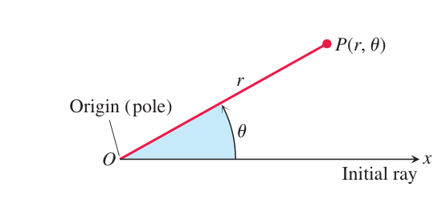
图 11.19　用极点和极轴建立平面极坐标系。

与三角学中的约定相同，逆时针测得的 $\theta$ 为正，顺时针测得的 $\theta$ 为负。一个直角坐标点只有一对直角坐标，却有无穷多对极坐标。例如，极轴上方 $\pi/6$ 方向、离极点 2 个单位的点既可以写成

$$
\left(2,\frac\pi6\right),
$$

也可以写成

$$
\left(2,-\frac{11\pi}{6}\right).
$$

极径 $r$ 还允许取负值。点 $(2,7\pi/6)$ 可以理解为沿 $7\pi/6$ 方向向前走 2 个单位；同一点也可以从 $\pi/6$ 方向向后走 2 个单位，所以还可写成 $(-2,\pi/6)$。

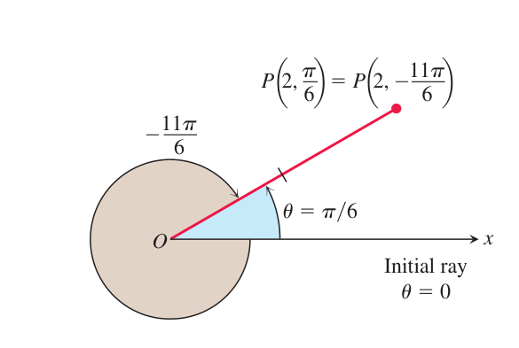
图 11.20　同一点可以有不同的极角。

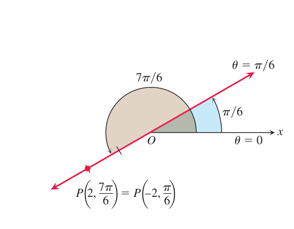
图 11.21　负极径表示沿给定方向的反向移动。

**例 1**　求点 $P(2,\pi/6)$ 的全部极坐标。

**解**　当极径取 $r=2$ 时，可以给极角加上任意个整周：

$$
\left(2,\frac\pi6+2n\pi\right),\qquad n=0,\pm1,\pm2,\ldots
$$

若取 $r=-2$，方向需要反转 $\pi$，可写为

$$
\left(-2,-\frac{5\pi}{6}+2n\pi\right),\qquad n=0,\pm1,\pm2,\ldots
$$

这两组坐标给出同一个点。

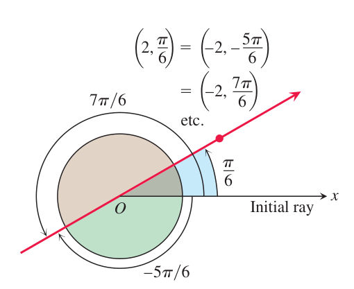
图 11.22　点 $P(2,\pi/6)$ 有无穷多组极坐标。

### 极坐标方程与图形

若固定 $r=a\ne0$，让 $\theta$ 在任意长度为 $2\pi$ 的区间内变化，则点 $P(r,\theta)$ 始终离极点 $|a|$ 个单位，因而描出以极点为圆心、半径为 $|a|$ 的圆。

若固定 $\theta=\theta_0$，让 $r$ 从 $-\infty$ 变化到 $\infty$，则点 $P(r,\theta)$ 描出一条经过极点、与极轴夹角为 $\theta_0$ 的直线。

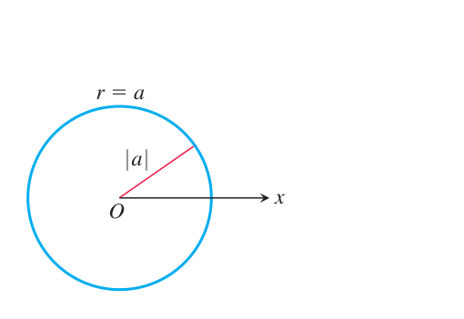
图 11.23　$r=a$ 表示半径为 $|a|$ 的圆。

**例 2**　同一个圆或同一条直线可以有多个极坐标方程。

**(a)** $r=1$ 与 $r=-1$ 都表示以 $O$ 为圆心、半径为 1 的圆。

**(b)** $\theta=\pi/6$、$\theta=7\pi/6$ 与 $\theta=-5\pi/6$ 都表示图 11.22 中的同一条直线。

形如 $r=a$、$\theta=\theta_0$ 的方程还可以与不等式组合，用来描述区域、线段或射线。

**例 3**　画出满足下列条件的点集：

$$
\text{(a) }1\le r\le2,quad0\le\theta\le\frac\pi2;
$$

$$
\text{(b) }-3\le r\le2,\quad\theta=\frac\pi4;
$$

$$
\text{(c) }\frac{2\pi}{3}\le\theta\le\frac{5\pi}{6},\quad r\text{ 不受限制}.
$$

图 11.24 分别给出四分之一圆环、同一直线上的一条线段，以及由两条过极点的直线围成的双向角形区域。

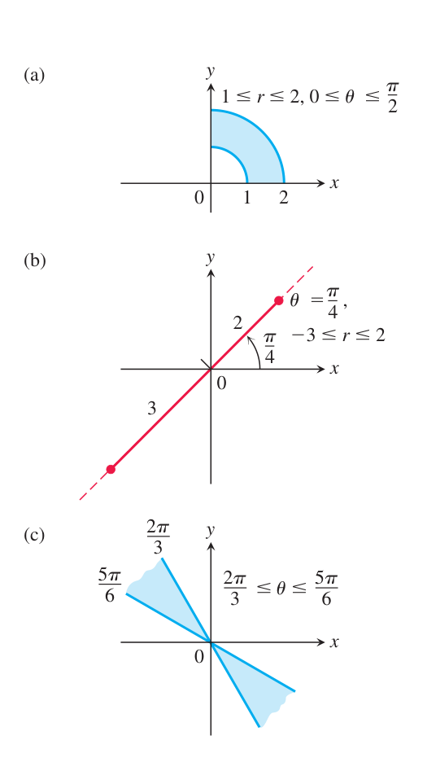
图 11.24　$r$ 与 $\theta$ 的典型方程和不等式所表示的图形（例 3）。

### 极坐标与直角坐标的关系

同时使用两种坐标时，把极点与直角坐标原点重合，并令极轴与正 $x$ 轴重合。由直角三角形关系可得

极坐标与直角坐标的换算公式

$$
x=r\cos\theta,\qquad y=r\sin\theta,\qquad
r^2=x^2+y^2,\qquad \tan\theta=\frac yx.
$$

前两个公式由 $(r,\theta)$ 唯一确定 $x,y$。反过来，已知 $(x,y)$ 时，$r^2=x^2+y^2$ 给出正、负两个 $r$ 值；对任意非原点的 $(x,y)$，在 $0\le\theta<2\pi$ 中可以找到唯一的角与正极径相配。再通过给角加 $2n\pi$ 或同时改变极径符号并把角加 $\pi$，即可得到其他极坐标表示。

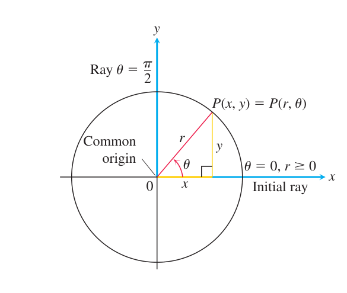
图 11.25　把极点与原点重合、极轴与正 $x$ 轴重合后，两种坐标之间的关系。

**例 4**　下列极坐标方程及其直角坐标形式说明：有些曲线用极坐标表示更简单，有些则不然。

<table style="display:table;width:auto;min-width:560px;margin:0;border-collapse:collapse;"><thead><tr style="background-color:#f3f3f3;border-bottom:1px solid #777;"><th style="padding:0.55em 1em;text-align:center;">极坐标方程</th><th style="padding:0.55em 1em;text-align:center;">对应的直角坐标方程</th></tr></thead><tbody><tr style="border-bottom:1px solid #ddd;"><td style="padding:0.45em 1em;text-align:center;">$r\cos\theta=2$</td><td style="padding:0.45em 1em;text-align:center;">$x=2$</td></tr><tr style="border-bottom:1px solid #ddd;"><td style="padding:0.45em 1em;text-align:center;">$r^2\cos\theta\sin\theta=4$</td><td style="padding:0.45em 1em;text-align:center;">$xy=4$</td></tr><tr style="border-bottom:1px solid #ddd;"><td style="padding:0.45em 1em;text-align:center;">$r^2\cos^2\theta-r^2\sin^2\theta=1$</td><td style="padding:0.45em 1em;text-align:center;">$x^2-y^2=1$</td></tr><tr style="border-bottom:1px solid #ddd;"><td style="padding:0.45em 1em;text-align:center;">$r=1+2r\cos\theta$</td><td style="padding:0.45em 1em;text-align:center;">$y^2-3x^2-4x-1=0$</td></tr><tr><td style="padding:0.45em 1em;text-align:center;">$r=1-\cos\theta$</td><td style="padding:0.45em 1em;text-align:center;">$x^4+y^4+2x^2y^2+2x^3+2xy^2-y^2=0$</td></tr></tbody></table>

**例 5**　求圆 $x^2+(y-3)^2=9$ 的极坐标方程。

**解**

$$
\begin{aligned}
x^2+(y-3)^2&=9,\\
x^2+y^2-6y&=0,\\
r^2-6r\sin\theta&=0,\\
r(r-6\sin\theta)&=0.
\end{aligned}
$$

方程 $r=6\sin\theta$ 已经包括原点，所以所求极坐标方程为

$$
r=6\sin\theta.
$$

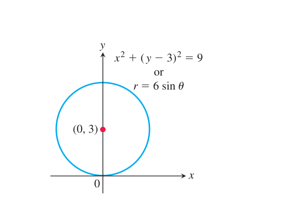
图 11.26　圆 $x^2+(y-3)^2=9$ 也可写成 $r=6\sin\theta$。

**例 6**　把下列极坐标方程化为直角坐标方程并识别图形。

**(a)** $r\cos\theta=-4$：由 $x=r\cos\theta$ 得

$$
x=-4,
$$

表示过 $x$ 轴上 $-4$ 点的竖直直线。

**(b)** $r^2=4r\cos\theta$：

$$
x^2+y^2=4x,\qquad (x-2)^2+y^2=4,
$$

表示圆心为 $(2,0)$、半径为 2 的圆。

**(c)** $r=4/(2\cos\theta-\sin\theta)$：两边乘以分母，得

$$
2r\cos\theta-r\sin\theta=4,
$$

因此

$$
2x-y=4,\qquad y=2x-4,
$$

表示斜率为 2、$y$ 轴截距为 $-4$ 的直线。

## 11.4 极坐标方程的图像

把极坐标方程的图像画在直角坐标平面内时，曲线的对称性和切线方向能显著简化作图过程。

### 对称性

极坐标图形的对称性检验

若 $(r,\theta)$ 在图形上，则：

1. 关于 $x$ 轴对称：$(r,-\theta)$ 或 $(-r,\pi-\theta)$ 也在图形上；

2. 关于 $y$ 轴对称：$(r,\pi-\theta)$ 或 $(-r,-\theta)$ 也在图形上；

3. 关于原点对称：$(-r,\theta)$ 或 $(r,\theta+\pi)$ 也在图形上。

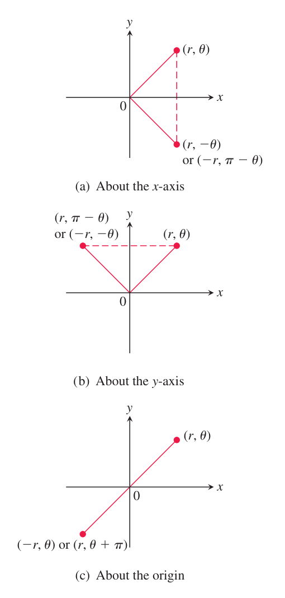
图 11.27　极坐标中的三种标准对称性检验。

### 斜率

极坐标曲线 $r=f(\theta)$ 在 $xy$ 平面中的斜率仍是 $dy/dx$，而不是 $dr/d\theta$。把曲线写成参数形式

$$
x=f(\theta)\cos\theta,\qquad y=f(\theta)\sin\theta,
$$

由参数曲线的求导公式和乘积法则可得

$$
\frac{dy}{dx}
=\frac{dy/d\theta}{dx/d\theta}
=\frac{f'(\theta)\sin\theta+f(\theta)\cos\theta}
{f'(\theta)\cos\theta-f(\theta)\sin\theta}.
$$

极坐标曲线的斜率

若 $r=f(\theta)$ 且 $dx/d\theta\ne0$，则

$$
\left.\frac{dy}{dx}\right|_{(r,\theta)}
=\frac{f'(\theta)\sin\theta+f(\theta)\cos\theta}
{f'(\theta)\cos\theta-f(\theta)\sin\theta}.
$$

如果曲线在 $\theta=\theta_0$ 时经过原点，即 $f(\theta_0)=0$，且 $f'(\theta_0)\ne0$，则

$$
\left.\frac{dy}{dx}\right|_{(0,\theta_0)}=\tan\theta_0.
$$

这里必须说明参数值 $(0,\theta_0)$，不能只说“原点处的斜率”，因为一条极坐标曲线可能在不同的 $\theta$ 值处多次经过原点，并具有不同的切线方向。

**例 1**　画出心形线 $r=1-\cos\theta$。

**解**　因为 $\cos(-\theta)=\cos\theta$，用 $-\theta$ 替换 $\theta$ 后方程不变，所以图形关于 $x$ 轴对称。

当 $\theta$ 从 $0$ 增加到 $\pi$ 时，$\cos\theta$ 从 1 减少到 $-1$，$r=1-\cos\theta$ 从 0 增加到 2；当 $\theta$ 从 $\pi$ 增加到 $2\pi$ 时，$r$ 又从 2 减少到 0。到 $2\pi$ 后曲线开始重复。

曲线在 $\theta=0$ 离开原点，在 $\theta=2\pi$ 返回原点；两次的斜率都是 $\tan0=\tan2\pi=0$。先计算 $0\le\theta\le\pi$ 的若干点并平滑连接，再关于 $x$ 轴反射，即得完整图形。由于形状像心脏，这类曲线称为心形线。

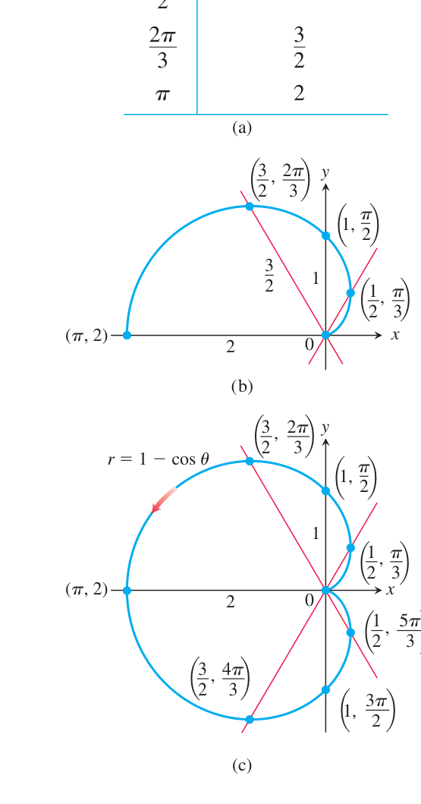
图 11.28　画出心形线 $r=1-\cos\theta$ 的步骤；箭头表示 $\theta$ 增大的方向。

**例 2**　画出曲线 $r^2=4\cos\theta$。

**解**　因为必须有 $\cos\theta\ge0$，取 $-\pi/2\le\theta\le\pi/2$ 就能得到整个图形。方程在 $\theta$ 换为 $-\theta$ 时不变，故关于 $x$ 轴对称；在 $r$ 换为 $-r$ 时也不变，故关于原点对称。这两个对称性又推出图形关于 $y$ 轴对称。

曲线在 $\theta=\pm\pi/2$ 经过原点，两次切线都是竖直的。对每个允许的 $\theta$，有两个极径

$$
r=\pm2\sqrt{\cos\theta}.
$$

根据若干取值、对称性以及原点处的切线方向连接各点，得到图 11.29 的双环图形。

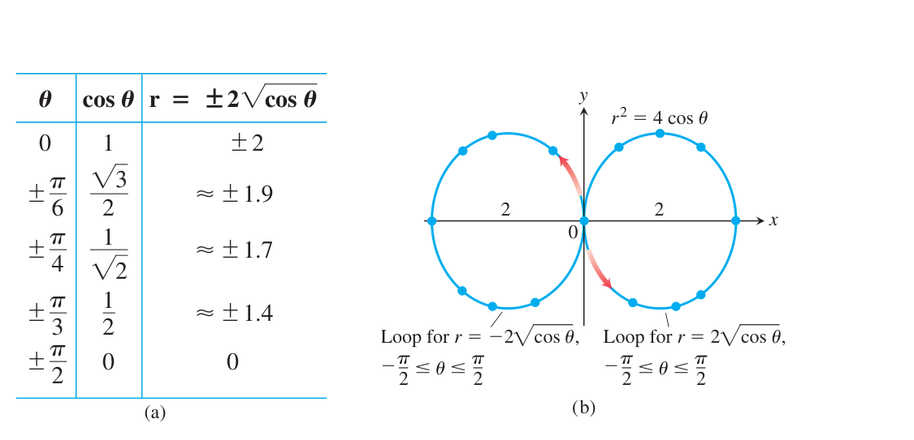
图 11.29　$r^2=4\cos\theta$ 的图像；箭头表示 $\theta$ 增大的方向。

### 从 $r\theta$ 平面转换到 $xy$ 平面

画 $r=f(\theta)$ 的极坐标图像时，可以列出 $(r,\theta)$ 值表，再按 $\theta$ 增大的顺序连接对应点。不过，如果曲线有多个环或凹陷，仅取少量点可能遗漏其结构。另一种方法是：

1. 先在直角坐标的 $\theta r$ 平面内画出函数 $r=f(\theta)$；
2. 再把这个函数图像当作一张连续的“数值表”，据此画出 $xy$ 平面中的极坐标图形。

第一个图像能直接显示 $r$ 在哪里为正、为负或不存在，以及它在哪些区间递增或递减，因此往往比单纯描点更可靠。

**例 3**　画出双纽线 $r^2=\sin2\theta$。

**解**　先在 $\theta r^2$ 平面画 $r^2=\sin2\theta$，舍去 $\sin2\theta<0$ 的参数区间；再画出

$$
r=\pm\sqrt{\sin2\theta}
$$

在 $\theta r$ 平面中的图像，最后把相应的极径和极角转换到 $xy$ 平面。中间的正、负两个平方根会把最终的双纽线各覆盖一次，因此完整过程把极坐标图形覆盖了两遍，但不会改变图形本身。

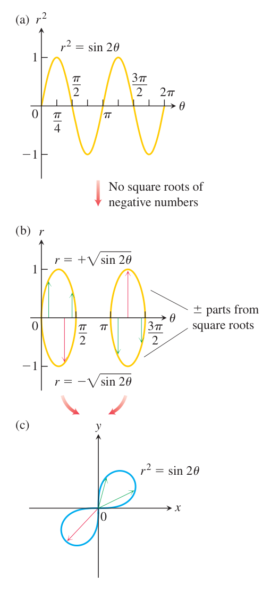
图 11.30　从 $r^2=\sin2\theta$ 的函数图像逐步得到双纽线。

对于复杂的极坐标曲线，可以使用绘图软件。如果软件不能直接绘制极坐标图，只需改写为参数方程

$$
x=f(\theta)\cos\theta,\qquad y=f(\theta)\sin\theta
$$

再作图即可；有些软件要求把参数 $\theta$ 改写成 $t$。

## 11.5 极坐标中的面积与长度

本节讨论如何用极坐标计算平面区域的面积和曲线长度。基本思想与直角坐标中相同，但由于极坐标区域由极径和极角描述，所得公式具有不同的形式。

### 平面区域的面积

图 11.31 中的区域 $OTS$ 由射线 $\theta=\alpha$、$\theta=\beta$ 和曲线 $r=f(\theta)$ 围成。把角 $\angle TOS$ 分成 $n$ 个小角，每个小区域近似为半径

$$
r_k=f(\theta_k)
$$

、圆心角为 $\Delta\theta_k$ 的扇形。因为圆心角为 $\Delta\theta_k$ 的扇形占整个圆的比例是 $\Delta\theta_k/(2\pi)$，其面积为

$$
A_k=\frac{\Delta\theta_k}{2\pi}\cdot\pi r_k^2
=\frac12[f(\theta_k)]^2\Delta\theta_k.
$$

于是整个区域的面积近似为

$$
\sum_{k=1}^n\frac12[f(\theta_k)]^2\Delta\theta_k.
$$

当分割的范数趋于零时，这个黎曼和趋于相应的定积分。

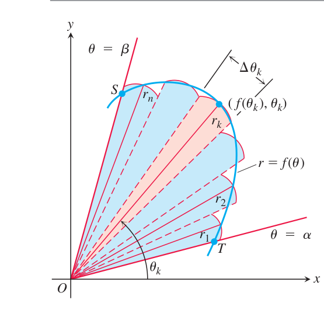
图 11.31　用互不重叠的小扇形逼近区域 $OTS$。

原点与曲线 $r=f(\theta)$ 之间扇形区域的面积

若 $\alpha\le\theta\le\beta$，则

$$
A=\int_\alpha^\beta\frac12r^2\,d\theta
=\int_\alpha^\beta\frac12[f(\theta)]^2\,d\theta.
$$

相应的面积微分为

$$
dA=\frac12r^2\,d\theta.
$$

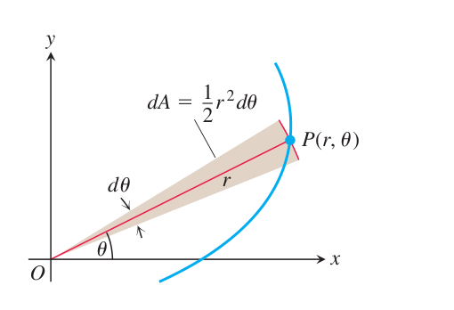
图 11.32　极坐标曲线 $r=f(\theta)$ 的面积微分。

**例 1**　求心形线

$$
r=2(1+\cos\theta)
$$

围成的面积。

**解**　当 $\theta$ 从 $0$ 增加到 $2\pi$ 时，极径恰好把整个区域扫过一次。因此

$$
\begin{aligned}
A&=\int_0^{2\pi}\frac12r^2\,d\theta\\
&=\int_0^{2\pi}2(1+\cos\theta)^2\,d\theta\\
&=\int_0^{2\pi}(3+4\cos\theta+\cos2\theta)\,d\theta\\
&=\left[3\theta+4\sin\theta+\frac12\sin2\theta\right]_0^{2\pi}\\
&=6\pi.
\end{aligned}
$$

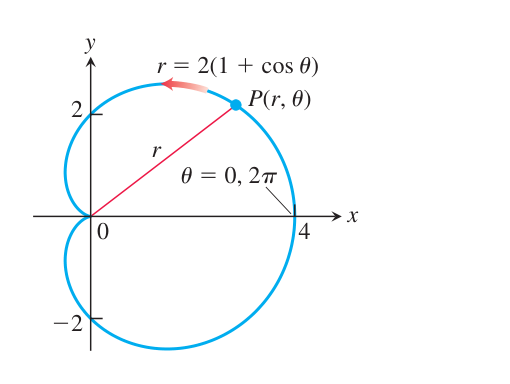
图 11.33　例 1 的心形线。

若区域在 $\alpha\le\theta\le\beta$ 内位于两条极坐标曲线 $r_1=r_1(\theta)$ 与 $r_2=r_2(\theta)$ 之间，且 $0\le r_1\le r_2$，则外侧扇形面积减去内侧扇形面积，得到

两条极坐标曲线之间区域的面积

$$
\begin{equation}
A=\int_\alpha^\beta\frac12\left(r_2^2-r_1^2\right)d\theta.
\tag{1}
\end{equation}
$$

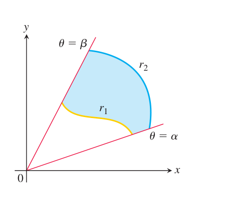
图 11.34　从外侧区域面积中减去内侧区域面积。

**例 2**　求圆 $r=1$ 内部、心形线 $r=1-\cos\theta$ 外部的区域面积。

**解**　两条曲线在 $\theta=\pm\pi/2$ 相交。区域关于 $x$ 轴对称，外侧曲线为 $r_2=1$，内侧曲线为 $r_1=1-\cos\theta$。因此

$$
\begin{aligned}
A&=2\int_0^{\pi/2}\frac12\left[1-(1-\cos\theta)^2\right]d\theta\\
&=\int_0^{\pi/2}(2\cos\theta-\cos^2\theta)\,d\theta\\
&=\left[2\sin\theta-\frac\theta2-\frac14\sin2\theta\right]_0^{\pi/2}\\
&=2-\frac\pi4.
\end{aligned}
$$

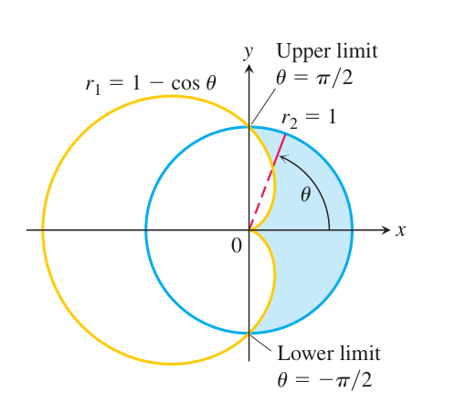
图 11.35　例 2 的区域及积分上下限。

一个点可以有多组极坐标，因此寻找两条极坐标曲线的所有交点时要格外小心。在直角坐标中，联立两个方程总能找到交点；在极坐标中，直接联立可能只找到部分交点，因为同一个交点在两个方程中可能使用不同的 $(r,\theta)$ 表示。实际计算前画出两条曲线，往往是确认全部交点最可靠的方法。

### 极坐标曲线的长度

把极坐标曲线 $r=f(\theta)$、$\alpha\le\theta\le\beta$ 参数化为

$$
\begin{equation}
x=f(\theta)\cos\theta,\qquad
y=f(\theta)\sin\theta.
\tag{2}
\end{equation}
$$

代入参数曲线的弧长公式并化简，得到

$$
\left(\frac{dx}{d\theta}\right)^2+
\left(\frac{dy}{d\theta}\right)^2
=r^2+\left(\frac{dr}{d\theta}\right)^2.
$$

极坐标曲线的长度

若 $r=f(\theta)$ 在 $[\alpha,\beta]$ 上有连续的一阶导数，并且点 $P(r,\theta)$ 随 $\theta$ 从 $\alpha$ 增加到 $\beta$ 时恰好把曲线走过一次，则

$$
\begin{equation}
L=\int_\alpha^\beta
\sqrt{r^2+\left(\frac{dr}{d\theta}\right)^2}\,d\theta.
\tag{3}
\end{equation}
$$

**例 3**　求心形线 $r=1-\cos\theta$ 的长度。

**解**　当 $0\le\theta\le2\pi$ 时，点恰好沿逆时针方向把曲线走过一次。因为

$$
r=1-\cos\theta,\qquad \frac{dr}{d\theta}=\sin\theta,
$$

所以

$$
\begin{aligned}
r^2+\left(\frac{dr}{d\theta}\right)^2
&=(1-\cos\theta)^2+\sin^2\theta\\
&=2-2\cos\theta
=4\sin^2\frac\theta2.
\end{aligned}
$$

在 $0\le\theta\le2\pi$ 上有 $\sin(\theta/2)\ge0$，于是

$$
\begin{aligned}
L&=\int_0^{2\pi}2\sin\frac\theta2\,d\theta\\
&=\left[-4\cos\frac\theta2\right]_0^{2\pi}=8.
\end{aligned}
$$

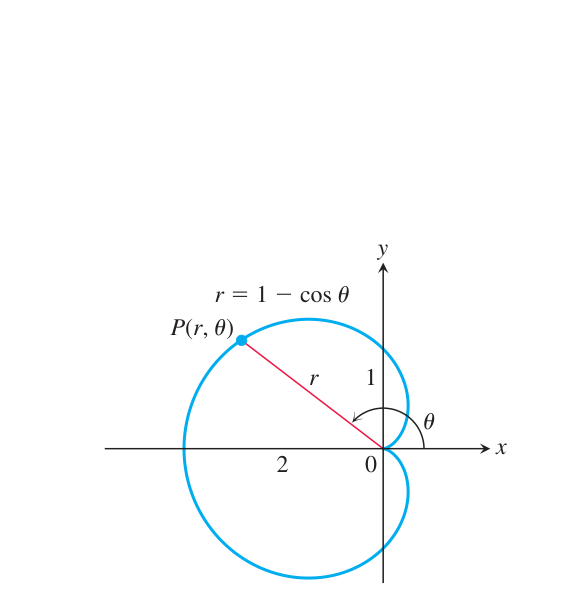
图 11.36　计算心形线 $r=1-\cos\theta$ 的长度。

## 11.6 圆锥曲线

本节从几何角度定义并复习抛物线、椭圆和双曲线，推导它们的标准直角坐标方程。这些曲线称为圆锥曲线，是因为它们可以由平面截双圆锥得到。古希腊数学家没有直角坐标和极坐标工具，只能用这种几何方式描述这些曲线。下一节将用极坐标统一表示圆锥曲线。

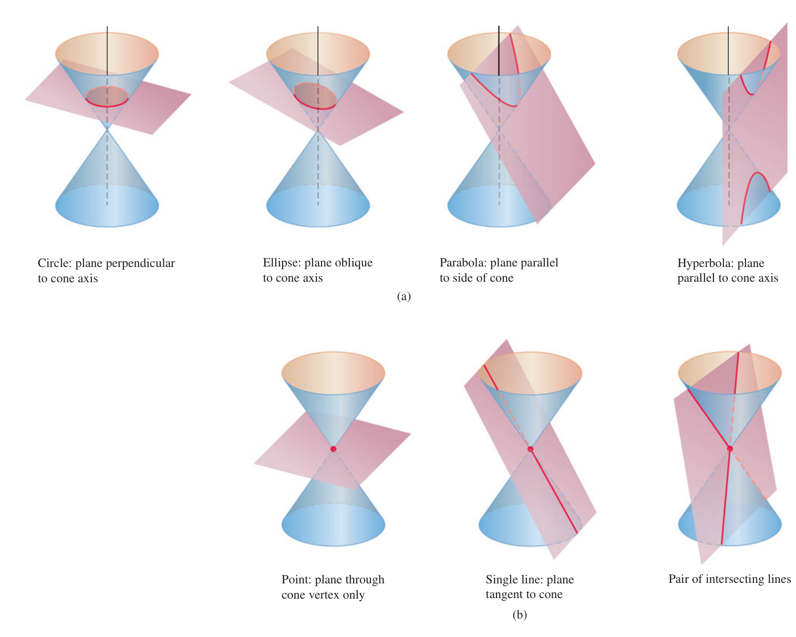
图 11.37　平面截双圆锥得到标准圆锥曲线。经过圆锥顶点得到的点、直线或相交直线称为退化圆锥曲线。

### 抛物线

定义　抛物线

平面内到一个定点与到一条定直线距离相等的所有点组成的集合称为<strong>抛物线</strong>。这个定点称为抛物线的<strong>焦点</strong>，定直线称为抛物线的<strong>准线</strong>。

若焦点恰好位于准线上，所得图形退化为经过焦点并垂直于准线的直线。以下只讨论焦点不在准线上的情形。

当焦点和准线分居某条坐标轴两侧时，抛物线具有最简单的方程。设焦点为正 $y$ 轴上的 $F(0,p)$，准线为 $y=-p$，其中 $p>0$。点 $P(x,y)$ 在抛物线上，当且仅当它到焦点和准线的距离相等。令 $Q(x,-p)$ 为 $P$ 到准线的垂足，则

$$
PF=\sqrt{x^2+(y-p)^2},\qquad PQ=|y+p|.
$$

令 $PF=PQ$，平方并化简，得到

$$
\begin{equation}
y=\frac{x^2}{4p},\qquad x^2=4py.
\tag{1}
\end{equation}
$$

方程表明图形关于 $y$ 轴对称，$y$ 轴称为抛物线的轴。抛物线与其轴相交的点称为顶点；$x^2=4py$ 的顶点为原点，正数 $p$ 称为焦距。

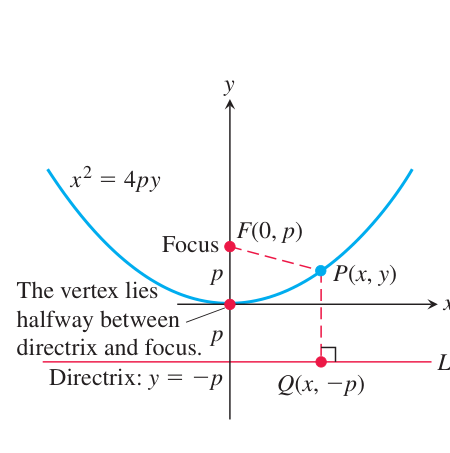
图 11.38　标准抛物线 $x^2=4py$，其中 $p>0$。

若焦点为 $(0,-p)$、准线为 $y=p$，抛物线向下开口，方程为

$$
x^2=-4py.
$$

交换 $x,y$，可得到向右或向左开口的抛物线：

$$
y^2=4px,\qquad y^2=-4px.
$$

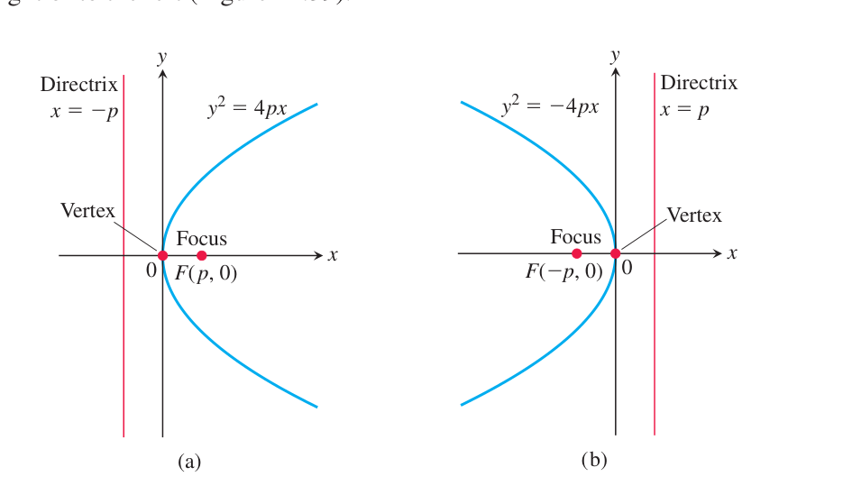
图 11.39　(a) $y^2=4px$；(b) $y^2=-4px$。

**例 1**　求抛物线 $y^2=10x$ 的焦点和准线。

**解**　与标准式 $y^2=4px$ 比较，得

$$
4p=10,\qquad p=\frac52.
$$

所以焦点为

$$
\left(\frac52,0\right),
$$

准线为

$$
x=-\frac52.
$$

### 椭圆

定义　椭圆

<strong>椭圆</strong>是平面内到两个定点的距离之和为常数的所有点组成的集合。这两个定点称为椭圆的<strong>焦点</strong>。

通过两个焦点的直线称为<strong>焦轴</strong>；焦点连线的中点称为<strong>中心</strong>；焦轴与椭圆的交点称为<strong>顶点</strong>。

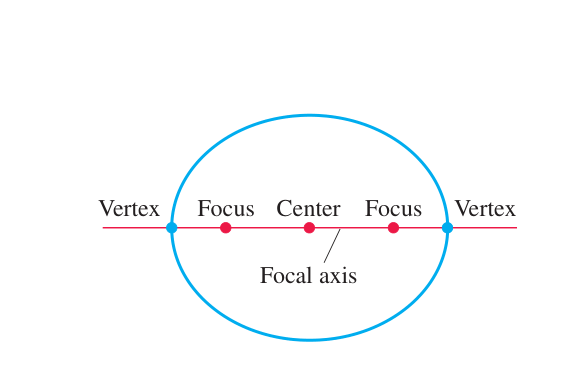
图 11.40　椭圆的焦点、焦轴、中心和顶点。

设焦点为 $F_1(-c,0)$、$F_2(c,0)$，并令椭圆上任一点 $P(x,y)$ 满足

$$
PF_1+PF_2=2a.
$$

由距离公式，

$$
\sqrt{(x+c)^2+y^2}+\sqrt{(x-c)^2+y^2}=2a.
$$

把第二个根式移到右边，平方；再分离剩下的根式并平方，可得

$$
\begin{equation}
\frac{x^2}{a^2}+\frac{y^2}{a^2-c^2}=1.
\tag{2}
\end{equation}
$$

由三角形 $PF_1F_2$ 的三角不等式，$2a>2c$，所以 $a>c$ 且 $a^2-c^2>0$。令

$$
\begin{equation}
b=\sqrt{a^2-c^2},
\tag{3}
\end{equation}
$$

则椭圆的标准方程为

$$
\begin{equation}
\frac{x^2}{a^2}+\frac{y^2}{b^2}=1.
\tag{4}
\end{equation}
$$

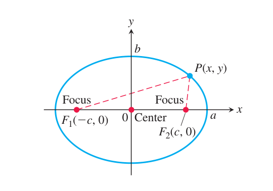
图 11.41　由 $PF_1+PF_2=2a$ 定义的椭圆，其中 $b^2=a^2-c^2$。

式 (4) 表明椭圆关于原点以及两条坐标轴对称，位于 $x=\pm a$、$y=\pm b$ 围成的矩形内，并在 $(\pm a,0)$、$(0,\pm b)$ 处与坐标轴相交。由隐函数求导，

$$
\frac{dy}{dx}=-\frac{b^2x}{a^2y},
$$

所以在 $(0,\pm b)$ 处切线水平，在 $(\pm a,0)$ 处切线竖直。

连接 $(\pm a,0)$ 的长为 $2a$ 的线段称为长轴，连接 $(0,\pm b)$ 的长为 $2b$ 的线段称为短轴；$a$、$b$ 分别称为半长轴和半短轴。中心到焦点的距离为

$$
c=\sqrt{a^2-b^2}.
$$

当 $a=b$ 时，椭圆成为圆。

**例 2**　椭圆

$$
\begin{equation}
\frac{x^2}{16}+\frac{y^2}{9}=1
\tag{5}
\end{equation}
$$

满足

$$
a=4,\qquad b=3,\qquad c=\sqrt{16-9}=\sqrt7.
$$

因此焦点为 $(\pm\sqrt7,0)$，顶点为 $(\pm4,0)$，中心为 $(0,0)$。若交换 $x,y$，得到

$$
\begin{equation}
\frac{x^2}{9}+\frac{y^2}{16}=1,
\tag{6}
\end{equation}
$$

其长轴改为竖直方向，焦点和顶点位于 $y$ 轴上。只要先比较两个坐标轴截距，就能判断长轴方向。

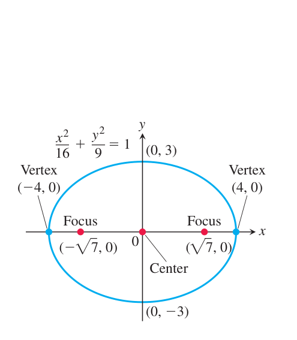
图 11.42　长轴水平的椭圆（例 2）。

中心在原点的椭圆标准方程

$$
\begin{aligned}
\text{焦点在 }x\text{ 轴：}&\quad
\frac{x^2}{a^2}+\frac{y^2}{b^2}=1,\quad a>b,\\
&c=\sqrt{a^2-b^2},\quad
\text{焦点 }(\pm c,0),\quad
\text{顶点 }(\pm a,0);\\[5pt]
\text{焦点在 }y\text{ 轴：}&\quad
\frac{x^2}{b^2}+\frac{y^2}{a^2}=1,\quad a>b,\\
&c=\sqrt{a^2-b^2},\quad
\text{焦点 }(0,\pm c),\quad
\text{顶点 }(0,\pm a).
\end{aligned}
$$

两种情形中，$a$ 都是半长轴，$b$ 都是半短轴。

### 双曲线

定义　双曲线

<strong>双曲线</strong>是平面内到两个定点的距离之差的绝对值为常数的所有点组成的集合。这两个定点称为双曲线的<strong>焦点</strong>。

通过焦点的直线称为<strong>焦轴</strong>；焦点连线的中点称为<strong>中心</strong>；焦轴与双曲线的交点称为<strong>顶点</strong>。

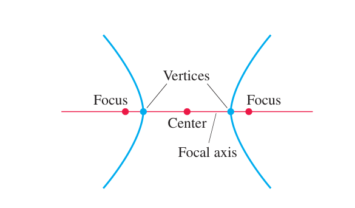
图 11.43　双曲线的焦点、焦轴、中心和顶点。

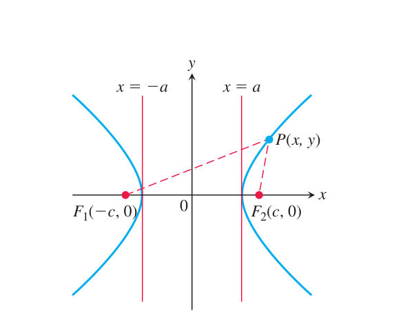
图 11.44　双曲线有两支；两支分别对应两种距离差的次序。

设焦点为 $F_1(-c,0)$、$F_2(c,0)$，距离差的绝对值为 $2a$。点 $P(x,y)$ 在双曲线上，当且仅当

$$
\begin{equation}
\sqrt{(x+c)^2+y^2}-\sqrt{(x-c)^2+y^2}=\pm2a.
\tag{7}
\end{equation}
$$

经过两次平方化简可得

$$
\begin{equation}
\frac{x^2}{a^2}+\frac{y^2}{a^2-c^2}=1.
\tag{8}
\end{equation}
$$

这里 $2a<2c$，所以 $a^2-c^2<0$。令

$$
\begin{equation}
b=\sqrt{c^2-a^2},
\tag{9}
\end{equation}
$$

便得到标准形式

$$
\begin{equation}
\frac{x^2}{a^2}-\frac{y^2}{b^2}=1.
\tag{10}
\end{equation}
$$

双曲线同样关于原点和两条坐标轴对称，在 $(\pm a,0)$ 处与 $x$ 轴相交，没有 $y$ 轴截距，而且曲线不会进入 $-a<x<a$ 的带状区域。由

$$
\frac{dy}{dx}=\frac{b^2x}{a^2y}
$$

可知顶点处切线竖直。

把式 (10) 右端的 1 换成 0，得到

$$
\frac{x^2}{a^2}-\frac{y^2}{b^2}=0,
$$

解出 $y$，即得两条渐近线：

$$
y=\pm\frac ba x.
$$

**例 3**　双曲线

$$
\begin{equation}
\frac{x^2}{4}-\frac{y^2}{5}=1
\tag{11}
\end{equation}
$$

满足 $a^2=4$、$b^2=5$，因此

$$
c=\sqrt{a^2+b^2}=3.
$$

它的焦点为 $(\pm3,0)$，顶点为 $(\pm2,0)$，中心为原点，渐近线为

$$
y=\pm\frac{\sqrt5}{2}x.
$$

如果交换 $x,y$，所得双曲线的焦点和顶点位于 $y$ 轴上，渐近线则为 $y=\pm2x/\sqrt5$。

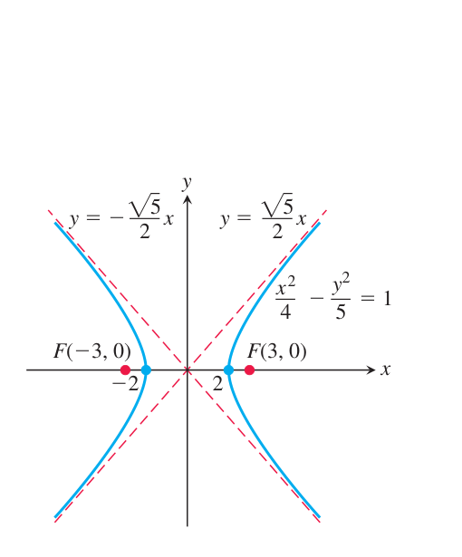
图 11.45　例 3 的双曲线及其渐近线。

中心在原点的双曲线标准方程

$$
\begin{aligned}
\text{焦点在 }x\text{ 轴：}&\quad
\frac{x^2}{a^2}-\frac{y^2}{b^2}=1,\\
&c=\sqrt{a^2+b^2},\quad
\text{焦点 }(\pm c,0),\quad
\text{顶点 }(\pm a,0),\\
&\text{渐近线 }y=\pm\frac ba x;\\[5pt]
\text{焦点在 }y\text{ 轴：}&\quad
\frac{y^2}{a^2}-\frac{x^2}{b^2}=1,\\
&c=\sqrt{a^2+b^2},\quad
\text{焦点 }(0,\pm c),\quad
\text{顶点 }(0,\pm a),\\
&\text{渐近线 }y=\pm\frac ab x.
\end{aligned}
$$

平移圆锥曲线时，按照第 1.2 节的方法，用 $x-h$、$y-k$ 代替标准方程中的 $x,y$，可把中心或顶点移动到 $(h,k)$。

**例 4**　说明方程

$$
x^2-4y^2+2x+8y-7=0
$$

表示双曲线，并求它的中心、渐近线和焦点。

**解**　分别对 $x,y$ 配方：

$$
\begin{aligned}
(x^2+2x)-4(y^2-2y)&=7,\\
(x^2+2x+1)-4(y^2-2y+1)&=7+1-4,\\
\frac{(x+1)^2}{4}-(y-1)^2&=1.
\end{aligned}
$$

这是标准双曲线向左平移 1 个单位、向上平移 1 个单位后的方程，中心为 $(-1,1)$。这里

$$
a^2=4,\qquad b^2=1,\qquad c^2=a^2+b^2=5.
$$

渐近线为

$$
y-1=\pm\frac12(x+1),
$$

焦点为

$$
(-1\pm\sqrt5,1).
$$

## 11.7 极坐标中的圆锥曲线

极坐标在天文学和航天工程中特别重要，因为卫星、月球、行星和彗星的轨道都近似为椭圆、抛物线或双曲线，而这些曲线可以用一个相对简单的极坐标方程统一描述。为得到这个方程，先引入圆锥曲线的离心率。离心率既能判定曲线是圆、椭圆、抛物线还是双曲线，也能衡量曲线被“压扁”的程度。

### 离心率

椭圆

$$
\frac{x^2}{a^2}+\frac{y^2}{b^2}=1,\qquad a>b
$$

的标准方程中没有直接出现中心到焦点的距离 $c$，但可由 $c=\sqrt{a^2-b^2}$ 求出。固定 $a$，让 $c$ 在 $0\le c\le a$ 内变化，椭圆的形状随之改变：$c=0$ 时有 $a=b$，图形是圆；$c$ 增大时椭圆越来越狭长；$c=a$ 时焦点与顶点重合，椭圆退化为线段。因此，用比值 $e=c/a$ 衡量椭圆的形状很自然。双曲线也使用同一比值，只是它满足 $c=\sqrt{a^2+b^2}$。

定义　离心率

椭圆 $x^2/a^2+y^2/b^2=1$（$a>b$）的离心率为

$$
e=\frac ca=\frac{\sqrt{a^2-b^2}}a.
$$

双曲线 $x^2/a^2-y^2/b^2=1$ 的离心率为

$$
e=\frac ca=\frac{\sqrt{a^2+b^2}}a.
$$

抛物线的离心率定义为 $e=1$。

抛物线有一个焦点和一条准线，而椭圆、双曲线各有两个焦点和两条准线。对于中心在原点、焦点在 $x$ 轴上的椭圆或双曲线，准线为

$$
x=\pm\frac ae.
$$

抛物线的定义可以写成

$$
\begin{equation}
PF=PD.
\tag{1}
\end{equation}
$$

其中 $F$ 为焦点，$D$ 为点 $P$ 到准线的垂足。椭圆也满足相似关系。焦点必须与同一侧的准线配对，且

$$
\begin{equation}
PF_1=e\,PD_1,\qquad PF_2=e\,PD_2.
\tag{2}
\end{equation}
$$

双曲线同样满足

$$
\begin{equation}
PF_1=e\,PD_1,\qquad PF_2=e\,PD_2.
\tag{3}
\end{equation}
$$

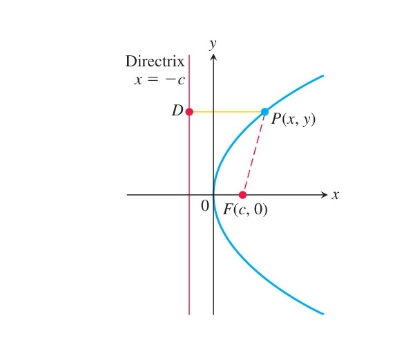
图 11.46　抛物线上任一点满足 $PF=PD$。

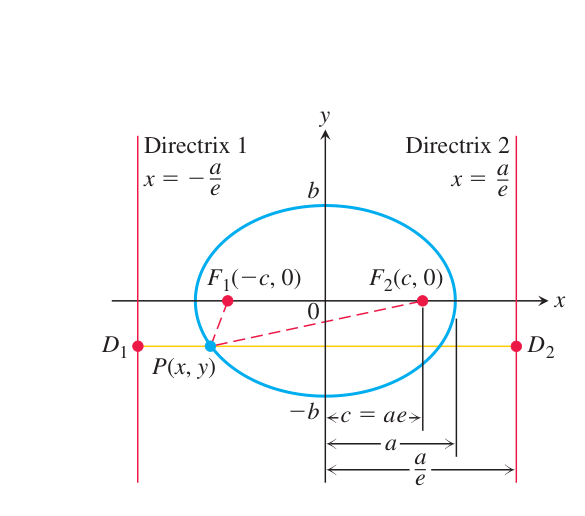
图 11.47　椭圆的焦点与相应准线。

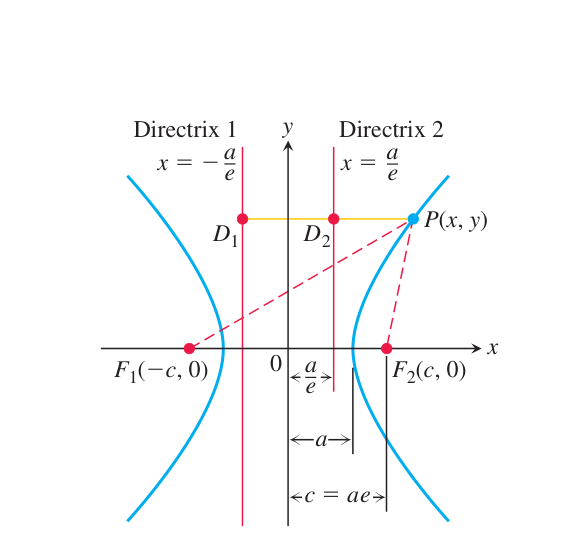
图 11.48　双曲线的焦点与相应准线。

在椭圆和双曲线中，

$$
e=\frac ca=\frac{2c}{2a}
=\frac{\text{两焦点之间的距离}}{\text{两顶点之间的距离}}.
$$

椭圆的焦点比顶点更靠近中心，所以 $0\le e<1$；双曲线的焦点比顶点离中心更远，所以 $e>1$。

三类圆锥曲线可以用同一个焦点—准线条件统一起来。设点 $P$ 到定点 $F$ 的距离是它到定直线的距离的固定倍数：

$$
\begin{equation}
PF=e\,PD.
\tag{4}
\end{equation}
$$

那么 $P$ 的轨迹是：

- 当 $0\le e<1$ 时，为离心率是 $e$ 的椭圆；
- 当 $e=1$ 时，为抛物线；
- 当 $e>1$ 时，为离心率是 $e$ 的双曲线。

当 $e\to1^-$ 时，椭圆越来越狭长；当双曲线的 $e\to\infty$ 时，两支逐渐压向与准线平行的两条直线。式 (4) 不含坐标，但转换成直角坐标时会因 $e$ 的大小而得到不同形式；在极坐标中，三类曲线却能统一为同一种形式。

**例 1**　求中心在原点、一个焦点为 $(3,0)$，且相应准线为 $x=1$ 的双曲线的直角坐标方程。

**解**　焦点坐标给出 $c=3$。由准线 $x=a/e=1$ 得 $a=e$。再利用 $e=c/a$：

$$
e=\frac3e,\qquad e^2=3,\qquad e=\sqrt3.
$$

对任一点 $P(x,y)$，焦点—准线条件为

$$
\sqrt{(x-3)^2+y^2}=\sqrt3,|x-1|.
$$

两边平方并化简：

$$
x^2-6x+9+y^2=3(x^2-2x+1),
$$

$$
2x^2-y^2=6,
$$

因此

$$
\frac{x^2}{3}-\frac{y^2}{6}=1.
$$

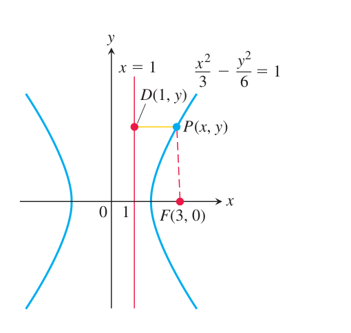
图 11.49　例 1 的双曲线及其准线。

### 极坐标方程

为了求椭圆、抛物线或双曲线的极坐标方程，把一个焦点放在极点，并把相应准线放在极点右侧的竖直直线 $x=k$ 上。对圆锥曲线上一点 $P(r,\theta)$，有

$$
PF=r,\qquad PD=k-r\cos\theta.
$$

代入 $PF=e\,PD$：

$$
r=e(k-r\cos\theta).
$$

解出 $r$ 得到统一方程。

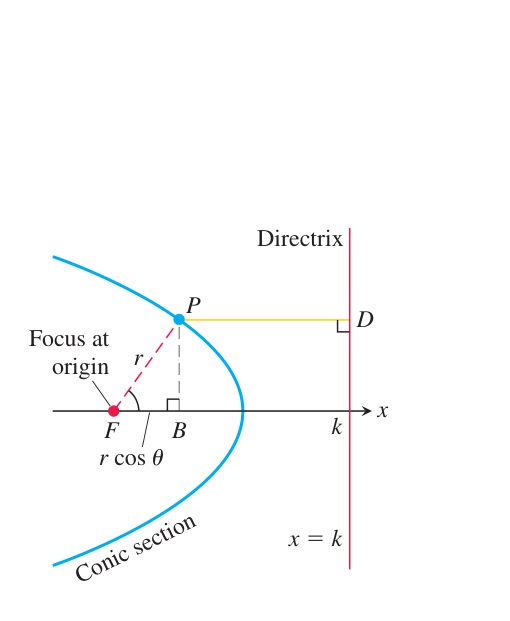
图 11.50　把焦点放在极点、准线放在 $x=k$ 上。

离心率为 $e$ 的圆锥曲线的极坐标方程

若焦点位于极点，竖直准线为 $x=k>0$，则

$$
\begin{equation}
r=\frac{ke}{1+e\cos\theta}.
\tag{5}
\end{equation}
$$

**例 2**　以下三个方程分别对应三类圆锥曲线：

$$
\begin{aligned}
e=\frac12:&\quad r=\frac{k}{2+\cos\theta} &&\text{椭圆},\\
e=1:&\quad r=\frac{k}{1+\cos\theta} &&\text{抛物线},\\
e=2:&\quad r=\frac{2k}{1+2\cos\theta} &&\text{双曲线}.
\end{aligned}
$$

在极坐标和直角坐标中，判定曲线类型所用的离心率是同一个数。

如果准线在极点左侧，即 $x=-k$，方程改为

$$
r=\frac{ke}{1-e\cos\theta}.
$$

若准线为 $y=k$ 或 $y=-k$，则把余弦分别换成带相应符号的正弦。四种情形为

$$
\begin{aligned}
x=k:&\quad r=\frac{ke}{1+e\cos\theta},
&x=-k:&\quad r=\frac{ke}{1-e\cos\theta},\\
y=k:&\quad r=\frac{ke}{1+e\sin\theta},
&y=-k:&\quad r=\frac{ke}{1-e\sin\theta}.
\end{aligned}
$$

图 11.51　焦点在极点、准线位于四个不同方向时的方程；图中以 $e=1$ 的抛物线为例。

**例 3**　求离心率为 $3/2$、准线为 $x=2$ 的双曲线方程。

**解**　式 (5) 中 $k=2$、$e=3/2$，所以

$$
r=\frac{2(3/2)}{1+(3/2)\cos\theta}
=\frac6{2+3\cos\theta}.
$$

**例 4**　求抛物线

$$
r=\frac{25}{10+10\cos\theta}
$$

的准线。

**解**　分子、分母同时除以 10：

$$
r=\frac{5/2}{1+\cos\theta}.
$$

这与 $r=ke/(1+e\cos\theta)$ 比较可知 $e=1$、$k=5/2$，故准线为

$$
x=\frac52.
$$

对半长轴为 $a$、离心率为 $e$ 的椭圆，由图 11.52 可得

$$
k=\frac ae-ea,
$$

所以 $ke=a(1-e^2)$。代入式 (5)，得到椭圆的标准极坐标方程。

图 11.52　椭圆中 $k=a/e-ea$，因而 $ke=a(1-e^2)$。

半长轴为 $a$、离心率为 $e$ 的椭圆

$$
\begin{equation}
r=\frac{a(1-e^2)}{1+e\cos\theta}.
\tag{6}
\end{equation}
$$

当 $e=0$ 时，式 (6) 变为 $r=a$，表示圆。

### 直线

设从极点向直线 $L$ 作垂线，垂足为 $P_0(r_0,\theta_0)$，其中 $r_0\ge0$。若 $P(r,\theta)$ 是 $L$ 上任一点，则直角三角形 $OP_0P$ 给出

$$
r_0=r\cos(\theta-\theta_0).
$$

直线的标准极坐标方程

$$
\begin{equation}
r\cos(\theta-\theta_0)=r_0.
\tag{7}
\end{equation}
$$

这里 $P_0(r_0,\theta_0)$ 是从极点到直线 $L$ 的垂足。

例如，若 $\theta_0=\pi/3$、$r_0=2$，则

$$
r\cos\left(\theta-\frac\pi3\right)=2.
$$

展开并用 $x=r\cos\theta$、$y=r\sin\theta$ 代换：

$$
\frac12x+\frac{\sqrt3}{2}y=2,
$$

即

$$
x+\sqrt3y=4.
$$

图 11.53　从直角三角形 $OP_0P$ 读出直线的极坐标方程。

### 圆

求圆心为 $P_0(r_0,\theta_0)$、半径为 $a$ 的圆的极坐标方程。设 $P(r,\theta)$ 为圆上一点，对三角形 $OP_0P$ 应用余弦定理：

$$
a^2=r_0^2+r^2-2r_0r\cos(\theta-\theta_0).
$$

如果圆经过极点，则 $r_0=a$，于是

$$
r=2a\cos(\theta-\theta_0).
$$

若圆心位于正 $x$ 轴，则 $\theta_0=0$，得到

$$
\begin{equation}
r=2a\cos\theta.
\tag{8}
\end{equation}
$$

若圆心位于正 $y$ 轴，则 $\theta_0=\pi/2$，得到

$$
\begin{equation}
r=2a\sin\theta.
\tag{9}
\end{equation}
$$

圆心位于负 $x$ 轴或负 $y$ 轴时，可在相应方程中把 $r$ 换成 $-r$。

图 11.54　对三角形 $OP_0P$ 应用余弦定理，得到圆的极坐标方程。

**例 5**　下表列出几个经过极点、圆心位于坐标轴上的圆。

<table style="display:table;width:auto;min-width:560px;margin:0;border-collapse:collapse;font-variant-numeric:tabular-nums;"><thead><tr style="background-color:#f3f3f3;border-bottom:1px solid #777;"><th style="padding:0.55em 1em;text-align:center;">半径</th><th style="padding:0.55em 1em;text-align:center;">圆心（极坐标）</th><th style="padding:0.55em 1em;text-align:center;">极坐标方程</th></tr></thead><tbody><tr style="border-bottom:1px solid #ddd;"><td style="padding:0.45em 1em;text-align:center;">$3$</td><td style="padding:0.45em 1em;text-align:center;">$(3,0)$</td><td style="padding:0.45em 1em;text-align:center;">$r=6\cos\theta$</td></tr><tr style="border-bottom:1px solid #ddd;"><td style="padding:0.45em 1em;text-align:center;">$2$</td><td style="padding:0.45em 1em;text-align:center;">$(2,\pi/2)$</td><td style="padding:0.45em 1em;text-align:center;">$r=4\sin\theta$</td></tr><tr style="border-bottom:1px solid #ddd;"><td style="padding:0.45em 1em;text-align:center;">$1/2$</td><td style="padding:0.45em 1em;text-align:center;">$(-1/2,0)$</td><td style="padding:0.45em 1em;text-align:center;">$r=-\cos\theta$</td></tr><tr><td style="padding:0.45em 1em;text-align:center;">$1$</td><td style="padding:0.45em 1em;text-align:center;">$(-1,\pi/2)$</td><td style="padding:0.45em 1em;text-align:center;">$r=-2\sin\theta$</td></tr></tbody></table>

