<!--
来源：Thomas' Calculus: Early Transcendentals，第13版，Thomas_Calculus.pdf。
第9章范围：PDF第550–585页（印刷页536–571）；正文止于PDF第580页（印刷页566）。
按“pdf转md文件.md”整理。保留正文、例题、图注和旁注，不收录各节练习及章末练习。练习专用表9.4–9.5和图9.35–9.38不收录。
公式编号沿用原书各节独立编号。
-->

# 第9章 一阶微分方程

**概述**　许多实际问题在用数学形式表达之后，会导出微分方程。前面各章研究沿直线运动的物体、放射性物质的衰变、人口增长以及热物体放入温度较低的介质后的冷却等现象时，我们已经遇到过不少这样的方程。

在第4.8节，我们介绍了形如 $\frac{dy}{dx}=f(x)$ 的微分方程，其中 $f$ 已知，$y$ 是 $x$ 的未知函数。当 $f$ 在某个区间上连续时，可以直接通过积分求得通解 $y(x)$，即 $y=\int f(x)\,dx$。随后在第7.2节，我们研究了形如 $\frac{dy}{dx}=f(x,y)$ 的微分方程，其中 $f$ 同时依赖自变量 $x$ 和因变量 $y$。在那里，我们学习了当微分方程可以分离变量时如何求通解。

本章进一步研究其他常见的一阶微分方程。它们只涉及未知函数 $y(x)$ 的一阶导数，可以描述简单电路，以及向容器中加入某种化学物质并与其他液体混合后浓度的变化等现象。涉及二阶导数的微分方程将在第17章研究。

## 9.1 解、斜率场与欧拉法

本节首先定义涉及一阶导数的一般微分方程，然后介绍斜率场，它能以几何图像呈现这些方程的解。许多微分方程无法求得显式解公式，但往往可以求出解的数值近似。这里介绍一种称为欧拉法的方法，它也是许多其他数值方法的基础。

### 一般一阶微分方程及其解

**一阶微分方程**是形如

$$
\begin{equation}
\frac{dy}{dx}=f(x,y)
\tag{1}
\end{equation}
$$

的方程，其中 $f(x,y)$ 是定义在 $xy$ 平面某个区域上的二元函数。称它为“一阶”，是因为方程只涉及一阶导数 $\frac{dy}{dx}$，不涉及更高阶导数。注意，$y'=f(x,y)$ 和 $\frac{d}{dx}y=f(x,y)$ 都与式（1）等价，本书将交替使用这三种写法。

式（1）的一个**解**是在某个 $x$ 值区间 $I$ 上定义的可微函数 $y=y(x)$，其中区间可以是无穷区间，并且在该区间上满足

$$
\frac{d}{dx}y(x)=f(x,y(x)).
$$

也就是说，把 $y(x)$ 及其导数 $y'(x)$ 代入式（1），对区间 $I$ 中的每个 $x$，所得等式都成立。一阶微分方程的**通解**是包含所有可能解的解。通解总含有一个任意常数，但含有任意常数并不意味着它就是通解。换句话说，一个解可以含有任意常数，却并不是通解。证明某个解确实是通解，可能需要微分方程理论中更深入的结果，宜在更高阶课程中研究。

**例 1**　证明函数族 $y=\frac{C}{x}+2$ 的每个成员，都是一阶微分方程

$$
\frac{dy}{dx}=\frac{1}{x}(2-y)
$$

在区间 $(0,\infty)$ 上的解，其中 $C$ 为任意常数。

**解**　对 $y=\frac{C}{x}+2$ 求导，得到

$$
\frac{dy}{dx}=C\frac{d}{dx}\left(\frac{1}{x}\right)+0=-\frac{C}{x^2}.
$$

需要证明，把 $\frac{C}{x}+2$ 代替 $y$、把 $-\frac{C}{x^2}$ 代替 $\frac{dy}{dx}$ 后，微分方程成立。也就是要验证，对所有 $x\in(0,\infty)$，

$$
-\frac{C}{x^2}=\frac{1}{x}\left[2-\left(\frac{C}{x}+2\right)\right].
$$

展开右端即可得到

$$
\frac{1}{x}\left[2-\left(\frac{C}{x}+2\right)\right]
=\frac{1}{x}\left(-\frac{C}{x}\right)=-\frac{C}{x^2}.
$$

因此，对每个 $C$，函数 $y=\frac{C}{x}+2$ 都是该微分方程的解。

与求原函数时一样，我们常常需要一阶微分方程 $y'=f(x,y)$ 的某个特解，而不只是通解。满足初始条件 $y(x_0)=y_0$ 的**特解**，是在 $x=x_0$ 时取值为 $y_0$ 的解 $y=y(x)$。因此，它的图像经过 $xy$ 平面上的点 $(x_0,y_0)$。一个**一阶初值问题**由微分方程 $y'=f(x,y)$ 和解必须满足的初始条件 $y(x_0)=y_0$ 组成。

**例 2**　证明函数

$$
y=(x+1)-\frac{1}{3}e^x
$$

是一阶初值问题

$$
\frac{dy}{dx}=y-x,\qquad y(0)=\frac{2}{3}
$$

的解。

**解**　方程 $\frac{dy}{dx}=y-x$ 是一阶微分方程，其中 $f(x,y)=y-x$。等式左端为

$$
\frac{dy}{dx}=\frac{d}{dx}\left(x+1-\frac{1}{3}e^x\right)=1-\frac{1}{3}e^x.
$$

等式右端为

$$
y-x=(x+1)-\frac{1}{3}e^x-x=1-\frac{1}{3}e^x.
$$

这个函数也满足初始条件，因为

$$
y(0)=\left[(x+1)-\frac{1}{3}e^x\right]_{x=0}=1-\frac{1}{3}=\frac{2}{3}.
$$

函数图像见图9.1。

  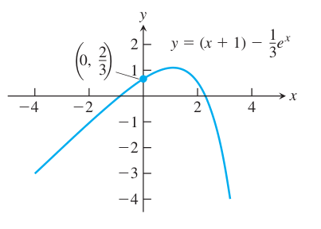
  
图9.1　例2中初值问题的解的图像。

### 斜率场：观察解曲线

每当我们给微分方程 $y'=f(x,y)$ 的解指定初始条件 $y(x_0)=y_0$，就要求**解曲线**（解的图像）经过点 $(x_0,y_0)$，且在该点的斜率为 $f(x_0,y_0)$。可以在 $f$ 的定义域内选取一些点 $(x,y)$，分别画出斜率为 $f(x,y)$ 的短线段，从而用图像表示这些斜率。每条线段与经过该点的解曲线具有相同斜率，因此在该点与曲线相切。所得图像称为**斜率场**或**方向场**，它展示了解曲线的大致形状。图9.2(a)给出一个斜率场，图9.2(b)在其中画出了一个特解。可以看到，这些短线段指示了解曲线经过各点时的方向。

  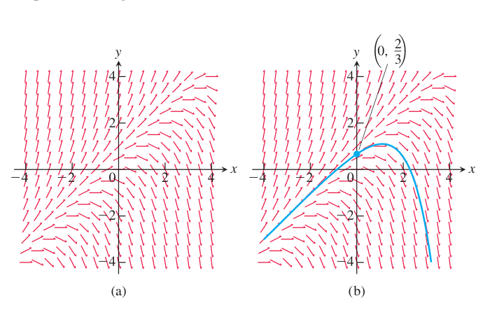
  
图9.2　(a)微分方程 $\frac{dy}{dx}=y-x$ 的斜率场；(b)经过点 $(0,\frac{2}{3})$ 的特解曲线（例2）。

图9.3给出了三个斜率场。沿着这些场中的切线段，可以看出解曲线的变化趋势。斜率场之所以有用，是因为它们展示了给定微分方程整个解曲线族的总体行为。例如，图9.3(b)表明，该图所示微分方程的每个解 $y(x)$ 都满足 $\lim_{x\to\pm\infty}y(x)=0$。我们将看到，了解解曲线的总体行为，往往是理解和预测由微分方程建模的实际系统结果的关键。

  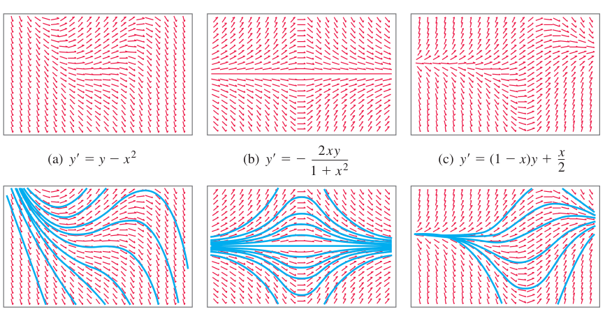
  
图9.3　斜率场（上排）及选取的解曲线（下排）。计算机绘图有时像这里一样把斜率线段画成箭头，但应将它们理解为切线段。

用纸笔绘制斜率场可能十分繁琐。这里的例图都是用计算机软件生成的。

### 欧拉法

对于初值问题 $y'=f(x,y)$、$y(x_0)=y_0$，如果不需要精确解，或者不能立即求出显式解公式，往往可以用计算机在适当的 $x$ 区间内生成一张 $y$ 的近似数值表。这张表称为问题的**数值解**，生成它的方法称为**数值方法**。

给定微分方程 $\frac{dy}{dx}=f(x,y)$ 和初始条件 $y(x_0)=y_0$，可以用线性化

$$
L(x)=y(x_0)+y'(x_0)(x-x_0),
\qquad\text{即}\quad
L(x)=y_0+f(x_0,y_0)(x-x_0)
$$

近似解 $y=y(x)$。在 $x_0$ 附近的一个小区间内，$L(x)$ 能很好地近似 $y(x)$（图9.4）。欧拉法的基本思想，是把一连串线性化连接起来，在较长的区间上近似曲线。具体方法如下。

  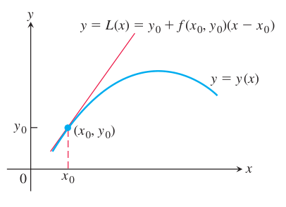
  
图9.4　$y=y(x)$ 在 $x=x_0$ 处的线性化 $L(x)$。

已知点 $(x_0,y_0)$ 在解曲线上。设自变量的下一个值为 $x_1=x_0+dx$。（回忆微分的定义中 $dx=\Delta x$。）若增量 $dx$ 很小，则

$$
y_1=L(x_1)=y_0+f(x_0,y_0)\,dx
$$

是精确解值 $y(x_1)$ 的良好近似。这样，从恰好位于解曲线上的点 $(x_0,y_0)$ 出发，得到了十分接近曲线上点 $(x_1,y(x_1))$ 的点 $(x_1,y_1)$（图9.5）。

  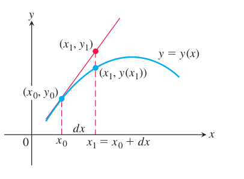
  
图9.5　第一个欧拉步用 $y_1=L(x_1)$ 近似 $y(x_1)$。

利用点 $(x_1,y_1)$ 以及通过该点的解曲线的斜率 $f(x_1,y_1)$，再向前走第二步。令 $x_2=x_1+dx$，用通过 $(x_1,y_1)$ 的解曲线的线性化计算

$$
y_2=y_1+f(x_1,y_1)\,dx.
$$

这就得到了沿解曲线 $y=y(x)$ 的下一个近似点 $(x_2,y_2)$（图9.6）。继续这样做，从 $(x_2,y_2)$ 出发，以斜率 $f(x_2,y_2)$ 走第三步，得到

$$
y_3=y_2+f(x_2,y_2)\,dx,
$$

依此类推。实际上，我们是在沿微分方程斜率场指示的方向，构造某个解的近似。

图9.6为了说明构造过程，故意把步长画得很大，所以近似显得粗糙。实际计算中，$dx$ 应足够小，使红色折线紧贴蓝色曲线，在整个区间内给出良好近似。

  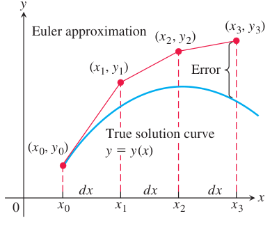
  
图9.6　初值问题 $y'=f(x,y)$、$y(x_0)=y_0$ 的三个欧拉近似步。随着步数增加，误差通常会累积，但不会像图中画得这样夸张。

**历史人物**　莱昂哈德·欧拉（Leonhard Euler，1703—1783）。

**例 3**　对初值问题 $y'=1+y$、$y(0)=1$，从 $x_0=0$ 出发，取 $dx=0.1$，用欧拉法求前三个近似值 $y_1,y_2,y_3$。

**解**　初始值为 $x_0=0$、$y_0=1$。欧拉近似对应的自变量取值为 $x_1=x_0+dx=0.1$、$x_2=x_0+2dx=0.2$、$x_3=x_0+3dx=0.3$。于是

$$
\begin{aligned}
\text{第一步：}\quad y_1&=y_0+f(x_0,y_0)\,dx\\
&=y_0+(1+y_0)\,dx\\
&=1+(1+1)(0.1)=1.2,\\[4pt]
\text{第二步：}\quad y_2&=y_1+f(x_1,y_1)\,dx\\
&=y_1+(1+y_1)\,dx\\
&=1.2+(1+1.2)(0.1)=1.42,\\[4pt]
\text{第三步：}\quad y_3&=y_2+f(x_2,y_2)\,dx\\
&=y_2+(1+y_2)\,dx\\
&=1.42+(1+1.42)(0.1)=1.662.
\end{aligned}
$$

例3中的逐步计算过程很容易继续下去。在数值解表中采用等间隔的自变量值，共向前走 $n$ 步，令

$$
\begin{aligned}
x_1&=x_0+dx,\\
x_2&=x_1+dx,\\
&\ \vdots\\
x_n&=x_{n-1}+dx.
\end{aligned}
$$

然后计算解的近似值：

$$
\begin{aligned}
y_1&=y_0+f(x_0,y_0)\,dx,\\
y_2&=y_1+f(x_1,y_1)\,dx,\\
&\ \vdots\\
y_n&=y_{n-1}+f(x_{n-1},y_{n-1})\,dx.
\end{aligned}
$$

步数 $n$ 可以按需要取得很大，但当 $n$ 太大时，误差可能累积。

欧拉法很容易在计算机或计算器上实现。输入 $x_0,y_0$、步数 $n$ 和步长 $dx$ 后，程序就按上述迭代方式算出近似值 $y_1,y_2,\ldots,y_n$，生成初值问题的数值解表。

解例3中的可分离变量方程，可以得到初值问题的精确解 $y=2e^x-1$。例4将利用这一结果。

**例 4**　从 $x_0=0$ 出发，在区间 $0\le x\le1$ 上用欧拉法求解 $y'=1+y$、$y(0)=1$，分别取（a）$dx=0.1$；（b）$dx=0.05$。将近似值与精确解 $y=2e^x-1$ 的值比较。

**解**　（a）用计算机生成表9.1中的近似值。“误差”一栏用未舍入的精确解值减去未舍入的欧拉近似值，随后将所有结果舍入到小数点后四位。

表9.1　$y'=1+y$、$y(0)=1$ 的欧拉解，步长 $dx=0.1$

<table style="display:table; width:auto; min-width:500px; margin:0; border-collapse:collapse; font-variant-numeric:tabular-nums;">
<thead><tr style="background-color:#f3f3f3; border-bottom:1px solid #777;"><th style="padding:0.6em 1em; text-align:center;">$x$</th><th style="padding:0.6em 1em; text-align:center;">$y$（欧拉法）</th><th style="padding:0.6em 1em; text-align:center;">$y$（精确值）</th><th style="padding:0.6em 1em; text-align:center;">误差</th></tr></thead>
<tbody>
<tr style="border-bottom:1px solid #ddd;"><td style="padding:0.5em 1em; text-align:right;">0</td><td style="padding:0.5em 1em; text-align:right;">1</td><td style="padding:0.5em 1em; text-align:right;">1</td><td style="padding:0.5em 1em; text-align:right;">0</td></tr>
<tr style="border-bottom:1px solid #ddd;"><td style="padding:0.5em 1em; text-align:right;">0.1</td><td style="padding:0.5em 1em; text-align:right;">1.2</td><td style="padding:0.5em 1em; text-align:right;">1.2103</td><td style="padding:0.5em 1em; text-align:right;">0.0103</td></tr>
<tr style="border-bottom:1px solid #ddd;"><td style="padding:0.5em 1em; text-align:right;">0.2</td><td style="padding:0.5em 1em; text-align:right;">1.42</td><td style="padding:0.5em 1em; text-align:right;">1.4428</td><td style="padding:0.5em 1em; text-align:right;">0.0228</td></tr>
<tr style="border-bottom:1px solid #ddd;"><td style="padding:0.5em 1em; text-align:right;">0.3</td><td style="padding:0.5em 1em; text-align:right;">1.662</td><td style="padding:0.5em 1em; text-align:right;">1.6997</td><td style="padding:0.5em 1em; text-align:right;">0.0377</td></tr>
<tr style="border-bottom:1px solid #ddd;"><td style="padding:0.5em 1em; text-align:right;">0.4</td><td style="padding:0.5em 1em; text-align:right;">1.9282</td><td style="padding:0.5em 1em; text-align:right;">1.9836</td><td style="padding:0.5em 1em; text-align:right;">0.0554</td></tr>
<tr style="border-bottom:1px solid #ddd;"><td style="padding:0.5em 1em; text-align:right;">0.5</td><td style="padding:0.5em 1em; text-align:right;">2.2210</td><td style="padding:0.5em 1em; text-align:right;">2.2974</td><td style="padding:0.5em 1em; text-align:right;">0.0764</td></tr>
<tr style="border-bottom:1px solid #ddd;"><td style="padding:0.5em 1em; text-align:right;">0.6</td><td style="padding:0.5em 1em; text-align:right;">2.5431</td><td style="padding:0.5em 1em; text-align:right;">2.6442</td><td style="padding:0.5em 1em; text-align:right;">0.1011</td></tr>
<tr style="border-bottom:1px solid #ddd;"><td style="padding:0.5em 1em; text-align:right;">0.7</td><td style="padding:0.5em 1em; text-align:right;">2.8974</td><td style="padding:0.5em 1em; text-align:right;">3.0275</td><td style="padding:0.5em 1em; text-align:right;">0.1301</td></tr>
<tr style="border-bottom:1px solid #ddd;"><td style="padding:0.5em 1em; text-align:right;">0.8</td><td style="padding:0.5em 1em; text-align:right;">3.2872</td><td style="padding:0.5em 1em; text-align:right;">3.4511</td><td style="padding:0.5em 1em; text-align:right;">0.1639</td></tr>
<tr style="border-bottom:1px solid #ddd;"><td style="padding:0.5em 1em; text-align:right;">0.9</td><td style="padding:0.5em 1em; text-align:right;">3.7159</td><td style="padding:0.5em 1em; text-align:right;">3.9192</td><td style="padding:0.5em 1em; text-align:right;">0.2033</td></tr>
<tr><td style="padding:0.5em 1em; text-align:right;">1.0</td><td style="padding:0.5em 1em; text-align:right;">4.1875</td><td style="padding:0.5em 1em; text-align:right;">4.4366</td><td style="padding:0.5em 1em; text-align:right;">0.2491</td></tr>
</tbody></table>

到达 $x=1$ 时（经过10步），误差约为精确解的 $5.6\%$。图9.7把精确解曲线与表9.1中的欧拉解散点叠加在一起。

  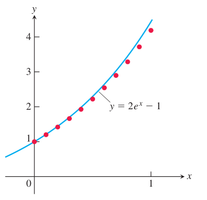
  
图9.7　$y=2e^x-1$ 的图像与表9.1中的欧拉近似散点叠加（例4）。

（b）减小步长是尝试减小误差的一种办法。表9.2给出了将步长减为 $0.05$、把步数加倍至20步时的计算结果及其与精确解的比较。与表9.1一样，所有运算都在舍入之前完成。这次到达 $x=1$ 时，相对误差只有约 $2.9\%$。

表9.2　$y'=1+y$、$y(0)=1$ 的欧拉解，步长 $dx=0.05$

<table style="display:table; width:auto; min-width:500px; margin:0; border-collapse:collapse; font-variant-numeric:tabular-nums;">
<thead><tr style="background-color:#f3f3f3; border-bottom:1px solid #777;"><th style="padding:0.6em 1em; text-align:center;">$x$</th><th style="padding:0.6em 1em; text-align:center;">$y$（欧拉法）</th><th style="padding:0.6em 1em; text-align:center;">$y$（精确值）</th><th style="padding:0.6em 1em; text-align:center;">误差</th></tr></thead>
<tbody>
<tr style="border-bottom:1px solid #ddd;"><td style="padding:0.5em 1em; text-align:right;">0</td><td style="padding:0.5em 1em; text-align:right;">1</td><td style="padding:0.5em 1em; text-align:right;">1</td><td style="padding:0.5em 1em; text-align:right;">0</td></tr>
<tr style="border-bottom:1px solid #ddd;"><td style="padding:0.5em 1em; text-align:right;">0.05</td><td style="padding:0.5em 1em; text-align:right;">1.1</td><td style="padding:0.5em 1em; text-align:right;">1.1025</td><td style="padding:0.5em 1em; text-align:right;">0.0025</td></tr>
<tr style="border-bottom:1px solid #ddd;"><td style="padding:0.5em 1em; text-align:right;">0.10</td><td style="padding:0.5em 1em; text-align:right;">1.205</td><td style="padding:0.5em 1em; text-align:right;">1.2103</td><td style="padding:0.5em 1em; text-align:right;">0.0053</td></tr>
<tr style="border-bottom:1px solid #ddd;"><td style="padding:0.5em 1em; text-align:right;">0.15</td><td style="padding:0.5em 1em; text-align:right;">1.3153</td><td style="padding:0.5em 1em; text-align:right;">1.3237</td><td style="padding:0.5em 1em; text-align:right;">0.0084</td></tr>
<tr style="border-bottom:1px solid #ddd;"><td style="padding:0.5em 1em; text-align:right;">0.20</td><td style="padding:0.5em 1em; text-align:right;">1.4310</td><td style="padding:0.5em 1em; text-align:right;">1.4428</td><td style="padding:0.5em 1em; text-align:right;">0.0118</td></tr>
<tr style="border-bottom:1px solid #ddd;"><td style="padding:0.5em 1em; text-align:right;">0.25</td><td style="padding:0.5em 1em; text-align:right;">1.5526</td><td style="padding:0.5em 1em; text-align:right;">1.5681</td><td style="padding:0.5em 1em; text-align:right;">0.0155</td></tr>
<tr style="border-bottom:1px solid #ddd;"><td style="padding:0.5em 1em; text-align:right;">0.30</td><td style="padding:0.5em 1em; text-align:right;">1.6802</td><td style="padding:0.5em 1em; text-align:right;">1.6997</td><td style="padding:0.5em 1em; text-align:right;">0.0195</td></tr>
<tr style="border-bottom:1px solid #ddd;"><td style="padding:0.5em 1em; text-align:right;">0.35</td><td style="padding:0.5em 1em; text-align:right;">1.8142</td><td style="padding:0.5em 1em; text-align:right;">1.8381</td><td style="padding:0.5em 1em; text-align:right;">0.0239</td></tr>
<tr style="border-bottom:1px solid #ddd;"><td style="padding:0.5em 1em; text-align:right;">0.40</td><td style="padding:0.5em 1em; text-align:right;">1.9549</td><td style="padding:0.5em 1em; text-align:right;">1.9836</td><td style="padding:0.5em 1em; text-align:right;">0.0287</td></tr>
<tr style="border-bottom:1px solid #ddd;"><td style="padding:0.5em 1em; text-align:right;">0.45</td><td style="padding:0.5em 1em; text-align:right;">2.1027</td><td style="padding:0.5em 1em; text-align:right;">2.1366</td><td style="padding:0.5em 1em; text-align:right;">0.0340</td></tr>
<tr style="border-bottom:1px solid #ddd;"><td style="padding:0.5em 1em; text-align:right;">0.50</td><td style="padding:0.5em 1em; text-align:right;">2.2578</td><td style="padding:0.5em 1em; text-align:right;">2.2974</td><td style="padding:0.5em 1em; text-align:right;">0.0397</td></tr>
<tr style="border-bottom:1px solid #ddd;"><td style="padding:0.5em 1em; text-align:right;">0.55</td><td style="padding:0.5em 1em; text-align:right;">2.4207</td><td style="padding:0.5em 1em; text-align:right;">2.4665</td><td style="padding:0.5em 1em; text-align:right;">0.0458</td></tr>
<tr style="border-bottom:1px solid #ddd;"><td style="padding:0.5em 1em; text-align:right;">0.60</td><td style="padding:0.5em 1em; text-align:right;">2.5917</td><td style="padding:0.5em 1em; text-align:right;">2.6442</td><td style="padding:0.5em 1em; text-align:right;">0.0525</td></tr>
<tr style="border-bottom:1px solid #ddd;"><td style="padding:0.5em 1em; text-align:right;">0.65</td><td style="padding:0.5em 1em; text-align:right;">2.7713</td><td style="padding:0.5em 1em; text-align:right;">2.8311</td><td style="padding:0.5em 1em; text-align:right;">0.0598</td></tr>
<tr style="border-bottom:1px solid #ddd;"><td style="padding:0.5em 1em; text-align:right;">0.70</td><td style="padding:0.5em 1em; text-align:right;">2.9599</td><td style="padding:0.5em 1em; text-align:right;">3.0275</td><td style="padding:0.5em 1em; text-align:right;">0.0676</td></tr>
<tr style="border-bottom:1px solid #ddd;"><td style="padding:0.5em 1em; text-align:right;">0.75</td><td style="padding:0.5em 1em; text-align:right;">3.1579</td><td style="padding:0.5em 1em; text-align:right;">3.2340</td><td style="padding:0.5em 1em; text-align:right;">0.0761</td></tr>
<tr style="border-bottom:1px solid #ddd;"><td style="padding:0.5em 1em; text-align:right;">0.80</td><td style="padding:0.5em 1em; text-align:right;">3.3657</td><td style="padding:0.5em 1em; text-align:right;">3.4511</td><td style="padding:0.5em 1em; text-align:right;">0.0853</td></tr>
<tr style="border-bottom:1px solid #ddd;"><td style="padding:0.5em 1em; text-align:right;">0.85</td><td style="padding:0.5em 1em; text-align:right;">3.5840</td><td style="padding:0.5em 1em; text-align:right;">3.6793</td><td style="padding:0.5em 1em; text-align:right;">0.0953</td></tr>
<tr style="border-bottom:1px solid #ddd;"><td style="padding:0.5em 1em; text-align:right;">0.90</td><td style="padding:0.5em 1em; text-align:right;">3.8132</td><td style="padding:0.5em 1em; text-align:right;">3.9192</td><td style="padding:0.5em 1em; text-align:right;">0.1060</td></tr>
<tr style="border-bottom:1px solid #ddd;"><td style="padding:0.5em 1em; text-align:right;">0.95</td><td style="padding:0.5em 1em; text-align:right;">4.0539</td><td style="padding:0.5em 1em; text-align:right;">4.1714</td><td style="padding:0.5em 1em; text-align:right;">0.1175</td></tr>
<tr><td style="padding:0.5em 1em; text-align:right;">1.00</td><td style="padding:0.5em 1em; text-align:right;">4.3066</td><td style="padding:0.5em 1em; text-align:right;">4.4366</td><td style="padding:0.5em 1em; text-align:right;">0.1300</td></tr>
</tbody></table>

在例4中，人们可能还想进一步减小步长以提高精度。但是，每多做一次计算，不仅需要额外的计算机时间，更重要的是，由于计算机内部用近似方式表示数字，也会增加舍入误差的累积。

误差分析以及减小数值计算误差的方法都很重要，但适合在更高阶课程中研究。还有一些比欧拉法更精确的数值方法，通常在后续微分方程或数值分析课程中介绍。

## 9.2 一阶线性方程

一阶**线性**微分方程可以写成

$$
\begin{equation}
\frac{dy}{dx}+P(x)y=Q(x),
\tag{1}
\end{equation}
$$

其中 $P,Q$ 是 $x$ 的连续函数。式（1）称为线性方程的**标准形式**。指数增长或衰减方程 $\frac{dy}{dx}=ky$（第7.2节）可以写成标准形式 $\frac{dy}{dx}-ky=0$，因此它是一个 $P(x)=-k$、$Q(x)=0$ 的线性方程。式（1）关于 $y$ 是线性的，因为 $y$ 和导数 $\frac{dy}{dx}$ 都只以一次幂出现，彼此不相乘，也不作为其他函数的自变量，例如不会出现 $\sin y$、$e^y$ 或 $\sqrt{dy/dx}$。

**例 1**　将方程 $x\frac{dy}{dx}=x^2+3y$（$x>0$）化为标准形式。

**解**

$$
\begin{aligned}
x\frac{dy}{dx}&=x^2+3y,\\
\frac{dy}{dx}&=x+\frac{3}{x}y
&&\text{两边除以 }x,\\
\frac{dy}{dx}-\frac{3}{x}y&=x
&&\text{标准形式}.
\end{aligned}
$$

此时 $P(x)=-\frac{3}{x}$、$Q(x)=x$。注意 $P(x)$ 是 $-\frac{3}{x}$，不是 $+\frac{3}{x}$。标准形式为 $y'+P(x)y=Q(x)$，所以负号属于 $P(x)$ 的表达式。

### 求解线性方程

为求解方程 $\frac{dy}{dx}+P(x)y=Q(x)$，在两边乘以一个正函数 $v(x)$，使左边变成乘积 $v(x)y$ 的导数。稍后说明如何找到 $v$，现在先说明一旦找到了它，为什么就能得到所求的解。

$$
\begin{aligned}
\frac{dy}{dx}+P(x)y&=Q(x)
&&\text{原方程的标准形式},\\
v(x)\frac{dy}{dx}+P(x)v(x)y&=v(x)Q(x)
&&\text{乘以正函数 }v(x),\\
\frac{d}{dx}\bigl(v(x)y\bigr)&=v(x)Q(x)
&&\text{选择 }v\text{ 使左端成为乘积的导数},\\
v(x)y&=\int v(x)Q(x)\,dx
&&\text{对 }x\text{ 积分}.
\end{aligned}
$$

于是

$$
\begin{equation}
y=\frac{1}{v(x)}\int v(x)Q(x)\,dx.
\tag{2}
\end{equation}
$$

式（2）用函数 $v(x)$ 和 $Q(x)$ 表示式（1）的解。我们把 $v(x)$ 称为式（1）的**积分因子**，因为乘上它以后方程便可积分。

为什么解中没有出现 $P(x)$ 的表达式？实际上它间接地出现在正函数 $v(x)$ 的构造中。由对 $v$ 的要求，

$$
\begin{aligned}
\frac{d}{dx}(vy)&=v\frac{dy}{dx}+Pvy,\\
v\frac{dy}{dx}+y\frac{dv}{dx}&=v\frac{dy}{dx}+Pvy
&&\text{乘积求导法则},\\
y\frac{dv}{dx}&=Pvy
&&\text{消去两边的 }v\frac{dy}{dx}.
\end{aligned}
$$

只要 $\frac{dv}{dx}=Pv$，最后一个等式就成立。于是

$$
\begin{aligned}
\frac{dv}{v}&=P\,dx
&&\text{分离变量，}v>0,\\
\int\frac{dv}{v}&=\int P\,dx
&&\text{两边积分},\\
\ln v&=\int P\,dx
&&v>0\text{，因此不需要绝对值},\\
e^{\ln v}&=e^{\int P\,dx}
&&\text{两边取指数}.
\end{aligned}
$$

所以

$$
\begin{equation}
v=e^{\int P\,dx}.
\tag{3}
\end{equation}
$$

式（1）的通解由式（2）给出，其中 $v(x)$ 由式（3）确定。不过，与其记忆通解公式，不如记住：先化为标准形式，正确识别 $P(x)$，再求积分因子。式（3）中可以采用 $P$ 的任意一个原函数。

求解线性方程 $y'+P(x)y=Q(x)$ 时，在两边乘以积分因子 $v(x)=e^{\int P(x)\,dx}$，然后对两边积分。

在这个过程中，左边的导数积分后总是得到积分因子与解函数的乘积 $v(x)y$，这正是 $v$ 的定义所保证的。

**例 2**　求解方程 $x\frac{dy}{dx}=x^2+3y$，其中 $x>0$。

**解**　首先化为标准形式（例1）：

$$
\frac{dy}{dx}-\frac{3}{x}y=x,
$$

从而确定 $P(x)=-\frac{3}{x}$。积分因子为

$$
\begin{aligned}
v(x)&=e^{\int P(x)\,dx}
=e^{\int(-3/x)\,dx}\\
&=e^{-3\ln|x|}
&&\text{积分常数取 }0\text{，使 }v\text{ 尽量简单}\\
&=e^{-3\ln x}
&&x>0\\
&=e^{\ln x^{-3}}=\frac{1}{x^3}.
\end{aligned}
$$

将标准形式两边乘以 $v(x)$，然后积分：

$$
\begin{aligned}
\frac{1}{x^3}\left(\frac{dy}{dx}-\frac{3}{x}y\right)&=\frac{1}{x^3}x,\\
\frac{1}{x^3}\frac{dy}{dx}-\frac{3}{x^4}y&=\frac{1}{x^2},\\
\frac{d}{dx}\left(\frac{y}{x^3}\right)&=\frac{1}{x^2}
&&\text{左边为 }\frac{d}{dx}(vy),\\
\frac{y}{x^3}&=\int\frac{1}{x^2}\,dx
&&\text{两边积分},\\
\frac{y}{x^3}&=-\frac{1}{x}+C.
\end{aligned}
$$

解出 $y$，得到通解

$$
y=x^3\left(-\frac{1}{x}+C\right)=-x^2+Cx^3,\qquad x>0.
$$

**历史人物**　阿德里安·马里·勒让德（Adrien Marie Legendre，1752—1833）。

**例 3**　求方程 $3xy'-y=\ln x+1$（$x>0$）满足 $y(1)=-2$ 的特解。

**解**　在 $x>0$ 时，方程的标准形式为

$$
y'-\frac{1}{3x}y=\frac{\ln x+1}{3x}.
$$

积分因子为 $v=e^{\int-dx/(3x)}=e^{-(1/3)\ln x}=x^{-1/3}$。因此

$$
x^{-1/3}y=\frac{1}{3}\int(\ln x+1)x^{-4/3}\,dx,
$$

左端就是 $vy$。对右端分部积分，得到

$$
x^{-1/3}y=-x^{-1/3}(\ln x+1)+\int x^{-4/3}\,dx+C.
$$

于是

$$
x^{-1/3}y=-x^{-1/3}(\ln x+1)-3x^{-1/3}+C,
$$

解出 $y$：

$$
y=-(\ln x+4)+Cx^{1/3}.
$$

代入 $x=1$、$y=-2$，有 $-2=-(0+4)+C$，所以 $C=2$。所求特解为

$$
y=2x^{1/3}-\ln x-4.
$$

例2在乘以积分因子之后，对等式两边积分。也可以像例3那样简化书写：只要记住左边总是积分为积分因子与解函数的乘积 $v(x)y$。由式（2），

$$
\begin{equation}
v(x)y=\int v(x)Q(x)\,dx.
\tag{4}
\end{equation}
$$

因此只需对式（1）右端的 $v(x)Q(x)$ 积分，再令结果等于 $v(x)y$，就能得到通解。不过，为强调积分因子在求解过程中的作用，有时仍采用例2的完整步骤。

注意，如果式（1）标准形式中的 $Q(x)$ 恒为零，那么线性方程也可以分离变量，并用第7.2节的方法求解：

$$
\begin{aligned}
\frac{dy}{dx}+P(x)y&=Q(x),\\
\frac{dy}{dx}+P(x)y&=0
&&Q(x)=0,\\
\frac{dy}{y}&=-P(x)\,dx
&&\text{分离变量}.
\end{aligned}
$$

### RL 电路

图9.8表示一个电路，其总电阻为常数 $R$ 欧姆，线圈所表示的自感为常数 $L$ 亨利。开关的端点 $a,b$ 闭合后，便接通电压为常数 $V$ 伏的电源。

  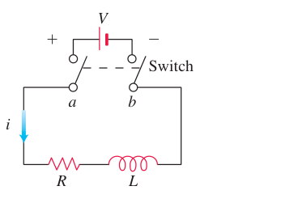
  
图9.8　例4中的 RL 电路。

对这样的电路，需要扩展欧姆定律 $V=RI$。同时考虑电阻和电感的正确方程是

$$
\begin{equation}
L\frac{di}{dt}+Ri=V,
\tag{5}
\end{equation}
$$

其中 $i$ 是电流，单位为安培；$t$ 是时间，单位为秒。解这个方程，就能预测开关闭合以后电流的变化。

**例 4**　图9.8中的 RL 电路在 $t=0$ 时闭合开关。电流将怎样随时间变化？

**解**　式（5）是关于 $i(t)$ 的一阶线性微分方程，其标准形式为

$$
\begin{equation}
\frac{di}{dt}+\frac{R}{L}i=\frac{V}{L}.
\tag{6}
\end{equation}
$$

给定 $t=0$ 时 $i=0$，相应的解为

$$
\begin{equation}
i=\frac{V}{R}-\frac{V}{R}e^{-(R/L)t}.
\tag{7}
\end{equation}
$$

求解过程留在习题28中。由于 $R,L$ 都为正数，$-\frac{R}{L}<0$，当 $t\to\infty$ 时 $e^{-(R/L)t}\to0$。因此

$$
\lim_{t\to\infty}i
=\lim_{t\to\infty}\left(\frac{V}{R}-\frac{V}{R}e^{-(R/L)t}\right)
=\frac{V}{R}-\frac{V}{R}\cdot0=\frac{V}{R}.
$$

在任一给定的有限时刻，理论上的电流都小于 $\frac{V}{R}$，但随着时间推移，电流趋近**稳态值** $\frac{V}{R}$。根据方程 $L\frac{di}{dt}+Ri=V$，当 $L=0$（没有电感），或 $\frac{di}{dt}=0$（恒定电流 $i$）时，电路中的电流就是 $I=\frac{V}{R}$（图9.9）。

  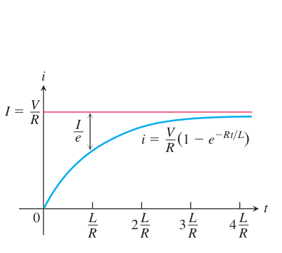
  
图9.9　例4中 RL 电路的电流增长。$I$ 是电流的稳态值，$\tau=L/R$ 称为电路的时间常数。经过3个时间常数，电流与稳态值的差已在稳态值的 $5\%$ 以内（习题27）。

式（7）把式（6）的解表示为两部分之和：稳态解 $\frac{V}{R}$ 和瞬态解 $-\frac{V}{R}e^{-(R/L)t}$，后者在 $t\to\infty$ 时趋于零。

## 9.3 应用

现在来看一阶微分方程的四个应用。第一个分析受到阻碍运动的力作用、沿直线运动的物体；第二个是人口增长模型；第三个研究与另一曲线族中每条曲线都正交（即成直角相交）的一条或一族曲线；最后一个分析流入和流出容器的化学物质浓度。这些模型涉及可分离变量方程或一阶线性方程。

### 阻力与速度成正比的运动

在某些情况下，可以合理地假设运动物体所受阻力与速度成正比，例如滑行至停止的汽车。物体运动越快，空气对它前进的阻碍越大。设质量为 $m$ 的物体沿一条坐标轴运动，时刻 $t$ 的位置函数为 $s$，速度为 $v$。由牛顿第二运动定律，阻碍运动的力为

$$
\text{力}=\text{质量}\times\text{加速度}=m\frac{dv}{dt}.
$$

若阻力与速度成正比，则

$$
m\frac{dv}{dt}=-kv,
\qquad\text{即}\quad
\frac{dv}{dt}=-\frac{k}{m}v
\quad(k>0).
$$

这是描述指数变化的可分离变量微分方程。满足初始条件 $t=0$ 时 $v=v_0$ 的解为（第7.2节）

$$
\begin{equation}
v=v_0e^{-(k/m)t}.
\tag{1}
\end{equation}
$$

从式（1）能看出什么？首先，如果 $m$ 很大，例如伊利湖上一艘2万吨矿砂船的质量，那么速度趋近于零需要很长时间，因为必须使指数中的 $t$ 足够大，才能使 $kt/m$ 足够大、$v$ 足够小。若再对式（1）积分，求出位置 $s$ 随时间 $t$ 的变化，就能知道更多信息。

设物体正在滑行至停止，而且唯一的作用力是与速率成正比的阻力。它能滑行多远？为此，从式（1）出发，求解初值问题

$$
\frac{ds}{dt}=v_0e^{-(k/m)t},\qquad s(0)=0.
$$

对 $t$ 积分，得到

$$
s=-\frac{v_0m}{k}e^{-(k/m)t}+C.
$$

代入 $t=0$ 时 $s=0$，得 $0=-\frac{v_0m}{k}+C$，所以 $C=\frac{v_0m}{k}$。物体在时刻 $t$ 的位置为

$$
\begin{equation}
s(t)=-\frac{v_0m}{k}e^{-(k/m)t}+\frac{v_0m}{k}
=\frac{v_0m}{k}\left(1-e^{-(k/m)t}\right).
\tag{2}
\end{equation}
$$

为了求出滑行距离，计算 $t\to\infty$ 时 $s(t)$ 的极限。由于 $-\frac{k}{m}<0$，有 $e^{-(k/m)t}\to0$，于是

$$
\begin{aligned}
\lim_{t\to\infty}s(t)
&=\lim_{t\to\infty}\frac{v_0m}{k}\left(1-e^{-(k/m)t}\right)\\
&=\frac{v_0m}{k}(1-0)=\frac{v_0m}{k}.
\end{aligned}
$$

因此，

$$
\begin{equation}
\text{滑行距离}=\frac{v_0m}{k}.
\tag{3}
\end{equation}
$$

数值 $\frac{v_0m}{k}$ 只是一个上界，但它很有用。至少在一个方面符合实际：如果 $m$ 很大，物体就会滑行很远。

**旁注**　在英制中，重量以磅计，质量以斯勒格（slug）计。若重力加速度取 $32\ \mathrm{ft/s^2}$，则重量的磅数等于质量的斯勒格数乘以32。

**例 1**　对一位体重192磅的滑冰者，式（1）中的 $k$ 约为 $\frac{1}{3}\ \mathrm{slug/s}$，而 $m=\frac{192}{32}=6\ \mathrm{slug}$。滑行速度从 $11\ \mathrm{ft/s}$（7.5英里/小时）减至 $1\ \mathrm{ft/s}$ 需要多长时间？完全停止之前会滑行多远？

**解**　将 $k=\frac{1}{3}$、$m=6$、$v_0=11$、$v=1$ 代入式（1），解出 $t$：

$$
\begin{aligned}
11e^{-t/18}&=1,\\
e^{-t/18}&=\frac{1}{11},\\
-\frac{t}{18}&=\ln\frac{1}{11}=-\ln11,\\
t&=18\ln11\approx43\ \mathrm{s}.
\end{aligned}
$$

第二问用式（3）计算：

$$
\text{滑行距离}=\frac{v_0m}{k}=\frac{11\cdot6}{1/3}=198\ \mathrm{ft}.
$$

### 指数人口增长模型的不准确性

在第7.2节，我们用指数变化定律建立了人口增长模型：

$$
\frac{dP}{dt}=kP,\qquad P(0)=P_0,
$$

其中 $P$ 为时刻 $t$ 的人口，$k>0$ 是常数增长率，$P_0$ 是 $t=0$ 时的人口。该模型的解为 $P=P_0e^{kt}$。

为了评价这个模型，注意指数增长微分方程说明

$$
\begin{equation}
\frac{dP/dt}{P}=k
\tag{4}
\end{equation}
$$

为常数，这个比率称为**相对增长率**。表9.3给出1980—1989年年中的世界人口。取 $dt=1$、$dP\approx\Delta P$，由表可见，式（4）的相对增长率近似为常数 $0.017$。

表9.3　世界人口（年中）

<table style="display:table; width:auto; min-width:500px; margin:0; border-collapse:collapse; font-variant-numeric:tabular-nums;">
<thead><tr style="background-color:#f3f3f3; border-bottom:1px solid #777;"><th style="padding:0.6em 1em;">年份</th><th style="padding:0.6em 1em;">人口（百万）</th><th style="padding:0.6em 1em;">$\Delta P/P$</th></tr></thead>
<tbody>
<tr style="border-bottom:1px solid #ddd;"><td style="padding:0.5em 1em; text-align:center;">1980</td><td style="padding:0.5em 1em; text-align:right;">4454</td><td style="padding:0.5em 1em; text-align:right;">$76/4454\approx0.0171$</td></tr>
<tr style="border-bottom:1px solid #ddd;"><td style="padding:0.5em 1em; text-align:center;">1981</td><td style="padding:0.5em 1em; text-align:right;">4530</td><td style="padding:0.5em 1em; text-align:right;">$80/4530\approx0.0177$</td></tr>
<tr style="border-bottom:1px solid #ddd;"><td style="padding:0.5em 1em; text-align:center;">1982</td><td style="padding:0.5em 1em; text-align:right;">4610</td><td style="padding:0.5em 1em; text-align:right;">$80/4610\approx0.0174$</td></tr>
<tr style="border-bottom:1px solid #ddd;"><td style="padding:0.5em 1em; text-align:center;">1983</td><td style="padding:0.5em 1em; text-align:right;">4690</td><td style="padding:0.5em 1em; text-align:right;">$80/4690\approx0.0171$</td></tr>
<tr style="border-bottom:1px solid #ddd;"><td style="padding:0.5em 1em; text-align:center;">1984</td><td style="padding:0.5em 1em; text-align:right;">4770</td><td style="padding:0.5em 1em; text-align:right;">$81/4770\approx0.0170$</td></tr>
<tr style="border-bottom:1px solid #ddd;"><td style="padding:0.5em 1em; text-align:center;">1985</td><td style="padding:0.5em 1em; text-align:right;">4851</td><td style="padding:0.5em 1em; text-align:right;">$82/4851\approx0.0169$</td></tr>
<tr style="border-bottom:1px solid #ddd;"><td style="padding:0.5em 1em; text-align:center;">1986</td><td style="padding:0.5em 1em; text-align:right;">4933</td><td style="padding:0.5em 1em; text-align:right;">$85/4933\approx0.0172$</td></tr>
<tr style="border-bottom:1px solid #ddd;"><td style="padding:0.5em 1em; text-align:center;">1987</td><td style="padding:0.5em 1em; text-align:right;">5018</td><td style="padding:0.5em 1em; text-align:right;">$87/5018\approx0.0173$</td></tr>
<tr style="border-bottom:1px solid #ddd;"><td style="padding:0.5em 1em; text-align:center;">1988</td><td style="padding:0.5em 1em; text-align:right;">5105</td><td style="padding:0.5em 1em; text-align:right;">$85/5105\approx0.0167$</td></tr>
<tr><td style="padding:0.5em 1em; text-align:center;">1989</td><td style="padding:0.5em 1em; text-align:right;">5190</td><td style="padding:0.5em 1em; text-align:right;"></td></tr>
</tbody></table>

来源：美国人口普查局（2007年9月），原书列出的资料地址为 www.census.gov/ipc/www/idb。

因此，根据表中数据，令 $t=0$ 对应1980年、$t=1$ 对应1981年，依此类推，可以用初值问题

$$
\frac{dP}{dt}=0.017P,\qquad P(0)=4454
$$

建立世界人口模型。解为 $P=4454e^{0.017t}$。在2008年（$t=28$），模型预测年中世界人口约为7169百万，即72亿（图9.10），高于美国人口普查局给出的实际人口6707百万。更现实的模型应考虑环境和其他影响增长率的因素；原书指出，增长率自1987年以来持续下降至约 $0.012$。第9.4节将讨论一个这样的模型。

  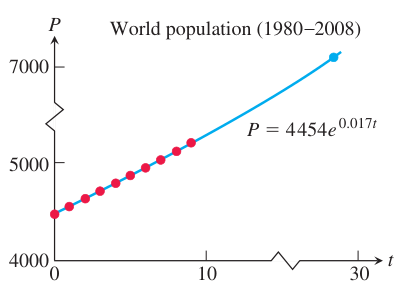
  
图9.10　解 $P=4454e^{0.017t}$ 在 $t=28$ 时的值为7169，比2008年的实际人口高出近 $7\%$。

### 正交轨线

曲线族的一条**正交轨线**，是与该曲线族中各条曲线成直角相交，也就是正交的曲线（图9.11）。例如，每条经过原点的直线，都是以原点为圆心的圆族 $x^2+y^2=a^2$ 的正交轨线（图9.12）。这种相互正交的曲线系在涉及电势的物理问题中特别重要：一个曲线族与电场有关，另一个曲线族对应恒定电势。流体动力学和热流问题中也会出现它们。

  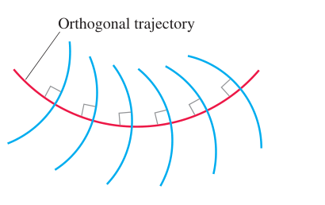
  
图9.11　正交轨线与曲线族成直角相交，即正交。

  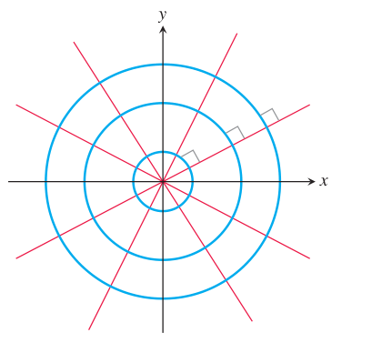
  
图9.12　每条经过原点的直线，都与以原点为圆心的圆族正交。

**例 2**　求曲线族 $xy=a$ 的正交轨线，其中 $a\ne0$ 为任意常数。

**解**　曲线 $xy=a$ 构成一族以坐标轴为渐近线的双曲线。首先求各曲线的斜率，即 $\frac{dy}{dx}$。对 $xy=a$ 隐式求导，得到

$$
x\frac{dy}{dx}+y=0,
\qquad\text{即}\quad
\frac{dy}{dx}=-\frac{y}{x}.
$$

因此，在双曲线 $xy=a$ 上任一点 $(x,y)$，切线斜率为 $-\frac{y}{x}$。正交轨线在同一点的切线斜率必须是它的负倒数，即 $\frac{x}{y}$。所以正交轨线满足

$$
\frac{dy}{dx}=\frac{x}{y}.
$$

这是可分离变量方程，按第7.2节的方法求解：

$$
\begin{aligned}
y\,dy&=x\,dx &&\text{分离变量},\\
\int y\,dy&=\int x\,dx &&\text{两边积分},\\
\frac{1}{2}y^2&=\frac{1}{2}x^2+C.
\end{aligned}
$$

于是

$$
\begin{equation}
y^2-x^2=b,
\tag{5}
\end{equation}
$$

其中 $b=2C$ 为任意常数。正交轨线就是式（5）所给出的曲线族，图9.13画出了其中的双曲线。

  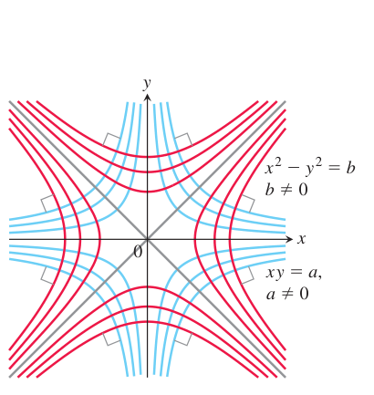
  
图9.13　每条曲线都与另一族中它所相交的各条曲线正交（例2）。

### 混合问题

设某种化学物质溶于液体（或分散在气体中），流入一个装有该液体（或气体）的容器，容器内也可能已溶有一定量的这种化学物质。搅拌使混合物保持均匀，并以已知速率流出容器。在这个过程中，常常需要知道任意时刻容器内化学物质的浓度。描述该过程的微分方程基于以下关系：

$$
\begin{equation}
\text{容器内物质量的变化率}
=\text{化学物质流入率}-\text{化学物质流出率}.
\tag{6}
\end{equation}
$$

若 $y(t)$ 是时刻 $t$ 容器内化学物质的量，$V(t)$ 是液体总体积，则该时刻化学物质的流出率为

$$
\begin{equation}
\begin{aligned}
\text{流出率}
&=\frac{y(t)}{V(t)}\cdot\text{液体流出速率}\\
&=\text{时刻 }t\text{ 容器内的浓度}\cdot\text{液体流出速率}.
\end{aligned}
\tag{7}
\end{equation}
$$

因此，式（6）变为

$$
\begin{equation}
\frac{dy}{dt}
=\text{化学物质流入率}-\frac{y(t)}{V(t)}\cdot\text{液体流出速率}.
\tag{8}
\end{equation}
$$

例如，若 $y$ 以磅计、$V$ 以加仑计、$t$ 以分钟计，式（8）中各项的单位关系为

$$
\frac{\text{磅}}{\text{分钟}}
=\frac{\text{磅}}{\text{分钟}}
-\frac{\text{磅}}{\text{加仑}}\cdot\frac{\text{加仑}}{\text{分钟}}.
$$

**例 3**　一家炼油厂的储罐中装有2000加仑汽油，最初溶有100磅添加剂。为准备冬季用油，将每加仑含2磅添加剂的汽油以40加仑/分钟的速率泵入储罐，同时将充分混合的溶液以45加仑/分钟的速率泵出。开始泵送20分钟后，罐中有多少添加剂（图9.14）？

  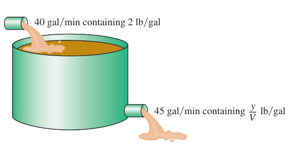
  
图9.14　例3中的储罐把流入液体与罐中液体混合，再输出混合后的液体。

**解**　设 $y$ 为时刻 $t$ 罐中的添加剂量，单位为磅。已知 $t=0$ 时 $y=100$。任意时刻罐中汽油和添加剂溶液的体积为

$$
\begin{aligned}
V(t)&=2000\ \mathrm{gal}
+\left(40\frac{\mathrm{gal}}{\mathrm{min}}
-45\frac{\mathrm{gal}}{\mathrm{min}}\right)(t\ \mathrm{min})\\
&=(2000-5t)\ \mathrm{gal}.
\end{aligned}
$$

因此，由式（7），

$$
\begin{aligned}
\text{流出率}
&=\frac{y(t)}{V(t)}\cdot\text{液体流出速率}\\
&=\frac{y}{2000-5t}\cdot45\\
&=\frac{45y}{2000-5t}\ \mathrm{lb/min}.
\end{aligned}
$$

这里液体流出速率为45加仑/分钟，$V=2000-5t$。另一方面，

$$
\text{流入率}
=\left(2\frac{\mathrm{lb}}{\mathrm{gal}}\right)
\left(40\frac{\mathrm{gal}}{\mathrm{min}}\right)
=80\ \mathrm{lb/min}.
$$

根据式（8），混合过程的微分方程为

$$
\frac{dy}{dt}=80-\frac{45y}{2000-5t},
$$

各项的单位为磅/分钟。先将方程化为标准线性形式：

$$
\frac{dy}{dt}+\frac{45}{2000-5t}y=80.
$$

于是 $P(t)=\frac{45}{2000-5t}$、$Q(t)=80$。积分因子为

$$
\begin{aligned}
v(t)&=e^{\int P\,dt}
=e^{\int\frac{45}{2000-5t}\,dt}\\
&=e^{-9\ln(2000-5t)}
&&2000-5t>0\\
&=(2000-5t)^{-9}.
\end{aligned}
$$

将标准方程两边乘以 $v(t)$ 并积分，得到

$$
\begin{aligned}
(2000-5t)^{-9}\left(\frac{dy}{dt}+\frac{45y}{2000-5t}\right)
&=80(2000-5t)^{-9},\\
(2000-5t)^{-9}\frac{dy}{dt}+45(2000-5t)^{-10}y
&=80(2000-5t)^{-9},\\
\frac{d}{dt}\left[(2000-5t)^{-9}y\right]
&=80(2000-5t)^{-9},\\
(2000-5t)^{-9}y&=\int80(2000-5t)^{-9}\,dt,\\
(2000-5t)^{-9}y
&=80\frac{(2000-5t)^{-8}}{(-8)(-5)}+C.
\end{aligned}
$$

通解为

$$
y=2(2000-5t)+C(2000-5t)^9.
$$

由 $t=0$ 时 $y=100$，确定常数：

$$
100=2(2000-0)+C(2000-0)^9,
\qquad C=-\frac{3900}{2000^9}.
$$

所以初值问题的特解为

$$
y=2(2000-5t)-\frac{3900}{2000^9}(2000-5t)^9.
$$

开始泵送20分钟后，罐中的添加剂量为

$$
y(20)=2[2000-5(20)]
-\frac{3900}{2000^9}[2000-5(20)]^9
\approx1342\ \mathrm{lb}.
$$

## 9.4 自治方程的图解

在第4章，我们学过一阶导数的符号能告诉我们函数图像在哪里递增、在哪里递减，二阶导数的符号能说明图像的凹凸性。利用导数决定图像形状的知识，可以用图形方法研究微分方程的解。我们将看到，从图像辨认物理行为，是理解实际系统的有力工具。图解法的出发点是**相线**和**平衡值**。为了引入这些概念，我们从与第4章很不相同的角度，考察可微函数的导数等于零时会发生什么。

### 平衡值与相线

对方程

$$
\frac{1}{5}\ln(5y-15)=x+1
$$

隐式求导，得到

$$
\frac{1}{5}\left(\frac{5}{5y-15}\right)\frac{dy}{dx}=1.
$$

解出 $y'=\frac{dy}{dx}$，有 $y'=5y-15=5(y-3)$。这里导数 $y'$ 只是因变量 $y$ 的函数，并在 $y=3$ 时等于零。

若微分方程中的 $\frac{dy}{dx}$ 只依赖 $y$，就称它为**自治微分方程**。下面研究自治方程的导数等于零时的情况，并假定所涉及的导数连续。

<strong>定义</strong>　若 $\frac{dy}{dx}=g(y)$ 是自治微分方程，则使 $\frac{dy}{dx}=0$ 的 $y$ 值称为<strong>平衡值</strong>或<strong>静止点</strong>。

因此，在平衡值处因变量不发生变化，$y$ 处于静止状态。这里强调的是使 $\frac{dy}{dx}=0$ 的 $y$ 值，而不是第4章研究的 $x$ 值。例如，自治方程

$$
\frac{dy}{dx}=(y+1)(y-2)
$$

的平衡值为 $y=-1$ 和 $y=2$。

为用图形研究自治方程的解，首先画出方程的**相线**：它是画在 $y$ 轴上的图，标明平衡值以及 $\frac{dy}{dx}$ 和 $\frac{d^2y}{dx^2}$ 为正或为负的区间。这样就能知道解在哪里递增或递减，以及解曲线的凹凸性。这些正是第4.4节用于描绘曲线的重要特征，因此无须求出解的公式，也能判断解曲线的形状。

**例 1**　画出方程 $\frac{dy}{dx}=(y+1)(y-2)$ 的相线，并用它描绘方程的解。

**解**

1. **画出 $y$ 的数轴，标出平衡值 $y=-1$ 和 $y=2$，这些位置满足 $\frac{dy}{dx}=0$。**

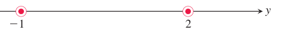

2. **确定并标出 $y'>0$ 和 $y'<0$ 的区间。** 这一步与第4.3节类似，但现在标记的是 $y$ 轴，而不是 $x$ 轴。

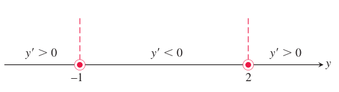

可以把 $y'$ 的符号信息直接概括在相线上。在 $y=-1$ 左侧，$y'>0$，所以解的 $y$ 值若小于 $-1$，就会从该值开始增大，趋向 $y=-1$。在这个区间画一支指向 $-1$ 的箭头，表示这一信息。

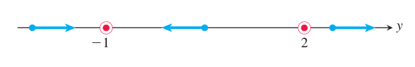

同样，在 $y=-1$ 与 $y=2$ 之间，$y'<0$，因此在这个区间取值的解会递减并趋向 $y=-1$。当 $y>2$ 时，$y'>0$，所以取值大于2的解会继续增大而无上界。

简言之，$xy$ 平面中水平线 $y=-1$ 下方的解曲线向上趋近 $y=-1$；位于 $y=-1$ 与 $y=2$ 之间的解曲线离开 $y=2$，向下趋近 $y=-1$；$y=2$ 上方的解曲线离开 $y=2$，不断上升。

3. **计算 $y''$，标出 $y''>0$ 和 $y''<0$ 的区间。** 为求 $y''$，对 $y'$ 关于 $x$ 作隐式求导：

$$
\begin{aligned}
y'&=(y+1)(y-2)=y^2-y-2,\\
y''&=\frac{d}{dx}(y')=\frac{d}{dx}(y^2-y-2)\\
&=2yy'-y'\\
&=(2y-1)y'\\
&=(2y-1)(y+1)(y-2).
\end{aligned}
$$

由此可见，$y''$ 在 $y=-1,\frac{1}{2},2$ 处改变符号。把这些符号信息加入相线。

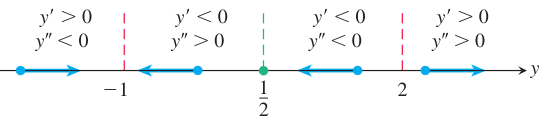

4. **在 $xy$ 平面中画出若干解曲线。** 水平线 $y=-1$、$y=\frac{1}{2}$ 和 $y=2$ 把平面分成若干水平带。在每个带中，已知 $y'$ 和 $y''$ 的符号，因此知道随着 $x$ 增大，解曲线是上升还是下降，以及向哪一侧弯曲（图9.15）。

“平衡线” $y=-1$ 和 $y=2$ 本身也是解曲线，因为常函数 $y=-1$、$y=2$ 满足微分方程。穿过 $y=\frac{1}{2}$ 的解曲线在那里具有拐点，凹凸性从该线上方的向下凹变为该线下方的向上凹。

与第2步的预测一致，中间带和下方带中的解随着 $x$ 增大趋近平衡值 $y=-1$；最上方带中的解则不断上升，远离 $y=2$。

  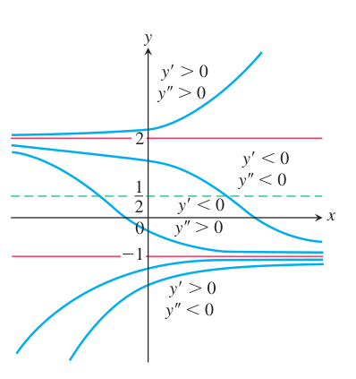
  
图9.15　例1的图解包括经过平衡值的水平线 $y=-1$ 和 $y=2$。任意两条不同的解曲线都不会相交或相切。

### 稳定与不稳定平衡

再看图9.15，特别注意平衡值附近解曲线的行为。一旦解曲线的值接近 $y=-1$，它便持续趋向该值，因此 $y=-1$ 是**稳定平衡**。而 $y=2$ 附近的行为恰好相反：除平衡解 $y=2$ 本身以外，其他解都随着 $x$ 增大而远离它。称 $y=2$ 为**不稳定平衡**。若解恰好处于这个值，它就保持不变；但只要偏离，无论偏离多小，都会继续远离。（有时平衡值不稳定，是因为解只在该点的一侧远离它。）

知道要观察什么以后，从初始相线（例1第2步的第二幅图）就能看出这种行为：箭头离开 $y=2$，而一旦位于 $y=2$ 左侧，箭头便指向 $y=-1$。

下面给出几个应用例子，利用例1的方法描绘其微分方程模型的解曲线族。

### 牛顿冷却定律

在第7.2节，我们解析地求解了描述牛顿冷却定律的微分方程

$$
\frac{dH}{dt}=-k(H-H_S),\qquad k>0.
$$

其中 $H$ 是物体在时刻 $t$ 的温度，$H_S$ 是周围介质的恒定温度。

设周围介质（例如房屋中的一个房间）的温度恒为 $15^\circ\mathrm{C}$，则温差为 $H(t)-15$。假设 $H$ 是时间 $t$ 的可微函数，由牛顿冷却定律，存在比例常数 $k>0$，使

$$
\begin{equation}
\frac{dH}{dt}=-k(H-15).
\tag{1}
\end{equation}
$$

使用 $-k$，是为了在 $H>15$ 时使导数为负。

当 $H=15$ 时，$\frac{dH}{dt}=0$，所以温度 $15^\circ\mathrm{C}$ 是平衡值。若 $H>15$，则式（1）给出 $H-15>0$、$\frac{dH}{dt}<0$：物体比房间热时，就会冷却。类似地，若 $H<15$，则 $H-15<0$、$\frac{dH}{dt}>0$：物体比房间冷时，就会升温。因此，式（1）描述的行为符合我们对温度变化的直觉。图9.16的初始相线概括了这些观察；$H=15$ 是稳定平衡。

  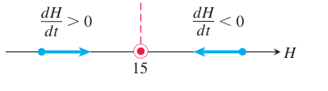
  
图9.16　构造牛顿冷却定律相线的第一步。经过足够长时间，温度趋向平衡值，即周围介质的温度。

对式（1）两边关于 $t$ 求导，以确定解曲线的凹凸性：

$$
\begin{aligned}
\frac{d}{dt}\left(\frac{dH}{dt}\right)
&=\frac{d}{dt}\bigl(-k(H-15)\bigr),\\
\frac{d^2H}{dt^2}&=-k\frac{dH}{dt}.
\end{aligned}
$$

由于 $-k$ 为负，$\frac{dH}{dt}<0$ 时二阶导数为正，$\frac{dH}{dt}>0$ 时二阶导数为负。图9.17把这一信息加到了相线上。

  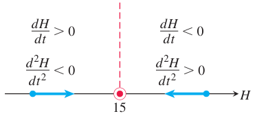
  
图9.17　牛顿冷却定律的完整相线。

完整相线说明：若物体温度高于平衡值 $15^\circ\mathrm{C}$，$H(t)$ 的图像递减且向上凹；若温度低于周围介质温度 $15^\circ\mathrm{C}$，图像递增且向下凹。利用这些信息可以画出典型解曲线（图9.18）。

  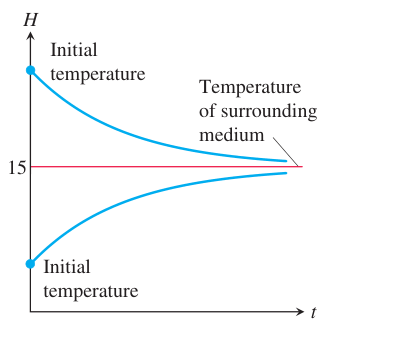
  
图9.18　温度随时间的变化。无论初温如何，物体温度 $H(t)$ 都趋向周围介质温度 $15^\circ\mathrm{C}$。

从图9.18上方的解曲线可以看出，物体冷却时，冷却速率也逐渐减小，因为 $\frac{dH}{dt}$ 趋于零。这个现象隐含在牛顿冷却定律及其微分方程中，而曲线随时间逐渐变平，使这一现象立即变得直观。

### 受到阻力的下落物体

牛顿指出，运动物体动量的变化率等于所受合力。数学表达式为

$$
\begin{equation}
F=\frac{d}{dt}(mv),
\tag{2}
\end{equation}
$$

其中 $F$ 为合力，$m$ 和 $v$ 分别为物体的质量与速度。原文以燃烧燃料的火箭说明质量随时间变化的情形；形式上，由乘积求导法则，式（2）右端展开为

$$
m\frac{dv}{dt}+v\frac{dm}{dt}.
$$

但在许多情形中，$m$ 为常数，$\frac{dm}{dt}=0$，式（2）简化为

$$
\begin{equation}
F=m\frac{dv}{dt},
\qquad\text{即}\quad F=ma,
\tag{3}
\end{equation}
$$

这就是**牛顿第二运动定律**（见第9.3节）。

> [!note]- 补充：变质量系统的适用边界
>
> 上面的乘积求导是代数运算。对火箭这样的开放变质量系统建立运动方程，还必须计入流入或流出质量所携带的动量，不能直接把 $F=\frac{d}{dt}(mv)$ 当作火箭本体的完整动力学方程。本节后续研究的是质量恒定的下落物体；本书第9.3节介绍了此处使用的定质量运动模型，本段只澄清原文例述的适用边界。

在自由落体中，重力产生的恒定加速度记作 $g$，使物体向下运动的力只有重力 $F_p=mg$。但考虑实际物体在空气中下落，例如从高处落下的一枚硬币，或从更高处跳下的跳伞者，就知道空气阻力迟早会影响下落速度。更现实的自由落体模型应包含空气阻力，图9.19用 $F_r$ 表示这一力。

  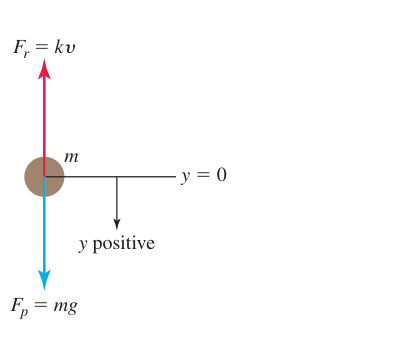
  
图9.19　物体在重力作用下下落，假定阻力与速度成正比。

原书在这里采用低速下的线性阻力近似，即阻力 $F_r$ 近似与物体速度成正比。下落物体的合力为 $F=F_p-F_r$，因此

$$
m\frac{dv}{dt}=mg-kv,
$$

也就是

$$
\begin{equation}
\frac{dv}{dt}=g-\frac{k}{m}v.
\tag{4}
\end{equation}
$$

可以用相线分析这个微分方程的速度解函数。令式（4）右边为零，得到平衡点

$$
v=\frac{mg}{k}.
$$

如果物体的初速度高于这个值，$\frac{dv}{dt}<0$，物体减速；如果速度低于 $\frac{mg}{k}$，则 $\frac{dv}{dt}>0$，物体加速。图9.20的初始相线概括了这些观察。

  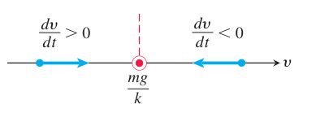
  
图9.20　受到阻力的下落物体的初始相线。

对式（4）两边关于 $t$ 求导，确定解曲线的凹凸性：

$$
\frac{d^2v}{dt^2}
=\frac{d}{dt}\left(g-\frac{k}{m}v\right)
=-\frac{k}{m}\frac{dv}{dt}.
$$

当 $v<\frac{mg}{k}$ 时，$\frac{d^2v}{dt^2}<0$；当 $v>\frac{mg}{k}$ 时，$\frac{d^2v}{dt^2}>0$。图9.21把这些信息加到相线上。注意它与牛顿冷却定律的相线（图9.17）相似，解曲线也相似（图9.22）。

  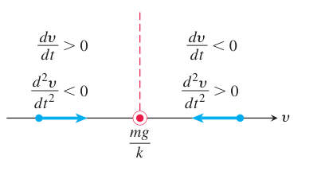
  
图9.21　下落物体的完整相线。

  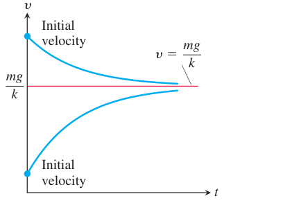
  
图9.22　受到阻力的下落物体的典型速度曲线。$v=mg/k$ 是终端速度。

图9.22给出两条典型解曲线。不论初速度如何，物体速度都趋近极限值 $v=\frac{mg}{k}$。这个稳定平衡值称为物体的**终端速度**。跳伞者通过改变身体迎风面积、从而改变 $k$，可以使终端速度在95至180英里/小时之间变化。

### 逻辑斯蒂种群增长

第9.3节用指数变化模型研究了人口增长。若 $P$ 表示个体数量，且忽略迁出和迁入，则

$$
\begin{equation}
\frac{dP}{dt}=kP,
\tag{5}
\end{equation}
$$

其中 $k>0$ 是单位时间内每个个体的出生率减去死亡率。

自然环境用于维持生命的资源有限，因此可以合理地假设环境只能容纳最大种群数量 $M$。随着种群接近这个**极限种群数量**或**环境容纳量**，资源变得不再充足，增长率 $k$ 随之下降。体现这种行为的一个简单关系为 $k=r(M-P)$，其中 $r>0$ 为常数。注意，当 $P$ 增加并趋近 $M$ 时，$k$ 减小；当 $P>M$ 时，$k$ 为负。把式（5）中的 $k$ 换成 $r(M-P)$，得到

$$
\begin{equation}
\frac{dP}{dt}=r(M-P)P=rMP-rP^2.
\tag{6}
\end{equation}
$$

式（6）给出的模型称为**逻辑斯蒂增长**模型。

分析式（6）的相线，可以预测种群随时间的变化。平衡值为 $P=M$ 和 $P=0$；当 $0<P<M$ 时，$\frac{dP}{dt}>0$；当 $P>M$ 时，$\frac{dP}{dt}<0$。图9.23记录了这些信息。

  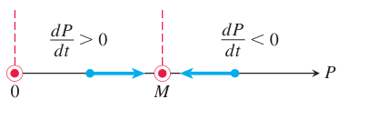
  
图9.23　逻辑斯蒂增长的初始相线（式6）。

对式（6）两边关于 $t$ 求导，确定种群曲线的凹凸性：

$$
\begin{equation}
\begin{aligned}
\frac{d^2P}{dt^2}
&=\frac{d}{dt}(rMP-rP^2)\\
&=rM\frac{dP}{dt}-2rP\frac{dP}{dt}\\
&=r(M-2P)\frac{dP}{dt}.
\end{aligned}
\tag{7}
\end{equation}
$$

若 $P=\frac{M}{2}$，则 $\frac{d^2P}{dt^2}=0$。若 $0<P<\frac{M}{2}$，则 $M-2P$ 和 $\frac{dP}{dt}$ 都为正，二阶导数为正。若 $\frac{M}{2}<P<M$，则 $M-2P<0$、$\frac{dP}{dt}>0$，二阶导数为负。若 $P>M$，两个因子都为负，二阶导数为正。把这些信息加入相线，得到图9.24。

  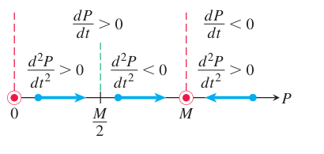
  
图9.24　逻辑斯蒂增长的完整相线（式6）。

直线 $P=\frac{M}{2}$ 和 $P=M$ 将 $tP$ 平面的第一象限分成水平带，各带中一阶、二阶导数的符号均已确定。因此知道种群曲线随时间怎样上升、下降和弯曲。平衡线 $P=0$ 与 $P=M$ 也都是种群曲线。穿过 $P=\frac{M}{2}$ 的种群曲线在此具有拐点，呈现**S形**，也就是像字母S一样向两个方向弯曲。图9.25给出典型种群曲线。注意，对正初始种群，这些曲线在 $t\to\infty$ 时趋近极限种群数量 $M$。

  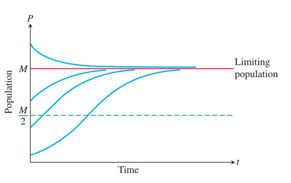
  
图9.25　逻辑斯蒂增长的种群曲线。

## 9.5 方程组与相平面

有些情形需要同时考虑几个一阶微分方程，而不是一个方程。这样的集合称为微分方程**组**。本节介绍一种称为**相平面分析**的图形方法，用它理解微分方程组。我们以同一个池塘中鳟鱼和鲈鱼的种群模型为背景说明这种分析。

### 相平面

一般的两个一阶微分方程组成的方程组可以写成

$$
\frac{dx}{dt}=F(x,y),\qquad
\frac{dy}{dt}=G(x,y).
$$

这种方程组称为**自治方程组**，因为 $\frac{dx}{dt}$ 和 $\frac{dy}{dt}$ 不显含自变量时间 $t$，而只依赖因变量 $x,y$。它的一个**解**由一对函数 $x(t)$ 和 $y(t)$ 组成，并在某个有限或无限时间区间内的每个 $t$，同时满足两个微分方程。

由于每个导数都依赖 $x,y$，不能只孤立地研究其中一个方程来求 $x(t)$ 或 $y(t)$。为了解这些解，我们把两个因变量放在一起，从某个指定点开始，在 $xy$ 平面上画出点 $(x(t),y(t))$。这两个解函数确定了一条经过指定点的解曲线，称为系统的**轨线**。轨线所在的 $xy$ 平面称为**相平面**。这样就能把两个解一起考虑，研究相平面中所有解轨线的行为。原书指出，不同的轨线不会彼此交叉或相切。（解轨线是参数曲线的例子，第11章将详细研究参数曲线。）

### 竞争模型

设两种鱼，例如鳟鱼和鲈鱼，在某个池塘中竞争相同的有限资源，如食物和氧气。用 $x(t)$ 表示时刻 $t$ 的鳟鱼数量，$y(t)$ 表示鲈鱼数量。实际的 $x(t),y(t)$ 总是整数，但我们用实值可微函数近似它们，从而能够应用微分方程方法。

有几个因素影响这两个种群的变化率。随着时间推移，两种鱼都会繁殖，所以假设各自种群按与自身数量成正比的速率增加。若只考虑这一因素，两个种群都会指数增长。但是，两物种间的竞争产生相反的影响：鲈鱼数量多，会使鳟鱼数量减少，反之亦然。模型假设这种影响的大小与两物种相互作用的频率成正比，而该频率又与两个种群数量之积 $xy$ 成正比。这些考虑导出如下模型：

$$
\begin{equation}
\frac{dx}{dt}=(a-by)x,
\tag{1a}
\end{equation}
$$

$$
\begin{equation}
\frac{dy}{dt}=(m-nx)y.
\tag{1b}
\end{equation}
$$

其中 $x(t)$ 是鳟鱼数量，$y(t)$ 是鲈鱼数量，$a,b,m,n$ 都是正常数。这个方程组的解是一对给出时刻 $t$ 两种鱼数量的函数 $x(t),y(t)$。式（1）的每个方程都同时包含两个未知函数，所以不能分别求解。我们改用图形分析研究这个竞争模型的解轨线。

下面考察鳟鱼—鲈鱼模型的相平面。由于种群数量不能为负，只研究 $xy$ 平面的第一象限，即 $x\ge0,y\ge0$。首先确定两种鱼的数量都保持不变的位置。当 $\frac{dx}{dt}=0$、$\frac{dy}{dt}=0$ 时，点 $(x(t),y(t))$ 不再变化，式（1a）、（1b）变为

$$
(a-by)x=0,\qquad (m-nx)y=0.
$$

这两个联立方程有两个解：$(x,y)=(0,0)$ 和 $(x,y)=(\frac{m}{n},\frac{a}{b})$。这些位置称为**平衡点**或**静止点**，在这些位置，两种群的数量一直保持常数。点 $(0,0)$ 对应没有这两种鱼的池塘；点 $(\frac{m}{n},\frac{a}{b})$ 对应两种鱼数量都不变的池塘。

接着注意：在直线 $y=\frac{a}{b}$ 上，由式（1a）有 $\frac{dx}{dt}=0$，即鳟鱼数量的瞬时变化率为零；类似地，在直线 $x=\frac{m}{n}$ 上，由式（1b）有 $\frac{dy}{dt}=0$，即鲈鱼数量的瞬时变化率为零。图9.26记录了这些信息。

  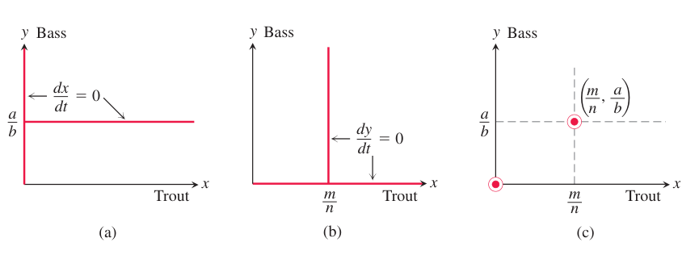
  
图9.26　式（1a）、（1b）所给竞争模型中的静止点。

建立竞争模型时，一般并不知道常数 $a,b,m,n$ 的精确值。尽管如此，仍可分析式（1）来了解解轨线的性质。先确定整个相平面中 $\frac{dx}{dt}$ 和 $\frac{dy}{dt}$ 的符号。虽然 $x(t),y(t)$ 分别是时刻 $t$ 两种鱼的数量，但我们把它们当作相平面中沿轨线运动的点 $(x(t),y(t))$。当 $\frac{dx}{dt}>0$ 时，$x(t)$ 增加，点向右运动；当 $\frac{dx}{dt}<0$ 时，点向左运动。同样，$\frac{dy}{dt}>0$ 时点向上运动，$\frac{dy}{dt}<0$ 时点向下运动。

在竖直线 $x=\frac{m}{n}$ 上，$\frac{dy}{dt}=0$。在线的左侧，$x<\frac{m}{n}$，由 $\frac{dy}{dt}=(m-nx)y$ 可知，在第一象限内部该导数为正，所以轨线向上。在线的右侧，该导数为负，轨线向下。图9.27表示这些方向。

  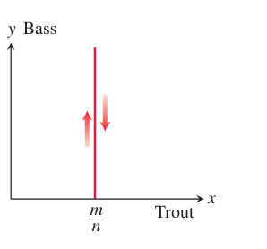
  
图9.27　在直线 $x=m/n$ 左侧，轨线向上；在其右侧，轨线向下。

类似地，在水平线 $y=\frac{a}{b}$ 上方，$\frac{dx}{dt}<0$，轨线向左；在线的下方，轨线向右，如图9.28。把这些信息结合起来，相平面被分为四个区域 $A,B,C,D$，各区域内的方向见图9.29。

  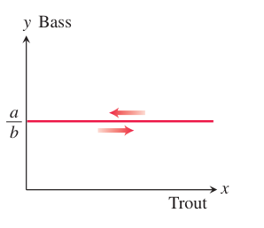
  
图9.28　在直线 $y=a/b$ 上方，轨线向左；在其下方，轨线向右。

  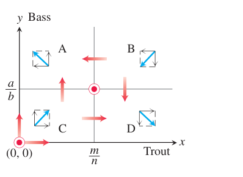
  
图9.29　由 $x=m/n$ 与 $y=a/b$ 划分出的四个区域内，轨线方向的综合图形分析。

再考察两个平衡点附近的情况。靠近 $(0,0)$ 的轨线离开该点，向右上方运动。靠近平衡点 $(\frac{m}{n},\frac{a}{b})$ 的行为取决于轨线从哪个区域出发。例如，从区域 $B$ 出发的轨线向左下方运动，趋近平衡点。根据起点的位置，它可能向下进入区域 $D$，也可能向左进入区域 $A$，或者直接趋近平衡点。如果进入区域 $A$ 或 $D$，它就会继续远离静止点。两个静止点都称为**不稳定**，在这里的意思是：每个静止点附近都有远离它的轨线。图9.30表示这些特征。

  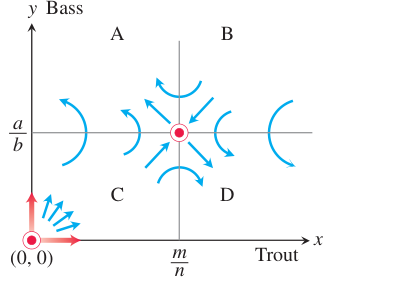
  
图9.30　静止点 $(0,0)$ 和 $(m/n,a/b)$ 附近沿轨线的运动。

可以证明，在直线 $y=\frac{a}{b}$ 上、下方的两个半平面内，各恰有一条轨线趋近平衡点 $(\frac{m}{n},\frac{a}{b})$（见习题7）。在这两条轨线构成的分界线上方，鲈鱼种群最终增长；在其下方，鲈鱼种群最终减少。图9.31示意了趋近平衡点的两条轨线。

  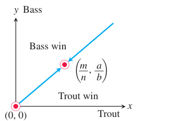
  
图9.31　竞争模型的定性分析结果。恰有两条轨线趋近点 $(m/n,a/b)$。

图形分析说明，在竞争模型的假设下，两物种不太可能都达到平衡数量，因为鱼的数量几乎不可能始终恰好沿两条趋近平衡点的轨线之一变化。此外，初始种群点 $(x_0,y_0)$ 决定了哪一种鱼更可能长期存活，两物种共存的可能性很小。

### 相平面分析方法的局限

与竞争模型不同，静止点附近的轨线行为并不总能确定。例如，设静止点取为原点 $(0,0)$，我们知道附近轨线的运动方向如图9.32。

  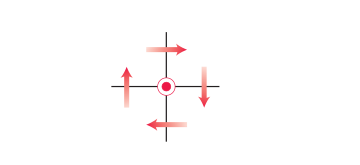
  
图9.32　静止点 $(0,0)$ 附近的轨线方向。

图9.32的信息不足以区分图9.33中的三种可能轨线。即使能确定平衡点附近某条轨线类似图9.33(c)，仍不知道其他轨线怎样变化：更靠近原点的轨线，可能像图9.33(a)或(b)那样运动。图9.33(b)中螺旋趋近静止点的轨线，永远不会在有限时间内真正到达该点。

  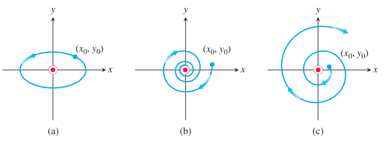
  
图9.33　三种可能的轨线运动：(a)周期运动；(b)趋向渐近稳定静止点的运动；(c)不稳定静止点附近的运动。

### 另一类行为

可以证明，方程组

$$
\begin{equation}
\frac{dx}{dt}=y+x-x(x^2+y^2),
\tag{2a}
\end{equation}
$$

$$
\begin{equation}
\frac{dy}{dt}=-x+y-y(x^2+y^2)
\tag{2b}
\end{equation}
$$

只有一个平衡点 $(0,0)$。但是，从单位圆上出发的任意轨线都会沿单位圆顺时针运动，因为当 $x^2+y^2=1$ 时有 $\frac{dy}{dx}=-\frac{x}{y}$（见习题2）。从单位圆内部的非平衡点出发，轨线向外螺旋运动，并在 $t\to\infty$ 时渐近趋近单位圆；从单位圆外部出发，轨线向内螺旋运动，同样渐近趋近单位圆。圆 $x^2+y^2=1$ 称为系统的一个**极限环**（图9.34）。在这个系统中，$x$ 和 $y$ 的变化最终趋向周期性。

  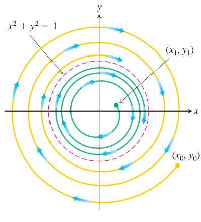
  
图9.34　解轨线 $x^2+y^2=1$ 是一个极限环。

