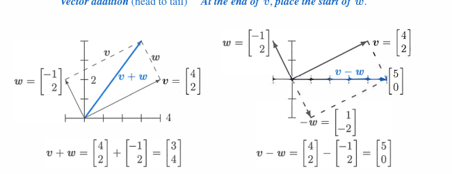
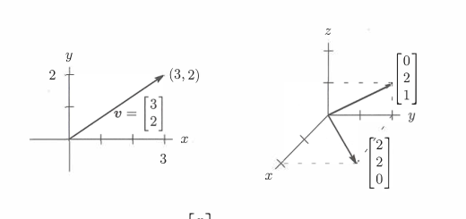
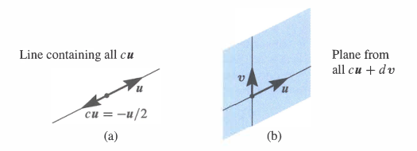
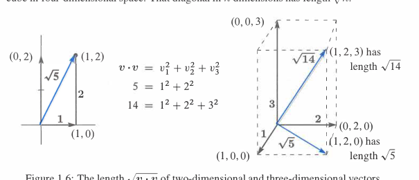
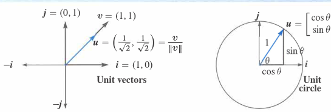
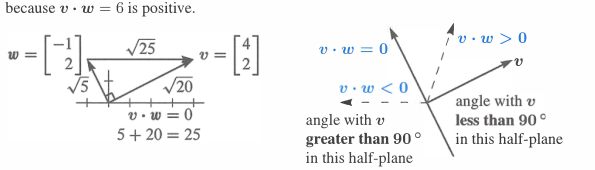
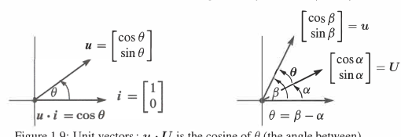
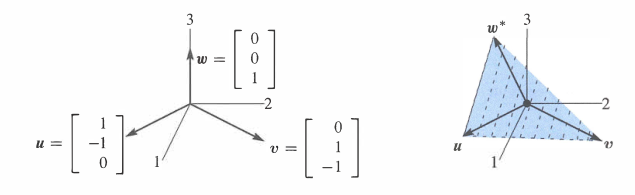

<!-- 来源：Gilbert Strang, Introduction to Linear Algebra, 5th ed.，PDF 第 11–40 页（书页第 1–30 页）。依照整理规范，不收录各节 Problem Set 与 Challenge Problems。 -->

# 第 1 章　向量导论

线性代数的核心是对向量进行两种运算：向量相加得到 $v+w$，向量乘数得到 $cv$。把两种运算结合起来，就得到**线性组合**

$$
cv+dw
=c\begin{bmatrix}1\\1\end{bmatrix}
+d\begin{bmatrix}2\\3\end{bmatrix}
=\begin{bmatrix}c+2d\\c+3d\end{bmatrix}.
$$

例如，$c=d=1$ 时得到 $v+w=(3,4)$；$c=2,d=1$ 时得到 $cv+dw=(4,5)$。有时我们需要一个特定组合，另一些时候则关心 $c,d$ 取遍所有实数时得到的**全部线性组合**。

所有 $cv$ 位于一条直线上。如果 $w$ 不在这条直线上，全部 $cv+dw$ 将充满二维平面。四维空间中，四个向量 $u,v,w,z$ 的组合 $cu+dv+ew+fz$ 通常能充满整个空间，但也可能只落在一个平面或一条直线上。

本章从可以画出的二维、三维向量出发，再自然地进入 $n$ 维空间：

- 1.1：向量加法 $v+w$ 与线性组合 $cv+dw$；
- 1.2：点积 $v\cdot w$ 与长度 $\lVert v\rVert=\sqrt{v\cdot v}$；
- 1.3：矩阵 $A$、线性方程 $Ax=b$ 与解 $x=A^{-1}b$。

## 1.1　向量与线性组合

  

    <ol style="margin:0; padding-left:1.6em;">
      <li style="margin:0.35em 0;">$3v+5w$ 是向量 $v,w$ 的一个典型线性组合。</li>
      <li style="margin:0.35em 0;">若 $v=(1,1)$、$w=(2,3)$，则 $3v+5w=(13,18)$。</li>
      <li style="margin:0.35em 0;">向量 $(2,3)=(2,0)+(0,3)$ 在平面中表示向右 $2$、向上 $3$。</li>
      <li style="margin:0.35em 0;">组合 $c(1,1)+d(2,3)$ 充满整个 $xy$ 平面。</li>
      <li style="margin:0.35em 0;">组合 $c(1,1,1)+d(2,3,4)$ 在三维空间中充满一个平面。</li>
      <li style="margin:0.35em 0;">方程 $c+2d=1,\ c+3d=0,\ c+4d=0$ 无解，因为 $(1,0,0)$ 不在该平面上。</li>
    </ol>
  

两个彼此分开的数 $v_1,v_2$ 组成一个二维列向量

$$
v=\begin{bmatrix}v_1\\v_2\end{bmatrix}.
$$

虽然不把 $v_1$ 与 $v_2$ 相加，却可以把向量相加。不同位置的分量始终彼此对应：

$$
\begin{bmatrix}v_1\\v_2\end{bmatrix}
+\begin{bmatrix}w_1\\w_2\end{bmatrix}
=\begin{bmatrix}v_1+w_1\\v_2+w_2\end{bmatrix}.
$$

减法同理。另一种基本运算是**标量乘法**：

$$
2v=\begin{bmatrix}2v_1\\2v_2\end{bmatrix}=v+v,
\qquad
-v=\begin{bmatrix}-v_1\\-v_2\end{bmatrix}.
$$

$cv$ 的分量是 $cv_1,cv_2$，数 $c$ 称为**标量**。$-v$ 与 $v$ 的和是零向量 $\boldsymbol 0=(0,0)$；零向量与标量 $0$ 不是同一个对象。

### 线性组合

先把 $v$ 乘以 $c$，把 $w$ 乘以 $d$，再相加，就得到 $cv+dw$。

  

    $cv$ 与 $dw$ 的和称为向量 $v,w$ 的一个线性组合 $cv+dw$。
  

四个特殊组合是

$$
\begin{aligned}
1v+1w&=v+w, & 1v-1w&=v-w,\\
0v+0w&=\boldsymbol 0, & cv+0w&=cv.
\end{aligned}
$$

零向量总是可能的组合。以后每次遇到一个向量“空间”，其中都会包含零向量。

向量有三种相互对应的表示：一组分量、从原点出发的箭头，以及平面中的终点。分量用于计算，箭头用于观察几何意义。将 $w$ 的起点放到 $v$ 的终点，得到首尾相接的向量和；平行四边形的对角线也是 $v+w$。

  
  
图 1.1　向量加法 $v+w=(3,4)$ 与向量之差 $v-w=(5,0)$。

先沿 $v$ 再沿 $w$，或者先沿 $w$ 再沿 $v$，会到达同一点，因此 $w+v=v+w$。

### 三维向量

二维向量 $(v_1,v_2)$ 对应 $xy$ 平面内的点。三个分量则对应三维空间中的点。例如

$$
v=\begin{bmatrix}1\\1\\-1\end{bmatrix},
\qquad
w=\begin{bmatrix}2\\3\\4\end{bmatrix},
\qquad
v+w=\begin{bmatrix}3\\4\\3\end{bmatrix}.
$$

三维向量通常表示从原点 $(0,0,0)$ 指向 $(v_1,v_2,v_3)$ 的箭头。列向量、从原点出发的箭头和箭头终点三者完全对应。平面中的 $(x,y)$ 与三维空间中的 $(x,y,0)$ 是不同的向量。

  
  
图 1.2　向量 $(x,y)$ 与 $(x,y,z)$ 分别对应二维和三维空间中的点。

为节省空间，列向量也常写成 $v=(1,1,-1)$。它仍表示列向量，不是行向量 $[\,1\ 1\ -1\,]$；后者是前者的转置。三维向量仍按分量相加，这一规则可直接推广到 $n$ 维。

### 从一个组合到全部组合

一个向量 $u$ 的全部组合是 $cu$；两个向量的全部组合是 $cu+dv$；三个向量的全部组合是 $cu+dv+ew$。在三维空间中，典型情形是：

1. 全部 $cu$ 充满一条经过原点的直线；
2. 全部 $cu+dv$ 充满一个经过原点的平面；
3. 全部 $cu+dv+ew$ 充满整个三维空间。

  
  
图 1.3　(a) 经过 $u$ 的直线；(b) 包含 $u,v$ 的平面。

若第三个向量 $w$ 不在 $u,v$ 的平面内，$ew$ 与所有 $cu+dv$ 的组合将充满整个三维空间。但如果 $w$ 本身就是某个 $cu+dv$，加入 $w$ 后仍不会离开原来的平面。

### 关键思想回顾

1. 二维向量 $v$ 有两个分量 $v_1,v_2$。
2. $v+w$ 与 $cv$ 都按分量计算。
3. 三个向量 $u,v,w$ 的线性组合是 $cu+dv+ew$。
4. 一个、两个、三个典型三维向量的全部组合依次充满直线、平面和 $\mathbb R^3$。

### Worked Examples

  

    
1.1 A

    
向量 $v=(1,1,0)$ 与 $w=(0,1,1)$ 的全部组合在 $\mathbb R^3$ 中充满一个平面。描述该平面，并找出一个不在平面内的向量。

    
<strong>解</strong>

    
$\displaystyle cv+dw=c\begin{bmatrix}1\\1\\0\end{bmatrix}+d\begin{bmatrix}0\\1\\1\end{bmatrix}=\begin{bmatrix}c\\c+d\\d\end{bmatrix}.$

    
第二分量始终等于第一、三分量之和。因此 $(1,2,3)$ 不在平面中，因为 $2\ne1+3$。也可以用 $n=(1,-1,1)$ 描述这个平面：$v\cdot n=w\cdot n=0$，所以 $n$ 垂直于平面。

  

  

    
1.1 B

    
令 $v=(1,0)$、$w=(0,1)$。描述 $c$ 取整数或 $c\ge0$ 时的所有 $cv$，再加入全部 $dw$。

    
<strong>解</strong>　整数 $c$ 产生 $x$ 轴上的等间距点；加入全部 $dw$ 后，得到经过这些点的无穷多条竖直平行线。$c\ge0$ 产生正 $x$ 轴半直线；再加入全部 $dw$，得到右半平面 $x\ge0$。

  

  

    
1.1 C

    
求 $c,d$，使 $cv+dw=b$，其中 $v=(2,-1)$、$w=(-1,2)$、$b=(1,0)$。

    
<strong>解</strong>

    
$\displaystyle c\begin{bmatrix}2\\-1\end{bmatrix}+d\begin{bmatrix}-1\\2\end{bmatrix}=\begin{bmatrix}1\\0\end{bmatrix}.$

    
比较分量得到 $2c-d=1$、$-c+2d=0$，所以 $c=\frac23,d=\frac13$。矩阵形式为

    
$\displaystyle \begin{bmatrix}2&-1\\-1&2\end{bmatrix}\begin{bmatrix}c\\d\end{bmatrix}=\begin{bmatrix}1\\0\end{bmatrix}.$

  

## 1.2　长度与点积

  

    <ol style="margin:0; padding-left:1.6em;">
      <li style="margin:0.35em 0;">$(1,2)\cdot(4,5)=14$。</li>
      <li style="margin:0.35em 0;">$(1,3,2)$ 与 $(4,-4,4)$ 垂直，因为点积为零。</li>
      <li style="margin:0.35em 0;">$v=(1,3,2)$ 的长度平方为 $v\cdot v=14$。</li>
      <li style="margin:0.35em 0;">$u=v/\lVert v\rVert$ 是与 $v$ 同方向的单位向量。</li>
      <li style="margin:0.35em 0;">$\cos\theta=(v\cdot w)/(\lVert v\rVert\lVert w\rVert)$。</li>
      <li style="margin:0.35em 0;">$(1,0)$ 与 $(1,1)$ 的夹角为 $45^\circ$。</li>
      <li style="margin:0.35em 0;">$|\cos\theta|\le1$ 导出 $|v\cdot w|\le\lVert v\rVert\lVert w\rVert$。</li>
    </ol>
  

点积先将对应分量相乘，再把结果相加。点积的结果是一个数。

  

    
定义　点积

    
$\displaystyle v\cdot w=v_1w_1+\cdots+v_nw_n$。

  

**例 1**　$v=(4,2)$ 与 $w=(-1,2)$ 的点积为

$$
v\cdot w=(4)(-1)+(2)(2)=0.
\tag{1}
$$

两个非零向量点积为零时互相垂直。坐标单位向量 $i=(1,0)$、$j=(0,1)$ 就满足 $i\cdot j=0$。点积的次序无关紧要：$w\cdot v=v\cdot w$。

**例 2**　在 $x=-1$ 处放重量 $4$，在 $x=2$ 处放重量 $2$。重量与距离的点积为 $(4)(-1)+(2)(2)=0$，两侧力矩抵消，杠杆平衡。

**例 3**　三种商品的价格为 $p=(p_1,p_2,p_3)$，买卖数量为 $q=(q_1,q_2,q_3)$，则总收入为

$$
q\cdot p=q_1p_1+q_2p_2+q_3p_3.
$$

当 $q\cdot p=0$ 时，总销售额与总购买额相等。

### 长度与单位向量

向量与自身的点积给出长度的平方。若 $v=(1,2,3)$，则 $v\cdot v=14$。

  

    
定义　向量的长度

    
$\displaystyle \lVert v\rVert=\sqrt{v\cdot v}=\sqrt{v_1^2+\cdots+v_n^2}$。

  

二维和三维中的长度来自勾股定理。四维向量 $(1,1,1,1)$ 的长度为 $2$；$n$ 维单位立方体主对角线的长度为 $\sqrt n$。

  
  
图 1.6　二维和三维向量的长度 $\sqrt{v\cdot v}$。

  

    
定义　单位向量

    
长度为 $1$ 的向量称为单位向量。非零向量 $v$ 同方向的单位向量是 $u=v/\lVert v\rVert$。

  

坐标单位向量为 $i=(1,0)$、$j=(0,1)$。与 $x$ 轴夹角为 $\theta$ 的单位向量为

$$
u=(\cos\theta,\sin\theta),
$$

因为 $\cos^2\theta+\sin^2\theta=1$。

  
  
图 1.7　坐标单位向量与单位圆上的向量。

### 两个向量之间的夹角

当 $v,w$ 垂直时，勾股定理给出

$$
\begin{equation}
\lVert v\rVert^2+\lVert w\rVert^2=\lVert v-w\rVert^2.
\tag{2}
\end{equation}
$$

二维中展开为

$$
\begin{equation}
(v_1^2+v_2^2)+(w_1^2+w_2^2)
=(v_1-w_1)^2+(v_2-w_2)^2.
\tag{3}
\end{equation}
$$

消去相同的平方项后得到

$$
\begin{equation}
v_1w_1+v_2w_2=0.
\tag{4}
\end{equation}
$$

因此直角对应 $v\cdot w=0$。若 $v\cdot w>0$，夹角小于 $90^\circ$；若 $v\cdot w<0$，夹角大于 $90^\circ$。

  
  
图 1.8　点积的正负区分锐角和钝角，点积为零对应直角。

夹角为 $\theta$ 的单位向量 $u,U$ 满足 $u\cdot U=\cos\theta$。

  
  
图 1.9　单位向量 $u,U$ 的点积是夹角 $\theta$ 的余弦。

非零向量 $v,w$ 分别除以长度后成为单位向量，从而得到

  

    
余弦公式

    
若 $v,w$ 都是非零向量，则夹角 $\theta$ 由下式给出。

  

$$
\begin{equation}
\cos\theta=\frac{v\cdot w}{\lVert v\rVert\lVert w\rVert}.
\tag{5}
\end{equation}
$$

由 $|\cos\theta|\le1$ 得到

$$
|v\cdot w|\le\lVert v\rVert\lVert w\rVert
\qquad\text{（柯西—施瓦茨不等式）},
$$

$$
\lVert v+w\rVert\le\lVert v\rVert+\lVert w\rVert
\qquad\text{（三角不等式）}.
$$

**例 5**　$v=(2,1)$、$w=(1,2)$ 的点积为 $4$，长度均为 $\sqrt5$，所以

$$
\cos\theta=\frac{4}{\sqrt5\sqrt5}=\frac45.
$$

施瓦茨不等式给出 $4<5$。又因 $v+w=(3,3)$，三角不等式给出 $\sqrt{18}<2\sqrt5$。

**例 6**　$v=(a,b)$ 与 $w=(b,a)$ 的点积为 $2ab$，长度均为 $\sqrt{a^2+b^2}$。因此

$$
2ab\le a^2+b^2.
$$

令 $x=a^2,y=b^2$，得到几何平均数不超过算术平均数：

$$
\sqrt{xy}\le\frac{x+y}{2}.
$$

### 关键思想回顾

1. 点积把对应分量相乘后求和。
2. $\lVert v\rVert=\sqrt{v\cdot v}$，$u=v/\lVert v\rVert$ 是单位向量。
3. 非零向量垂直时，$v\cdot w=0$。
4. 夹角余弦为 $(v\cdot w)/(\lVert v\rVert\lVert w\rVert)$。

### Worked Examples

  

    
1.2 A

    
对 $v=(3,4)$、$w=(4,3)$ 检验两个不等式并求夹角余弦。

    
<strong>解</strong>　$v\cdot w=24$，$\lVert v\rVert=\lVert w\rVert=5$，$v+w=(7,7)$，所以

    
$\displaystyle 24<25,\qquad 7\sqrt2<10,\qquad \cos\theta=\frac{24}{25}.$

    
当一个向量是另一个的倍数时，施瓦茨不等式取等号；两向量同向时，三角不等式也取等号。

  

  

    
1.2 B

    
求与 $v=(3,4)$ 同方向的单位向量 $u$，以及与 $u$ 垂直的单位向量。

    
<strong>解</strong>

    
$\displaystyle u=\left(\frac35,\frac45\right),\qquad U=\left(-\frac45,\frac35\right),\qquad u\cdot U=0.$

    
另一个选择是 $-U=(\frac45,-\frac35)$，因此共有两个。

  

  

    
1.2 C

    
已知 $r=(2,-1)$、$s=(-1,2)$，求 $x=(c,d)$，使 $x\cdot r=1$、$x\cdot s=0$。

    
<strong>解</strong>　两个点积给出 $2c-d=1$、$-c+2d=0$，即 Worked Example 1.1 C 中的方程。列组合与行点积最终都统一为 $Ax=b$。

  

## 1.3　矩阵

  

    <ol style="margin:0; padding-left:1.6em;">
      <li style="margin:0.35em 0;">$A=\begin{bmatrix}1&2\\3&4\\5&6\end{bmatrix}$ 是 $3\times2$ 矩阵。</li>
      <li style="margin:0.35em 0;">$Ax$ 是 $A$ 的各列的线性组合。</li>
      <li style="margin:0.35em 0;">$Ax$ 的各分量也是 $A$ 的各行与 $x$ 的点积。</li>
      <li style="margin:0.35em 0;">矩阵方程 $Ax=b$ 同时表示一组线性方程。</li>
      <li style="margin:0.35em 0;">若 $A$ 可逆，解可以写成 $x=A^{-1}b$；但并非每个矩阵都有逆。</li>
    </ol>
  

取三个向量

$$
u=\begin{bmatrix}1\\-1\\0\end{bmatrix},
\qquad
v=\begin{bmatrix}0\\1\\-1\end{bmatrix},
\qquad
w=\begin{bmatrix}0\\0\\1\end{bmatrix}.
$$

把它们放入矩阵 $A$ 的各列，则

$$
\begin{equation}
x_1u+x_2v+x_3w
=\begin{bmatrix}x_1\\x_2-x_1\\x_3-x_2\end{bmatrix}.
\tag{1}
\end{equation}
$$

$$
\begin{equation}
Ax=
\begin{bmatrix}
1&0&0\\
-1&1&0\\
0&-1&1
\end{bmatrix}
\begin{bmatrix}x_1\\x_2\\x_3\end{bmatrix}
=\begin{bmatrix}x_1\\x_2-x_1\\x_3-x_2\end{bmatrix}.
\tag{2}
\end{equation}
$$

矩阵乘向量 $Ax$ 与列组合 $x_1u+x_2v+x_3w$ 完全相同。记输出为 $b$：

$$
\begin{equation}
Ax=
\begin{bmatrix}x_1\\x_2-x_1\\x_3-x_2\end{bmatrix}
=\begin{bmatrix}b_1\\b_2\\b_3\end{bmatrix}=b.
\tag{3}
\end{equation}
$$

这个 $A$ 称为**差分矩阵**，因为输出的分量是输入的相邻差分。例如

$$
\begin{equation}
x=\begin{bmatrix}1\\4\\9\end{bmatrix},
\qquad
Ax=\begin{bmatrix}1-0\\4-1\\9-4\end{bmatrix}
=\begin{bmatrix}1\\3\\5\end{bmatrix}.
\tag{4}
\end{equation}
$$

平方数 $1,4,9$ 的差是奇数 $1,3,5$。矩阵乘法也可以逐行理解：$Ax$ 的各分量分别是 $A$ 的各行与 $x$ 的点积：

$$
\begin{equation}
Ax=
\begin{bmatrix}
(1,0,0)\cdot x\\
(-1,1,0)\cdot x\\
(0,-1,1)\cdot x
\end{bmatrix}.
\tag{5}
\end{equation}
$$

逐行计算适合数值运算；逐列理解则直接揭示线性组合，而线性组合是线性代数的核心。

### 线性方程与逆矩阵

过去的问题是已知 $x$，计算 $b=Ax$；现在反过来，已知 $b$，寻找产生它的 $x$。这就是逆问题。方程组为

$$
x_1=b_1,\qquad -x_1+x_2=b_2,\qquad -x_2+x_3=b_3.
$$

从上到下求解：

$$
\begin{equation}
x_1=b_1,\qquad x_2=b_1+b_2,\qquad x_3=b_1+b_2+b_3.
\tag{6}
\end{equation}
$$

若 $b=(0,0,0)$，则 $x=(0,0,0)$；若 $b=(1,3,5)$，则 $x=(1,4,9)$。这个矩阵 $A$ 是**可逆的**，可以从 $b$ 恢复 $x$：

$$
\begin{equation}
x=
\begin{bmatrix}
1&0&0\\
1&1&0\\
1&1&1
\end{bmatrix}
\begin{bmatrix}b_1\\b_2\\b_3\end{bmatrix}
=A^{-1}b.
\tag{7}
\end{equation}
$$

如果 $b$ 是 $x$ 的差分，那么 $x$ 就是 $b$ 的逐项累加。求和矩阵正是差分矩阵的逆。这与微积分基本定理相似：

$$
\begin{equation}
Ax=b,\quad x=A^{-1}b;
\qquad
\frac{dx}{dt}=b,\quad x(t)=\int_0^t b\,dt.
\tag{8}
\end{equation}
$$

对 $x(t)=t^2$，后向差分为

$$
\begin{equation}
x(t)-x(t-1)=2t-1,
\tag{9}
\end{equation}
$$

而中心差分恰好等于导数：

$$
\begin{equation}
\frac{x(t+1)-x(t-1)}{2}=2t.
\tag{10}
\end{equation}
$$

### 循环差分

将第三个向量换为 $w^*=(-1,0,1)$，得到循环差分矩阵

$$
\begin{equation}
Cx=
\begin{bmatrix}
1&0&-1\\
-1&1&0\\
0&-1&1
\end{bmatrix}
\begin{bmatrix}x_1\\x_2\\x_3\end{bmatrix}
=\begin{bmatrix}x_1-x_3\\x_2-x_1\\x_3-x_2\end{bmatrix}=b.
\tag{11}
\end{equation}
$$

$Cx=0$ 有无穷多个解：

$$
\begin{equation}
\begin{bmatrix}x_1\\x_2\\x_3\end{bmatrix}
=\begin{bmatrix}c\\c\\c\end{bmatrix}.
\tag{12}
\end{equation}
$$

任意常向量的循环差分都为零。另一方面，取 $b=(1,3,5)$ 时无解，因为左边三个差分之和恒为零，而右边分量之和为 $9$：

$$
\begin{equation}
\begin{bmatrix}x_1-x_3\\x_2-x_1\\x_3-x_2\end{bmatrix}
=\begin{bmatrix}1\\3\\5\end{bmatrix}
\qquad\text{无解}.
\tag{13}
\end{equation}
$$

一般地，$Cx=b$ 可解必须满足 $b_1+b_2+b_3=0$。所有列组合都位于平面 $b_1+b_2+b_3=0$ 中。

  
  
图 1.10　独立向量 $u,v,w$；位于同一平面内的相关向量 $u,v,w^*$。

### 线性无关与线性相关

矩阵 $A$ 与 $C$ 的前两列 $u,v$ 相同，它们的组合形成一个平面。关键是第三个向量是否在这个平面内：

- **线性无关：**$w$ 不在 $u,v$ 的平面内；
- **线性相关：**$w^*$ 位于 $u,v$ 的平面内。

事实上，

$$
\begin{equation}
u+v+w^*=0,\qquad w^*=-u-v.
\tag{14}
\end{equation}
$$

加入已在平面中的 $w^*$ 不会产生新向量；原来的 $w=(0,0,1)$ 不在平面内，所以 $u,v,w$ 的组合能充满三维空间。

$u,v,w$ 线性无关：除零组合外，没有其他组合产生零向量。$u,v,w^*$ 线性相关：例如 $u+v+w^*=0$。对 $n$ 个 $n$ 维向量：

- 列向量独立：$Ax=0$ 只有零解，$A$ 可逆；
- 列向量相关：$Cx=0$ 有非零解，因此 $C$ 不可逆。

### 关键思想回顾

1. $Ax$ 是 $A$ 的各列的线性组合。
2. 当 $A$ 可逆时，$Ax=b$ 的解是 $x=A^{-1}b$。
3. 循环差分矩阵 $C$ 没有逆；它的三列位于同一平面内并相加为零。
4. 本节提前展示了后续章节将正式发展的关键概念。

### Worked Examples

  

    
1.3 A

    
把差分矩阵 $A$ 的左下角元素改为 $a_{31}=1$：

    
$\displaystyle \begin{bmatrix}1&0&0\\-1&1&0\\1&-1&1\end{bmatrix}\begin{bmatrix}x_1\\x_2\\x_3\end{bmatrix}=\begin{bmatrix}b_1\\b_2\\b_3\end{bmatrix}.$

    
<strong>解</strong>　$x_1=b_1$，$x_2=b_1+b_2$，$x_3=b_2+b_3$，所以

    
$\displaystyle A^{-1}=\begin{bmatrix}1&0&0\\1&1&0\\0&1&1\end{bmatrix}.$

    
$A^{-1}$ 的第 $j$ 列，就是右端 $b$ 取第 $j$ 个坐标单位向量时的解。

  

  

    
1.3 B

    
$E$ 是消元矩阵。$E$ 完成减法，$E^{-1}$ 完成相应的加法：

    
$\displaystyle E=\begin{bmatrix}1&0\\-\ell&1\end{bmatrix},\qquad E^{-1}=\begin{bmatrix}1&0\\\ell&1\end{bmatrix}.$

    
若 $b_2=x_2-\ell x_1$，逆运算就把 $\ell b_1$ 加回 $b_2$。

  

  

    
1.3 C

    
把循环差分改成中心差分：

    
$\displaystyle Cx=\begin{bmatrix}0&1&0\\-1&0&1\\0&-1&0\end{bmatrix}\begin{bmatrix}x_1\\x_2\\x_3\end{bmatrix}=\begin{bmatrix}x_2\\x_3-x_1\\-x_2\end{bmatrix}=b.$

    
$Cx=b$ 只有在 $b_1+b_3=0$ 时才可解，所以这个 $3\times3$ 矩阵不可逆。相应的 $4\times4$ 中心差分矩阵却可逆：第一、四行先确定 $x_2,x_3$，中间两行再确定 $x_1,x_4$；$5\times5$ 时又会变得不可逆。

  

