<!-- 来源：Gilbert Strang, Introduction to Linear Algebra, 5th ed., Chapter 4, printed pages 194–242。按转换规范不收录各节 Problem Set。 -->

# 第 4 章　正交性

## 4.1　四个基本子空间的正交性

本节的要点如下。

1. 正交向量满足 $v^Tw=0$，并且
   $$
   \|v\|^2+\|w\|^2=\|v+w\|^2=\|v-w\|^2.
   $$
2. 如果对每个 $v\in V$ 和每个 $w\in W$ 都有 $v^Tw=0$，则子空间 $V$ 与 $W$ 正交。
3. $A$ 的行空间与零空间正交；$A$ 的列空间与 $N(A^T)$ 正交。
4. 第一对子空间的维数之和为 $r+(n-r)=n$，第二对的维数之和为 $r+(m-r)=m$。
5. 行空间与零空间互为正交补：每个 $x\in\mathbb R^n$ 都能分解为 $x=x_{\rm row}+x_{\rm null}$。
6. 若空间 $S$ 的维数为 $d$，则 $S$ 的每一组基都恰好含有 $d$ 个向量。
7. 若 $S$ 中的 $d$ 个向量线性无关，它们便张成 $S$；若 $d$ 个向量张成 $S$，它们便线性无关。

两个向量的点积为零时，它们彼此正交：$v\cdot w=v^Tw=0$。本章将这一概念推广到正交子空间、正交基和正交矩阵。两个子空间中的任意一对向量、正交基中的任意两个不同向量，以及矩阵 $Q$ 的任意两列，都将彼此正交。

勾股定理 $a^2+b^2=c^2$ 正是正交向量的长度关系。若 $v^Tw=w^Tv=0$，则

$$
\|v+w\|^2=(v+w)^T(v+w)=v^Tv+w^Tw=\|v\|^2+\|w\|^2.
$$

第 3 章借助子空间来理解 $Ax=b$，首先出现的是列空间和零空间；再考察 $A^T$，又得到另外两个基本子空间。这四个子空间揭示了矩阵真正的作用。第一层理解把 $Ax$ 看成一组数；第二层把它看成列向量的线性组合；第三层则要看到这些子空间及其相互关系。图 4.2 将给出完整图景。

行空间垂直于零空间。$A$ 的每一行都与 $Ax=0$ 的每一个解垂直，这就是线性代数基本定理第二部分在图左侧给出的直角。

列空间垂直于 $A^T$ 的零空间。当 $b$ 不在列空间中、方程 $Ax=b$ 无法精确求解时，$N(A^T)$ 就会发挥作用：最小二乘解的误差 $e=b-Ax$ 位于这个空间中。最小二乘法是本章最重要的应用。

基本定理第一部分给出了各子空间的维数。行空间和列空间的维数同为秩 $r$；两个零空间的维数分别为 $n-r$ 和 $m-r$。现在要进一步说明，行空间和零空间是 $\mathbb R^n$ 中的正交子空间。

> **定义　正交子空间**
>
> 若向量空间的两个子空间 $V$ 与 $W$ 满足
> $$
> v^Tw=0\qquad\text{对所有 }v\in V\text{ 和 }w\in W,
> $$
> 就称 $V$ 与 $W$ 正交。

**例 1**　把房间的地面无限延伸，得到一个子空间 $V$；两面墙的交线构成一维子空间 $W$。这两个子空间正交，因为沿墙角竖直方向的每个向量，都垂直于地面内的每个向量。

**例 2**　两面相互垂直的墙看起来形成直角，但它们作为两个平面子空间却并不正交。两面墙的交线同时属于 $V$ 和 $W$，而交线上的非零向量不可能垂直于自身。因此，$\mathbb R^3$ 中两个二维平面不可能成为正交子空间。

若一个向量同时位于两个正交子空间中，它只能是零向量。此时可以令 $v=w$，正交性给出 $v^Tv=0$，于是 $v=0$。

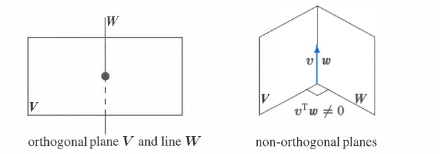

*图 4.1　当 $\dim V+\dim W$ 大于整个空间的维数时，$V$ 与 $W$ 不可能正交。*

线性代数中最重要的例子来自四个基本子空间。零空间与行空间只在零向量处相交；更进一步，它们以 $90^\circ$ 相交。这个事实直接来自 $Ax=0$。

零空间中的每个向量 $x$ 都与 $A$ 的每一行正交，因为

$$
\begin{equation}
A x=
\begin{bmatrix}
\text{第 1 行}\\
\vdots\\
\text{第 }m\text{ 行}
\end{bmatrix}x=
\begin{bmatrix}
(\text{第 1 行})\cdot x\\
\vdots\\
(\text{第 }m\text{ 行})\cdot x
\end{bmatrix}
=0.
\tag{1}
\end{equation}
$$

第一条方程说明第 1 行垂直于 $x$，最后一条方程说明第 $m$ 行垂直于 $x$。因此，每一行与 $x$ 的点积都为零，行的任意线性组合也与 $x$ 垂直。于是整个行空间 $C(A^T)$ 与 $N(A)$ 正交。

也可以用矩阵语言简洁地证明这一点。行空间中的向量可写成 $A^Ty$，而对任意 $x\in N(A)$，

$$
\begin{equation}
(A^Ty)^Tx=y^TAx=0.
\tag{2}
\end{equation}
$$

这说明 $A^Ty$ 与 $x$ 正交。第一个证明直接显示各行与 $x$ 相乘得到零；第二个证明则说明为什么基本定理中必须同时出现 $A$ 与 $A^T$。

**例 3**　设

$$
A=
\begin{bmatrix}
1&3&4\\
5&2&7
\end{bmatrix},
\qquad
x=
\begin{bmatrix}
1\\1\\-1
\end{bmatrix}.
$$

两行与 $x$ 的点积分别为

$$
1+3-4=0,
\qquad
5+2-7=0.
$$

因此 $x\in N(A)$，且它垂直于 $A$ 的每一行。本例中 $C(A)=\mathbb R^2$，而 $N(A^T)$ 只有零向量。一般地，$A$ 的列空间与 $A^T$ 的零空间总是正交的。

> $N(A^T)$ 中的每个向量 $y$ 都与 $A$ 的每一列正交。因此，左零空间 $N(A^T)$ 与列空间 $C(A)$ 是 $\mathbb R^m$ 中的正交子空间。

把刚才关于 $A$ 的证明应用于 $A^T$ 即可：$A^T$ 的零空间与 $A^T$ 的行空间正交，而 $A^T$ 的行空间正是 $A$ 的列空间。也可以直接观察

$$
\begin{equation}
A^Ty=
\begin{bmatrix}
(\text{第 1 列})^T\\
\vdots\\
(\text{第 }n\text{ 列})^T
\end{bmatrix}y
=0.
\tag{3}
\end{equation}
$$

所以 $y$ 与 $A$ 的每一列点积为零，进而垂直于整个列空间。

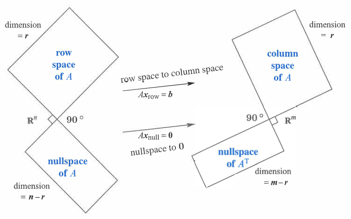

*图 4.2　两对正交子空间。左侧两个空间的维数之和为 $n$，右侧两个空间的维数之和为 $m$。*

### 正交补

四个基本子空间不仅成对正交，它们的维数也恰好填满所在空间。$\mathbb R^3$ 中两条直线可以互相垂直，但它们不可能同时是某个 $3\times3$ 矩阵的行空间和零空间，因为维数 $1+1=2$，没有填满 $3$ 维空间。对基本子空间而言，正确的维数必须是 $r$ 与 $n-r$，其和为 $n$。因此，它们不只是正交子空间，而且互为正交补。

> **定义　正交补**
>
> 子空间 $V$ 的正交补包含所有与 $V$ 中每个向量都垂直的向量，记作 $V^\perp$，读作“$V$ perp”。

按照定义，零空间是行空间的正交补。凡是垂直于全部行的向量 $x$ 都满足 $Ax=0$，因而属于零空间；反过来，零空间中的向量都与每一行垂直。

同样，若 $v$ 与整个零空间正交，那么 $v$ 必须在行空间中。否则可以把 $v$ 作为新的一行加入矩阵，而不改变零空间，却会扩大行空间，这与维数关系 $r+(n-r)=n$ 冲突。因此

$$
N(A)^\perp=C(A^T).
$$

在 $\mathbb R^m$ 中，左零空间和列空间也互为正交补，其维数 $m-r$ 与 $r$ 之和为 $m$。

---

**线性代数基本定理，第二部分**

$$
N(A)=C(A^T)^\perp\quad\text{（在 }\mathbb R^n\text{ 中）},
$$

$$
N(A^T)=C(A)^\perp\quad\text{（在 }\mathbb R^m\text{ 中）}.
$$

第一部分给出四个基本子空间的维数，第二部分给出它们之间的直角关系。

---

“互补”的意义在于，每个 $x\in\mathbb R^n$ 都可以分解为一个行空间分量 $x_r$ 和一个零空间分量 $x_n$：

$$
x=x_r+x_n.
$$

矩阵 $A$ 作用于这个分解时，

$$
Ax=Ax_r+Ax_n=Ax_r,
$$

因为 $Ax_n=0$。零空间分量被送到零，行空间分量被送入列空间；矩阵乘法不可能把向量送到列空间之外。

更进一步，列空间中的每个 $b$ 都恰好来自行空间中的一个向量 $x_r$。若 $Ax_r=Ax_r'$，则 $x_r-x_r'$ 属于零空间；同时它又属于行空间。两个正交子空间的交集只有零向量，所以 $x_r-x_r'=0$，即 $x_r=x_r'$。换句话说，丢掉两个零空间以后，$A$ 从行空间到列空间的作用是可逆的。第 7.4 节的伪逆将把这一部分反演回来。

**例 4**　每个秩为 $r$ 的矩阵都含有一个可逆的 $r\times r$ 子矩阵。例如

$$
A=
\begin{bmatrix}
3&0&0&0&0\\
0&5&0&0&0\\
0&0&0&0&0
\end{bmatrix}
$$

含有由主元行和主元列选出的可逆子矩阵 $\begin{bmatrix}3&0\\0&5\end{bmatrix}$。其余十一个零造成了零空间和左零空间。类似地，秩同为 $2$ 的矩阵

$$
B=
\begin{bmatrix}
1&2&3&4&5\\
1&2&4&5&6\\
1&2&4&5&6
\end{bmatrix}
$$

在主元行与主元列的交叉位置包含可逆子矩阵 $\begin{bmatrix}1&3\\1&4\end{bmatrix}$。选取 $\mathbb R^n$ 与 $\mathbb R^m$ 的适当基后，每个矩阵都能呈现为对角形式。这一思想发展为奇异值分解，它在应用中极其重要。

特别要记住：除零行以外，$A$ 的某一行不可能同时属于 $A$ 的零空间。任何向量若与自身正交，就只能是零向量。

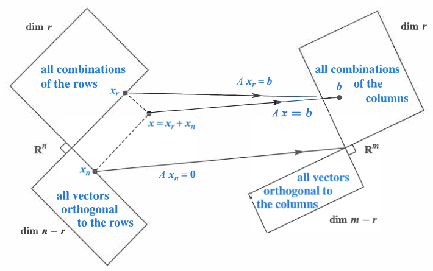

*图 4.3　把 $x=x_r+x_n$ 分解后，行空间分量 $x_r$ 被送入列空间，零空间分量 $x_n$ 被送到零。*

### 怎样画出完整图景

图 4.2 与图 4.3 必须同时表现四个子空间的正交关系。直线与平面的正交尚且容易画出，如图 4.4；但在 $\mathbb R^4$ 中，如何在平面图上画出两个互相正交的二维子空间，就没有同样直观的方法。图中的矩形也只是对子空间的示意；真正的子空间都是无限延伸的。

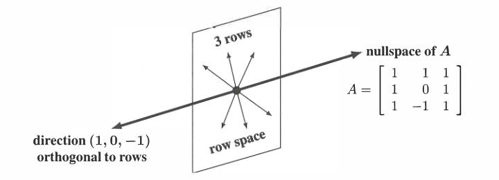

*图 4.4　矩阵 $A=\begin{bmatrix}1&1&1\\1&0&1\\1&-1&1\end{bmatrix}$ 的行空间是一个平面，零空间是方向为 $(1,0,-1)$ 的正交直线。维数满足 $2+1=3$。*

### 合并来自两个子空间的基

一组基既要线性无关，又要张成整个空间。通常这两个条件都要检查；但当向量个数恰好等于空间维数时，只检查其中一个条件就够了：

- $\mathbb R^n$ 中任意 $n$ 个线性无关向量都张成 $\mathbb R^n$，因而构成一组基。
- $\mathbb R^n$ 中任意 $n$ 个张成向量都线性无关，因而构成一组基。

把这些向量放进 $n\times n$ 方阵 $A$ 的列中，便得到等价的说法：若 $A$ 的 $n$ 列线性无关，它们必张成 $\mathbb R^n$，所以 $Ax=b$ 对每个 $b$ 都有解；若这 $n$ 列张成 $\mathbb R^n$，它们必线性无关，所以解是唯一的。对方阵来说，存在性与唯一性相互蕴含，此时 $A$ 可逆。

从消元角度看，没有自由变量意味着有 $n$ 个主元，回代能为任意 $b$ 给出唯一解；反过来，若对每个 $b$ 都有解，消元就不能产生零行，于是有 $n$ 个主元、没有自由变量，零空间只有零向量。

行空间的一组基有 $r$ 个向量，零空间的一组基有 $n-r$ 个向量，合起来正好有 $n$ 个。它们线性无关：若 $x_r+x_n=0$，则 $x_r=-x_n$ 同时位于行空间和零空间中，只能为零。因此这 $n$ 个向量张成 $\mathbb R^n$，每个 $x$ 都能唯一写成 $x_r+x_n$。

**例 5**　设

$$
A=\begin{bmatrix}1&2\\3&6\end{bmatrix},
\qquad
x=\begin{bmatrix}4\\3\end{bmatrix}.
$$

行空间由 $(1,2)^T$ 张成，零空间由 $(2,-1)^T$ 张成。把 $x$ 分解为这两个正交方向上的分量：

$$
x=x_r+x_n
=\begin{bmatrix}2\\4\end{bmatrix}
+\begin{bmatrix}2\\-1\end{bmatrix}.
$$

下一节将用投影对任意 $A$ 和 $x$ 计算这种分解。

### 关键思想回顾

1. 若每个 $v\in V$ 都与每个 $w\in W$ 正交，则子空间 $V$ 与 $W$ 正交。
2. 若 $W$ 包含所有与 $V$ 正交的向量，且反之亦然，则 $V$ 与 $W$ 互为正交补。在 $\mathbb R^n$ 中，正交补的维数之和为 $n$。
3. $N(A)$ 与 $C(A^T)$ 互为正交补，维数为 $(n-r)+r=n$；$N(A^T)$ 与 $C(A)$ 互为正交补，维数为 $(m-r)+r=m$。
4. $\mathbb R^n$ 中任意 $n$ 个线性无关向量都张成 $\mathbb R^n$；任意 $n$ 个张成向量也必线性无关。

### 例题解析

**4.1 A**　设 $S$ 是 $\mathbb R^9$ 中的六维子空间。

1. 与 $S$ 正交的子空间可能有多大维数？
2. $S$ 的正交补 $S^\perp$ 的维数是多少？
3. 以 $S$ 为行空间的矩阵 $A$，最小可能是多少行多少列？
4. 以 $S^\perp$ 为零空间的矩阵 $B$，最小可能是多少行多少列？

**解**

1. 与 $S$ 正交的子空间可以有 $0,1,2,3$ 维。
2. $S^\perp$ 是最大的正交子空间，维数为 $9-6=3$。
3. 最小的 $A$ 是 $6\times9$ 矩阵，它的六行可取为 $S$ 的一组基。
4. 答案与第 3 问相同。若在 $A$ 后添加一个由前六行线性组合得到的新行，所得矩阵 $B$ 的行空间与零空间都不变；消元会把新行变成零行。因此最小规模仍为 $6\times9$。

**4.1 B**　方程

$$
x-3y-4z=0
$$

描述了 $\mathbb R^3$ 中的平面子空间 $P$。

1. $P$ 是矩阵 $A=\begin{bmatrix}1&-3&-4\end{bmatrix}$ 的零空间。
2. 特解 $s_1=(3,1,0)^T$ 与 $s_2=(4,0,1)^T$ 构成 $P$ 的一组基。
3. 与 $P$ 正交的直线 $P^\perp$ 由向量 $(1,-3,-4)^T$ 张成；这个向量正是 $A$ 的行。

## 4.2　投影

本节的核心结论如下。

1. $b$ 在由 $a$ 张成的直线上的投影，是离 $b$ 最近的点
   $$
   p=a\frac{a^Tb}{a^Ta}.
   $$
2. 误差 $e=b-p$ 与 $a$ 正交，直角三角形的三边满足 $\|p\|^2+\|e\|^2=\|b\|^2$。
3. $b$ 在子空间 $S$ 上的投影 $p$ 是 $S$ 中离 $b$ 最近的向量，且 $b-p$ 与 $S$ 正交。
4. 只有当 $A$ 的列线性无关时，$A^TA$ 才可逆；事实上 $N(A^TA)=N(A)$。
5. $b$ 在 $A$ 的列空间上的投影为
   $$
   p=A(A^TA)^{-1}A^Tb.
   $$
6. 投影矩阵为
   $$
   P=A(A^TA)^{-1}A^T,
   $$
   并满足 $p=Pb$、$P^2=P=P^T$。

先从两个直观问题开始。向量 $b=(2,3,4)^T$ 在 $z$ 轴和 $xy$ 平面上的投影分别是什么？又是什么矩阵产生了这两个投影？

投影到一条直线时，$p$ 是 $b$ 沿这条直线的分量；投影到一个平面时，$p$ 是 $b$ 位于平面内的分量。投影矩阵 $P$ 把 $b$ 变为 $p=Pb$。对这里的 $b$，横向投到 $z$ 轴得到

$$
p_1=\begin{bmatrix}0\\0\\4\end{bmatrix},
$$

竖直投到 $xy$ 平面得到

$$
p_2=\begin{bmatrix}2\\3\\0\end{bmatrix}.
$$

相应的投影矩阵是

$$
P_1=
\begin{bmatrix}
0&0&0\\0&0&0\\0&0&1
\end{bmatrix},
\qquad
P_2=
\begin{bmatrix}
1&0&0\\0&1&0\\0&0&0
\end{bmatrix}.
$$

$P_1$ 取出每个向量的 $z$ 分量，秩为 $1$；$P_2$ 取出 $x,y$ 分量，秩为 $2$。

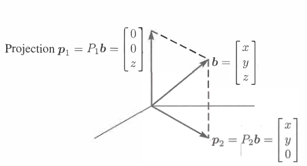

*图 4.5　$p_1=P_1b$ 是 $b$ 在 $z$ 轴上的投影，$p_2=P_2b$ 是 $b$ 在 $xy$ 平面上的投影。*

$z$ 轴与 $xy$ 平面不仅正交，而且互为正交补。每个 $b\in\mathbb R^3$ 都是它在这两个子空间中的分量之和：

$$
\begin{equation}
p_1+p_2=b,
\qquad
P_1+P_2=I.
\tag{1}
\end{equation}
$$

我们的目标是把这个例子推广到任意直线、平面和 $n$ 维子空间：找出 $b$ 在子空间中的分量 $p$，并找出产生它的投影矩阵 $P$。$\mathbb R^m$ 的每个子空间都有自己的 $m\times m$ 投影矩阵。要计算 $P$，首先需要对子空间作出恰当描述，而最好的描述就是一组基。

把基向量放入矩阵 $A$ 的列中，我们要做的就是投影到 $A$ 的列空间。例如，$z$ 轴是

$$
A_1=\begin{bmatrix}0\\0\\1\end{bmatrix}
$$

的列空间，而 $xy$ 平面既是

$$
A_2=
\begin{bmatrix}
1&0\\0&1\\0&0
\end{bmatrix}
$$

的列空间，也是

$$
A_3=
\begin{bmatrix}
1&2\\2&3\\0&0
\end{bmatrix}
$$

的列空间。一个子空间可以有许多组基，所以由 $A_2$ 和 $A_3$ 得到的投影向量及投影矩阵相同。一般问题是：把任意 $b$ 投影到任意 $m\times n$ 矩阵 $A$ 的列空间上。先从 $n=1$ 的直线开始，此时 $A$ 只有一列，记为 $a$。

### 投影到一条直线

设过原点的直线方向为 $a=(a_1,\ldots,a_m)^T$。在这条直线上寻找离 $b=(b_1,\ldots,b_m)^T$ 最近的点 $p$。投影的关键是正交性：从 $b$ 指向 $p$ 的误差向量 $e=b-p$ 必须垂直于 $a$。

投影 $p$ 是 $a$ 的某个倍数，写成 $p=\widehat{x}a$。误差 $e=b-\widehat{x}a$ 与 $a$ 垂直，因此

$$
\begin{equation}
a^T(b-\widehat{x}a)=0,
\qquad
\widehat{x}=\frac{a^Tb}{a^Ta}.
\tag{2}
\end{equation}
$$

于是

$$
p=\widehat{x}a=\frac{a^Tb}{a^Ta}a.
$$

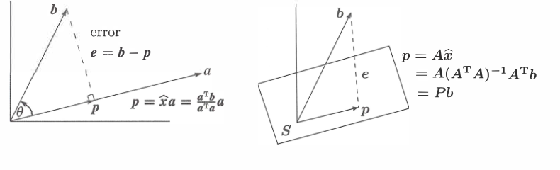

*图 4.6　左：$b$ 在由 $a$ 张成的直线上的投影。右：$b$ 在 $S=C(A)$ 上的投影。两种情形的误差都垂直于投影子空间。*

两个特殊情形很容易检查：若 $b=a$，则 $\widehat{x}=1$，所以 $Pa=a$；若 $b\perp a$，则 $a^Tb=0$，投影为 $p=0$。

**例 1**　把

$$
b=\begin{bmatrix}1\\1\\1\end{bmatrix}
$$

投影到由

$$
a=\begin{bmatrix}1\\2\\2\end{bmatrix}
$$

张成的直线上。由于 $a^Tb=5$、$a^Ta=9$，

$$
\widehat{x}=\frac59,
\qquad
p=\frac59a=
\begin{bmatrix}
5/9\\10/9\\10/9
\end{bmatrix}.
$$

误差为

$$
e=b-p=
\begin{bmatrix}
4/9\\-1/9\\-1/9
\end{bmatrix},
$$

并且 $e^Ta=4/9-2/9-2/9=0$。向量 $b$ 被分成沿直线的分量 $p$ 和垂直分量 $e$，所以

$$
\|b\|^2=\|p\|^2+\|e\|^2.
$$

若 $\theta$ 是 $a$ 与 $b$ 的夹角，则

$$
\begin{equation}
\|p\|=\|b\|\cos\theta.
\tag{3}
\end{equation}
$$

直接使用点积比先计算夹角更简单：本例的 $\cos\theta=5/(3\sqrt3)$、$\|b\|=\sqrt3$，其中出现了平方根，而 $p=5a/9$ 没有。

把 $p$ 的公式写成矩阵乘法，就能读出投影矩阵：

$$
p=a\frac{a^Tb}{a^Ta}=\frac{aa^T}{a^Ta}b=Pb,
\qquad
P=\frac{aa^T}{a^Ta}.
$$

$P$ 是一个列向量乘一个行向量再除以标量，因此是 $m\times m$ 的秩一矩阵。它的列空间正是由 $a$ 张成的直线。

**例 2**　对 $a=(1,2,2)^T$，

$$
P=\frac{aa^T}{a^Ta}
=\frac19
\begin{bmatrix}
1&2&2\\
2&4&4\\
2&4&4
\end{bmatrix}.
$$

对例 1 的 $b=(1,1,1)^T$，确有

$$
Pb=\frac19
\begin{bmatrix}
5\\10\\10
\end{bmatrix}=p.
$$

把 $a$ 加倍并不会改变 $P$，因为投影的仍是同一条直线。并且 $P^2=P$：第一次投影后向量已经在直线上，再投影一次不会改变它。这个 $P$ 的对角线元素之和为 $1$。

矩阵 $I-P$ 也是投影矩阵。它产生三角形的另一条边：

$$
(I-P)b=b-p=e.
$$

因此，当 $P$ 投影到一个子空间时，$I-P$ 投影到其正交补。本例中，$I-P$ 把向量投影到垂直于 $a$ 的平面。

### 投影到一个子空间

设 $a_1,\ldots,a_n\in\mathbb R^m$ 线性无关。要在这些向量张成的子空间中寻找离给定向量 $b$ 最近的线性组合

$$
p=\widehat{x}_1a_1+\cdots+\widehat{x}_na_n=A\widehat{x}.
$$

这里 $A$ 的列就是 $a_1,\ldots,a_n$。与投影到直线相同，我们按三步进行：先求 $\widehat{x}$，再求 $p=A\widehat{x}$，最后求投影矩阵 $P$。

几何是关键。误差 $b-A\widehat{x}$ 必须垂直于整个列空间，因而与每个基向量 $a_i$ 垂直：

$$
\begin{equation}
\begin{aligned}
a_1^T(b-A\widehat{x})&=0,\\
&\vdots\\
a_n^T(b-A\widehat{x})&=0.
\end{aligned}
\tag{4}
\end{equation}
$$

把这些方程合在一起，得到

$$
A^T(b-A\widehat{x})=0,
$$

也就是著名的正规方程

$$
\begin{equation}
A^TA\widehat{x}=A^Tb.
\tag{5}
\end{equation}
$$

当 $A$ 的列线性无关时，$A^TA$ 可逆，因此

$$
\widehat{x}=(A^TA)^{-1}A^Tb.
$$

投影向量为

$$
\begin{equation}
p=A\widehat{x}=A(A^TA)^{-1}A^Tb,
\tag{6}
\end{equation}
$$

所以投影矩阵为

$$
\begin{equation}
P=A(A^TA)^{-1}A^T.
\tag{7}
\end{equation}
$$

当 $n=1$ 时，$A=a$，矩阵 $A^TA$ 退化为标量 $a^Ta$，这些公式正好回到直线投影。区别只是：对标量 $a^Ta$ 做除法，对矩阵 $A^TA$ 则取逆。

正规方程也可以直接由四个基本子空间得到。误差 $e=b-A\widehat{x}$ 垂直于 $C(A)$，因此位于其正交补 $N(A^T)$ 中；于是 $A^Te=0$，即 $A^T(b-A\widehat{x})=0$。投影把 $b$ 分成了列空间中的 $p$ 和左零空间中的 $e$。

**例 3**　设

$$
A=
\begin{bmatrix}
1&0\\
1&1\\
1&2
\end{bmatrix},
\qquad
b=
\begin{bmatrix}
6\\0\\0
\end{bmatrix}.
$$

先计算

$$
A^TA=
\begin{bmatrix}
3&3\\3&5
\end{bmatrix},
\qquad
A^Tb=
\begin{bmatrix}
6\\0
\end{bmatrix}.
$$

正规方程给出

$$
\begin{equation}
\begin{bmatrix}
3&3\\3&5
\end{bmatrix}
\begin{bmatrix}
\widehat{x}_1\\\widehat{x}_2
\end{bmatrix}=
\begin{bmatrix}
6\\0
\end{bmatrix},
\qquad
\widehat{x}=
\begin{bmatrix}
5\\-3
\end{bmatrix}.
\tag{8}
\end{equation}
$$

因此

$$
\begin{equation}
p=A\widehat{x}=
\begin{bmatrix}
5\\2\\-1
\end{bmatrix},
\qquad
e=b-p=
\begin{bmatrix}
1\\-2\\1
\end{bmatrix}.
\tag{9}
\end{equation}
$$

误差 $e$ 与两列 $(1,1,1)^T$、$(0,1,2)^T$ 都正交。另一方面，

$$
(A^TA)^{-1}=\frac16
\begin{bmatrix}
5&-3\\-3&3
\end{bmatrix},
$$

从而

$$
\begin{equation}
P=A(A^TA)^{-1}A^T
=\frac16
\begin{bmatrix}
5&2&-1\\
2&2&2\\
-1&2&5
\end{bmatrix}.
\tag{10}
\end{equation}
$$

这个矩阵满足 $Pb=p$、$P^2=P$。

需要警惕一个看似合理却错误的约分：不能把 $(A^TA)^{-1}$ 拆成 $A^{-1}(A^T)^{-1}$，再把 $A$ 与 $A^{-1}$ 消掉。这里的 $A$ 是矩形矩阵，根本没有逆矩阵。涉及矩形矩阵的问题经常会引出 $A^TA$；只要 $A$ 的列线性无关，$A^TA$ 就可逆。

> **定理**
>
> $A^TA$ 可逆，当且仅当 $A$ 的列线性无关。

**证明**　事实上，对任意矩阵 $A$，$A^TA$ 与 $A$ 有相同的零空间。若 $Ax=0$，左乘 $A^T$ 立即得到 $A^TAx=0$。反过来，若 $A^TAx=0$，左乘 $x^T$ 得

$$
\begin{equation}
x^TA^TAx=(Ax)^T(Ax)=\|Ax\|^2=0.
\tag{11}
\end{equation}
$$

所以 $Ax=0$。因此 $N(A^TA)=N(A)$。$A$ 的列线性无关恰好意味着 $N(A)=\{0\}$，也就意味着方阵 $A^TA$ 可逆。证毕。

$A^TA$ 是 $n\times n$ 方阵，并且

$$
(A^TA)^T=A^TA,
$$

所以它是对称矩阵。若 $A$ 的列相关，$A^TA$ 不可逆；若 $A$ 的列无关，$A^TA$ 对称且可逆。

下面两组计算把差别直接显示出来。第一组中 $A$ 的两列相关，因此 $A^TA$ 也奇异：

$$
\begin{bmatrix}
1&1&0\\2&2&0
\end{bmatrix}
\begin{bmatrix}
1&2\\1&2\\0&0
\end{bmatrix}
=
\begin{bmatrix}
2&4\\4&8
\end{bmatrix}.
$$

第二组中 $A$ 的两列线性无关，因此 $A^TA$ 可逆：

$$
\begin{bmatrix}
1&1&0\\2&2&1
\end{bmatrix}
\begin{bmatrix}
1&2\\1&2\\0&1
\end{bmatrix}
=
\begin{bmatrix}
2&4\\4&9
\end{bmatrix}.
$$

简要总结：为求 $p=\widehat{x}_1a_1+\cdots+\widehat{x}_na_n$，先解 $A^TA\widehat{x}=A^Tb$，再取 $p=A\widehat{x}$ 和 $e=b-p$。投影矩阵 $P=A(A^TA)^{-1}A^T$ 满足 $p=Pb$、$P^2=P$，而 $b$ 到子空间 $C(A)$ 的距离就是 $\|e\|$。

### 关键思想回顾

1. $b$ 在由 $a$ 张成的直线上的投影为 $p=a(a^Tb/a^Ta)$。
2. 秩一投影矩阵 $P=aa^T/(a^Ta)$ 把 $b$ 变成 $p$。
3. 把 $b$ 投影到子空间后，误差 $e=b-p$ 与该子空间正交。
4. 当 $A$ 有 $n$ 个线性无关列时，正规方程 $A^TA\widehat{x}=A^Tb$ 给出 $\widehat{x}$，再由 $p=A\widehat{x}$ 得到投影。
5. 投影矩阵 $P=A(A^TA)^{-1}A^T$ 满足 $P^T=P$、$P^2=P$ 和 $Pb=p$。

### 例题解析

**4.2 A**　先把 $b=(3,4,4)^T$ 投影到由 $a=(2,2,1)^T$ 张成的直线上，再投影到由 $a$ 与 $a^*=(1,0,0)^T$ 张成的平面上。

直线投影为

$$
p=\frac{a^Tb}{a^Ta}a
=\frac{18}{9}(2,2,1)^T
=(4,4,2)^T=2a.
$$

误差 $e=b-p=(-1,0,2)^T$ 与 $a$ 正交。

令

$$
A=\begin{bmatrix}a&a^*\end{bmatrix}
=\begin{bmatrix}
2&1\\2&0\\1&0
\end{bmatrix}.
$$

则

$$
(A^TA)^{-1}=\frac15
\begin{bmatrix}
1&-2\\-2&9
\end{bmatrix},
\qquad
P=A(A^TA)^{-1}A^T=
\begin{bmatrix}
1&0&0\\
0&0.8&0.4\\
0&0.4&0.2
\end{bmatrix}.
$$

于是

$$
p^*=Pb=(3,4.8,2.4)^T,
\qquad
e^*=b-p^*=(0,-0.8,1.6)^T.
$$

$e^*$ 与 $a$、$a^*$ 都正交，并且 $Pe^*=0$。这是因为 $e^*$ 位于所投平面的正交补，也就是 $P$ 的零空间。还可直接验证 $P^2=P=P^T$。

**4.2 B**　某人的脉搏三次测量为 $70,80,120$ 次/分。用常数 $x$ 拟合这些数据，相当于求

$$
A=\begin{bmatrix}1\\1\\1\end{bmatrix},
\qquad
b=\begin{bmatrix}70\\80\\120\end{bmatrix}
$$

对应的最小二乘解。

由微积分，令

$$
E=(x-70)^2+(x-80)^2+(x-120)^2,
$$

则

$$
\frac{dE}{dx}=2(x-70)+2(x-80)+2(x-120)=0,
$$

得到

$$
\widehat{x}=\frac{70+80+120}{3}=90.
$$

由投影公式同样得到

$$
\widehat{x}=\frac{a^Tb}{a^Ta}
=\frac{70+80+120}{3}=90.
$$

所以最接近三次读数的水平线就是它们的平均值。若再加入一次测量 $130$，新平均值为 $100$，也可由更新公式

$$
\widehat{x}_{\rm new}
=\widehat{x}_{\rm old}+\frac14(130-\widehat{x}_{\rm old})
$$

直接得到，无须重新把全部旧数据求和。

## 4.3　最小二乘近似

本节的核心结论如下。

1. 解正规方程 $A^TA\widehat{x}=A^Tb$，就得到 $b$ 在 $C(A)$ 上的投影 $p=A\widehat{x}$。
2. 当 $Ax=b$ 无解时，$\widehat{x}$ 是最小二乘解，它使 $\|b-Ax\|^2$ 达到最小。
3. 对误差函数 $E=\|Ax-b\|^2$ 的各变量求偏导并令其为零，也会得到 $A^TA\widehat{x}=A^Tb$。
4. 用直线拟合点 $(t_1,b_1),\ldots,(t_m,b_m)$ 时，$A$ 的两列是 $(1,\ldots,1)^T$ 和 $(t_1,\ldots,t_m)^T$。
5. 此时
   $$
   A^TA=
   \begin{bmatrix}
   m&\sum t_i\\
   \sum t_i&\sum t_i^2
   \end{bmatrix},
   \qquad
   A^Tb=
   \begin{bmatrix}
   \sum b_i\\
   \sum t_ib_i
   \end{bmatrix}.
   $$

$Ax=b$ 经常无解，通常是因为方程多于未知数，即 $m>n$。此时 $A$ 的列只能张成 $\mathbb R^m$ 中的一个低维子空间；只要测量中带有误差，$b$ 往往就不在这个列空间中。消元会遇到矛盾方程，但实际问题不能因为数据含有噪声就停下来。

我们未必能把误差 $e=b-Ax$ 降为零。若 $e=0$，$x$ 是 $Ax=b$ 的精确解；若 $\|e\|$ 已尽可能小，$\widehat{x}$ 就是最小二乘解。上一节强调投影 $p$，本节强调产生这个投影的 $\widehat{x}$，两者由 $p=A\widehat{x}$ 联系起来。基本方程仍然是

$$
A^TA\widehat{x}=A^Tb.
$$

可以把它非正式地记作：当 $Ax=b$ 无解时，左乘 $A^T$，再解 $A^TA\widehat{x}=A^Tb$。

**例 1　用直线拟合三个点**　求最接近 $(0,6)$、$(1,0)$、$(2,0)$ 的直线。没有一条直线 $b=C+Dt$ 能同时经过这三个点，因为在 $t=0,1,2$ 处需要满足

$$
\begin{aligned}
C+D\cdot0&=6,\\
C+D\cdot1&=0,\\
C+D\cdot2&=0.
\end{aligned}
$$

写成矩阵形式：

$$
\begin{equation}
A=
\begin{bmatrix}
1&0\\
1&1\\
1&2
\end{bmatrix},
\qquad
x=
\begin{bmatrix}
C\\D
\end{bmatrix},
\qquad
b=
\begin{bmatrix}
6\\0\\0
\end{bmatrix}.
\tag{1}
\end{equation}
$$

这个 $3\times2$ 方程组无解，因为 $b$ 不是两列 $(1,1,1)^T$ 与 $(0,1,2)^T$ 的线性组合。上一节的例 3 已经算出 $\widehat{x}=(5,-3)^T$，所以最佳直线是

$$
b=5-3t.
$$

### 使误差最小

怎样使 $e=b-Ax$ 尽可能短？几何、线性代数和微积分会给出同一个答案。

**从几何看。**　所有 $Ax$ 都位于由 $A$ 的两列张成的平面中。平面内离 $b$ 最近的点是投影 $p$，所以最佳选择满足 $A\widehat{x}=p$。最小误差 $e=b-p$ 垂直于两列。由于 $p$ 位于列空间中，三个高度 $p_1,p_2,p_3$ 的确落在同一条直线上。

**从代数看。**　每个 $b$ 都可以分成列空间中的 $p$ 和左零空间中的 $e$：

$$
b=p+e.
$$

原方程 $Ax=b$ 无解，但去掉不可避免的 $e$ 后，$Ax=p$ 可解。对任意 $x$，$Ax-p$ 位于列空间，$e$ 位于左零空间，两者正交。因此

$$
\begin{equation}
\|Ax-b\|^2=\|Ax-p\|^2+\|e\|^2.
\tag{2}
\end{equation}
$$

选择 $x=\widehat{x}$ 使 $Ax-p=0$，就留下最小可能误差 $\|e\|$。所以

$$
\widehat{x}\text{ 使 }E=\|A x-b\|^2\text{ 达到最小。}
$$

例 1 的最佳直线在三处的高度为 $p=(5,2,-1)^T$，相应误差为 $e=(1,-2,1)^T$。这些误差是数据点到直线的竖直距离，最小二乘法使 $e_1^2+e_2^2+e_3^2$ 最小。

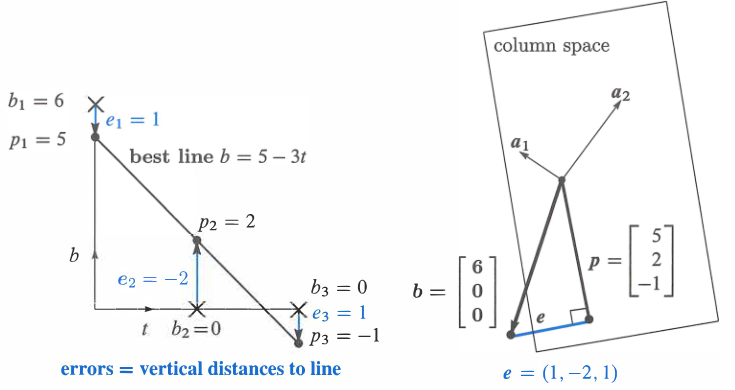

*图 4.6　左图在数据平面中画出最佳直线 $b=5-3t$；右图在 $\mathbb R^3$ 中把 $b$ 投影到 $C(A)$。两图描述同一个问题。*

误差 $1,-2,1$ 的和为零，因为 $e$ 与 $A$ 的第一列 $(1,1,1)^T$ 正交：

$$
e_1+e_2+e_3=0.
$$

**从微积分看。**　要最小化的误差函数是

$$
\begin{equation}
E=\|Ax-b\|^2
=(C+D\cdot0-6)^2+(C+D\cdot1)^2+(C+D\cdot2)^2.
\tag{3}
\end{equation}
$$

分别对 $C$ 和 $D$ 求偏导并令其为零：

$$
\frac{\partial E}{\partial C}
=2(C+D\cdot0-6)+2(C+D\cdot1)+2(C+D\cdot2)=0,
$$

$$
\frac{\partial E}{\partial D}
=2(C+D\cdot0-6)(0)+2(C+D\cdot1)(1)+2(C+D\cdot2)(2)=0.
$$

第二个导数中的额外因子 $0,1,2$ 来自链式法则，它们正是 $A$ 的第二列；第一个导数中的因子 $1,1,1$ 则是 $A$ 的第一列。约去 $2$ 并整理，得到

$$
\begin{equation}
\begin{aligned}
3C+3D&=6,\\
3C+5D&=0,
\end{aligned}
\qquad
\begin{bmatrix}
3&3\\3&5
\end{bmatrix}=A^TA.
\tag{4}
\end{equation}
$$

这正是正规方程 $A^TA\widehat{x}=A^Tb$。解为 $C=5,D=-3$，与几何和代数所得完全相同。

> **最小二乘的关键方程**
>
> 当 $A^TA\widehat{x}=A^Tb$ 时，$\|Ax-b\|^2$ 对各未知量的偏导数都为零，误差达到最小。

### 最小二乘的完整图景

在图 4.3 中，左侧的 $x$ 被分成 $x_r+x_n$，并且方程 $Ax=b$ 有许多解。本节的情形正好相反：$Ax=b$ 没有解，因此我们不分解 $x$，而是把 $b$ 分解为 $p+e$。我们用可解的 $A\widehat{x}=p$ 代替不可解的 $Ax=b$，而误差 $e=b-p$ 无法避免。

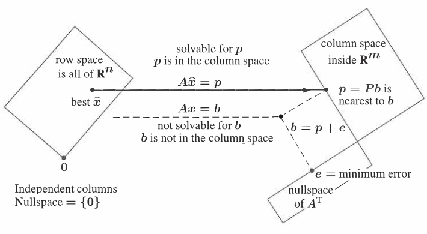

*图 4.7　投影 $p=A\widehat{x}$ 是列空间中离 $b$ 最近的点，因此 $\widehat{x}$ 使 $E=\|b-Ax\|^2$ 最小。*

当 $A$ 的列线性无关时，$N(A)=\{0\}$，所以 $A^TA$ 可逆，正规方程唯一确定 $\widehat{x}$。误差满足 $A^Te=0$，也就是 $e\in N(A^T)$。第 7 章会给出包含全部四个子空间的图景：每个 $x$ 分解为 $x_r+x_n$，每个 $b$ 分解为 $p+e$；最佳解取行空间中的 $x_r$，舍去不影响 $Ax$ 的零空间分量 $x_n$。

### 拟合一条直线

设 $m>2$ 个测量点在时刻 $t_1,\ldots,t_m$ 的高度为 $b_1,\ldots,b_m$。最佳直线 $C+Dt$ 一般不会准确经过所有点，它在各点的竖直误差为 $e_1,\ldots,e_m$，最小二乘直线使

$$
E=e_1^2+\cdots+e_m^2
$$

最小。

若要精确经过全部点，必须解

$$
\begin{aligned}
C+Dt_1&=b_1,\\
C+Dt_2&=b_2,\\
&\vdots\\
C+Dt_m&=b_m,
\end{aligned}
$$

即

$$
\begin{equation}
A x=b,
\qquad
A=
\begin{bmatrix}
1&t_1\\
1&t_2\\
\vdots&\vdots\\
1&t_m
\end{bmatrix},
\qquad
x=\begin{bmatrix}C\\D\end{bmatrix}.
\tag{5}
\end{equation}
$$

只有两个未知量却有 $m$ 条方程，因而通常无解。若 $b$ 偶然位于 $C(A)$ 中，所有点便恰好共线，$p=b$ 且 $e=0$。一般情况下则解正规方程。

点积矩阵为

$$
\begin{equation}
A^TA=
\begin{bmatrix}
m&\sum t_i\\
\sum t_i&\sum t_i^2
\end{bmatrix},
\tag{6}
\end{equation}
$$

右端为

$$
\begin{equation}
A^Tb=
\begin{bmatrix}
\sum b_i\\
\sum t_ib_i
\end{bmatrix}.
\tag{7}
\end{equation}
$$

因此最佳直线的 $C,D$ 由

$$
\begin{equation}
\begin{bmatrix}
m&\sum t_i\\
\sum t_i&\sum t_i^2
\end{bmatrix}
\begin{bmatrix}C\\D\end{bmatrix}=
\begin{bmatrix}
\sum b_i\\
\sum t_ib_i
\end{bmatrix}
\tag{8}
\end{equation}
$$

给出。残差 $e=b-A\widehat{x}$ 与 $A$ 的两列正交，满足 $A^Te=0$。从微积分看，同一组方程来自对

$$
E(C,D)=\sum_{i=1}^m(C+Dt_i-b_i)^2
$$

分别求 $\partial E/\partial C=0$ 与 $\partial E/\partial D=0$。

**例 2　把时间移到平均值附近**　在 $t=-2,0,2$ 时测得 $b=1,2,4$。因为时间之和为零，$A$ 的两列 $(1,1,1)^T$ 与 $(-2,0,2)^T$ 正交：

$$
\begin{equation}
A=
\begin{bmatrix}
1&-2\\
1&0\\
1&2
\end{bmatrix},
\qquad
A^TA=
\begin{bmatrix}
3&0\\0&8
\end{bmatrix},
\qquad
A^Tb=
\begin{bmatrix}
7\\6
\end{bmatrix}.
\tag{9}
\end{equation}
$$

因此两个未知量彼此解耦：

$$
C=\frac73,
\qquad
D=\frac34.
$$

$A^TA$ 中的非对角元是 $A$ 两列的点积；列正交使它们为零，所以对角矩阵几乎与单位矩阵同样容易处理。

为获得正交列，可以从各个原始时刻中减去平均时刻 $\bar t$。例如原始时刻为 $1,3,5$，则 $\bar t=3$，新变量 $T=t-\bar t$ 取值 $-2,0,2$，它们的和为零。最佳直线写成

$$
C+DT=C+D(t-\bar t).
$$

这正预示了下一节的 Gram–Schmidt 思想：先把列变成正交向量，使 $A^TA$ 成为对角矩阵，计算便会显著简化。

### 当 $A$ 的列相关时，怎样选择 $\widehat{x}$

此前一直假设 $A$ 的列线性无关。若列相关，$A^TA$ 不可逆，投影 $p$ 仍然唯一，但产生 $p$ 的 $x$ 不再唯一。例如

$$
A=
\begin{bmatrix}
1&1\\
1&1
\end{bmatrix},
\qquad
b=\begin{bmatrix}3\\1\end{bmatrix}.
$$

两次测量发生在同一时刻，一条直线不可能同时经过高度 $3$ 和 $1$。把 $b$ 投影到 $C(A)$ 得

$$
p=\begin{bmatrix}2\\2\end{bmatrix}.
$$

原来无解的 $Ax=b$ 变成了有无穷多解的 $Ax=p$，因为 $(1,-1)^T\in N(A)$。所有相应直线在该时刻都有同样的两个最小误差 $1$ 和 $-1$，但误差本身不能决定选哪一条直线。

第 7.4 节的伪逆会从 $Ax=p$ 的全部解中选择长度最短的一个。这里它选择

$$
x^+=(1,1)^T,
$$

其长度为 $\sqrt2$，比 $(2,0)^T$ 和 $(0,2)^T$ 的长度 $2$ 更短。这个选择等价于令解的零空间分量为零。当 $A$ 的列线性无关时，零空间只有零向量，伪逆就退化为通常的左逆 $(A^TA)^{-1}A^T$。

数值软件处理奇异或几乎奇异的矩阵时，可能出现 `Inf`、`NaN` 或约为 $10^{16}$ 的巨大数，并伴随警告。它们分别对应 $0x=b$、$0x=0$ 和 $10^{-16}x=1$ 这类困难：无解、多解以及极度接近奇异。

### 用抛物线拟合

抛出的球不适合用直线拟合。抛物线

$$
b=C+Dt+Et^2
$$

允许物体先上升后下降。虽然 $t^2$ 是时间的非线性函数，但未知系数 $C,D,E$ 仍然线性出现，所以这依然是线性代数问题。

在时刻 $t_1,\ldots,t_m$ 测得高度 $b_1,\ldots,b_m$。若要求抛物线精确经过全部点，要解

$$
\begin{equation}
A x=b,
\qquad
A=
\begin{bmatrix}
1&t_1&t_1^2\\
1&t_2&t_2^2\\
\vdots&\vdots&\vdots\\
1&t_m&t_m^2
\end{bmatrix},
\qquad
x=\begin{bmatrix}C\\D\\E\end{bmatrix}.
\tag{10}
\end{equation}
$$

当 $m>3$ 时，这 $m$ 条方程一般无解。最接近数据的抛物线由三个正规方程

$$
A^TA\widehat{x}=A^Tb
$$

确定。列空间维数通常为 $3$；投影 $p=A\widehat{x}$ 是三列的线性组合；第 $i$ 个误差是 $e_i=b_i-C-Dt_i-Et_i^2$，总平方误差是 $\sum e_i^2$。对 $C,D,E$ 求三个偏导并令其为零，会再次得到同一组正规方程。

**例 3**　求经过 $t=0,1,2$ 时高度 $b=6,0,0$ 的抛物线。方程为

$$
\begin{equation}
\begin{aligned}
C+D\cdot0+E\cdot0^2&=6,\\
C+D\cdot1+E\cdot1^2&=0,\\
C+D\cdot2+E\cdot2^2&=0.
\end{aligned}
\tag{11}
\end{equation}
$$

这是含三个未知量的三条方程，可以精确求解：

$$
(C,D,E)=(6,-9,3).
$$

所以抛物线为

$$
b=6-9t+3t^2.
$$

此时 $A$ 的三列张成整个 $\mathbb R^3$，投影矩阵就是 $I$，故 $p=b$、$e=0$。既然 $Ax=b$ 可以直接求解，就没有必要先乘 $A^T$。

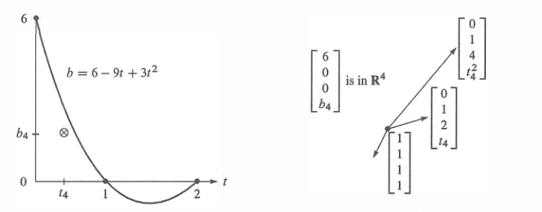

*图 4.8　在 $t=0,1,2$ 处精确拟合意味着 $p=b$、$e=0$。若加入不在该抛物线上的第四个点，则 $m>n$，需要把 $b$ 投影到 $C(A)$。*

若第四个点恰好也在抛物线上，新的四条方程仍可解；否则就必须转向 $A^TA\widehat{x}=A^Tb$。最小二乘法会在四个误差之间取得平衡，而不会简单地把全部误差都留给第四个点。

### 关键思想回顾

1. 最小二乘解 $\widehat{x}$ 使
   $$
   \|Ax-b\|^2=x^TA^TAx-2x^TA^Tb+b^Tb
   $$
   达到最小。这是 $m$ 条方程误差平方之和。
2. 最佳 $\widehat{x}$ 来自正规方程 $A^TA\widehat{x}=A^Tb$。
3. 用直线 $b=C+Dt$ 拟合 $m$ 个点时，正规方程给出 $C$ 与 $D$。
4. 最佳直线的高度组成 $p=(p_1,\ldots,p_m)^T$；数据点到直线的竖直误差组成 $e=(e_1,\ldots,e_m)^T$，并满足 $A^Te=0$。
5. 用 $n<m$ 个函数的线性组合拟合 $m$ 个点时，$Ax=b$ 通常无解；正规方程给出均方误差最小的组合。

### 例题解析

**4.3 A　离群值对不同误差准则的影响**　前九次测量全为零，第十次测量 $b_{10}=40$。用水平线 $y=C$ 拟合这十个点。

1. 最小二乘误差 $E_2=e_1^2+\cdots+e_{10}^2$ 给出平均值。这里 $A$ 是全 $1$ 列向量，$A^TA=10$、$A^Tb=40$，所以 $10C=40$，即 $C=4$。
2. 最小最大误差 $E_\infty=\max|e_i|$ 要求 $C$ 位于 $0$ 与 $40$ 的中点，因此 $C=20$。
3. 最小绝对误差和 $E_1=|e_1|+\cdots+|e_{10}|$ 给出中位数，因此 $C=0$。若从零向上移动，$9|C|+|40-C|$ 只会增加。

最小二乘对离群值较敏感，因此统计中有时更偏好绝对误差和，但后者产生的是非线性方程。

若改用直线 $C+Dt$ 拟合从 $(1,0)$ 到 $(9,0)$ 以及 $(10,40)$ 的十个点，则

$$
A^TA=
\begin{bmatrix}
10&55\\55&385
\end{bmatrix},
$$

正规方程给出

$$
C=-8,
\qquad
D=\frac{24}{11}.
$$

最小二乘解依赖于 $b$ 是线性的：把所有测量乘以 $3$，$C,D$ 也乘以 $3$；再给所有测量加 $30$，只会给截距 $C$ 加 $30$。

**4.3 B　用抛物线拟合五个点**　在 $t=-2,-1,0,1,2$ 时，数据为 $b=(0,0,1,0,0)^T$。矩阵为

$$
A=
\begin{bmatrix}
1&-2&4\\
1&-1&1\\
1&0&0\\
1&1&1\\
1&2&4
\end{bmatrix}.
$$

由于时间关于零对称，第二列与第一、第三列都正交。因此

$$
A^TA=
\begin{bmatrix}
5&0&10\\
0&10&0\\
10&0&34
\end{bmatrix},
\qquad
A^Tb=
\begin{bmatrix}
1\\0\\0
\end{bmatrix}.
$$

$D$ 与 $C,E$ 解耦，正规方程给出

$$
C=\frac{34}{70},
\qquad
D=0,
\qquad
E=-\frac{10}{70}.
$$

$D=0$ 也符合对称性：最佳抛物线应关于 $t=0$ 对称。

## 4.4　标准正交基与 Gram–Schmidt 过程

本节有两个目标：先说明正交性为什么有用，再说明怎样构造正交向量。若列向量两两正交，$A^TA$ 就是对角矩阵，求 $\widehat{x}$ 和 $p=A\widehat{x}$ 会非常简单。Gram–Schmidt 过程则从原来不正交的基向量出发，通过减去投影构造出彼此正交的向量。

第 3 章中，基由一组线性无关并张成空间的向量组成。基向量可以以任意非零、非 $180^\circ$ 的夹角相交，但我们想象坐标轴时几乎总把它们画成互相垂直，因为这既简化图形，也简化计算。

向量 $q_1,\ldots,q_n$ 在 $i\ne j$ 时满足 $q_i^Tq_j=0$，就称它们正交。再把每个向量除以自身长度，使 $\|q_i\|=1$，便得到标准正交向量。

> **定义　标准正交向量组**
>
> 若
> $$
> q_i^Tq_j=
> \begin{cases}
> 0,&i\ne j,\\
> 1,&i=j,
> \end{cases}
> $$
> 则向量 $q_1,\ldots,q_n$ 是标准正交的。把它们作为列组成的矩阵通常记为 $Q$。

矩阵 $Q$ 不必是方阵。只要它的列标准正交，就有

$$
\begin{equation}
Q^TQ=
\begin{bmatrix}
q_1^T\\q_2^T\\\vdots\\q_n^T
\end{bmatrix}
\begin{bmatrix}
q_1&q_2&\cdots&q_n
\end{bmatrix}
=I.
\tag{1}
\end{equation}
$$

第 $i$ 行与第 $j$ 列的乘积是 $q_i^Tq_j$。非对角位置因正交而为零，对角位置因 $\|q_i\|=1$ 而为一。常见情形是 $Q$ 为 $m\times n$ 矩形矩阵且 $m>n$；有时也有 $m=n$。

若 $Q$ 为方阵，则 $Q^TQ=I$ 意味着

$$
Q^T=Q^{-1}.
$$

此时 $QQ^T=I$ 也成立，$Q$ 的行与列一样是标准正交的。这样的方阵称为**正交矩阵**。若列仅仅正交但未归一化，$Q^TQ$ 仍为对角矩阵，只是对角元不全为 $1$；这种情形也已经非常容易计算。

“标准正交矩阵”也许是更贴切的名称，但惯例并不这样称呼：任何具有标准正交列的矩阵都可以记为 $Q$，只有当 $Q$ 是方阵时，才称它为正交矩阵。

**例 1　旋转矩阵**　矩阵

$$
Q=
\begin{bmatrix}
\cos\theta&-\sin\theta\\
\sin\theta&\cos\theta
\end{bmatrix}
$$

把平面中的每个向量旋转角度 $\theta$。它的逆矩阵与转置矩阵都是

$$
Q^T=Q^{-1}=
\begin{bmatrix}
\cos\theta&\sin\theta\\
-\sin\theta&\cos\theta
\end{bmatrix}.
$$

两列点积为零，且由 $\sin^2\theta+\cos^2\theta=1$ 可知它们都是单位向量。因此两列构成 $\mathbb R^2$ 的一组标准正交基。$Q^{-1}$ 把向量反向旋转 $-\theta$，与 $Q^T$ 相同。

**例 2　置换矩阵**　下列矩阵分别把 $(x,y,z)$ 改排成 $(y,z,x)$，把 $(x,y)$ 改排成 $(y,x)$：

$$
\begin{bmatrix}
0&1&0\\
0&0&1\\
1&0&0
\end{bmatrix}
\begin{bmatrix}x\\y\\z\end{bmatrix}=
\begin{bmatrix}y\\z\\x\end{bmatrix},
\qquad
\begin{bmatrix}
0&1\\1&0
\end{bmatrix}
\begin{bmatrix}x\\y\end{bmatrix}=
\begin{bmatrix}y\\x\end{bmatrix}.
$$

这些矩阵的列都是单位向量，并且 $1$ 出现在不同位置，所以各列互相正交。每个置换矩阵都是正交矩阵，其逆等于转置；逆矩阵把分量恢复到原来的顺序。

**例 3　反射矩阵**　若 $u$ 是任意单位向量，令

$$
Q=I-2uu^T.
$$

注意 $uu^T$ 是矩阵，而 $u^Tu=\|u\|^2=1$ 是一个数。于是

$$
\begin{equation}
Q^T=I-2uu^T=Q,
\qquad
Q^TQ=I-4uu^T+4uu^Tuu^T=I.
\tag{2}
\end{equation}
$$

所以反射矩阵既对称又正交，并且 $Q^2=I$：连续反射两次会回到原向量。

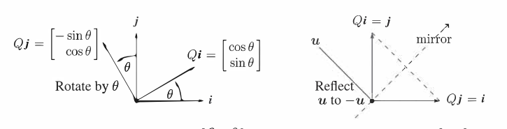

*图 4.10　左：旋转矩阵 $Q=\begin{bmatrix}c&-s\\s&c\end{bmatrix}$。右：关于 $45^\circ$ 直线反射的矩阵 $Q=\begin{bmatrix}0&1\\1&0\end{bmatrix}$。*

例如取

$$
u=\frac1{\sqrt2}\begin{bmatrix}-1\\1\end{bmatrix},
$$

则

$$
Q=I-2uu^T
=I-2
\begin{bmatrix}
1/2&-1/2\\-1/2&1/2
\end{bmatrix}=
\begin{bmatrix}
0&1\\1&0
\end{bmatrix}.
$$

它把 $(x,y)$ 变成 $(y,x)$。镜面直线上的向量如 $(3,3)$ 保持不动。

旋转、反射和置换都保持向量长度，事实上任意具有标准正交列的 $Q$ 都满足

$$
\|Qx\|^2=(Qx)^T(Qx)=x^TQ^TQx=x^Tx=\|x\|^2.
$$

因此

$$
\begin{equation}
\|Qx\|=\|x\|\qquad\text{对每个 }x.
\tag{3}
\end{equation}
$$

同理，$Q$ 也保持点积和夹角：

$$
(Qx)^T(Qy)=x^TQ^TQy=x^Ty.
$$

### 用标准正交基作投影：以 $Q$ 代替 $A$

正交矩阵很适合数值计算，因为它不改变向量长度，数值不会因乘以 $Q$ 而任意增大。稳定的计算程序会尽可能使用 $Q$。

投影公式都涉及 $A^TA$，其元素是基向量之间的点积 $a_i^Ta_j$。若基向量本来就是标准正交的，$A$ 变成 $Q$，而 $A^TA$ 简化为 $Q^TQ=I$。因此

$$
\begin{equation}
\widehat{x}=Q^Tb,
\qquad
p=Q\widehat{x},
\qquad
P=QQ^T.
\tag{4}
\end{equation}
$$

不再需要求任何逆矩阵。$\widehat{x}=Q^Tb$ 的各分量只是 $q_1,\ldots,q_n$ 与 $b$ 的点积，而投影是这些一维投影之和：

$$
\begin{equation}
p=QQ^Tb
=q_1(q_1^Tb)+\cdots+q_n(q_n^Tb).
\tag{5}
\end{equation}
$$

若 $Q$ 是 $n\times n$ 方阵，列空间就是整个空间。此时 $Q^T=Q^{-1}$，所以 $\widehat{x}=Q^Tb$ 是 $Qx=b$ 的精确解；投影到整个空间仍是 $b$ 本身，即 $p=b$、$P=QQ^T=I$。于是每个 $b$ 都能按标准正交基分解为

$$
\begin{equation}
b=q_1(q_1^Tb)+q_2(q_2^Tb)+\cdots+q_n(q_n^Tb).
\tag{6}
\end{equation}
$$

恒等式 $QQ^T=I$ 是傅里叶级数以及应用数学中各种“变换”的基础：先把向量 $b$ 或函数 $f(x)$ 分解为互相垂直的分量，再把这些分量相加，由逆变换重建原对象。

**例 4**　正交矩阵

$$
Q=\frac13
\begin{bmatrix}
-1&2&2\\
2&-1&2\\
2&2&-1
\end{bmatrix}
$$

满足 $Q^TQ=QQ^T=I$。把 $b=(0,0,1)^T$ 分别投影到三列 $q_1,q_2,q_3$ 上，得到

$$
p_1=q_1(q_1^Tb)=\frac23q_1,
\qquad
p_2=q_2(q_2^Tb)=\frac23q_2,
\qquad
p_3=q_3(q_3^Tb)=-\frac13q_3.
$$

前两个投影之和是 $b$ 在 $q_1,q_2$ 所张平面上的投影；三个投影之和则重建 $b$：

$$
\begin{aligned}
b=p_1+p_2+p_3
&=\frac23q_1+\frac23q_2-\frac13q_3\\
&=\frac19
\begin{bmatrix}
-2+4-2\\
4-2-2\\
4+4+1
\end{bmatrix}
=\begin{bmatrix}0\\0\\1\end{bmatrix}.
\end{aligned}
$$

### Gram–Schmidt 过程

“正交是好事”，但原始基向量通常并不正交。Gram–Schmidt 过程从三个线性无关向量 $a,b,c$ 出发，构造三个正交向量 $A,B,C$，然后用各自长度归一化：

$$
q_1=\frac{A}{\|A\|},
\qquad
q_2=\frac{B}{\|B\|},
\qquad
q_3=\frac{C}{\|C\|}.
$$

先取 $A=a$。第二个方向 $B$ 必须垂直于 $A$，所以从 $b$ 中减去它在 $A$ 方向上的投影：

$$
\begin{equation}
B=b-\frac{A^Tb}{A^TA}A.
\tag{7}
\end{equation}
$$

左乘 $A^T$ 可验证 $A^TB=A^Tb-A^Tb=0$。$B$ 正是投影问题中的误差向量，并且不会为零，否则 $a,b$ 就线性相关。

第三个向量 $c$ 一般不垂直于 $A,B$。从它减去在这两个已确定方向上的投影，得到

$$
\begin{equation}
C=c-\frac{A^Tc}{A^TA}A-\frac{B^Tc}{B^TB}B.
\tag{8}
\end{equation}
$$

这就是整个过程唯一的思想：从每个新向量中减去它沿所有已确定方向的投影。若还有第四个向量 $d$，就从中减去沿 $A,B,C$ 的三个投影以得到 $D$。

从历史名称看，作者认为这个核心想法大概来自 Gram，但并不确定 Schmidt 在其中具体加入了什么。

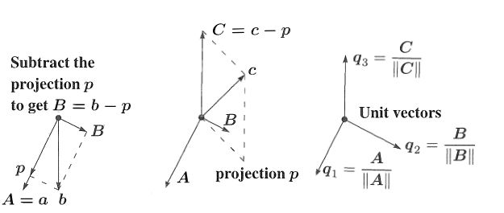

*图 4.11　先把 $b$ 投影到由 $a$ 张成的直线上，以 $B=b-p$ 得到正交方向；再把 $c$ 投影到 $AB$ 平面，以 $C=c-p$ 得到第三个正交方向；最后分别除以长度。*

向量 $A,B,C,D$ 可以在全部构造完以后统一归一化，也可以每求得一个就立刻归一化，得到标准正交向量 $q_1,q_2,q_3,q_4$。

**Gram–Schmidt 示例**　从线性无关但不正交的向量

$$
a=\begin{bmatrix}1\\-1\\0\end{bmatrix},
\qquad
b=\begin{bmatrix}2\\0\\-2\end{bmatrix},
\qquad
c=\begin{bmatrix}3\\-3\\3\end{bmatrix}
$$

出发。先取 $A=a$，有 $A^TA=2$、$A^Tb=2$。因此

$$
B=b-\frac{A^Tb}{A^TA}A
=b-\frac22A
=\begin{bmatrix}1\\1\\-2\end{bmatrix}.
$$

确有 $A^TB=0$。接着从 $c$ 中减去沿 $A$ 与 $B$ 的投影：

$$
C=c-\frac{A^Tc}{A^TA}A-\frac{B^Tc}{B^TB}B
=c-\frac62A+\frac66B
=\begin{bmatrix}1\\1\\1\end{bmatrix}.
$$

$C$ 与 $A,B$ 都垂直。三个向量的长度分别为 $\sqrt2,\sqrt6,\sqrt3$，所以标准正交基为

$$
q_1=\frac1{\sqrt2}\begin{bmatrix}1\\-1\\0\end{bmatrix},
\qquad
q_2=\frac1{\sqrt6}\begin{bmatrix}1\\1\\-2\end{bmatrix},
\qquad
q_3=\frac1{\sqrt3}\begin{bmatrix}1\\1\\1\end{bmatrix}.
$$

未归一化的 $A,B,C$ 有时含分数，而归一化后的 $q_i$ 几乎总会含平方根。

### 分解 $A=QR$

开始时矩阵 $A$ 的列是 $a,b,c$，结束时矩阵 $Q$ 的列是 $q_1,q_2,q_3$。由于两组向量张成同一个子空间，它们之间存在一个连接矩阵。这个矩阵就是 $A=QR$ 中的上三角矩阵 $R$。

第一步 $q_1=a/\|a\|$ 只涉及 $a$。第二步只在 $a,b$ 所张平面中构造 $q_1,q_2$，还不涉及 $c$。一般地：

- $a,A,q_1$ 都在同一条直线上；
- $a,b$，$A,B$，以及 $q_1,q_2$ 都在同一平面中；
- $a,b,c$，$A,B,C$，以及 $q_1,q_2,q_3$ 都在同一个三维子空间中。

在第 $k$ 步，$a_1,\ldots,a_k$ 只是 $q_1,\ldots,q_k$ 的线性组合，不会用到后面的 $q$。因此连接矩阵 $R$ 是上三角的：

$$
\begin{equation}
\begin{bmatrix}a&b&c\end{bmatrix}=
\begin{bmatrix}q_1&q_2&q_3\end{bmatrix}
\begin{bmatrix}
q_1^Ta&q_1^Tb&q_1^Tc\\
0&q_2^Tb&q_2^Tc\\
0&0&q_3^Tc
\end{bmatrix},
\qquad
A=QR.
\tag{9}
\end{equation}
$$

左乘 $Q^T$ 得 $R=Q^TA$。后面的 $q_i$ 与前面的 $a_j$ 正交，所以 $i>j$ 时 $q_i^Ta_j=0$，这正是 $R$ 下三角部分为零的原因。

在刚才的例子中，

$$
A=
\begin{bmatrix}
1&2&3\\
-1&0&-3\\
0&-2&3
\end{bmatrix}=
\begin{bmatrix}
1/\sqrt2&1/\sqrt6&1/\sqrt3\\
-1/\sqrt2&1/\sqrt6&1/\sqrt3\\
0&-2/\sqrt6&1/\sqrt3
\end{bmatrix}
\begin{bmatrix}
\sqrt2&\sqrt2&\sqrt{18}\\
0&\sqrt6&-\sqrt6\\
0&0&\sqrt3
\end{bmatrix}
=QR.
$$

$R$ 的对角元 $\sqrt2,\sqrt6,\sqrt3$ 正是 $A,B,C$ 的长度。任意列线性无关的 $m\times n$ 矩阵都能分解为 $A=QR$，其中 $Q$ 为具有标准正交列的 $m\times n$ 矩阵，$R$ 为对角元为正的 $n\times n$ 上三角矩阵。

这个分解对最小二乘尤其有用：

$$
A^TA=(QR)^TQR=R^TQ^TQR=R^TR.
$$

正规方程于是化为

$$
\begin{equation}
R^TR\widehat{x}=R^TQ^Tb,
\qquad
R\widehat{x}=Q^Tb,
\qquad
\widehat{x}=R^{-1}Q^Tb.
\tag{10}
\end{equation}
$$

不必直接求解无解的 $Ax=b$，而是通过回代快速求解上三角方程 $R\widehat{x}=Q^Tb$。主要计算量在构造 $Q,R$ 的 Gram–Schmidt 过程中，约需 $mn^2$ 次乘法。

### 修正 Gram–Schmidt 算法

逐列处理 $A$。对第 $j$ 列，先令 $v=a_j$；依次减去它在已经确定的 $q_1,\ldots,q_{j-1}$ 上的投影，再把剩余向量归一化：

$$
\begin{equation}
r_{ij}=q_i^Tv,
\qquad
v\leftarrow v-r_{ij}q_i,
\qquad
r_{jj}=\|v\|,
\qquad
q_j=\frac{v}{r_{jj}}.
\tag{11}
\end{equation}
$$

这对应如下伪代码：

```text
for j = 1:n
    v = A(:,j)
    for i = 1:j-1
        R(i,j) = Q(:,i)' * v
        v = v - R(i,j) * Q(:,i)
    end
    R(j,j) = norm(v)
    Q(:,j) = v / R(j,j)
end
```

例如从 $a,b,c=a_1,a_2,a_3$ 出发，算法依次完成

$$
q_1=\frac{a_1}{\|a_1\|},
\qquad
B=a_2-(q_1^Ta_2)q_1,
\qquad
q_2=\frac{B}{\|B\|},
$$

再计算

$$
C^*=a_3-(q_1^Ta_3)q_1,
\qquad
C=C^*-(q_2^TC^*)q_2,
\qquad
q_3=\frac{C}{\|C\|}.
$$

它一次减去一个投影，称为**修正 Gram–Schmidt**。数值上，这通常比式 (8) 一次减去全部投影更稳定。

要恢复 $A$ 的第 $j$ 列，只需撤销归一化和各次投影：

$$
\begin{equation}
r_{jj}q_j=a_j-\sum_{i=1}^{j-1}r_{ij}q_i.
\tag{12}
\end{equation}
$$

把求和项移到左边，正好得到矩阵乘法 $QR=A$ 的第 $j$ 列。

实际的高质量数值软件通常不会直接使用上述 Gram–Schmidt 代码，而会用 Householder 反射逐列把 $A$ 化成上三角矩阵 $R$，方式类似消元得到 $U$。第 11 章将讨论反射矩阵 $I-2uu^T$。若 $A$ 为三对角矩阵，还可以用 $2\times2$ 旋转进一步简化。不论具体算法如何，结果仍是 $A=QR$；MATLAB、Julia 与 Python 数值库都提供相应的 QR 分解。Gram–Schmidt 仍是理解正交化思想最清楚的过程。

### 关键思想回顾

1. 若标准正交向量 $q_1,\ldots,q_n$ 是 $Q$ 的列，则 $q_i^Tq_j=0$、$q_i^Tq_i=1$ 合起来就是 $Q^TQ=I$。
2. 若 $Q$ 是方阵，即正交矩阵，则 $Q^T=Q^{-1}$。
3. $Q$ 保持向量长度：$\|Qx\|=\|x\|$。
4. 到 $C(Q)$ 的投影矩阵为 $P=QQ^T$。
5. 若 $Q$ 是方阵，则 $P=QQ^T=I$，而每个向量都有分解
   $$
   b=q_1(q_1^Tb)+\cdots+q_n(q_n^Tb).
   $$
6. Gram–Schmidt 从线性无关的 $a,b,c$ 构造标准正交的 $q_1,q_2,q_3$；矩阵形式就是 $A=QR=$（标准正交列矩阵 $Q$）（上三角矩阵 $R$）。

### 例题解析

**4.4 A　Hadamard 矩阵**　从

$$
H_2=
\begin{bmatrix}
1&1\\1&-1
\end{bmatrix}
$$

出发，按分块形式构造

$$
H_4=
\begin{bmatrix}
H_2&H_2\\
H_2&-H_2
\end{bmatrix}=
\begin{bmatrix}
1&1&1&1\\
1&-1&1&-1\\
1&1&-1&-1\\
1&-1&-1&1
\end{bmatrix}.
$$

它的列彼此正交，且每列长度为 $2$，因此

$$
Q_4=\frac12H_4
$$

是正交矩阵。不存在 $5\times5$ 的 $\pm1$ Hadamard 矩阵，因为两列的点积由五个 $\pm1$ 相加，不可能等于零。

下一阶矩阵为

$$
H_8=
\begin{bmatrix}
H_4&H_4\\
H_4&-H_4
\end{bmatrix}.
$$

由分块乘法，

$$
H_8^TH_8=
\begin{bmatrix}
H_4^T&H_4^T\\
H_4^T&-H_4^T
\end{bmatrix}
\begin{bmatrix}
H_4&H_4\\
H_4&-H_4
\end{bmatrix}=
\begin{bmatrix}
8I&0\\0&8I
\end{bmatrix},
$$

所以 $H_8$ 的列长度为 $\sqrt8$，而 $Q_8=H_8/\sqrt8$ 是正交矩阵。

对 $b=(6,0,0,2)^T$，它在 $H_4$ 前两列上的投影分别为

$$
p_1=(2,2,2,2)^T,
\qquad
p_2=(1,-1,1,-1)^T.
$$

因为两列正交，所以 $b$ 在它们所张二维空间上的投影可以直接相加：

$$
p_{1,2}=p_1+p_2=(3,1,3,1)^T.
$$

**4.4 B**　正交列的关键优点是 $A^TA$ 为对角矩阵，容易求逆；向正交直线的投影彼此独立，可以直接相加。因此，向两个正交方向所张平面的投影就是两个一维投影之和：

$$
p_{1,2}=p_1+p_2.
$$
