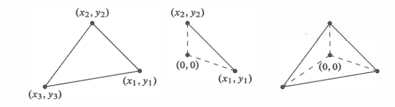
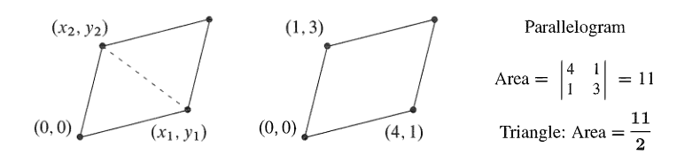
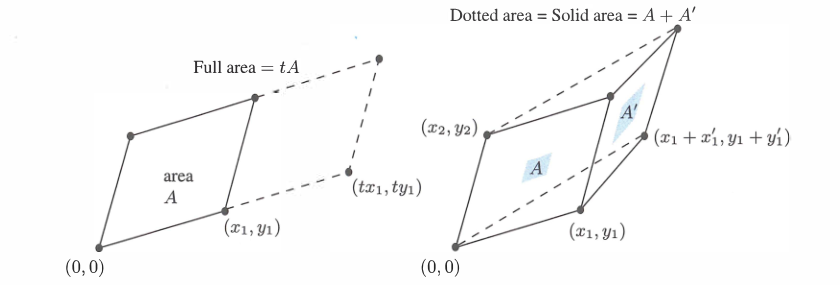
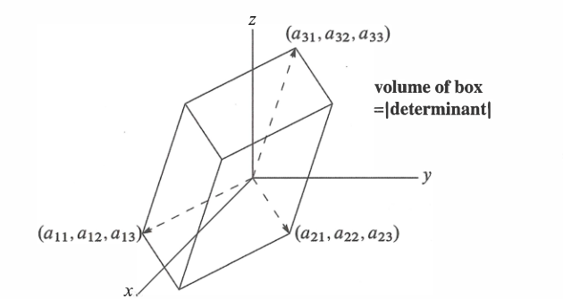
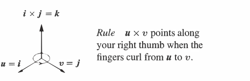

<!-- 来源：Gilbert Strang, Introduction to Linear Algebra, 5th ed., Chapter 5, printed pages 247–283。按转换规范不收录各节 Problem Set。 -->

# 第 5 章　行列式

---

1. 对于
   $$
   A=\begin{bmatrix}a&b\\c&d\end{bmatrix},
   $$
   行列式为 $\det A=ad-bc$。奇异矩阵
   $$
   A=\begin{bmatrix}a&xa\\c&xc\end{bmatrix}
   $$
   的行列式为零。
2. **交换两行会使符号反转。**
   $$
   PA=
   \begin{bmatrix}0&1\\1&0\end{bmatrix}
   \begin{bmatrix}a&b\\c&d\end{bmatrix}=
   \begin{bmatrix}c&d\\a&b\end{bmatrix},
   \qquad
   \det(PA)=bc-ad=-\det A.
   $$
3. 行列式对第一行单独具有线性：
   $$
   \det
   \begin{bmatrix}
   xa+yA&xb+yB\\
   c&d
   \end{bmatrix}
   =x(ad-bc)+y(Ad-Bc).
   $$
4. 消元给出
   $$
   EA=
   \begin{bmatrix}
   a&b\\
   0&d-\dfrac{c}{a}b
   \end{bmatrix},
   $$
   因此
   $$
   \det(EA)=a\left(d-\frac{c}{a}b\right)
   =\text{主元的乘积}
   =\det A.
   $$
5. 当 $A$ 是 $n\times n$ 矩阵时，上述事实仍然成立：$A$ 奇异时 $\det A=0$；交换两行时行列式反号；行列式对第一行单独具有线性；行列式等于主元乘积并根据行交换次数添加正负号。此外，
   $$
   \det(BA)=(\det B)(\det A),
   \qquad
   \det(A^T)=\det A.
   $$
   一个行列式包含着惊人的信息。

---

## 5.1 行列式的性质

行列式把一个方阵 $A$ 对应为一个数，记作 $\det A$ 或 $|A|$。这个数首先回答一个最基本的问题：矩阵是否可逆。本节稍后将证明

$$
A\text{ 可逆}
\quad\Longleftrightarrow\quad
\det A\ne0.
$$

因此，$\det A=0$ 是矩阵不可逆的明确信号；这样的矩阵称为奇异矩阵。

先看二阶矩阵

$$
A=
\begin{bmatrix}
a&b\\
c&d
\end{bmatrix}
$$

它的行列式为

$$
\det A=ad-bc
$$

当 $ad-bc\ne0$ 时，逆矩阵是

$$
\begin{equation}
A^{-1}
=\frac{1}{ad-bc}
\begin{bmatrix}
d&-b\\
-c&a
\end{bmatrix}
\tag{1}
\end{equation}
$$

把 $A$ 与右边的矩阵相乘，结果就是单位矩阵 $I$。这个公式清楚地说明了行列式为何重要：求逆时必须除以 $\det A$。若 $ad-bc=0$，分母为零，逆矩阵便不存在。

例如，如果两行成比例，存在数 $t$ 使得

$$
(c,d)=t(a,b),
$$

那么 $c=ta$、$d=tb$，于是

$$
ad-bc=a(tb)-b(ta)=0.
$$

所以行向量线性相关时，矩阵不可逆，行列式也等于零。反过来的完整结论将在规则 8 中证明。

行列式还与消元中的主元直接相连。若 $a\ne0$，二阶矩阵在不交换行的情况下有两个主元：

$$
a,
\qquad
d-\frac{c}{a}b.
$$

它们的乘积为

$$
a\left(d-\frac{c}{a}b\right)
=ad-bc
=\det A.
$$

因此，在不需要行交换时，**行列式就是主元的乘积**。

如果先交换两行，主元变为

$$
c,
\qquad
b-\frac{a}{c}d,
$$

乘积则是

$$
c\left(b-\frac{a}{c}d\right)
=bc-ad
=-\det A.
$$

这说明行交换不会改变主元乘积的绝对值，但会改变其符号。一般情况下，行列式等于全部主元的乘积，再根据行交换次数补上正号或负号。

### 三种计算方法

对于 $n\times n$ 矩阵，行列式可以用三种方法计算：

1. **主元公式：** 将 $n$ 个主元相乘，并根据行交换次数乘以 $1$ 或 $-1$。
2. **大公式：** 把从每一行、每一列各取一个元素形成的 $n!$ 个乘积，按相应的正负号相加。
3. **代数余子式公式：** 把一个 $n$ 阶行列式化为 $n$ 个带符号的 $n-1$ 阶行列式。

第一种方法适合实际计算；后两种方法直接揭示行列式与矩阵元素之间的关系，将在第 5.2 节推导。

### 符号反转与线性

行列式中的正负号来自一条基本规则：

**交换两行时，行列式改变符号。**

因为转置不改变行列式，同样的规则也适用于交换两列。例如，

$$
\det
\begin{bmatrix}
1&0\\
0&1
\end{bmatrix}
=1,
\qquad
\det
\begin{bmatrix}
0&1\\
1&0
\end{bmatrix}
=-1.
$$

从单位矩阵 $I$ 出发，每交换一次行，置换矩阵 $P$ 的行列式就改变一次符号。因此：

- 经过偶数次行交换得到的置换称为偶置换，满足 $\det P=1$；
- 经过奇数次行交换得到的置换称为奇置换，满足 $\det P=-1$。

行列式的另一条基本性质是**对每一行分别线性**。这里的“分别”非常重要：先固定其余 $n-1$ 行，只让第 $i$ 行发生变化。若第 $i$ 行是两个行向量的线性组合 $\alpha u+\beta v$，则

$$
\begin{aligned}
\det
\begin{bmatrix}
r_1\\
\vdots\\
\alpha u+\beta v\\
\vdots\\
r_n
\end{bmatrix}
&=
\alpha
\det
\begin{bmatrix}
r_1\\
\vdots\\
u\\
\vdots\\
r_n
\end{bmatrix}+
\beta
\det
\begin{bmatrix}
r_1\\
\vdots\\
v\\
\vdots\\
r_n
\end{bmatrix}.
\end{aligned}
$$

在这个等式中，除第 $i$ 行外，$r_1,\ldots,r_n$ 全部保持不变。也就是说，行列式对每一行单独看都是线性的；这种性质称为**逐行线性**或**多重线性**。

这并不表示映射 $A\mapsto\det A$ 对整个矩阵 $A$ 是线性的。矩阵相加会同时改变所有行，所以一般有

$$
\det(A+B)\ne\det A+\det B.
$$

例如，取 $A=B=I$ 且 $n>1$，则

$$
\det(A+B)=\det(2I)=2^n,
\qquad
\det A+\det B=2.
$$

两者并不相等。原因是 $2I$ 的 $n$ 行都乘以了 $2$，逐行提出因子后总共得到 $2^n$，而不是一个因子 $2$。

本节将从三条基本性质出发定义并研究行列式：

1. $\det I=1$；
2. 交换两行时行列式改变符号；
3. 行列式对每一行分别线性。

这三条性质将推出本节后面的规则 4—10，也将导出行列式的计算公式。

### 本章后续内容

行列式主要有以下三个应用：

1. 它给出逆矩阵 $A^{-1}$ 和方程解 $A^{-1}b$ 的显式公式，其中求解 $A^{-1}b$ 的公式称为克拉默法则。
2. 当一个盒子的边由矩阵 $A$ 的各行或各列给出时，它的体积为 $|\det A|$。
3. 特征值 $\lambda$ 满足
   $$
   \det(A-\lambda I)=0.
   $$
   这个应用将在第 6 章系统展开。

### 行列式的三个基本性质

行列式有三个基本性质，即规则 1、2、3。只使用这三条规则，就能计算任意方阵 $A$ 的行列式。这个数有两种记法：

$$
\det A
\qquad\text{和}\qquad
|A|
$$

方括号表示矩阵，竖线表示它的行列式。对于二阶矩阵，三条基本性质会导出熟悉的结果：

$$
\det
\begin{bmatrix}
a&b\\c&d
\end{bmatrix}=
\begin{vmatrix}
a&b\\c&d
\end{vmatrix}
=ad-bc.
$$

由规则 1—3 还可以推出规则 4—10。最后两条是

$$
\det(AB)=(\det A)(\det B),
\qquad
\det(A^T)=\det A
$$

下面会用二阶公式检查各条规则，但要记住：这些规则适用于任意 $n\times n$ 矩阵。

---

**规则 1　$n\times n$ 单位矩阵的行列式为 $1$。**

$$
\det I=1.
$$

例如，

$$
\begin{vmatrix}
1&0\\0&1
\end{vmatrix}
=1,
\qquad
\begin{vmatrix}
1&&0\\
&\ddots&\\
0&&1
\end{vmatrix}
=1
$$

这条最简单的规则与单位立方体的体积为 $1$ 完全对应。

---

**规则 2　交换两行时，行列式改变符号。**

二阶情形可以直接检查：

$$
\begin{vmatrix}
c&d\\a&b
\end{vmatrix}=-
\begin{vmatrix}
a&b\\c&d
\end{vmatrix}
$$

因为两边都等于 $bc-ad$。

利用这条规则，可以求出任意置换矩阵 $P$ 的行列式：从 $I$ 出发不断交换行，直到得到 $P$。若行交换次数为偶数，则 $\det P=+1$；若次数为奇数，则 $\det P=-1$。

---

**规则 3　行列式对每一行分别是线性函数，其他各行保持不变。**

若第一行乘以 $t$，行列式也乘以 $t$；若把两个可能的第一行相加，相应的行列式也相加：

$$
\begin{vmatrix}
ta&tb\\c&d
\end{vmatrix}=
t
\begin{vmatrix}
a&b\\c&d
\end{vmatrix},
$$

$$
\begin{vmatrix}
a+a'&b+b'\\c&d
\end{vmatrix}=
\begin{vmatrix}
a&b\\c&d
\end{vmatrix}+
\begin{vmatrix}
a'&b'\\c&d
\end{vmatrix}.
$$

这条规则只在其他各行不变时成立；上面两个式子中的 $c,d$ 始终保持不变。第一个式子的两边都是 $tad-tbc$，所以可以提出因子 $t$；第二个式子的两边都是 $ad+a'd-bc-b'c$。

当 $A$ 是 $n\times n$ 矩阵而只有一行改变时，同样的规则仍然成立。例如，

$$
\begin{vmatrix}
4&8&8\\
0&1&1\\
0&0&1
\end{vmatrix}=
4
\begin{vmatrix}
1&2&2\\
0&1&1\\
0&0&1
\end{vmatrix},
$$

并且

$$
\begin{vmatrix}
4&8&8\\
0&1&1\\
0&0&1
\end{vmatrix}=
\begin{vmatrix}
4&0&0\\
0&1&1\\
0&0&1
\end{vmatrix}+
\begin{vmatrix}
0&8&8\\
0&1&1\\
0&0&1
\end{vmatrix}.
$$

仅靠规则 3，还不能立即知道这些行列式的值；上式左边的行列式等于 $4$。

把数乘与相加结合起来，就得到一行中的任意线性组合。利用规则 2，可以先把任意一行换到第一行，使用线性规则后再换回去。

规则 3 并不意味着 $\det(2I)=2\det I$。为了得到 $2I$，必须把每一行都乘以 $2$，因子 $2$ 会从每一行各提出一次：

$$
\begin{vmatrix}
2&0\\0&2
\end{vmatrix}
=2^2=4,
\qquad
\begin{vmatrix}
t&0\\0&t
\end{vmatrix}
=t^2.
$$

这与面积和体积完全相同：矩形的各边放大 $2$ 倍，面积放大 $4$ 倍；$n$ 维盒子的各边放大 $t$ 倍，体积放大 $t^n$ 倍。这并非巧合，后面将看到行列式确实等于有向体积。

三条基本性质完全确定了 $\det A$。现在本可以直接推导一般的 $n$ 阶公式，但那会稍显复杂。先逐步推出规则 4—10，会使行列式更容易使用。

### 从三个基本性质推出的规则

**规则 4　如果 $A$ 有两行相同，则 $\det A=0$。**

二阶情形为

$$
\begin{vmatrix}
a&b\\a&b
\end{vmatrix}
=0.
$$

这条规则由规则 2 推出。交换两行相同的行，矩阵没有变化，因此行列式 $D$ 应保持不变；但规则 2 又要求它变为 $-D$。唯一满足 $D=-D$ 的数是 $D=0$，所以行列式必须为零。

有两行相同的矩阵不可能可逆，规则 4 相应地给出 $\det A=0$。不过，一个矩阵即使没有两行完全相同，也仍可能奇异、行列式仍可能为零。规则 5 才是关键：我们可以像消元那样进行行运算，而不改变 $\det A$。

**规则 5　从一行减去另一行的任意倍数，$\det A$ 不变。**

例如，从第 2 行减去第 1 行的 $\ell$ 倍：

$$
\begin{vmatrix}
a&b\\
c-\ell a&d-\ell b
\end{vmatrix}=
\begin{vmatrix}
a&b\\
c&d
\end{vmatrix}.
$$

根据规则 3，左边可以拆成右边再加上

$$
-\ell
\begin{vmatrix}
a&b\\a&b
\end{vmatrix}.
$$

附加项因两行相同而由规则 4 等于零，所以规则 5 对任意阶矩阵都成立，而不只是二阶矩阵。

**结论。** 从 $A$ 消元到 $U$ 的普通消元步骤不会改变行列式，因此 $\det A=\det U$。只要能求出三角矩阵 $U$ 的行列式，就能求出任意矩阵 $A$ 的行列式。每次行交换都会使符号反转，所以总有

$$
\det A=\pm\det U.
$$

规则 5 已经把一般问题缩小成了三角矩阵的问题。

**规则 6　矩阵中若有一行全为零，则 $\det A=0$。**

例如，

$$
\begin{vmatrix}
0&0\\c&d
\end{vmatrix}
=0,
\qquad
\begin{vmatrix}
a&b\\0&0
\end{vmatrix}
=0.
$$

一个简单证明是：把另一行加到零行上。根据规则 5，行列式不变；但此时矩阵出现两行相同，由规则 4，其行列式为零。

**规则 7　若 $A$ 是三角矩阵，则**

$$
\det A=a_{11}a_{22}\cdots a_{nn},
$$

即行列式等于对角元素的乘积。二阶例子是

$$
\begin{vmatrix}
a&b\\0&d
\end{vmatrix}
=ad,
\qquad
\begin{vmatrix}
a&0\\c&d
\end{vmatrix}
=ad.
$$

先假设所有对角元素都非零。用消元消去非对角元素：若 $A$ 是下三角矩阵，从下面各行减去上面各行的适当倍数；若 $A$ 是上三角矩阵，则反向进行。规则 5 保证行列式不变，而矩阵最终变为对角矩阵：

$$
\det
\begin{bmatrix}
a_{11}&&0\\
&\ddots&\\
0&&a_{nn}
\end{bmatrix}
=(a_{11})(a_{22})\cdots(a_{nn}).
$$

由规则 3，从第一行提出 $a_{11}$，从第二行提出 $a_{22}$，依次直到从最后一行提出 $a_{nn}$。剩余的行列式是 $\det I=1$，这里终于用到了规则 1。

如果某个对角元素 $a_{ii}=0$，三角矩阵 $A$ 就是奇异矩阵，消元会产生零行。规则 5 说明行列式在消元中不变，规则 6 又说明有零行时行列式为零。于是得到判断奇异与可逆的重要准则。

**规则 8　若 $A$ 奇异，则 $\det A=0$；若 $A$ 可逆，则 $\det A\ne0$。**

对于二阶矩阵，

$$
\begin{bmatrix}
a&b\\c&d
\end{bmatrix}
\quad\text{奇异}
\quad\Longleftrightarrow\quad
ad-bc=0.
$$

**证明。** 消元把 $A$ 化为 $U$。若 $A$ 奇异，则 $U$ 有零行，因此

$$
\det A=\det U=0.
$$

若 $A$ 可逆，则 $U$ 的对角线上有完整的非零主元，它们的乘积由规则 7 给出非零行列式：

$$
\begin{equation}
\det A=\pm\det U
=\pm(\text{主元的乘积}).
\tag{2}
\end{equation}
$$

二阶矩阵在 $a\ne0$ 时的两个主元是 $a$ 和 $d-(c/a)b$，因此

$$
\begin{vmatrix}
a&b\\c&d
\end{vmatrix}=
\begin{vmatrix}
a&b\\
0&d-(c/a)b
\end{vmatrix}
=ad-bc.
$$

这是行列式的第一个计算公式。MATLAB 也是通过主元的乘积来计算 $\det A$。$\pm\det U$ 的符号取决于行交换次数的奇偶性：交换次数为偶数时取 $+1$，为奇数时取 $-1$；这个符号就是执行行交换的置换矩阵 $P$ 的行列式。

若没有行交换，则 $P=I$，并且

$$
\det A=\det U=\text{主元的乘积},
\qquad
\det L=1.
$$

一般地，

$$
\begin{equation}
PA=LU
\quad\Longrightarrow\quad
(\det P)(\det A)=(\det L)(\det U),
\qquad
\det A=\pm\det U.
\tag{3}
\end{equation}
$$

**规则 9　乘积 $AB$ 的行列式等于两个行列式的乘积：**

$$
\det(AB)=(\det A)(\det B).
$$

二阶形式为

$$
\begin{vmatrix}
a&b\\c&d
\end{vmatrix}
\begin{vmatrix}
p&q\\r&s
\end{vmatrix}=
\begin{vmatrix}
ap+br&aq+bs\\
cp+dr&cq+ds
\end{vmatrix}.
$$

当 $B=A^{-1}$ 时，这条规则说明

$$
AA^{-1}=I
\quad\Longrightarrow\quad
(\det A)(\det A^{-1})=\det I=1,
$$

所以 $\det(A^{-1})=1/\det A$。

乘积规则是目前最复杂的规则。即使在二阶情形中，也需要一些代数运算：

$$
\begin{aligned}
|A||B|
&=(ad-bc)(ps-qr)\\
&=(ap+br)(cq+ds)-(aq+bs)(cp+dr)\\
&=|AB|.
\end{aligned}
$$

对一般的 $n\times n$ 情形，可以给出一个简洁证明。先设 $\det B\ne0$，并定义

$$
D(A)=\frac{\det(AB)}{\det B}.
$$

检查这个比值 $D(A)$ 是否满足定义行列式的三个基本性质：

1. **单位矩阵。** 当 $A=I$ 时，
   $$
   D(I)=\frac{\det B}{\det B}=1.
   $$
2. **符号反转。** 交换 $A$ 的两行，也会交换 $AB$ 的相应两行，因此 $\det(AB)$ 和比值 $D(A)$ 都改变符号。
3. **线性。** 把 $A$ 的第一行乘以 $t$，$AB$ 的第一行也乘以 $t$，所以 $\det(AB)$ 与 $D(A)$ 都乘以 $t$。若把 $A$ 与 $A'$ 的第一行相加，那么 $AB$ 与 $A'B$ 的第一行也相加；规则 3 说明行列式相加，除以 $\det B$ 后比值也相加。

因此 $D(A)$ 具有定义 $\det A$ 的同样三条性质，只能等于 $\det A$。于是

$$
\frac{\det(AB)}{\det B}=\det A,
$$

这就证明了

$$
\det(AB)=(\det A)(\det B).
$$

若 $\det B=0$，则 $B$ 奇异，$AB$ 也奇异，因此等式两边都是零。

**规则 10　转置矩阵 $A^T$ 与 $A$ 有相同的行列式：**

$$
\det(A^T)=\det A.
$$

二阶情形直接给出

$$
\begin{vmatrix}
a&b\\c&d
\end{vmatrix}=
\begin{vmatrix}
a&c\\b&d
\end{vmatrix}
=ad-bc.
$$

若 $A$ 奇异，$A^T$ 也奇异，所以等式两边都是零。若 $A$ 可逆，则有通常的分解

$$
PA=LU.
$$

两边转置得到

$$
A^TP^T=U^TL^T.
$$

利用规则 9 比较两个等式的行列式：

$$
(\det P)(\det A)=(\det L)(\det U),
$$

$$
(\det A^T)(\det P^T)=(\det U^T)(\det L^T).
$$

首先，$\det L=\det L^T=1$，因为两者的对角线元素全为 $1$。其次，$\det U=\det U^T$，因为两个三角矩阵具有相同的对角线。最后，$\det P=\det P^T$：置换矩阵满足 $P^TP=I$，由规则 9 得 $(\det P^T)(\det P)=1$，而二者都只能是 $1$ 或都只能是 $-1$。

因此 $L,U,P$ 与 $L^T,U^T,P^T$ 分别具有相同的行列式，最终得到

$$
\det A=\det A^T.
$$

**关于列的重要说明。** 由于 $\det A=\det A^T$，所有关于行的规则都同样适用于列：交换两列时行列式改变符号；出现零列或两列相同时行列式为零；一列乘以 $t$ 时行列式也乘以 $t$；行列式对每一列分别线性。

性质已经足够多了。下一节将寻找并使用行列式的显式公式。

### 关键思想回顾

1. 行列式由 $\det I=1$、交换两行时符号反转以及对每一行分别线性这三个性质定义。
2. 消元之后，$\det A$ 等于主元乘积并根据行交换次数添加正负号。
3. $\det A=0$ 当且仅当 $A$ 不可逆。
4. 两个重要性质是
   $$
   \det(AB)=(\det A)(\det B),
   \qquad
   \det(A^T)=\det A.
   $$

### Worked Examples

---

**5.1 A　行变换与行列式**

对矩阵 $A=(a_{ij})$ 进行下列运算，求 $M_1,M_2,M_3$ 的行列式与 $\det A$ 的关系：

- 在 $M_1$ 中，把每个 $a_{ij}$ 乘以 $(-1)^{i+j}$，得到棋盘式正负号；
- 在 $M_2$ 中，分别从第 2、3、1 行减去 $A$ 的第 1、2、3 行；
- 在 $M_3$ 中，分别把 $A$ 的第 1、2、3 行加到第 2、3、1 行。

$$
M_1=
\begin{bmatrix}
a_{11}&-a_{12}&a_{13}\\
-a_{21}&a_{22}&-a_{23}\\
a_{31}&-a_{32}&a_{33}
\end{bmatrix},
$$

$$
M_2=
\begin{bmatrix}
R_1-R_3\\
R_2-R_1\\
R_3-R_2
\end{bmatrix},
\qquad
M_3=
\begin{bmatrix}
R_1+R_3\\
R_2+R_1\\
R_3+R_2
\end{bmatrix}.
$$

三个答案依次是 $\det A$、$0$ 和 $2\det A$。

矩阵 $M_1$ 可以写成

$$
M_1=
\begin{bmatrix}
1&0&0\\0&-1&0\\0&0&1
\end{bmatrix}
A
\begin{bmatrix}
1&0&0\\0&-1&0\\0&0&1
\end{bmatrix}.
$$

因此

$$
\det M_1=(-1)(\det A)(-1)=\det A.
$$

$M_2$ 的三行之和为零，因此它是奇异矩阵，$\det M_2=0$。

利用规则 3 对每一行分别线性，$M_3$ 的行列式可以拆成八个行列式。其中除第一项与最后一项外，其余六项都有重复行，行列式为零。第一项是 $\det A$；最后一项相对于 $A$ 进行了两次行交换，仍为 $\det A$。所以

$$
\det M_3=\det A+\det A=2\det A.
$$

可以取 $A=I$ 直接检验这个结果。

---

**5.1 B　通过行列变换计算行列式**

说明怎样通过行运算得到

$$
\begin{equation}
\det
\begin{bmatrix}
1-a&1&1\\
1&1-a&1\\
1&1&1-a
\end{bmatrix}
=a^2(3-a).
\tag{4}
\end{equation}
$$

先从第 1 行减去第 3 行，再从第 2 行减去第 3 行，得到

$$
\det
\begin{bmatrix}
-a&0&a\\
0&-a&a\\
1&1&1-a
\end{bmatrix}.
$$

然后把第 1 列加到第 3 列，再把第 2 列也加到第 3 列。所得下三角矩阵的对角线为 $-a,-a,3-a$，所以

$$
\det A=(-a)(-a)(3-a)=a^2(3-a).
$$

当 $a=0$ 或 $a=3$ 时，行列式为零。$a=0$ 时得到全 $1$ 矩阵，它显然奇异；$a=3$ 时，每一行元素之和为零，矩阵同样奇异。数 $0$ 和 $3$ 正是全 $1$ 矩阵的特征值。这个例子揭示了重要现象，并把我们引向第 6 章。

---

## 5.2 置换与代数余子式

---

1. 二阶行列式 $ad-bc$ 有 $2!$ 项，每项带正号或负号；一般的 $n$ 阶行列式由 $n!$ 个带正负号的项相加而成。
2. 当 $n=3$ 时，$\det A$ 有 $3!=6$ 项，其中两项是
   $$
   +a_{12}a_{23}a_{31},
   \qquad
   -a_{13}a_{22}a_{31}.
   $$
   每一项都恰好使用第 1、2、3 行各一次，也使用第 1、2、3 列各一次。
3. 第二项带负号，是因为列顺序 $(3,2,1)$ 需要一次行列交换才能恢复为 $(1,2,3)$。
4. 六项中包含
   $$
   a_{11}a_{22}a_{33}-a_{11}a_{23}a_{32}
   =a_{11}(a_{22}a_{33}-a_{23}a_{32})
   =a_{11}C_{11}.
   $$
5. 总有
   $$
   \det A=a_{11}C_{11}+a_{12}C_{12}+\cdots+a_{1n}C_{1n}.
   $$
   每个代数余子式都是一个 $n-1$ 阶行列式并带有适当符号。

---

计算机通常用主元求行列式。本节解释另外两种方法：一种是使用全部 $n!$ 个置换的“大公式”，另一种是使用 $n-1$ 阶行列式的“代数余子式公式”。最好的例子是下面这个四阶矩阵：

$$
A=
\begin{bmatrix}
2&-1&0&0\\
-1&2&-1&0\\
0&-1&2&-1\\
0&0&-1&2
\end{bmatrix},
\qquad
\det A=5.
$$

可以用三种方法得到这个行列式：主元、大公式和代数余子式。

1. 主元的乘积为
   $$
   2\cdot\frac32\cdot\frac43\cdot\frac54=5.
   $$
2. 式 (8) 中的大公式有 $4!=24$ 项，但只有五项非零：
   $$
   \det A=16-4-4-4+1=5.
   $$
   其中 $16$ 来自主对角线上的 $2\cdot2\cdot2\cdot2$。当你能从大公式中找出三个 $-4$ 和一个 $+1$ 的来源时，就真正理解了式 (8)。
3. 第一行中的 $2,-1,0,0$ 分别乘以来自其他行的代数余子式 $4,3,2,1$，于是
   $$
   2\cdot4-1\cdot3=5.
   $$
   这些代数余子式是三阶行列式。第一行的某个元素使用了一行和一列后，其代数余子式只使用没有被它占用的行与列。

**行列式的每一项都恰好使用每一行和每一列一次。**

### 主元公式

消元得到 $A=LU$ 时，主元 $d_1,\ldots,d_n$ 位于上三角矩阵 $U$ 的对角线上。如果没有行交换，主元相乘便得到行列式：

$$
\begin{equation}
\det A=(\det L)(\det U)
=(1)(d_1d_2\cdots d_n).
\tag{1}
\end{equation}
$$

这个公式在第 5.1 节已经出现过。当消元包含行交换时，分解变为 $PA=LU$，而置换矩阵 $P$ 的行列式是 $-1$ 或 $+1$：

$$
\begin{equation}
(\det P)(\det A)=(\det L)(\det U)
\quad\Longrightarrow\quad
\det A=\pm(d_1d_2\cdots d_n).
\tag{2}
\end{equation}
$$

**例 1**　一次行交换产生主元 $4,2,1$，并带来重要的负号：

$$
A=
\begin{bmatrix}
0&0&1\\
0&2&3\\
4&5&6
\end{bmatrix},
\qquad
PA=
\begin{bmatrix}
4&5&6\\
0&2&3\\
0&0&1
\end{bmatrix}.
$$

所以

$$
\det A=-(4)(2)(1)=-8.
$$

行交换次数为奇数——这里只有一次——意味着 $\det P=-1$。

下一个例子不需要行交换。它的三阶形式可能正是本书最早分解为 $LU$ 的矩阵之一；特别之处在于，同样的计算可以直接推广到任意 $n$ 阶。主元给出行列式，反过来，行列式也将给出主元。

**例 2**　下面三对角矩阵 $A$ 的前几个主元是

$$
2,\quad\frac32,\quad\frac43.
$$

接下来是 $\frac54,\frac65$，最终是 $\frac{n+1}{n}$。它的 $LU$ 分解为

$$
\begin{bmatrix}
2&-1&&&\\
-1&2&-1&&\\
&-1&2&\ddots&\\
&&\ddots&\ddots&-1\\
&&&-1&2
\end{bmatrix}=
\begin{bmatrix}
1&&&&\\
-\frac12&1&&&\\
&-\frac23&1&&\\
&&\ddots&\ddots&\\
&&&-\frac{n-1}{n}&1
\end{bmatrix}
\begin{bmatrix}
2&-1&&&\\
&\frac32&-1&&\\
&&\frac43&\ddots&\\
&&&\ddots&-1\\
&&&&\frac{n+1}{n}
\end{bmatrix}.
$$

主元位于最后一个矩阵 $U$ 的对角线上。把

$$
2,\quad\frac32,\quad\frac43,\quad\frac54
$$

相乘时，中间的分子分母全部约去，因此四阶矩阵的行列式为 $5$，三阶矩阵的行列式为 $4$。一般的 $n$ 阶行列式为

$$
\det A
=(2)\left(\frac32\right)\left(\frac43\right)
\cdots\left(\frac{n+1}{n}\right)
=n+1.
$$

**重要事实：** 前 $k$ 个主元只取决于原矩阵 $A$ 左上角的 $k\times k$ 子矩阵 $A_k$。这条规则适用于所有不需要行交换的矩阵。

前 $k$ 个主元来自 $A$ 左上角的 $A_k$，并且

$$
\det A_k=d_1d_2\cdots d_k.
$$

一阶矩阵 $A_1$ 只包含第一个主元，所以 $\det A_1=d_1$。左上角二阶矩阵满足 $\det A_2=d_1d_2$。最终，$n$ 阶矩阵的行列式包含全部 $n$ 个主元。

从整个矩阵开始消元时，前几步只处理左上角的 $A_k$。假定没有行交换，则

$$
A=LU,
\qquad
A_k=L_kU_k.
$$

把 $\det A_k$ 除以 $\det A_{k-1}$，前 $k-1$ 个主元全部约去，只剩最新的主元 $d_k$。因此每个主元都是相邻两个行列式的比值：

$$
\begin{equation}
d_k
=\frac{d_1d_2\cdots d_k}{d_1d_2\cdots d_{k-1}}
=\frac{\det A_k}{\det A_{k-1}}.
\tag{3}
\end{equation}
$$

只要所有左上角子矩阵都满足 $\det A_k\ne0$，消元就不需要行交换。

### 行列式的大公式

主元很适合计算。它们浓缩了足以求出行列式的大量信息，但很难直接看出主元与原始元素 $a_{ij}$ 的关系。为了直接从矩阵元素推导行列式的显式公式，我们回到规则 1—3：逐行线性、交换两行时符号反转以及 $\det I=1$。

这个公式有 $n!$ 项，而

$$
n!=1,2,6,24,120,\ldots
$$

增长得非常快。当 $n=11$ 时，项数大约为四千万。$n=2$ 时两项是 $ad$ 和 $bc$：一半带负号，例如 $-bc$；另一半带正号，例如 $ad$。$n=3$ 时有 $3!=(3)(2)(1)=6$ 项：

$$
\begin{equation}
\begin{aligned}
\det A
={}&a_{11}a_{22}a_{33}
+a_{12}a_{23}a_{31}
+a_{13}a_{21}a_{32}\\
&-a_{11}a_{23}a_{32}
-a_{12}a_{21}a_{33}
-a_{13}a_{22}a_{31}.
\end{aligned}
\tag{4}
\end{equation}
$$

注意其中的规律。每个乘积，例如 $a_{11}a_{23}a_{32}$，都从每一行取一个元素，也从每一列取一个元素。它的列顺序是 $(1,3,2)$，所以带负号。乘积 $a_{13}a_{21}a_{32}$ 的列顺序是 $(3,1,2)$，所以带正号。正负号由置换决定。

下一步 $n=4$ 时有 $4!=24$ 项，也就是从每一行和每一列各取一个元素共有 24 种方法。主对角线乘积

$$
a_{11}a_{22}a_{33}a_{44}
$$

的列顺序是 $(1,2,3,4)$，总带正号；这就是恒等置换。

为了系统地推导大公式，先从 $n=2$ 开始。目标是得到 $ad-bc$。把每一行拆成两个更简单的行：

$$
\begin{bmatrix}a&b\end{bmatrix}=
\begin{bmatrix}a&0\end{bmatrix}+
\begin{bmatrix}0&b\end{bmatrix},
$$

$$
\begin{bmatrix}c&d\end{bmatrix}=
\begin{bmatrix}c&0\end{bmatrix}+
\begin{bmatrix}0&d\end{bmatrix}.
$$

先对第 1 行使用线性性并保持第 2 行不变，再对第 2 行使用线性性并保持第 1 行不变：

$$
\begin{equation}
\begin{aligned}
\begin{vmatrix}
a&b\\c&d
\end{vmatrix}
&=
\begin{vmatrix}
a&0\\c&d
\end{vmatrix}+
\begin{vmatrix}
0&b\\c&d
\end{vmatrix}\\
&=
\begin{vmatrix}
a&0\\c&0
\end{vmatrix}+
\begin{vmatrix}
a&0\\0&d
\end{vmatrix}+
\begin{vmatrix}
0&b\\c&0
\end{vmatrix}+
\begin{vmatrix}
0&b\\0&d
\end{vmatrix}.
\end{aligned}
\tag{5}
\end{equation}
$$

最后一行共有 $2^2=4$ 个行列式。第一个和第四个为零，因为其中一行是另一行的倍数，只剩 $2!=2$ 项：

$$
\begin{aligned}
\begin{vmatrix}
a&0\\0&d
\end{vmatrix}+
\begin{vmatrix}
0&b\\c&0
\end{vmatrix}
&=
ad
\begin{vmatrix}
1&0\\0&1
\end{vmatrix}+
bc
\begin{vmatrix}
0&1\\1&0
\end{vmatrix}\\
&=ad-bc.
\end{aligned}
$$

拆分过程产生了置换矩阵，它们的行列式提供正号或负号；置换则记录列的顺序。在二阶情形中，列顺序是 $(1,2)$ 或 $(2,1)$。

现在令 $n=3$。每一行都可以拆成三个更简单的行，例如 $\begin{bmatrix}a_{11}&0&0\end{bmatrix}$。对每一行使用线性性，$\det A$ 会拆成 $3^3=27$ 个简单行列式。如果重复选择同一列——例如又选取 $\begin{bmatrix}a_{21}&0&0\end{bmatrix}$——简单行列式中就会出现相关行，因此为零。

只有 $a_{ij}$ 来自不同列时才需要保留，例如列顺序 $(3,1,2)$。列 $(1,2,3)$ 有 $3!=6$ 种排列：

$$
\begin{equation}
(1,2,3),\ (2,3,1),\ (3,1,2),\
(1,3,2),\ (2,1,3),\ (3,2,1).
\tag{6}
\end{equation}
$$

前三个是偶置换，需要 $0$ 或 $2$ 次交换；后三个是奇置换，需要奇数次交换。列顺序 $(3,1,2)$ 选出 $a_{13}a_{21}a_{32}$，它需要两次交换，所以带正号。

把每一项中的 $a_{ij}$ 提出，可以把六项写为“元素乘以置换矩阵的行列式”：

$$
\begin{equation}
\begin{aligned}
\det A
={}&a_{11}a_{22}a_{33}\det P_{123}
+a_{12}a_{23}a_{31}\det P_{231}
+a_{13}a_{21}a_{32}\det P_{312}\\
&+a_{11}a_{23}a_{32}\det P_{132}
+a_{12}a_{21}a_{33}\det P_{213}
+a_{13}a_{22}a_{31}\det P_{321}.
\end{aligned}
\tag{7}
\end{equation}
$$

前三个偶置换满足 $\det P=+1$，后三个奇置换满足 $\det P=-1$。这就系统地证明了三阶公式。

现在可以写出一般的 $n$ 阶公式。列号 $(1,2,\ldots,n)$ 有 $n!$ 种排列

$$
P=(\alpha,\beta,\ldots,\omega).
$$

从第 1 行取 $a_{1\alpha}$，从第 2 行取 $a_{2\beta}$，直到从第 $n$ 行取 $a_{n\omega}$。行列式包含乘积

$$
a_{1\alpha}a_{2\beta}\cdots a_{n\omega}
$$

并乘以 $+1$ 或 $-1$。一半的列排列带负号。

---

**行列式的大公式**

$$
\begin{equation}
\det A
=\sum_{\text{全部 }n!\text{ 个列置换 }P=(\alpha,\beta,\ldots,\omega)}
(\det P)\,
a_{1\alpha}a_{2\beta}\cdots a_{n\omega}.
\tag{8}
\end{equation}
$$

每个简单乘积都从每一行、每一列各取一个元素。

---

二阶情形是 $+a_{11}a_{22}-a_{12}a_{21}=ad-bc$，其中 $P$ 是 $(1,2)$ 或 $(2,1)$。

三阶公式可以形象地看成三个“向右下方”的乘积和三个“向左下方”的乘积。**警告：** 不要把这个图形规律直接套到四阶矩阵；那样只能得到 8 项，而四阶行列式需要完整的 24 项。

**例 3　上三角矩阵。** 当 $U$ 为上三角矩阵时，$n!$ 个乘积中只有主对角线对应的一项可能非零：

$$
\det U=u_{11}u_{22}\cdots u_{nn}.
$$

其他任意列排列都会选到至少一个位于对角线下方的零元素；例如一旦选到 $u_{21}=0$，式 (8) 中的相应项就为零。特别地，$\det I=1$，唯一的非零项是主对角线上的 $(1)(1)\cdots(1)$。

**例 4**　设 $Z$ 除第 3 列外与单位矩阵相同：

$$
\begin{equation}
Z=
\begin{bmatrix}
1&0&a&0\\
0&1&b&0\\
0&0&c&0\\
0&0&d&1
\end{bmatrix},
\qquad
\det Z=c.
\tag{9}
\end{equation}
$$

主对角线给出带正号的乘积 $(1)(1)(c)(1)$。虽然共有 $4!=24$ 个乘积，但其余 23 个都是零。原因是：若从第 3 列选取 $a,b$ 或 $d$，第 3 列就已被占用，而第 3 行在其余可选位置上只有零。

也可以用消元得到相同结论。若 $c=0$，$Z$ 有零行，所以 $\det Z=c=0$；若 $c\ne0$，从其他各行减去第 3 行的适当倍数，消去 $a,b,d$，就得到对角矩阵，因此 $\det Z=c$。

这个例子很快会用于克拉默法则。若把 $a,b,c,d$ 移到 $Z$ 的第一列，行列式就变为 $a$。改变 $I$ 的一列所得到的矩阵，其行列式仍只由主对角线上的一个非零乘积给出。

**例 5**　设矩阵 $A$ 只在主对角线的上下两条邻近对角线上有 $1$。当 $n=4$ 时，

$$
A=
\begin{bmatrix}
0&1&0&0\\
1&0&1&0\\
0&1&0&1\\
0&0&1&0
\end{bmatrix},
\qquad
P=
\begin{bmatrix}
0&1&0&0\\
1&0&0&0\\
0&0&0&1\\
0&0&1&0
\end{bmatrix}.
$$

两个矩阵的行列式都为 $1$。$A$ 的第一行唯一非零选择在第 2 列，第四行唯一非零选择在第 3 列，于是第 2、3 行必须选择第 1、4 列。换言之，大公式中唯一非零项对应的置换就是 $P$，所以 $\det A=\det P$。列顺序为 $(2,1,4,3)$，经过两次交换得到，因此 $\det P=+1$，从而 $\det A=+1$。

### 用代数余子式计算行列式

式 (8) 可以直接作为行列式的定义：它一次给出全部内容，但需要仔细消化。这个包含 $n!$ 项的和必须满足规则 1—3，随后规则 4—10 才会全部成立。最容易检查的是 $\det I=1$。

从第一行提出因子 $a_{11}$、$a_{12}$、直到 $a_{1n}$ 时，可以直接看出线性。对三阶矩阵，把通常的六项分成三组：

$$
\begin{equation}
\begin{aligned}
\det A
={}&a_{11}(a_{22}a_{33}-a_{23}a_{32})\\
&+a_{12}(a_{23}a_{31}-a_{21}a_{33})\\
&+a_{13}(a_{21}a_{32}-a_{22}a_{31}).
\end{aligned}
\tag{10}
\end{equation}
$$

括号中的三个量称为**代数余子式**。它们是只使用第 2、3 行的二阶行列式。第一行提供因子 $a_{11},a_{12},a_{13}$，下面各行提供代数余子式 $C_{11},C_{12},C_{13}$。表达式

$$
a_{11}C_{11}+a_{12}C_{12}+a_{13}C_{13}
$$

显然对 $a_{11},a_{12},a_{13}$ 线性，这正是规则 3。

$a_{11}$ 的代数余子式是

$$
C_{11}=a_{22}a_{33}-a_{23}a_{32}.
$$

其中仍然遵守“每一行和每一列各取一个元素”的原则。$a_{11}$ 已经占用第 1 行和第 1 列，剩余元素自然构成一个二阶行列式。

正负号必须格外小心。与 $a_{12}$ 配对的二阶行列式看起来是

$$
a_{21}a_{33}-a_{23}a_{31},
$$

但在代数余子式 $C_{12}$ 中要反转符号。于是 $a_{12}C_{12}$ 才是三阶行列式中的正确项。第一行的符号依次为正、负、正、负。删去第 1 行和第 $j$ 列，得到 $n-1$ 阶子矩阵 $M_{1j}$；再乘以 $(-1)^{1+j}$，得到代数余子式：

$$
C_{1j}=(-1)^{1+j}\det M_{1j}.
$$

沿第一行展开为

$$
\begin{equation}
\det A
=a_{11}C_{11}+a_{12}C_{12}+\cdots+a_{1n}C_{1n}.
\tag{11}
\end{equation}
$$

在大公式 (8) 中，所有乘以 $a_{11}$ 的项合并为 $C_{11}=\det M_{11}$，符号是 $(-1)^{1+1}=+1$。式 (11) 是式 (8) 的另一种写法，也是式 (10) 的一般形式：第一行的元素乘以只使用其他各行的代数余子式。

对第 1 行成立的结论，对任意第 $i$ 行同样成立。第 $i$ 行元素 $a_{ij}$ 的代数余子式是

$$
C_{ij}=(-1)^{i+j}\det M_{ij},
$$

其中 $M_{ij}$ 是删去第 $i$ 行和第 $j$ 列后得到的 $n-1$ 阶子矩阵。因为 $a_{ij}$ 已经占用了第 $i$ 行与第 $j$ 列，$M_{ij}$ 必须把它们排除。

例如，$a_{43}$ 的代数余子式需要删去第 4 行与第 3 列，并乘以 $(-1)^{4+3}$。全部符号呈棋盘式：

$$
(-1)^{i+j}=
\begin{bmatrix}
+&-&+&-\cdots\\
-&+&-&+\cdots\\
+&-&+&-\cdots\\
-&+&-&+\cdots\\
\vdots&\vdots&\vdots&\vdots
\end{bmatrix}.
$$

---

**代数余子式公式**

行列式等于 $A$ 的任意一行与该行代数余子式的点积：

$$
\begin{equation}
\det A
=a_{i1}C_{i1}+a_{i2}C_{i2}+\cdots+a_{in}C_{in},
\qquad
C_{ij}=(-1)^{i+j}\det M_{ij}.
\tag{12}
\end{equation}
$$

---

$n$ 阶行列式由 $n-1$ 阶行列式组合而成。若继续递归，每个子行列式又会拆成 $n-2$ 阶行列式，最终到达一阶行列式，并定义

$$
\det[a]=a.
$$

因此，式 (12) 本身也足以递归定义全部行列式。

本书选择从线性、符号反转和 $\det I=1$ 这些性质构造 $\det A$；大公式 (8) 与代数余子式公式 (10)—(12) 都由这些性质推出。

由 $\det A=\det A^T$，还可以沿列而不是沿行展开。沿第 $j$ 列，元素是 $a_{1j},\ldots,a_{nj}$，相应代数余子式是 $C_{1j},\ldots,C_{nj}$：

$$
\begin{equation}
\det A
=a_{1j}C_{1j}+a_{2j}C_{2j}+\cdots+a_{nj}C_{nj}.
\tag{13}
\end{equation}
$$

当矩阵含有大量零元素时，代数余子式特别有用。

**例 6**　$-1,2,-1$ 三对角矩阵的第一行只有两个非零元素，所以只需代数余子式 $C_{11}$ 与 $C_{12}$。对四阶矩阵，

$$
\begin{equation}
\begin{aligned}
D_4
&=
\begin{vmatrix}
2&-1&0&0\\
-1&2&-1&0\\
0&-1&2&-1\\
0&0&-1&2
\end{vmatrix}\\
&=
2
\begin{vmatrix}
2&-1&0\\
-1&2&-1\\
0&-1&2
\end{vmatrix}
-(-1)
\begin{vmatrix}
-1&-1&0\\
0&2&-1\\
0&-1&2
\end{vmatrix}.
\end{aligned}
\tag{14}
\end{equation}
$$

右边第一项是 $2C_{11}$。$C_{11}$ 仍具有与原矩阵相同的 $-1,2,-1$ 三对角结构，只是阶数小一阶。

为了计算 $C_{12}$，沿它的第一列作代数余子式展开。该列只有最上面的 $-1$ 非零，这又贡献一个 $-1$，最后留下一个比原矩阵低两阶的 $-1,2,-1$ 行列式。因此，每个 $n$ 阶行列式 $D_n$ 都由 $D_{n-1}$ 和 $D_{n-2}$ 得到：

$$
\begin{equation}
D_4=2D_3-D_2,
\qquad
D_n=2D_{n-1}-D_{n-2}.
\tag{15}
\end{equation}
$$

直接计算得 $D_2=3$、$D_3=4$，所以

$$
D_4=2(4)-3=5.
$$

数列 $3,4,5,\ldots$ 满足

$$
D_n=n+1,
$$

因为 $n+1=2n-(n-1)$。这个三对角矩阵的特殊答案也在例 2 中由主元乘积得到过。

**例 7**　考虑同一个矩阵，但把左上角第一个元素改为 $1$：

$$
B_4=
\begin{bmatrix}
1&-1&0&0\\
-1&2&-1&0\\
0&-1&2&-1\\
0&0&-1&2
\end{bmatrix}.
$$

这个矩阵的全部主元都是 $1$，所以行列式为 $1$。从代数余子式也能得到相同结果：沿第一行展开时，代数余子式与例 6 完全相同，只需把 $a_{11}=2$ 改成 $b_{11}=1$：

$$
\det B_4=D_3-D_2,
\qquad
\text{而不是}\qquad
\det A_4=2D_3-D_2.
$$

因此

$$
\det B_4=4-3=1.
$$

一般地，$\det B_n=n-(n-1)=1$。如果再把最后一个对角元素 $2$ 也改成 $1$，每一行元素之和为零，所以行列式变为零。

### 关键思想回顾

1. 不发生行交换时，$\det A$ 等于主元的乘积；左上角子矩阵 $A_k$ 满足
   $$
   \det A_k=\text{前 }k\text{ 个主元的乘积}.
   $$
2. 大公式 (8) 的每一项都使用每一行和每一列一次。$n!$ 项中，一半带正号（$\det P=+1$），一半带负号。
3. 代数余子式
   $$
   C_{ij}=(-1)^{i+j}\det M_{ij}
   $$
   是删去第 $i$ 行、第 $j$ 列后的低一阶行列式再配上正确符号。
4. 行列式等于 $A$ 的任意一行与该行代数余子式的点积。当一行含有大量零时，只需要计算少数几个代数余子式。

### Worked Examples

---

**5.2 A　Hessenberg 矩阵与 Fibonacci 数**

Hessenberg 矩阵是在三角矩阵之外多出一条非零对角线的矩阵。利用第 1 行的代数余子式，证明四阶行列式满足 Fibonacci 递推式

$$
|H_4|=|H_3|+|H_2|.
$$

同样的规律对所有阶数成立：

$$
|H_n|=|H_{n-1}|+|H_{n-2}|.
$$

问 $|H_n|$ 是哪个 Fibonacci 数？这里

$$
H_2=
\begin{bmatrix}
2&1\\
1&2
\end{bmatrix},
\quad
H_3=
\begin{bmatrix}
2&1&0\\
1&2&1\\
1&1&2
\end{bmatrix},
\quad
H_4=
\begin{bmatrix}
2&1&0&0\\
1&2&1&0\\
1&1&2&1\\
1&1&1&2
\end{bmatrix}.
$$

$H_4$ 的代数余子式 $C_{11}$ 就是 $|H_3|$。还需要 $C_{12}$：

$$
\begin{aligned}
C_{12}
&=-
\begin{vmatrix}
1&1&0\\
1&2&1\\
1&1&2
\end{vmatrix}\\
&=-
\begin{vmatrix}
2&1&0\\
1&2&1\\
1&1&2
\end{vmatrix}+
\begin{vmatrix}
1&0&0\\
1&2&1\\
1&1&2
\end{vmatrix}\\
&=-|H_3|+|H_2|.
\end{aligned}
$$

这里第 2、3 行保持不变，只对第一行使用线性性。于是

$$
\begin{aligned}
|H_4|
&=2C_{11}+1C_{12}\\
&=2|H_3|-|H_3|+|H_2|\\
&=|H_3|+|H_2|.
\end{aligned}
$$

实际数值为

$$
|H_1|=2,\qquad |H_2|=3,\qquad |H_3|=5.
$$

因此 $|H_n|=2,3,5,8,\ldots$ 服从 Fibonacci 递推式，结论是

$$
|H_n|=F_{n+2}.
$$

---

**5.2 B　大公式中的正负号**

下面三个问题都使用大公式中由偶置换和奇置换产生的正负号：

1. 若 $A$ 是 $10\times10$ 全 $1$ 矩阵，大公式怎样给出 $\det A=0$？
2. 把全部 $n!$ 个置换矩阵相乘为一个置换矩阵 $P$，$P$ 是奇置换还是偶置换？
3. 把每个 $a_{ij}$ 乘以 $i/j$，为什么 $\det A$ 不变？

**解答 1。** 当所有 $a_{ij}=1$ 时，大公式 (8) 中的每个乘积都等于 $1$。一半带正号，一半带负号，恰好完全抵消，所以 $\det A=0$。当然，全 $1$ 矩阵本来就是奇异矩阵；这里假设 $n>1$。

**解答 2。** 在二阶情形中，两个置换矩阵的乘积是奇置换；在三阶情形中，三个奇置换以任意顺序相乘也得到奇置换。但当 $n>3$ 时，全部置换的乘积是偶置换。原因是共有 $n!/2$ 个奇置换，而只要 $n!$ 含有因子 $4$，$n!/2$ 就是偶数；偶数个奇置换相乘得到偶置换。

**解答 3。** 每个 $a_{ij}$ 都乘以 $i/j$。因此，大公式中的每个乘积

$$
a_{1\alpha}a_{2\beta}\cdots a_{n\omega}
$$

都乘以全部行号 $i=1,2,\ldots,n$，同时除以全部列号 $j=1,2,\ldots,n$。虽然列号按某个置换顺序出现，但仍然完整地出现一次，所以总因子为

$$
\frac{1\cdot2\cdots n}{1\cdot2\cdots n}=1.
$$

每个乘积都不变，因此 $\det A$ 不变。

也可以从矩阵乘法说明这一点。令

$$
D=\operatorname{diag}(1,2,\ldots,n).
$$

左乘 $D$ 会把第 $i$ 行乘以 $i$，右乘 $D^{-1}$ 会把第 $j$ 列除以 $j$。新矩阵是 $DAD^{-1}$，由乘积规则，

$$
\det(DAD^{-1})
=(\det D)(\det A)(\det D^{-1})
=\det A.
$$

---

## 5.3 克拉默法则、逆矩阵与体积

---

1. $A^{-1}=C^T/\det A$，因此 $(A^{-1})_{ij}$ 等于代数余子式 $C_{ji}$ 除以 $\det A$。
2. 克拉默法则用
   $$
   x_j=\frac{\det(A\text{ 的第 }j\text{ 列换成 }b)}{\det A}
   $$
   计算 $x=A^{-1}b$。
3. 若平行四边形的四个顶点是 $(0,0)$、$(a,b)$、$(c,d)$ 和 $(a+c,b+d)$，则其面积为 $|ad-bc|$。
4. 若矩阵 $A$ 的各行（或各列）给出盒子的边，则盒子的体积为 $|\det A|$。
5. 向量 $w=u\times v$ 的三个分量是
   $$
   \det
   \begin{bmatrix}
   \boldsymbol{i}&\boldsymbol{j}&\boldsymbol{k}\\
   u_1&u_2&u_3\\
   v_1&v_2&v_3
   \end{bmatrix}
   $$
   沿第一行展开所得的代数余子式。并且 $v\times u=-(u\times v)$，$w^Tu=0$，$w^Tv=0$。

---

本节不用消元，而是用代数方法求解 $Ax=b$，同时求出 $A^{-1}$。下面所有公式都会除以 $\det A$：$A^{-1}$ 以及 $A^{-1}b$ 的每个分量，都是一个行列式与 $\det A$ 的比值。先从克拉默法则开始。

**克拉默法则求解 $Ax=b$。** 一个巧妙的思路可以直接给出第一个分量 $x_1$。把单位矩阵 $I$ 的第一列换成 $x$，所得矩阵的行列式就是 $x_1$。用 $A$ 左乘这个矩阵时，第一列变成 $Ax=b$，其余两列则从 $A$ 原样保留下来：

$$
\begin{equation}
A
\begin{bmatrix}
x_1&0&0\\
x_2&1&0\\
x_3&0&1
\end{bmatrix}=
\begin{bmatrix}
b_1&a_{12}&a_{13}\\
b_2&a_{22}&a_{23}\\
b_3&a_{32}&a_{33}
\end{bmatrix}
=B_1.
\tag{1}
\end{equation}
$$

这里的乘法是逐列完成的。对等式中的三个矩阵取行列式，得到

$$
\begin{equation}
(\det A)x_1=\det B_1,
\qquad
x_1=\frac{\det B_1}{\det A}.
\tag{2}
\end{equation}
$$

这就是克拉默法则给出的 $x$ 的第一个分量：改变 $A$ 的一列便得到 $B_1$。

为了求 $x_2$，把 $x$ 和 $b$ 分别放到 $I$ 和 $A$ 的第二列：

$$
\begin{equation}
\begin{bmatrix}
a_1&a_2&a_3
\end{bmatrix}
\begin{bmatrix}
1&x_1&0\\
0&x_2&0\\
0&x_3&1
\end{bmatrix}=
\begin{bmatrix}
a_1&b&a_3
\end{bmatrix}
=B_2.
\tag{3}
\end{equation}
$$

取行列式便有 $(\det A)x_2=\det B_2$，所以 $x_2=(\det B_2)/(\det A)$。

**例 1**　求解

$$
3x_1+4x_2=2,
\qquad
5x_1+6x_2=4.
$$

需要计算三个行列式：

$$
\det A=
\begin{vmatrix}
3&4\\
5&6
\end{vmatrix}
=-2,
\quad
\det B_1=
\begin{vmatrix}
2&4\\
4&6
\end{vmatrix}
=-4,
\quad
\det B_2=
\begin{vmatrix}
3&2\\
5&4
\end{vmatrix}
=2.
$$

所有比值都除以 $\det A=-2$，因此

$$
x_1=\frac{-4}{-2}=2,
\qquad
x_2=\frac{2}{-2}=-1.
$$

检验：

$$
\begin{bmatrix}
3&4\\
5&6
\end{bmatrix}
\begin{bmatrix}
2\\-1
\end{bmatrix}=
\begin{bmatrix}
2\\4
\end{bmatrix}.
$$

---

**克拉默法则**　若 $\det A\ne0$，则方程 $Ax=b$ 的解由行列式给出：

$$
\begin{equation}
x_1=\frac{\det B_1}{\det A},
\qquad
x_2=\frac{\det B_2}{\det A},
\qquad\ldots\qquad
x_n=\frac{\det B_n}{\det A}.
\tag{4}
\end{equation}
$$

矩阵 $B_j$ 是把 $A$ 的第 $j$ 列换成向量 $b$ 所得到的矩阵。

---

求解一个 $n\times n$ 方程组时，克拉默法则要计算 $n+1$ 个行列式：$A$ 的行列式以及 $n$ 个不同的 $B_j$ 的行列式。如果每个行列式都按包含全部置换的“大公式”展开，每个行列式有 $n!$ 项，总计便有 $(n+1)!$ 项。用这种方法进行数值计算非常低效，但它确实给出了一个显式的解公式。

**例 2**　克拉默法则不适合大量数值计算，却很适合含字母的推导。对于 $n=2$，通过求解 $AA^{-1}=I$ 来寻找

$$
A^{-1}=\begin{bmatrix}x&y\end{bmatrix}.
$$

两列 $x$ 和 $y$ 满足

$$
\begin{bmatrix}
a&b\\c&d
\end{bmatrix}
\begin{bmatrix}
x_1\\x_2
\end{bmatrix}=
\begin{bmatrix}
1\\0
\end{bmatrix},
\qquad
\begin{bmatrix}
a&b\\c&d
\end{bmatrix}
\begin{bmatrix}
y_1\\y_2
\end{bmatrix}=
\begin{bmatrix}
0\\1
\end{bmatrix}.
$$

它们具有相同的系数矩阵 $A$。除 $\det A$ 外，还要计算

$$
\begin{vmatrix}1&b\\0&d\end{vmatrix}=d,
\qquad
\begin{vmatrix}a&1\\c&0\end{vmatrix}=-c,
\qquad
\begin{vmatrix}0&b\\1&d\end{vmatrix}=-b,
\qquad
\begin{vmatrix}a&0\\c&1\end{vmatrix}=a.
$$

后四个行列式恰好是代数余子式。因此

$$
x_1=\frac{d}{\det A},
\quad
x_2=\frac{-c}{\det A},
\quad
y_1=\frac{-b}{\det A},
\quad
y_2=\frac{a}{\det A},
$$

从而

$$
A^{-1}
=\frac{1}{ad-bc}
\begin{bmatrix}
d&-b\\
-c&a
\end{bmatrix}.
$$

新的要点是：$A^{-1}$ 与代数余子式有关。当右端是单位矩阵 $I$ 的一列时，就像 $AA^{-1}=I$ 中那样，克拉默法则里每个 $B_j$ 的行列式都是 $A$ 的一个代数余子式。

在 $n=3$ 时也能直接看到这一点。求解 $Ax=(1,0,0)^T$ 可得到 $A^{-1}$ 的第一列，克拉默法则中的三个分子为

$$
\begin{equation}
\begin{vmatrix}
1&a_{12}&a_{13}\\
0&a_{22}&a_{23}\\
0&a_{32}&a_{33}
\end{vmatrix},
\qquad
\begin{vmatrix}
a_{11}&1&a_{13}\\
a_{21}&0&a_{23}\\
a_{31}&0&a_{33}
\end{vmatrix},
\qquad
\begin{vmatrix}
a_{11}&a_{12}&1\\
a_{21}&a_{22}&0\\
a_{31}&a_{32}&0
\end{vmatrix}.
\tag{5}
\end{equation}
$$

第一个行列式是

$$
C_{11}=a_{22}a_{33}-a_{23}a_{32}.
$$

第二个行列式是代数余子式 $C_{12}=-(a_{21}a_{33}-a_{23}a_{31})$，正确的负号会自动出现。这个 $C_{12}$ 进入 $A^{-1}$ 的第一列。除以 $\det A$ 后，就得到逆矩阵。

---

**逆矩阵公式**　$A^{-1}$ 的第 $i,j$ 个元素，是代数余子式 $C_{ji}$（不是 $C_{ij}$）除以 $\det A$：

$$
\begin{equation}
(A^{-1})_{ij}=\frac{C_{ji}}{\det A},
\qquad
A^{-1}=\frac{C^T}{\det A}.
\tag{6}
\end{equation}
$$

---

各个 $C_{ij}$ 组成**代数余子式矩阵** $C$；转置 $C^T$ 才出现在 $A^{-1}$ 中。为了计算 $(A^{-1})_{ij}$，应删去 $A$ 的第 $j$ 行和第 $i$ 列，将余下行列式乘以 $(-1)^{i+j}$ 得到 $C_{ji}$，再除以 $\det A$。

以 $(A^{-1})_{31}$ 为例。为了得到第一列，求解 $Ax=(1,0,0)^T$。第三个分量 $x_3$ 等于式 (5) 中第三个行列式除以 $\det A$，而该行列式正是

$$
C_{13}=a_{21}a_{32}-a_{22}a_{31}.
$$

所以

$$
(A^{-1})_{31}=\frac{C_{13}}{\det A}.
$$

总结来说，在求解 $AA^{-1}=I$ 时，$I$ 的每一列都产生 $A^{-1}$ 的一列。$A^{-1}$ 的每个元素都是一个比值：分子是 $n-1$ 阶行列式，分母是 $n$ 阶行列式。

**直接证明 $A^{-1}=C^T/\det A$。** 这个公式等价于 $AC^T=(\det A)I$：

$$
\begin{equation}
\begin{bmatrix}
a_{11}&a_{12}&a_{13}\\
a_{21}&a_{22}&a_{23}\\
a_{31}&a_{32}&a_{33}
\end{bmatrix}
\begin{bmatrix}
C_{11}&C_{21}&C_{31}\\
C_{12}&C_{22}&C_{32}\\
C_{13}&C_{23}&C_{33}
\end{bmatrix}=
\begin{bmatrix}
\det A&0&0\\
0&\det A&0\\
0&0&\det A
\end{bmatrix}.
\tag{7}
\end{equation}
$$

$A$ 的第一行乘以 $C^T$ 的第一列，得到右边第一个 $\det A$：

$$
a_{11}C_{11}+a_{12}C_{12}+a_{13}C_{13}=\det A.
$$

这正是代数余子式展开。类似地，$A$ 的第二行乘以 $C^T$ 的第二列也得到 $\det A$。这里元素 $a_{2j}$ 正好乘以代数余子式 $C_{2j}$。

式 (7) 主对角线以外的零如何解释？此时 $A$ 的一行乘上了另一行对应的代数余子式。例如

$$
\begin{equation}
a_{21}C_{11}+a_{22}C_{12}+a_{23}C_{13}=0.
\tag{8}
\end{equation}
$$

这可以看成一个新矩阵 $A^*$ 的代数余子式展开：把 $A$ 的第二行复制到第一行。$A^*$ 有两行相同，所以 $\det A^*=0$。同时，$A^*$ 的 $C_{11},C_{12},C_{13}$ 与 $A$ 相同，因为删去第一行以后其余各行完全一致。因此

$$
AC^T=(\det A)I,
\qquad
A^{-1}=\frac{C^T}{\det A}.
$$

**例 3**　“求和矩阵” $A$ 的行列式为 $1$，它的逆矩阵由代数余子式组成：

$$
A=
\begin{bmatrix}
1&0&0&0\\
1&1&0&0\\
1&1&1&0\\
1&1&1&1
\end{bmatrix},
\qquad
A^{-1}=
\begin{bmatrix}
1&0&0&0\\
-1&1&0&0\\
0&-1&1&0\\
0&0&-1&1
\end{bmatrix}.
$$

删去 $A$ 的第 1 行和第 1 列，得到三阶代数余子式 $C_{11}=1$。再删去第 1 行和第 2 列，所得三阶子矩阵仍为三角矩阵，行列式仍为 $1$；但因为符号是 $(-1)^{1+2}$，所以 $C_{12}=-1$。转置 $C$ 后，这个 $-1$ 进入 $A^{-1}$ 的 $(2,1)$ 位置。

三角矩阵的逆仍为三角矩阵，代数余子式给出了其中一个原因。

**例 4**　如果所有代数余子式都非零，能否保证 $A$ 可逆？不能。

### 三角形的面积

矩形的面积是底乘高，三角形的面积是底乘高的一半。但如果只知道三角形三个顶点 $(x_1,y_1)$、$(x_2,y_2)$ 和 $(x_3,y_3)$，通过顶点去计算底和高并不是求面积的好方法。

行列式是计算面积的最佳工具。三角形的面积是一个 $3\times3$ 行列式绝对值的一半。在这个公式中，计算底和高时会出现的平方根恰好消失。如果一个顶点位于原点，例如 $(x_3,y_3)=(0,0)$，只需要一个 $2\times2$ 行列式。

*图 5.1　一般三角形；从原点出发的特殊三角形；一般三角形分成三个特殊三角形。*

---

顶点为 $(x_1,y_1)$、$(x_2,y_2)$ 和 $(x_3,y_3)$ 的三角形，其面积为

$$
\text{面积}
=\frac12
\left|
\begin{matrix}
x_1&y_1&1\\
x_2&y_2&1\\
x_3&y_3&1
\end{matrix}
\right|.
$$

当 $(x_3,y_3)=(0,0)$ 时，

$$
\text{面积}
=\frac12
\left|
\begin{matrix}
x_1&y_1\\
x_2&y_2
\end{matrix}
\right|.
$$

---

在三阶行列式中令 $x_3=y_3=0$，就得到二阶行列式。这两个公式都不含平方根，值得记住。三阶行列式可以按代数余子式展开成三个二阶行列式，正如图 5.1 中第三个三角形由三个从原点出发的特殊三角形组成：

$$
\begin{equation}
\text{面积}
=\frac12(x_1y_2-x_2y_1)
+\frac12(x_2y_3-x_3y_2)
+\frac12(x_3y_1-x_1y_3).
\tag{9}
\end{equation}
$$

如果原点位于三角形外部，三个特殊三角形中可能有两个带负号，但它们的总和仍然正确。真正需要解释的是：为什么一个顶点为 $(0,0)$ 的三角形，其面积为 $\frac12|x_1y_2-x_2y_1|$？

先去掉因子 $\frac12$，考虑面积是三角形两倍的平行四边形。我们将证明，图 5.2 中平行四边形的面积就是行列式 $x_1y_2-x_2y_1$ 的绝对值。图中的面积是 $11$，所以三角形面积是 $\frac{11}{2}$。

*图 5.2　三角形是平行四边形的一半；面积是行列式绝对值的一半。*

**证明：从 $(0,0)$ 出发的平行四边形面积等于二阶行列式的绝对值。** 证明方法很多，下面的方法与本书的思路一致。我们说明面积满足定义行列式的三条基本性质，因此面积就是行列式的绝对值。

1. 当 $A=I$ 时，平行四边形是单位正方形，面积为 $\det I=1$。
2. 交换两行时，行列式反号；面积的绝对值保持不变，因为得到的仍是同一个平行四边形。
3. 把第一行乘以 $t$ 时，图 5.3(a) 表明面积也乘以 $t$。保持第二行不变，把新行 $(x_1',y_1')$ 加到 $(x_1,y_1)$ 上时，图 5.3(b) 表明两个实线平行四边形的面积之和等于虚线平行四边形的面积；虚线补出的两个三角形全等。

*图 5.3　保持边 $(x_2,y_2)$ 不变时，面积对第一条边满足线性规则。*

这个证明看似特别，但它有一个重要优点：同样适用于 $n$ 维。由原点出发的 $n$ 条边可以作为一个 $n\times n$ 矩阵的各行；再补上其他边，就得到高维“盒子”，正如由两条边补成平行四边形。

图 5.4 展示了一个三维盒子，它的各条边不必互相垂直。体积等于 $|\det A|$。前面的证明仍然适用，因为体积也满足行列式的三条基本性质：一条边放大 $t$ 倍，体积放大 $t$ 倍；一条边由两条边相加得到时，相应体积也相加。这正是图 5.3(b) 从二维提升到三维乃至 $n$ 维的情形。本来可以把这些盒子全部画出来，可惜纸面只有二维。

*图 5.4　由矩阵 $A$ 的三行形成的三维盒子。*

单位立方体的体积为 $1=\det I$。交换两行，也就是交换两条边，盒子及其体积绝对值都不变；行列式则改变符号，用来区分这些边构成的是右手组三元组（$\det A>0$）还是左手组三元组（$\det A<0$）。因此，盒子的体积等于 $|\det A|$。

**例 5**　设一个长方体的三条边两两垂直，长度分别为 $r,s,t$，则体积为 $rst$。以 $r,s,t$ 为对角元素的对角矩阵 $A$ 给出这三条边，而 $\det A=rst$ 也正好等于其体积。

**例 6**　在微积分中，盒子可以无限小。为了在圆形区域上积分，可以把 $x,y$ 换成极坐标 $r,\theta$：

$$
x=r\cos\theta,
\qquad
y=r\sin\theta.
$$

极坐标中的小面积是一个行列式 $J$ 乘以 $dr\,d\theta$：

$$
J=
\left|
\begin{matrix}
\dfrac{\partial x}{\partial r}&\dfrac{\partial x}{\partial\theta}\\[4pt]
\dfrac{\partial y}{\partial r}&\dfrac{\partial y}{\partial\theta}
\end{matrix}
\right|=
\left|
\begin{matrix}
\cos\theta&-r\sin\theta\\
\sin\theta&r\cos\theta
\end{matrix}
\right|
=r.
$$

这个行列式就是微小面积

$$
dA=r\,dr\,d\theta
$$

中的 $r$。伸缩因子 $J$ 进入二重积分的方式，与普通积分中 $dx/du$ 进入换元公式

$$
\int dx
=\int\frac{dx}{du}\,du
$$

完全相同。对于三重积分，包含九个偏导数的 Jacobi 矩阵是 $3\times3$ 矩阵。

### 叉积

叉积是一个额外的应用，而且只属于三维空间。设

$$
u=(u_1,u_2,u_3),
\qquad
v=(v_1,v_2,v_3).
$$

点积的结果是一个数，而叉积的结果仍是三维向量，记作 $u\times v$。叉积的三个分量是二阶代数余子式。先写出公式，再说明使它在几何和物理中有用的性质。

---

**定义**　向量 $u=(u_1,u_2,u_3)$ 与 $v=(v_1,v_2,v_3)$ 的叉积为

$$
\begin{equation}
u\times v=
\begin{vmatrix}
\boldsymbol{i}&\boldsymbol{j}&\boldsymbol{k}\\
u_1&u_2&u_3\\
v_1&v_2&v_3
\end{vmatrix}
=(u_2v_3-u_3v_2)\boldsymbol{i}
+(u_3v_1-u_1v_3)\boldsymbol{j}
+(u_1v_2-u_2v_1)\boldsymbol{k}.
\tag{10}
\end{equation}
$$

向量 $u\times v$ 同时垂直于 $u$ 和 $v$，并且 $v\times u=-(u\times v)$。

---

三阶行列式是记忆 $u\times v$ 最方便的方法，尽管这种写法并不是普通意义上的行列式，因为第一行放的是向量 $\boldsymbol{i},\boldsymbol{j},\boldsymbol{k}$，后两行放的是数。例如，向量 $\boldsymbol{i}=(1,0,0)$ 乘以 $u_2v_3-u_3v_2$，给出叉积的第一个分量。

下标呈循环规律：$2,3$ 给出 $u\times v$ 的第一个分量，$3,1$ 给出第二个分量，$1,2$ 给出第三个分量。

**性质 1**　$v\times u$ 相当于交换行列式的第 2、3 行，因此

$$
v\times u=-(u\times v).
$$

**性质 2**　$u\times v$ 垂直于 $u$，也垂直于 $v$。直接展开点积，各项两两抵消：

$$
\begin{equation}
\begin{aligned}
u\cdot(u\times v)
&=u_1(u_2v_3-u_3v_2)
+u_2(u_3v_1-u_1v_3)\\
&\quad+u_3(u_1v_2-u_2v_1)=0.
\end{aligned}
\tag{11}
\end{equation}
$$

也可以把 $u\cdot(u\times v)$ 看作一个三阶行列式：它有两行都是 $u$，所以等于零。

**性质 3**　任意向量与自身的叉积都为零：

$$
u\times u=0.
$$

当 $u,v$ 平行时，叉积为零；当 $u,v$ 垂直时，点积为零。一个公式含 $\sin\theta$，另一个含 $\cos\theta$：

$$
\begin{equation}
\|u\times v\|=\|u\|\,\|v\|\,|\sin\theta|,
\qquad
|u\cdot v|=\|u\|\,\|v\|\,|\cos\theta|.
\tag{12}
\end{equation}
$$

**例 7**　$u=(3,2,0)$ 和 $v=(1,4,0)$ 位于 $xy$ 平面内，$u\times v$ 沿 $z$ 轴向上：

$$
u\times v=
\begin{vmatrix}
\boldsymbol{i}&\boldsymbol{j}&\boldsymbol{k}\\
3&2&0\\
1&4&0
\end{vmatrix}
=10\boldsymbol{k}
=(0,0,10).
$$

$\|u\times v\|$ 等于以 $u,v$ 为边的平行四边形面积，因此本例中的面积为 $10$。

**例 8**　$u=(1,1,1)$ 与 $v=(1,1,2)$ 的叉积是

$$
u\times v=
\begin{vmatrix}
\boldsymbol{i}&\boldsymbol{j}&\boldsymbol{k}\\
1&1&1\\
1&1&2
\end{vmatrix}
=\boldsymbol{i}-\boldsymbol{j}
=(1,-1,0).
$$

这个向量与 $(1,1,1)$、$(1,1,2)$ 都垂直，正如预期；平行四边形的面积为 $\sqrt2$。

**例 9**　$\boldsymbol{i}=(1,0,0)$ 和 $\boldsymbol{j}=(0,1,0)$ 的叉积服从右手定则：

$$
\boldsymbol{i}\times\boldsymbol{j}=
\begin{vmatrix}
\boldsymbol{i}&\boldsymbol{j}&\boldsymbol{k}\\
1&0&0\\
0&1&0
\end{vmatrix}
=\boldsymbol{k}.
$$

*右手四指从 $u$ 卷向 $v$ 时，拇指所指方向就是 $u\times v$。*

当右手四指从 $u$ 卷向 $v$ 时，拇指指向 $u\times v$。因此

$$
\boldsymbol{i}\times\boldsymbol{j}=\boldsymbol{k},
\qquad
\boldsymbol{j}\times\boldsymbol{k}=\boldsymbol{i},
\qquad
\boldsymbol{k}\times\boldsymbol{i}=\boldsymbol{j}.
$$

这是循环顺序。反循环顺序会使方向反转：

$$
\boldsymbol{k}\times\boldsymbol{j}=-\boldsymbol{i},
\qquad
\boldsymbol{i}\times\boldsymbol{k}=-\boldsymbol{j},
\qquad
\boldsymbol{j}\times\boldsymbol{i}=-\boldsymbol{k}.
$$

也可以不借助坐标来定义叉积：

---

**定义**　$u\times v$ 的长度为 $\|u\|\,\|v\|\,|\sin\theta|$，方向同时垂直于 $u$ 和 $v$，具体指向由右手定则确定。

---

物理学家偏爱这个定义，因为它不依赖坐标轴。若 $u$ 表示质点的位置，$F=(F_x,F_y,F_z)$ 表示作用力，那么 $F$ 与 $u$ 平行时，$u\times F=0$，不会产生转动。叉积 $u\times F$ 是转动力矩，方向沿转轴，也就是同时垂直于 $u$ 和 $F$；它的大小 $\|u\|\,\|F\|\,|\sin\theta|$ 衡量产生转动的力矩。

### 三重积 = 行列式 = 体积

由于 $u\times v$ 是向量，可以再与第三个向量 $w$ 作点积，得到三重积 $(u\times v)\cdot w$。它也称为**标量三重积**，因为结果是一个数。事实上，它就是行列式，并给出以 $u,v,w$ 为边的盒子体积：

$$
\begin{equation}
(u\times v)\cdot w=
\begin{vmatrix}
w_1&w_2&w_3\\
u_1&u_2&u_3\\
v_1&v_2&v_3
\end{vmatrix}=
\begin{vmatrix}
u_1&u_2&u_3\\
v_1&v_2&v_3\\
w_1&w_2&w_3
\end{vmatrix}.
\tag{13}
\end{equation}
$$

$w$ 可以放在第一行，也可以放在第三行；两个行列式相等，因为从一个排列变到另一个需要两次行交换。

$$
(u\times v)\cdot w=0
$$

恰好发生在 $u,v,w$ 位于同一平面时。对此有三种解释：

1. $u\times v$ 垂直于该平面，因此它与 $w$ 的点积为零；
2. 同一平面内的三个向量线性相关，相应矩阵奇异，行列式为零；
3. 以 $u,v,w$ 为边的盒子被压扁到一个平面上，体积为零。

三重积等于以 $u,v,w$ 为边的盒子体积，这是一个非常有力的结论。与二阶矩阵中的 $ad-bc$ 一样，这个三阶行列式把可逆矩阵与奇异矩阵区分开来。第 6 章将集中研究怎样找到奇异矩阵。

### 关键思想回顾

1. 克拉默法则用行列式之比求解 $Ax=b$，例如
   $$
   x_1=\frac{\det B_1}{\det A}
   =\frac{\det\begin{bmatrix}b&a_2&\cdots&a_n\end{bmatrix}}{\det A}.
   $$
2. 若 $C$ 是 $A$ 的代数余子式矩阵，则
   $$
   A^{-1}=\frac{C^T}{\det A}.
   $$
3. 当盒子的边由 $A$ 的各行给出时，盒子的体积为 $|\det A|$。
4. 二重积分和三重积分作变量替换时，需要用面积和体积的伸缩因子。
5. 在 $\mathbb{R}^3$ 中，$u\times v$ 同时垂直于 $u$ 和 $v$；特别地，$\boldsymbol{i}\times\boldsymbol{j}=\boldsymbol{k}$。

### Worked Examples

**5.3 A　用代数余子式寻找零空间**

如果 $A$ 奇异，等式

$$
AC^T=(\det A)I
$$

就变成

$$
AC^T=0.
$$

因此，$C^T$ 的每一列都属于 $A$ 的零空间，而这些列正是 $A$ 各行的代数余子式。对于秩为 $2$ 的 $3\times3$ 矩阵，可以迅速用代数余子式找到零空间。这个方法直到这里才出现，确实有些晚。下面对两个秩为 $2$ 的奇异矩阵，用某一行的代数余子式组成 $x$，求解 $Ax=0$：

$$
A_1=
\begin{bmatrix}
1&4&7\\
2&3&9\\
2&2&8
\end{bmatrix},
\qquad
A_2=
\begin{bmatrix}
1&1&2\\
1&1&1\\
1&1&1
\end{bmatrix}.
$$

第一个矩阵第一行的代数余子式为

$$
\begin{vmatrix}
3&9\\
2&8
\end{vmatrix}
=6,
\qquad-
\begin{vmatrix}
2&9\\
2&8
\end{vmatrix}
=2,
\qquad
\begin{vmatrix}
2&3\\
2&2
\end{vmatrix}
=-2.
$$

所以 $x=(6,2,-2)^T$ 满足 $A_1x=0$。第二行的代数余子式为 $(-18,-6,6)=-3x$，它同样属于 $A_1$ 的一维零空间。

第二个矩阵第一行的代数余子式全为零，只得到没有意义的零向量 $x=(0,0,0)^T$；第二行的代数余子式给出

$$
x=(1,-1,0)^T,
$$

它满足 $A_2x=0$。

每个秩为 $n-1$ 的 $n\times n$ 矩阵至少有一个非零代数余子式，这一点见第 3.3 节习题 12；但当秩为 $n-2$ 时，全部代数余子式都是零，这种方法只能得到 $x=0$。

**5.3 B　克拉默法则、逆矩阵与体积**

用克拉默法则的比值 $\det B_j/\det A$ 求解 $Ax=b$，并由 $A^{-1}=C^T/\det A$ 求逆矩阵。这里

$$
\begin{bmatrix}
2&6&2\\
1&4&2\\
5&9&0
\end{bmatrix}
\begin{bmatrix}
x\\y\\z
\end{bmatrix}=
\begin{bmatrix}
0\\0\\1
\end{bmatrix}.
$$

因为 $b=(0,0,1)^T$ 是 $I$ 的第三列，所以解向量就是 $A^{-1}$ 的第三列。还要分别求以 $A$ 的列为边、以 $A^{-1}$ 的行为边的两个盒子的体积。

把右端向量 $b$ 放入第 $j$ 列，得到

$$
\det B_1=
\begin{vmatrix}
0&6&2\\
0&4&2\\
1&9&0
\end{vmatrix}
=4,
$$

$$
\det B_2=
\begin{vmatrix}
2&0&2\\
1&0&2\\
5&1&0
\end{vmatrix}
=-2,
\qquad
\det B_3=
\begin{vmatrix}
2&6&0\\
1&4&0\\
5&9&1
\end{vmatrix}
=2.
$$

它们正是第 3 行的代数余子式 $C_{31},C_{32},C_{33}$。与第 3 行作点积便得到

$$
\det A
=a_{31}C_{31}+a_{32}C_{32}+a_{33}C_{33}
=(5,9,0)\cdot(4,-2,2)
=2.
$$

三个比值 $\det B_j/\det A$ 给出

$$
x=(2,-1,1)^T.
$$

由于 $b=(0,0,1)^T$ 是 $I$ 的第三列，这个 $x$ 正是 $A^{-1}$ 的第三列。其余各行的代数余子式除以 $\det A$，给出 $A^{-1}$ 的其他列：

$$
A^{-1}
=\frac{C^T}{\det A}
=\frac12
\begin{bmatrix}
-18&18&4\\
10&-10&-2\\
-11&12&2
\end{bmatrix}.
$$

可以直接相乘检验 $AA^{-1}=I$。以 $A$ 的各列为边的盒子体积为

$$
|\det A|=2.
$$

以 $A$ 的各行为边时，体积仍为 $2$，因为 $|\det A^T|=|\det A|$。以 $A^{-1}$ 的各行为边时，体积为

$$
|\det A^{-1}|=\frac{1}{|\det A|}=\frac12.
$$
