<!--
来源：远程火箭飞行动力学与制导（陈克俊）PDF，第 214-267 页。
本文件由扫描页 OCR 后整理为 Markdown；正文不保留分页标记。
-->

# 第 6 章 主动段运动特性分析与弹道设计

前面各章按火箭飞行中受力特性分别建立了主动段、自由段与再入段弹道方程。当给定火箭各分系统参数及发射点的位置、射击方位角后，即可逐段求解。但在新型号设计中，如何根据应用部门对导弹、卫星提出的战术技术指标，如载荷重量、导弹的射程或卫星的轨道根数及精度指标等，进行方案论证，还涉及分配和协调各分系统设计指标有关的弹道问题。在这一章中，首先建立适用于方案论证阶段的简化弹道方程；然后分析火箭在主动段的运动特性，将影响火箭分系统的因素归结为五个设计参数，并以此为基础，讨论火箭主动段终点参数及导弹射程的近似估算方法；最后研究如何根据射程或主动段终点速度 $v_k$ 选择各分系统的设计参数。

## 6.1 用于方案论证阶段简化的纵向方程

在方案论证阶段，主要关心各分系统设计参数对射程的影响，因此只研究火箭的纵向运动。为方便计算，可对纵向运动方程式 (3-4-15) 作进一步简化。

式(3-4-15)：纵向运动方程

---

$$
\begin{equation}
\left\{
\begin{aligned}
m\dot v&=P-C_xqS_m+mg_r\frac{y+R}{r}\sin\theta+mg_r\frac{x}{r}\cos\theta,\\
mv\dot\theta&=(P+C_yqS_m)\alpha+mg_r\frac{y+R}{r}\cos\theta-mg_r\frac{x}{r}\sin\theta,\\
\dot x&=v\cos\theta,\\
\dot y&=v\sin\theta,\\
\alpha&=A_z(\varphi-\varphi_{pr}),\\
A_z&=\frac{M_{z\delta}}{M_z^\alpha+a_\varphi M_{z\delta}},\\
\varphi&=\theta+\alpha,\\
r&=\sqrt{x^2+(y+R)^2+z^2},\\
h&=r-R,\\
m&=m_0-\dot mt.
\end{aligned}
\right.
\tag{3-4-15}
\end{equation}
$$

---

### 6.1.1 几何关系与引力项的简化

本小节简化式 (3-4-15) 的几何关系和引力项，得到式 (6-1-3) 中的高度关系及重力分量。原式为：

$$
\left\{
\begin{aligned}
r&=\sqrt{x^2+(R+y)^2+z^2},\\
h&=r-R,\\
m\dot v&=P-C_xqS_m\\
&\quad+mg_r\frac{R+y}{r}\sin\theta\\
&\quad+mg_r\frac{x}{r}\cos\theta,\\
mv\dot\theta&=(P+C_yqS_m)\alpha\\
&\quad+mg_r\frac{R+y}{r}\cos\theta\\
&\quad-mg_r\frac{x}{r}\sin\theta.
\end{aligned}
\right.
$$

先处理几何关系与引力项。仅考虑纵向运动时取 $z=0$，于是 $r=\sqrt{x^2+(R+y)^2}$。主动段的水平射程和高度相对于地球半径较小，因而可取

$$
\begin{aligned}
\frac{x}{r}&\approx0,\\
\frac{R+y}{r}&\approx1,\\
r&\approx R+y,\\
h=r-R&\approx y.
\end{aligned}
$$

第 3 章中的径向引力加速度 $g_r=-fM/r^2$ 已包含方向符号。以下记 $g=g_r<0$，并保留其随高度的变化。这样，式 (3-4-15) 的两个引力分量分别近似为 $mg\sin\theta$ 和 $mg\cos\theta$。位置、质量方程保持原状，可先得到

$$
\left\{
\begin{aligned}
m\dot v&\approx P-C_xqS_m+mg\sin\theta,\\
mv\dot\theta&\approx(P+C_yqS_m)\alpha+mg\cos\theta,\\
\dot x&=v\cos\theta,\\
\dot y&=v\sin\theta,\\
m&=m_0-\dot m t.
\end{aligned}
\right.
$$

### 6.1.2 法向气动力与控制力的合并

本小节处理式 (3-4-15) 中的法向运动方程，原式为：

$$
\left\{
\begin{aligned}
mv\dot\theta&=(P+C_yqS_m)\alpha\\
&\quad+mg_r\frac{y+R}{r}\cos\theta\\
&\quad-mg_r\frac{x}{r}\sin\theta.
\end{aligned}
\right.
$$

目标是将其中的 $C_yqS_m\alpha$ 与式 (3-4-15) 未显式列出的法向控制力 $R'\delta_\varphi$ 合并，得到式 (6-1-3) 中的 $CY^\alpha\alpha$。这里的 $\delta_\varphi$ 是控制量：

> **偏角 $\delta_\varphi$：** 俯仰控制通道的等效舵偏角，即把参与俯仰控制的舵面偏转按相同控制效果折算后的角度；它是控制机构的偏转量，不是火箭的俯仰角 $\varphi$ 或攻角 $\alpha$。在本节采用的燃气舵模型中，它对应第 2 章式 (2-4-17) 的法向等效舵偏角 $\delta_z$。$Y_{1c}$ 是燃气舵施加的法向控制力在箭体坐标系 $y_1$ 轴上的分量，与前述速度坐标系中的法向气动力 $Y$ 来源不同；在此模型中 $Y_{1c}=R'\delta_\varphi$，其中 $R'$ 是一对燃气舵的升力梯度。

接下来先说明气动力对攻角的线性近似，再用控制力矩的瞬时平衡条件求出偏角，并将两种法向力合并。

$Y$ 表示火箭在速度坐标系 $y_v$ 方向上的法向气动力。固定飞行状态，在零攻角附近对 $Y(\alpha)$ 作一阶展开：

$$
Y(\alpha)\approx Y(0)
+\left.\frac{\partial Y}{\partial\alpha}\right|_{\alpha=0}\alpha.
$$

对轴对称火箭，在零攻角、零侧滑角且无不对称气动作用时，上下两侧的法向气动力相互抵消，故 $Y(0)=0$。记 $Y^\alpha=\left.\partial Y/\partial\alpha\right|_{\alpha=0}=C_yqS_m$，于是 $Y\approx Y^\alpha\alpha$。这里$C_y$ 为升力系数对攻角的导数，$q$ 为动压，$S_m$ 为气动参考面积。

下面以质心为矩心，考察绕箭体 $z_1$ 轴的力矩。$M_{z1}^\alpha$ 是气动力矩对攻角 $\alpha$ 的导数，$M_{z1}^\delta$ 是控制力矩对偏角 $\delta_\varphi$ 的导数；$Y_1^\alpha$ 是气动力在箭体 $y_1$ 方向的分量对攻角的导数。

$x_g$、$x_p$、$x_c$ 分别表示质心、气动压心和法向控制力作用点沿箭体纵轴的位置，所以 $x_g-x_p$、$x_g-x_c$ 是相应的有符号力臂。下列关系是本步额外使用的条件，并非式 (3-4-15) 中列出的方程：

$$
\begin{aligned}
M_{z1}^\alpha&=Y_1^\alpha(x_g-x_p),\\
M_{z1}^\delta&=R'(x_g-x_c),\\
M_{z1}^\alpha\alpha+M_{z1}^\delta\delta_\varphi&=0.
\end{aligned}
$$

由瞬时力矩平衡式可得

$$
\delta_\varphi=-\frac{M_{z1}^{\alpha}}{M_{z1}^{\delta}}\alpha
=-\frac{Y_1^{\alpha}(x_g-x_p)}{R'(x_g-x_c)}\alpha.
$$

当近似认为 $Y_1^{\alpha}=Y^{\alpha}$ 后，气动力与控制力的法向合力为

$$
\begin{aligned}
Y+R'\delta_\varphi
&=Y^\alpha\alpha-\frac{Y^\alpha(x_g-x_p)}{x_g-x_c}\alpha\\
&=\left(1-\frac{x_g-x_p}{x_g-x_c}\right)Y^{\alpha}\alpha
=\frac{x_p-x_c}{x_g-x_c}Y^\alpha\alpha.
\end{aligned}
$$

记

$$
\begin{equation}
C=\frac{x_p-x_c}{x_g-x_c}
\tag{6-1-1}
\end{equation}
$$

即有

$$
\begin{equation}
Y+R'\delta_\varphi=CY^\alpha\alpha
\tag{6-1-2}
\end{equation}
$$

### 6.1.3 有效推力与攻角关系

本小节将式 (3-4-15) 中的 $P$ 改记为式 (6-1-3) 的有效推力 $P_e$，并补用控制律和力矩平衡条件求攻角。式 (3-4-15) 经 6.1.1 节的引力近似后，与本步相关的原有关系为：

$$
\left\{
\begin{aligned}
m\dot v&=P-C_xqS_m+mg\sin\theta,\\
mv\dot\theta&=(P+C_yqS_m)\alpha+mg\cos\theta,\\
\alpha&=A_z(\varphi-\varphi_{pr}),\\
A_z&=\frac{M_{z\delta}}{M_z^\alpha+a_\varphi M_{z\delta}},\\
\varphi&=\theta+\alpha.
\end{aligned}
\right.
$$

先说明推力记号。$P=P_x-X_{1c}$ 来自第 3 章建立质心动力学方程时对轴向力的定义，并不是式 (3-4-15) 中单列的方程。本节把同一净轴向推力记作有效推力 $P_e$，即

$$
P_e=P=P_x-X_{1c}=\dot m u'_e-S_ep_H-X_{1c}.
$$

其中 $\dot m u'_e-S_ep_H$ 为考虑喷口压力与环境压力后的发动机推力；这里的 $P_e$ 与第 3 章的 $P$ 是记号替换，而非新增的一项力。

再看法向方程。式 (3-4-15) 中，$C_yqS_m\alpha=Y$。采用上述几何与引力近似后，式 (3-4-15) 可化为

$$
mv\dot\theta=P\alpha+Y+mg\cos\theta.
$$

式 (3-4-15) 已略去控制机构直接作用于质心的法向力。若按第 2 章式 (2-4-17) 将这项保留下来，在本节的小角度近似下，其法向投影为 $Y_{1c}=R'\delta_\varphi$，于是受力方程增加一项：

$$
\begin{aligned}
mv\dot\theta&=P\alpha+Y+mg\cos\theta\\
&\quad+R'\delta_\varphi.
\end{aligned}
$$

这一步是补回控制力，并非由式 (3-4-15) 直接代数变形。随后用式 (6-1-2) 的 $Y+R'\delta_\varphi=CY^\alpha\alpha$，再将 $P$ 记为 $P_e$，得到

$$
\begin{aligned}
mv\dot\theta&=(P_e+CY^\alpha)\alpha+mg\cos\theta,\\
\dot\theta&=\frac{P_e+CY^\alpha}{mv}\alpha
+\frac{g}{v}\cos\theta.
\end{aligned}
$$

切向上同样以 $P_e$ 代替 $P$。$S_m$ 与下式的 $S_M$ 均指气动参考面积，于是

$$
m\dot v=P_e-C_xqS_M+mg\sin\theta,
\qquad
\dot v=\frac{P_e}{m}-\frac{C_xqS_M}{m}+g\sin\theta.
$$

最后消去姿态角。另补用俯仰通道的控制律 $\delta_\varphi=a_0^\varphi(\varphi-\varphi_{pr})$（本章式 (6-2-7)），它并非式 (3-4-15) 中单列的方程；式 (3-4-15) 给出 $\varphi=\theta+\alpha$。将二者代入力矩平衡条件，得

$$
\begin{aligned}
0&=M_{z1}^\alpha\alpha+M_{z1}^\delta\delta_\varphi\\
&=M_{z1}^\alpha\alpha
+a_0^\varphi M_{z1}^\delta(\theta+\alpha-\varphi_{pr}),\\
(M_{z1}^\alpha+a_0^\varphi M_{z1}^\delta)\alpha
&=a_0^\varphi M_{z1}^\delta(\varphi_{pr}-\theta).
\end{aligned}
$$

因此 $\alpha=A_\varphi(\varphi_{pr}-\theta)$，其中 $A_\varphi$ 的表达式列于式 (6-1-3)。联立以上切向、法向、位置、质量及高度关系，得到简化的纵向运动方程：

$$
\begin{equation}
\left\{\begin{aligned}
\dot v&=\frac{P_e}{m}-\frac{1}{m}C_xqS_M+g\sin\theta\\
\dot\theta&=\frac{1}{mv}(P_e+CY^\alpha)\alpha+\frac{g}{v}\cos\theta\\
\dot x&=v\cos\theta\\
\dot y&=v\sin\theta\\
\alpha&=A_\varphi(\varphi_{pr}-\theta)\\
A_\varphi&=\frac{a_0^\varphi M_{z1}^\delta}{M_{z1}^\alpha+a_0^\varphi M_{z1}^\delta}\\
h&=y\\
m&=m_0-\dot m t
\end{aligned}\right.
\tag{6-1-3}
\end{equation}
$$

**关于两式的衔接：** 当前转写的式 (3-4-15) 在法向式中未显式列出 $R'\delta_\varphi$，其 $\alpha=A_z(\varphi-\varphi_{pr})$ 与所列 $A_z$ 也不能仅靠代入 $\varphi=\theta+\alpha$ 化为式 (6-1-3) 的攻角关系。上面的推导因此明确补用了控制法向力、控制律及力矩瞬时平衡条件；不应将这两处写成从当前式 (3-4-15) 直接代数变形所得。

### 6.1.4 数值求解与射程计算

本小节没有从式 (3-4-15) 到式 (6-1-3) 的新增变换，而是使用前三节得到的整组式 (6-1-3) 进行数值积分，再由关机点状态计算射程。积分所需的初始条件及终止条件为

$$
\left\{
\begin{aligned}
v(0)=x(0)=y(0)=h(0)=\alpha(0)&=0,\\
\theta(0)&=90^\circ,\\
m(0)&=m_0,\\
m(t_k)&=m_k.
\end{aligned}
\right.
$$

上式中，$m_k$ 为火箭除去全部燃料后的质量。式 (6-1-3) 实际是 7 个方程，$A_\varphi$ 为系数表达式；按上述条件积分，即得 $v_k,\theta_k,x_k,y_k$。然后按下式

$$
\left\{\begin{aligned}
\beta_k&=\arctan\frac{x_k}{R+y_k},\\
\Theta_k&=\theta_k+\beta_k,\\
r_k&=R+h_k,
\end{aligned}\right.
$$

算得关机点参数 $\Theta_k,r_k$。最后运用椭圆弹道计算出被动段射程 $\beta_c$，从而得到全射程

$$
\beta=\beta_k+\beta_c.
$$

## 6.2 主动段运动特性分析

简化后的纵向运动方程式(6-1-3)，虽然在形式上已大大简化，但它仍是一组非线性的变系数微分方程组，只能采用数值积分求解。下面对单级火箭主动段运动特性进行定性分析，以助于主动段运动的物理现象。

### 6.2.1 切向运动特性分析

将式 (6-1-3) 中沿飞行轨迹切线方向的动力学方程写为

$$
\dot v=\frac{P_e}{m}-\frac{X}{m}+g\sin\theta.
$$

式中，各符号的含义如下：

- $v$ 为飞行速率，即速度矢量的大小，是标量。
- $\dot v=\mathrm dv/\mathrm dt$ 为切向加速度，表示速率随时间 $t$ 的变化率。
- $P_e$ 为有效推力，在本节的小角度近似下作为沿轨迹切线方向的推力。
- $m$ 为火箭的瞬时质量，随推进剂消耗而减小。
- $X$ 为气动阻力的大小，方向与速度方向相反，因此在方程中取负号。
- $g$ 为带方向符号的引力加速度，沿用前文约定取 $g<0$，其数值随高度变化。
- $\theta$ 为速度倾角，即速度方向与发射坐标系 $x$ 轴的夹角，在纵向平面内由 $x$ 轴向上转动为正。

因此，$P_e/m$、$-X/m$ 和 $g\sin\theta$ 分别表示有效推力、气动阻力和引力产生的切向加速度。由于这里的 $g$ 已包含负号，上升时 $g\sin\theta<0$，表示引力使飞行速率减小。

为说明有效推力的组成，先约定各符号的含义：

- $P_e$ 为有效推力，即扣除控制机构引起的轴向力损失后的净轴向推力。
- $\dot m$ 为推进剂质量消耗率，取正值；若火箭瞬时质量为 $m$，则 $\dot m=-\mathrm dm/\mathrm dt$。
- $u'_e$ 为真空等效排气速度，已计入喷口燃气压力对推力的贡献，因此 $\dot m u'_e$ 为发动机真空推力。
- $S_e$ 为发动机喷管出口截面积。
- $p_H$ 为火箭所在高度处的大气压强，$S_ep_H$ 表示环境大气压力引起的推力减小量。
- $X_{1c}$ 为控制机构引起的轴向力损失，如燃气舵阻力或摇摆发动机造成的轴向推力损失。

有效推力可写为

$$
P_e=\dot m u'_e-S_ep_H-X_{1c}.
$$

忽略控制机构引起的轴向力损失 $X_{1c}$（燃气舵阻力或摇摆发动机的轴向推力损失），将上述有效推力表达式代入切向方程，可得

$$
\begin{equation}
\dot v=\frac{\dot m}{m}u'_e+g\sin\theta-\frac{X}{m}-\frac{S_ep_H}{m}
\tag{6-2-1}
\end{equation}
$$

将上式由 $t=0$ 积分至 $t_k$ 时刻，并记

$$
\begin{equation}
\left\{\begin{aligned}
v_{idk}&=\int_0^{t_k}\frac{\dot m}{m}u'_e\,dt\\
\Delta v_{1k}&=-\int_0^{t_k}g\sin\theta\,dt\\
\Delta v_{2k}&=\int_0^{t_k}\frac{X}{m}\,dt\\
\Delta v_{3k}&=\int_0^{t_k}\frac{S_ep_H}{m}\,dt
\end{aligned}\right.
\tag{6-2-2}
\end{equation}
$$

$$
\begin{equation}
v(t_k)=v_{idk}-\Delta v_{1k}-\Delta v_{2k}-\Delta v_{3k}
\tag{6-2-3}
\end{equation}
$$

$v_{idk}$ 为火箭在真空无引力作用下由推力产生的速度，称为理想速度。注意到 $\dot m=-dm/dt$，而 $u'_e$ 为常数，则 $v_{idk}$ 可直接积分得到

$$
\begin{equation}
v_{idk}=-u'_e\ln\frac{m_k}{m_0}
\tag{6-2-4}
\end{equation}
$$

记 $\mu_k=m_k/m_0$。如果至 $t_k$ 时燃料全部烧完，则 $m_k$ 即为火箭的结构质量，故 $\mu_k$ 称为结构比。由式 (6-2-4) 可知，减小 $\mu_k$ 和增大 $u'_e$ 可提高理想速度。

$\Delta v_{1k}$ 为引力加速度分量引起的速度损失，称为引力损失。主动段飞行时间较长时，引力损失较大；主动段弹道越陡，即 $\theta$ 角变化越缓慢，损失也越大。对中程导弹而言，该项损失约为理想速度的 20%～30%。

$\Delta v_{2k}$ 为阻力造成的速度损失。火箭由静止起飞并不断加速；阻力虽与飞行速度的平方成正比，但还与大气密度及阻力系数有关。主动段开始时虽在稠密大气层内飞行，但火箭速度很低；随后速度增加，而大气密度又显著下降。因此，主动段阻力呈两头小、中间大的变化。对中程导弹而言，阻力速度损失约占理想速度的 3%～5%。

$\Delta v_{3k}$ 为发动机在大气中工作时由大气静压力引起的速度损失，对中程导弹而言也约占理想速度的 5%。对于远程导弹，由于关机点速度倾角较小，弹道比中近程导弹平缓，引力损失的相对比例减小；同时大气层外飞行时间增长，阻力及大气静压所引起速度损失的相对比例也减小。图 6-1 给出射程约 3000 km 的典型导弹的有效推力 $P_e$、阻力 $X$、引力 $mg$ 及其分量 $mg\sin\theta$、切向力和相应加速度 $\dot v$ 随时间的变化曲线。

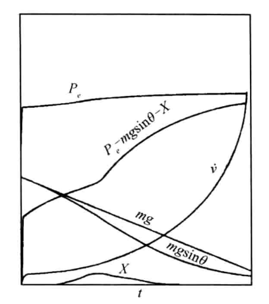

图6-1 切向力和相应加速度随时间的变化曲线

### 6.2.2 主动段转弯过程及运动特性分析

远程火箭发射时通常采用竖直发射。在起飞后的垂直上升段，弹轴 $x_1$ 及速度轴 $x_v$ 均沿发射点垂直向上，即 $\varphi=\theta=90^\circ$。其中，各符号的含义如下：

- $x$ 轴为发射坐标系的水平轴：以发射点为原点，在发射点的水平面内指向预先确定的发射瞄准方向，作为本节俯仰角和速度倾角的共同参考方向。
- $x_1$ 为弹轴，即沿火箭箭体纵向、指向头部的坐标轴，表示箭体的朝向。
- $x_v$ 为速度轴，沿火箭质心的速度方向，表示火箭的运动方向。
- $\varphi$ 为俯仰角，即弹轴 $x_1$ 与发射坐标系水平 $x$ 轴的夹角，在纵向平面内向上转动为正。
- $\theta$ 为速度倾角，即速度轴 $x_v$ 与同一水平 $x$ 轴的夹角，同样以向上转动为正。

因此，$\varphi=\theta=90^\circ$ 表示箭体朝向和速度方向均竖直向上；两轴重合，对应攻角 $\alpha=\varphi-\theta=0$。

根据射程或入轨点参数要求，应在关机点将速度轴转到某一角度 $\theta_k$，其中下标 $k$ 表示关机时刻，即 $\theta_k$ 为关机时的速度倾角。

由式 (6-1-3) 中沿飞行轨迹法线方向的动力学方程，利用法向加速度分量为 $v\dot\theta$，可得速度倾角的变化率方程：

$$
\begin{equation}
\dot\theta=\frac{1}{mv}(P_e+CY^\alpha)\alpha+\frac{g}{v}\cos\theta
\tag{6-2-5}
\end{equation}
$$

可见，要使速度矢量转变，必须提供垂直于速度矢量的法向力。引力 $g$ 可使 $\theta$ 减小，但垂直起飞后 $\theta=90^\circ$，不能依靠引力首先使速度轴偏转。即使 $\theta<90^\circ$，$g$ 本身只随高度变化，也不能作为控制量；同时它对 $\theta$ 的影响较小，而主动段发动机工作时间有限，因此不能把引力分量作为速度轴偏转的主要法向力。

速度倾角变化率方程 (6-2-5) 表明，主要法向力应由升力和推力的法向分量提供，且与攻角 $\alpha$ 有关。攻角是速度轴 $x_v$ 与弹轴 $x_1$ 之间的有向夹角，在本节的纵向运动中满足 $\alpha=\varphi-\theta$。

为使火箭由竖直上升转入转弯飞行，需要先改变弹轴的方向，使其偏离速度轴，形成攻角。箭体朝向改变时，速度方向不会立即同步改变；由攻角产生的推力法向分量和升力，使速度方向逐渐偏转。改变弹轴方向需要施加绕 $z_1$ 轴的控制力矩，这可由燃气舵或摇摆发动机等执行机构提供。其中，$z_1$ 为箭体坐标系中垂直于俯仰运动平面的轴，绕该轴转动会改变箭体的俯仰角。

写出控制力矩表达式前，先说明各符号的含义：

- $M_{z1c}$ 为以火箭质心为矩心、绕箭体 $z_1$ 轴的控制力矩分量；下标 $c$ 表示控制机构产生的作用。
- $\delta_\varphi$ 为俯仰控制通道的等效舵偏角，表示控制机构的偏转量；下标 $\varphi$ 表示俯仰通道，它不是火箭的俯仰角 $\varphi$。
- $M_{z1c}^{\delta}$ 为控制力矩对等效舵偏角的导数，即单位偏角变化引起的控制力矩变化量；上标 $\delta$ 表示对偏角求导，不是乘方。
- $R'$ 为法向控制力对等效舵偏角的导数，在前文采用的燃气舵模型中是一对燃气舵的升力梯度。小偏角下，法向控制力等于 $R'\delta_\varphi$；撇号表示对偏角求导，不是对时间求导。
- $x_g$ 和 $x_c$ 分别为火箭质心和法向控制力作用点沿箭体纵向的位置，采用同一位置坐标约定。两者之差 $x_g-x_c$ 为本式中的有符号力臂，其符号决定给定控制力产生的力矩方向。

在小偏角的线性近似下，控制力矩等于法向控制力乘以相应力臂，因此有

$$
\begin{equation}
M_{z1c}=M_{z1c}^{\delta}\delta_\varphi=R'(x_g-x_c)\delta_\varphi
\tag{6-2-6}
\end{equation}
$$

为规定火箭在主动段各时刻应采取的姿态，预先给定期望俯仰角随时间变化的规律 $\varphi_{pr}(t)$，称为俯仰程序。典型的俯仰程序如图 6-2 所示：垂直上升段保持 $90^\circ$，转弯段逐渐减小，瞄准段保持某一给定角度。具体确定方法将在第 6.4 节介绍，本节先分析火箭如何在给定程序下转弯。

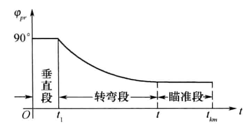

图6-2 弹道导弹的飞行程序

在下面的控制关系中，各符号的含义为：

- $\varphi_{pr}$ 为当前时刻的期望俯仰角，下标 $pr$ 表示程序给定值；为简洁起见，省略其时间自变量 $t$。
- $\varphi$ 为火箭当前的实际俯仰角，$\varphi-\varphi_{pr}$ 为实际姿态相对于期望姿态的偏差，称为程序误差角。
- $\delta_\varphi$ 为俯仰控制通道的等效舵偏角，用于产生调整箭体姿态的控制力矩。
- $a_0^\varphi$ 为俯仰通道的比例控制系数，表示单位程序误差角对应的等效舵偏角；上标 $\varphi$ 表示俯仰通道，不是乘方，其符号需与舵偏角和控制力矩的方向约定配合。

本节采用比例控制关系，即根据实际俯仰角与程序给定值的偏差确定等效舵偏角：

$$
\begin{equation}
\delta_\varphi=a_0^\varphi(\varphi-\varphi_{pr})
\tag{6-2-7}
\end{equation}
$$

由上述控制关系确定等效舵偏角 $\delta_\varphi$ 后，可根据第 3.3.1 节引入的“力矩瞬时平衡”假设求攻角。为便于理解下面的表达式，先说明其中新增的符号及记号对应关系：

- $M_{z1}^{\delta}$ 为绕箭体 $z_1$ 轴的控制力矩对等效舵偏角 $\delta_\varphi$ 的导数，与式 (6-2-6) 中的 $M_{z1c}^{\delta}$ 表示同一量，此处省略了表示控制作用的下标 $c$。
- $M_{z1}^{\alpha}$ 为绕箭体 $z_1$ 轴的气动稳定力矩对攻角 $\alpha$ 的导数，表示单位攻角变化引起的稳定力矩变化量。
- $Y_1^{\alpha}$ 为气动力沿箭体 $y_1$ 轴的分量对攻角的导数；$y_1$ 轴位于箭体俯仰运动平面内，并垂直于弹轴 $x_1$。上标 $\alpha$ 表示对攻角求导，不是乘方。
- $x_p$ 为气动压心沿箭体纵向的位置，与前述质心位置 $x_g$、控制力作用点位置 $x_c$ 采用同一位置坐标约定；$x_g-x_p$ 为气动力相对于质心的有符号力臂。

其余符号沿用前文定义：$\alpha$ 为攻角，$\delta_\varphi$ 为俯仰通道的等效舵偏角，$R'$ 为法向控制力对偏角的导数。在线性近似下，$M_{z1}^{\alpha}=Y_1^\alpha(x_g-x_p)$，$M_{z1}^{\delta}=R'(x_g-x_c)$。将它们代入力矩平衡条件 $M_{z1}^{\alpha}\alpha+M_{z1}^{\delta}\delta_\varphi=0$，当 $M_{z1}^{\alpha}\ne0$ 时，可解得

$$
\begin{equation}
\alpha=-\frac{M_{z1}^{\delta}}{M_{z1}^{\alpha}}\delta_\varphi=-\frac{R'(x_g-x_c)}{Y_1^\alpha(x_g-x_p)}\delta_\varphi
\tag{6-2-8}
\end{equation}
$$

由此产生法向力，使速度轴 $x_v$ 转动，并保证关机时刻 $t_k$ 的速度倾角为 $\theta_k$。由式 (6-2-8) 可知，对于静稳定火箭（$x_g-x_p<0$）和静不稳定火箭（$x_g-x_p>0$），给定同一 $\delta_\varphi$ 时，攻角 $\alpha$ 的符号不同，转弯过程中的物理现象也有区别。下面按图 6-2 的程序角分段，讨论两种火箭的 $\Delta\varphi_{pr}$、$\alpha$ 和 $\delta_\varphi$ 的变化。

#### 1. 垂直段

垂直起飞段约持续几秒到十余秒。在此段 $\varphi_{pr}=90^\circ$，程序轴 $x_{1pr}$ 与实际弹轴 $x_1$ 重合，且均沿发射坐标系 $y$ 轴竖直向上，故 $\Delta\varphi_{pr}=0$、$\delta_\varphi=0$；速度轴 $x_v$ 的起始状态也与 $x_1$ 重合，即 $\alpha=0$。因此，既没有使弹轴转弯的力矩，也没有使速度轴转弯的法向力，$x_{1pr},x_1,x_v$ 三轴始终重合，即 $\varphi_{pr}=\varphi=\theta=90^\circ$。

#### 2. 转弯段

1）静稳定火箭。垂直段结束后，控制系统按预定的俯仰程序，将期望俯仰角 $\varphi_{pr}$ 从 $90^\circ$ 开始减小。此时，实际弹轴 $x_1$ 暂时仍竖直向上，故实际俯仰角 $\varphi$ 大于程序给定值 $\varphi_{pr}$，形成正的程序误差角 $\Delta\varphi_{pr}=\varphi-\varphi_{pr}$。执行机构相应产生正的等效舵偏角 $\delta_\varphi$，火箭受到负控制力矩 $M_{z1c}$，促使弹轴向地面坐标系 $x$ 轴方向偏转。此时速度轴仍处于垂直状态，因而产生负攻角；负攻角又产生负法向力，使速度轴也向 $x$ 轴方向偏转。对静稳定火箭，负攻角产生正安定力矩 $M_{z1st}$，与负控制力矩平衡。程序角不断减小，上述过程连续进行；引力法向分量也使速度轴向 $x$ 轴方向偏转。

2）静不稳定火箭。转弯初始同样形成正的程序误差角和正舵偏角，弹轴向 $x$ 轴偏转并出现负攻角。对静不稳定火箭，负攻角产生负稳定力矩，它与负控制力矩共同加快弹轴偏转，直至 $\varphi<\varphi_{pr}$，程序误差角转为负值，舵偏角也由正变负，以正控制力矩与负稳定力矩平衡。程序角继续减小，负攻角则使速度轴不断偏转。图 6-3 和图 6-4 分别表示两类火箭转弯段中程序轴、弹轴、速度轴以及力和力矩的方向。

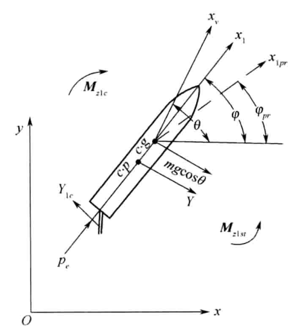

图6-3 静稳定火箭转弯段情况

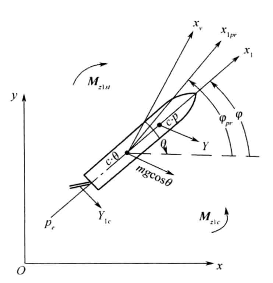

图6-4 静不稳定火箭转弯段情况

转弯段快结束时，程序角取为定值，速度轴在负法向力作用下继续偏转并逐渐向弹轴靠拢；气动力矩减小后，控制力矩促使弹轴向程序轴偏转，直至三轴重合。因此在转弯段末点，$\Delta\varphi_{pr}=\delta_\varphi=\alpha=0$。

#### 3. 瞄准段

瞄准段的程序角为常值。该段起始时三轴重合，弹轴保持与程序轴重合；速度轴则在引力法向分量作用下偏离程序轴，$\theta$ 减小，因而出现正攻角。对静稳定火箭，正攻角形成负安定力矩，使弹轴向 $\varphi$ 减小方向转动并形成负程序误差角；对静不稳定火箭，正攻角形成正安定力矩，使弹轴向 $\varphi$ 增大方向转动并形成正程序误差角。两类火箭均产生与 $\Delta\varphi_{pr}$ 同号的舵偏角，并处于稳定力矩与控制力矩瞬时平衡的状态。图 6-5、图 6-6 表示该段的轴系、力和力矩关系。

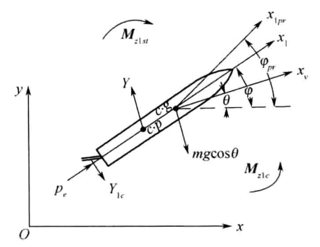

图6-5 静稳定火箭瞄准段情况

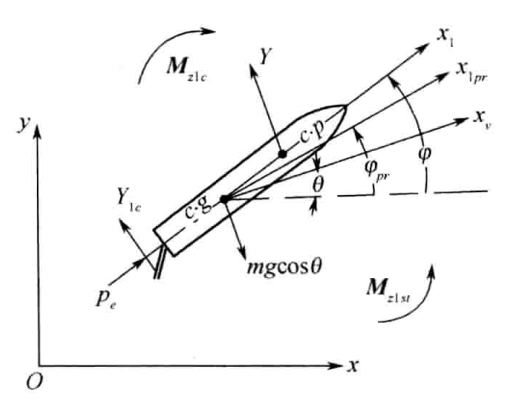

图6-6 静不稳定火箭瞄准段情况

在整个瞄准段，引力法向分量始终作用，故正攻角总是存在，似乎有不断增大的趋势。但正攻角出现，会使推力与升力的正法向分量增大，且推力远大于引力，故必然会对引力法向分量起抵消作用，以致超过引力法向分量，从而使得速度轴x，又向θ增大的方向偏转，减小了正攻角。

图 6-7、图 6-8 分别给出静稳定火箭与静不稳定火箭在整个主动段中攻角 $\alpha$、舵偏角 $\delta_\varphi$ 及程序误差角 $\Delta\varphi_{pr}$ 的变化关系。

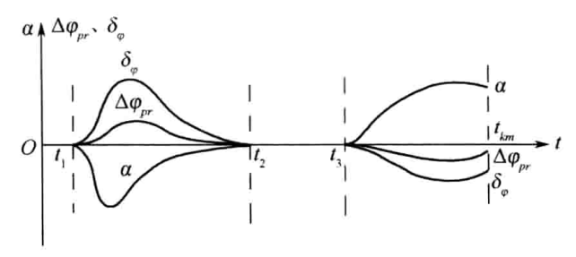

图6-7 静稳定火箭在整个主动段中 $\alpha$、$\delta_\varphi$ 和 $\Delta\varphi_{pr}$ 的变化关系

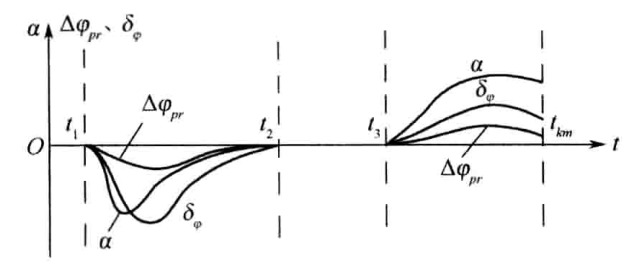

图6-8 静不稳定火箭在整个主动段中 $\alpha$、$\delta_\varphi$ 和 $\Delta\varphi_{pr}$ 的变化关系

图 6-9、图 6-10 分别给出两类火箭在整个主动段中程序角 $\varphi_{pr}$、速度倾角 $\theta$ 及火箭俯仰角 $\varphi$ 的变化关系。

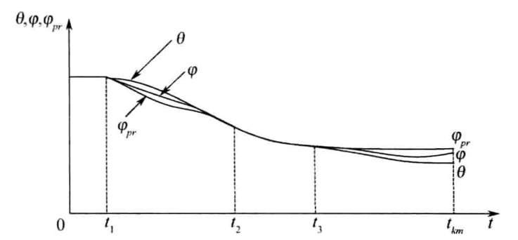

图6-9 静稳定火箭在整个主动段中 $\theta$、$\varphi$ 和 $\varphi_{pr}$ 的变化关系

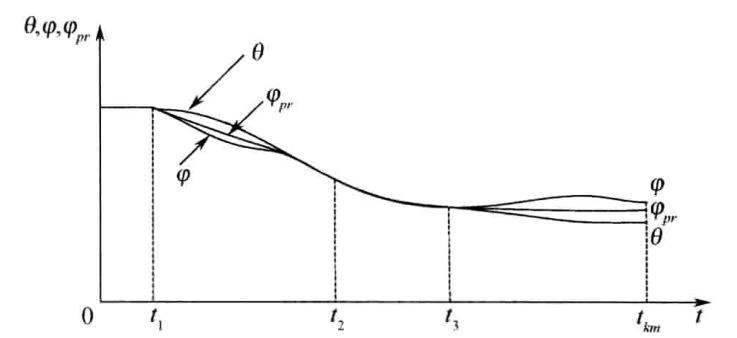

图6-10 静不稳定火箭在整个主动段中 $\theta$、$\varphi$ 和 $\varphi_{pr}$ 的变化关系

### 6.2.3 法向运动特性分析

将速度倾角变化率方程 (6-2-5) 两边乘以速率 $v$，可得法向加速度分量 $v\dot\theta$ 的表达式：

$$
v\dot\theta=\frac{1}{m}(P_e+CY^\alpha)\alpha+g\cos\theta.
$$

法向加速度 $v\dot\theta$ 的大小反映火箭主动段飞行时所受法向力的大小。由于攻角较小，该力基本与 $y_v$ 轴平行。为了减轻结构质量，应尽量减小法向加速度，避免因较大法向力而采取横向加固措施。设计者可让火箭在飞行速度较小时转弯快些、速度较大时转弯慢些，使全主动段的法向加速度不过大，同时保证关机时速度轴转到预定的 $\theta_k$。速度倾角变化率 $\dot\theta$ 和法向加速度 $v\dot\theta$ 随时间的规律见图 6-11。

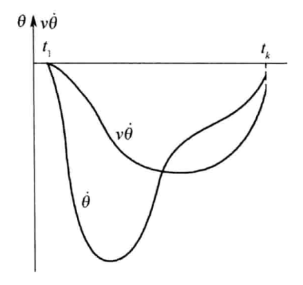

图6-11 主动段速度倾角变化率 $\dot\theta$ 和法向加速度 $v\dot\theta$ 随时间的变化规律

## 6.3 主动段终点运动参数及全射程估算

由自由飞行段分析可知，导弹全射程取决于主动段终点运动参数，即

$$
\beta=\beta(v_k,\Theta_k,\beta_k).
$$

由于关机点速度倾角的最佳值\Theta.op与能量参数v,有关，而v又主要取决于Vs，因此，要解决全射程的估算问题，首先要对v进行估算。影响v的因素很多，如导弹的结构重量、气动力外形、发动机系统参数、控制系统参数等。为了估算v，将其主要影响因素归结为五个设计参数，然后运用半经验的方法找出V，与五个设计参数的关系。这样在选取一组设计参数后即可估算v及相应的xx，yk，进而估算出导弹的全射程。

### 6.3.1 设计参数

#### 1. 结构比 $\mu_k$

$\mu_k$ 为推进剂全部燃烧完后的纯结构质量 $m_k$（或结构重量 $G_k$）与起飞质量 $m_0$（或起飞重量 $G_0$）之比，即

$$
\begin{equation}
\mu_k=\frac{m_k}{m_0}=\frac{G_k}{G_0}
\tag{6-3-1}
\end{equation}
$$

相同起飞重量下，$\mu_k$ 越小，结构重量越小，可携带推进剂越多，结构越优越。因此 $\mu_k$ 是衡量结构优劣的主要参数之一。由式 (6-2-4) 可知，$\mu_k$ 越小，理想速度越大。在当时的材料和工艺水平下，单级液体火箭 $\mu_k$ 的下限约为 0.08～0.1，固体推进剂导弹稍大。

#### 2. 地面重推比 $v_0$

$v_0$ 为导弹起飞重量与发动机地面额定推力之比，即

$$
\begin{equation}
v_0=\frac{G_0}{P_0}
\tag{6-3-2}
\end{equation}
$$

$v_0$ 越小，表示加速性能越好，达到一定速度的时间越短，引力速度损失越小。但 $v_0$ 不宜过小，因为过大加速度会提高结构强度要求并增加结构重量。

#### 3. 地面比推力 $P_{SP.O}$

如式 (2-1-45) 所示

$$
\begin{equation}
P_{SP.O}=\frac{P_0}{\dot G_0}
\tag{6-3-3}
\end{equation}
$$

比推力反映推进剂地面重量秒消耗量所产生的地面推力，是衡量发动机性能的指标之一。在地面推力一定时，比推力越大，单位时间推进剂消耗越少。它主要取决于推进剂种类和发动机工作状态。

#### 4. 发动机高空特性系数 $a$

$a$ 为发动机真空比推力与地面比推力之比，即

$$
\begin{equation}
a=\frac{P_{SP.V}}{P_{SP.O}}
\tag{6-3-4}
\end{equation}
$$

该系数反映发动机高空工作性能，其变化范围较小，约为 1.10～1.15。

#### 5. 起飞截面负荷 $P_M$

$P_M$ 为导弹起飞重量与最大截面积之比，即

$$
\begin{equation}
P_M=\frac{G_0}{S_M}
\tag{6-3-5}
\end{equation}
$$

可见，PM为起飞时单位截面上所承受的重量。导弹起飞重量一定时，SM越小，则P越大。而SM越小。即一般来说导弹就越长，所以PM直接与导弹的长细比有关，而导弹的长细比直接影响导弹的空气动力，故也称Pu为空气动力特性参数。除上述五个设计参数外，通常还引进另一辅助参数T，该T为将导弹起飞时的整个重量看作全部是推进剂，按重量秒耗量燃烧完所需的时间，即

$$
\begin{equation}
T=\frac{G_0}{\dot G}
\tag{6-3-6}
\end{equation}
$$

$T$ 为理想时间，不是独立参数，可用上述设计参数中的 $P_{SP.O}$ 和 $v_0$ 表示：

$$
\begin{equation}
T=\frac{G_0}{P_0}\frac{P_0}{\dot G}=v_0P_{SP.O}
\tag{6-3-7}
\end{equation}
$$

### 6.3.2 主动段终点速度的估算

由式(6-2-1)及式(6-2-3)知，V可以用理想速度及引力、阻力和大气静压引起的三个速度损矢量来表示。下面设法将这些量用设计参数来表示。已知

由于真空推力为

将其代入理想速度表达式，且注意到式(6-3-4)，则有

$$
\begin{equation}
v_{idk}=-g_0aP_{SP.O}\ln\mu_k
\tag{6-3-8}
\end{equation}
$$

考虑到

则有

$$
\begin{equation}
dt=-T\,d\mu
\tag{6-3-9}
\end{equation}
$$

因此，引力、阻力和大气静压引起的速度损失的积分式(6-2-2)通过置换变量后可导得

$$
\begin{equation}
\Delta v_{1k}=\int_0^{t_k}g\sin\theta\,dt=g_0v_0P_{SP.O}\int_{\mu_k}^{1}\sin\theta\,d\mu
\tag{6-3-10}
\end{equation}
$$

$$
\begin{equation}
\Delta v_{2k}=\int_0^{t_k}\frac{X}{m}\,dt=\frac{g_0v_0P_{SP.O}}{P_M}\int_{\mu_k}^{1}C_x\frac{\rho v^2}{2}\frac{d\mu}{\mu}
\tag{6-3-11}
\end{equation}
$$

$$
\begin{equation}
\Delta v_{3k}=\int_0^{t_k}\frac{S_ep_H}{m}\,dt=g_0P_{SP.O}(a-1)\int_{\mu_k}^{1}\frac{p_H}{p_0}\frac{d\mu}{\mu}
\tag{6-3-12}
\end{equation}
$$

$$
\begin{equation}
\left\{\begin{aligned}
I_{1k}&=\int_{\mu_k}^{1}\sin\theta\,d\mu\\
I_{2k}&=\int_{\mu_k}^{1}C_x\frac{\rho v^2}{2}\frac{d\mu}{\mu}\\
I_{3k}&=\int_{\mu_k}^{1}\frac{p_H}{p_0}\frac{d\mu}{\mu}
\end{aligned}\right.
\tag{6-3-13}
\end{equation}
$$

$$
\begin{equation}
\left\{\begin{aligned}
\Delta v_{1k}&=g_0v_0P_{SP.O}I_{1k}\\
\Delta v_{2k}&=\frac{g_0v_0P_{SP.O}}{P_M}I_{2k}\\
\Delta v_{3k}&=g_0P_{SP.O}(a-1)I_{3k}
\end{aligned}\right.
\tag{6-3-14}
\end{equation}
$$

将式(6-3-8)及式(6-3-14)代入式(6-2-3)，即有

$$
\begin{equation}
v_k=-g_0aP_{SP.O}\ln\mu_k-g_0v_0P_{SP.O}I_{1k}-\frac{g_0v_0P_{SP.O}}{P_M}I_{2k}-g_0P_{SP.O}(a-1)I_{3k}
\tag{6-3-15}
\end{equation}
$$

现在的问题是如何将式（6-3-14）中的各个积分表示为五个设计参数的函数。下面分别讨论。

#### 1. $I_1$ 的估算

$I_1$ 是 $sin\theta(\mu)$ 的积分，而 $\theta(\mu)$ 与导弹的飞行程序有关。在控制系统作用下，程序误差角 $\Delta\varphi$ 与攻角 $\alpha$ 均较小，可近似认为 $\theta(\mu)=\varphi_{pr}(\mu)$。

弹道导弹的俯仰程序通常具有相似特征：起飞时有一段垂直飞行段，接近主动段终点时有一段常值俯仰程序角的瞄准段，该常值俯仰角与关机点最佳速度倾角有关。不同射程对应的 $\theta_k$ 不同。垂直段终点与瞄准段起点之间用转弯段连接；考虑到 $\theta(\mu)$ 的微小变化对终点速度影响不显著，估算时通常用二次曲线连接两段，取

$$
\begin{equation}
\theta=\begin{cases}
90^\circ, & 1\geq\mu\geq0.95,\\
4\left(\dfrac{\pi}{2}-\theta_k\right)(\mu-0.45)^2+\theta_k, & 0.95\geq\mu\geq0.45,\\
\theta_k, & 0.45\geq\mu.
\end{cases}
\tag{6-3-16}
\end{equation}
$$

由上式可知，不同的 $\theta_k$ 对应不同的 $\theta(\mu)$。图 6-12 给出了不同 $\theta_k$ 对应的典型程序。将式（6-3-16）代入 $I_1$ 的定义式，即可积分得到 $I_1=I_1(\mu_k,\theta_k)$，其结果绘成图 6-13。

设计参数给定后，先计算理想速度 $v_{id}$；考虑速度损失，可取理想速度的约 70% 求最佳速度倾角，并将其作为 $\theta_k$。再由 $I_1(\mu_k,\theta_k)$ 曲线查得 $I_1$，计算引力造成的速度损失 $\Delta v_1$，从而得到速度的一次近似值

$$
\begin{equation}
v_1(\mu)=v_{id}(\mu)-\Delta v_1(\mu)
\tag{6-3-17}
\end{equation}
$$

图6-12 近似计算飞行性能时采用的典型程序

图6-13 近似计算重力损失时采用的函数

#### 2. $I_2$ 的估算

由式（6-3-13）可见，估算 $I_{2k}$ 需要知道阻力系数 $C_x(M)$ 以及 $\rho v$ 随 $\mu$ 的变化规律。虽然 $C_x(M)$ 曲线与具体导弹的气动特性有关，但阻力损失通常是小量，因此由 $C_x(M)$ 误差引起的速度损失误差也较小，可采用典型导弹的 $C_x(M)$ 曲线计算。速度 $v$ 用一次近似值 $v_1(\mu)$ 代替。计算密度 $\rho$ 和马赫数 $M$ 所需的高度，可由下式近似求得：

$$
\begin{equation}
y=v_0P_{SP.O}\int_{\mu}^{1}v_1(\mu)\sin\theta(\mu)\,d\mu
\tag{6-3-18}
\end{equation}
$$

由 $y$ 可根据大气表查得 $\rho(y)$ 和声速 $a(y)$，再由 $v$、$a$ 求得 $M$ 并查取 $C_x(M)$。由于 $y$、$\mu$、$M$ 一一对应，将 $\rho$、$v$、$C_x$ 代入 $I_2$ 的表达式进行数值积分，并整理大量计算结果，可得到图 6-14 所示的经验曲线 $I_2(\mu_k,\sigma)$，其中

$$
\begin{equation}
\sigma=v_0P_{SP.O}\sqrt{\frac{1}{2}g_0P_{SP.O}(a+1)\sin\theta_k}\cdot10^{-3}
\tag{6-3-19}
\end{equation}
$$

由设计参数计算出 $\mu_k$ 和 $\sigma$ 后，即可由图 6-14 查得 $I_2$，进而算出阻力速度损失 $\Delta v_2$，得到速度的二次近似值

$$
\begin{equation}
v_2(\mu)=v_{id}(\mu)-\Delta v_1(\mu)-\Delta v_2(\mu)
\tag{6-3-20}
\end{equation}
$$

#### 3. $I_3$ 的估算

由式（6-3-13）可知，$I_3$ 与大气压力 $P_H$ 有关，而 $P_H$ 是高度的函数。可用速度的二次近似值计算 $y(\mu)$：

$$
\begin{equation}
y(\mu)=v_0P_{SP.O}\int_{\mu}^{1}v_2(\mu)\sin\theta(\mu)\,d\mu
\tag{6-3-21}
\end{equation}
$$

根据 $y(\mu)$ 查大气表得到 $P_H/P_0$，代入 $I_3$ 的表达式进行数值积分。大量计算结果可整理成图 6-15 所示的经验曲线 $\eta=\eta(\mu_k,v_0)$，而 $I_{3k}$ 与 $\eta$ 的关系为

$$
\begin{equation}
I_{3k}=\frac{\eta}{\dfrac{1}{2}g_0P_{SP.O}(a+1)\sqrt[3]{\dfrac{1}{2}g_0P_{SP.O}(a+1)\sin\theta_k}\cdot10^{-3}}
\tag{6-3-22}
\end{equation}
$$

因此，设计参数给定后即可依次确定 $I_{1k}$、$I_{2k}$ 和 $I_{3k}$，计算三种速度损失，进而估算主动段终点速度 $v_k$。

图6-14 计算阻力损失时采用的函数

图6-15 计算 $I_3$ 时采用的函数 $\eta(\mu_k,v_0)$

以一典型导弹为例，其设计参数为 $v_0=0.577$、$P_{SP.V}=288\,\mathrm{s}$、$P_{SP.O}=240\,\mathrm{s}$、$P_M=10000\,\mathrm{kg/m^2}$、$\theta_k=38^\circ20'$。按上述方法计算出的 $v_{id}$、$\Delta v_1$、$\Delta v_2$、$\Delta v_3$ 及其百分比变化见图 6-16；图 6-17、图 6-18 和图 6-19 分别比较了三项速度损失的近似计算与精确数值积分结果。

图6-16 $v_{id}$、$\Delta v_1$、$\Delta v_2$、$\Delta v_3$ 及其百分比变化曲线

图6-17 $\Delta v_1$ 的近似计算与精确计算结果比较

图6-18 $\Delta v_2$ 的近似计算与精确计算结果比较

图6-19 $\Delta v_3$ 的近似计算与精确计算结果比较

### 6.3.3 主动段终点位置参数近似计算

将式（6-3-8）的理想速度改写为

$$
v_{id}=-g_0P_{SP.O}\ln\mu+g_0(a-1)P_{SP.O}\int_{\mu}^{1}\frac{d\mu}{\mu}.
$$

由式（6-3-15），主动段速度可表示成

$$
\begin{aligned}
v(\mu)={}&-g_0P_{SP.O}\ln\mu-g_0v_0P_{SP.O}I_1
-\frac{g_0v_0P_{SP.O}}{P_M}\int_{\mu}^{1}C_x\frac{\rho v^2}{2}\frac{d\mu}{\mu}\\
&+g_0P_{SP.O}(a-1)\int_{\mu}^{1}\left(1-\frac{P_H}{P_0}\right)\frac{d\mu}{\mu}.
\end{aligned}
$$

等式右端最后两项符号相反，可彼此抵消一部分；近似计算导弹主动段终点坐标时将其略去，得到

$$
\begin{equation}
v(\mu)=-g_0P_{SP.O}\ln\mu-g_0v_0P_{SP.O}I_1
\tag{6-3-23}
\end{equation}
$$

主动段终点坐标为

$$
\begin{equation}
y_k=v_0P_{SP.O}\int_{\mu_k}^{1}v(\mu)\sin\theta(\mu,\theta_k)\,d\mu
\tag{6-3-24}
\end{equation}
$$

$$
\begin{equation}
x_k=v_0P_{SP.O}\int_{\mu_k}^{1}v(\mu)\cos\theta(\mu,\theta_k)\,d\mu
\tag{6-3-25}
\end{equation}
$$

将式（6-3-23）代入式（6-3-24），得到

$$
\begin{equation}
y_k=g_0v_0P_{SP.O}^{2}\int_{\mu_k}^{1}\sin\theta\ln\frac{1}{\mu}\,d\mu-g_0v_0^2P_{SP.O}^{2}\int_{\mu_k}^{1}\sin\theta I_1\,d\mu
\tag{6-3-26}
\end{equation}
$$

注意到

$$
I_1=\int_{\mu}^{1}\sin\theta\,d\mu,
\qquad dI_1=-\sin\theta\,d\mu,
$$

则式（6-3-26）可写为

$$
\begin{equation}
y_k=g_0v_0P_{SP.O}^{2}\left(\int_{\mu_k}^{1}\sin\theta\ln\frac{1}{\mu}\,d\mu-v_0\int_{I_1}^{I_{1k}}I_1\,dI_1\right)
\tag{6-3-27}
\end{equation}
$$

将式(6-3-23)代入式(6-3-25)得

$$
\begin{equation}
x_k=g_0v_0P_{SP.O}^{2}\left(\int_{\mu_k}^{1}\cos\theta\ln\frac{1}{\mu}\,d\mu-v_0\int_{\mu_k}^{1}I_1\cos\theta\,d\mu\right)
\tag{6-3-28}
\end{equation}
$$

$$
\begin{equation}
\left\{\begin{aligned}
\Phi_1&=\int_{\mu_k}^{1}\sin\theta\ln\frac{1}{\mu}\,d\mu\\
\Phi_2&=\int_{\mu_k}^{1}\cos\theta\ln\frac{1}{\mu}\,d\mu\\
\Phi_3&=\int_{\mu_k}^{1}\cos\theta I_1\,d\mu
\end{aligned}\right.
\tag{6-3-29}
\end{equation}
$$

式中，$\Phi_1$、$\Phi_2$、$\Phi_3$ 均为 $\mu_k$、$\theta_k$ 的函数。将按 $\theta_k$ 选定的典型程序 $\theta(\mu)$ 代入式（6-3-29），从 $\mu_k$ 积分至 1，所得结果绘于图 6-20、图 6-21 和图 6-22。于是主动段终点坐标的近似计算式（6-3-27）、式（6-3-28）可写成

$$
\begin{equation}
\left\{\begin{aligned}
y_k&=g_0v_0P_{SP.O}^{2}\left(\Phi_1-\frac{1}{2}v_0I_1^2\right)\\
x_k&=g_0v_0P_{SP.O}^{2}(\Phi_2-v_0\Phi_3)
\end{aligned}\right.
\tag{6-3-30}
\end{equation}
$$

图6-20 $\Phi_1$ 关于 $\mu_k$、$\theta_k$ 的关系曲线

图6-21 $\Phi_2$ 关于 $\mu_k$、$\theta_k$ 的关系曲线

图6-22 $\Phi_3$ 关于 $\mu_k$、$\theta_k$ 的关系曲线

### 6.3.4 全射程估算

根据上面估算出的主动段终点参数 $v_k$、$x_k$、$y_k$，即可估算全射程。先计算

$$
h_k\approx y_k,
\qquad
\beta_k=\arctan\frac{x_k}{R+y_k},
\qquad
\Theta_k=\theta_k+\beta_k.
$$

再由被动段射程公式

$$
\tan\frac{\beta_c}{2}=\frac{B+\sqrt{B^2-4AC}}{2A},
$$

其中

$$
\begin{aligned}
A&=2R\left(1+\tan^2\Theta_k-V_k\right)-V_kh_k,\\
B&=2RV_k\tan\Theta_k,\\
C&=-h_kV_k,
\end{aligned}
$$

求得 $\beta_c$，于是全射程为

$$
L=R(\beta_c+\beta_k).
$$

上述估算忽略了再入大气层的空气动力，把再入段看作自由飞行段椭圆弹道的延伸。在新型导弹方案论证阶段，还可采用更简便的全射程估算方法：不计主动段终点坐标，直接用估算出的速度 $v_k$ 计算最佳速度倾角 $\Theta_{ke.opt}$ 下的自由段射程：

$$
\tan\frac{\beta_{ce}}{2}=\frac{1}{2}\frac{V_k}{\sqrt{1-V_k}},
\qquad
L_{ke}=2R\arctan\frac{V_k}{2\sqrt{1-V_k}}.
$$

将自由段射程乘以系数 $k$ 估算全射程，即

$$
\begin{equation}
L=kL_{ke}=2kR\arctan\frac{V_k}{2\sqrt{1-V_k}}
\tag{6-3-31}
\end{equation}
$$

其中 $k$ 为比例系数。自由飞行段射程占全射程的绝大部分，故 $k$ 大于 1 而接近 1，且射程越大，$k$ 越接近 1。$k$ 不仅取决于射程或主动段终点速度，还与主动段工作时间有关；后者又取决于地面比推力 $P_{SP.O}$ 和重推比 $v_0$。注意到理想时间 $T=P_{SP.O}v_0$，可将其作为参变量，即 $k=k(v_k,T)$。在大量精确计算的基础上可绘出图 6-23 所示的函数曲线。

当 $T$ 一定时，$v_k$ 越大，自由飞行段射程在全射程中所占比例越大，$k$ 越小；当 $v_k$ 一定时，$T$ 越大，主动段工作时间越长，主动段射程越大，故 $k$ 越大。

图6-23 不同 $T$ 值时比例系数 $k$ 与 $v_k$ 的关系

选定一组设计参数后，即可算出 $T$ 和 $v_k$，再查图 6-23 得到 $k$，由式（6-3-31）估计全射程。工程估算中还可近似取 $r_k=R$，代入式（6-3-31）并整理为

$$
\begin{equation}
L=222.4k\arctan\frac{v_k^2}{15.28\sqrt{62.57-v_k^2}}
\tag{6-3-32}
\end{equation}
$$

式中反正切值取度，长度单位取千米。由式（6-3-32）也可用全射程 $L$ 反求 $v_k$。由 $L=kL_{ke}$ 可解得

$$
\begin{equation}
v_k=11.19\sqrt{\tan\left(\frac{L}{222.4k}\right)\tan\left(45^\circ-\frac{L}{2\times222.4k}\right)}
\tag{6-3-33}
\end{equation}
$$

但式中的 $k$ 实际是 $v_k$、$T$ 的函数。设计参数 $P_{SP.O}$、$v_0$ 给定后，$T$ 随之确定。因此，在给定 $T$ 的条件下，可对不同的 $v_k$ 求得 $k=k(v_k)$，再由式（6-3-32）算出 $L=L(v_k)$。计算结果可绘成以 $T$ 为参变量的全射程 $L$ 与主动段终点速度 $v_k$ 的关系曲线，如图 6-24 所示。

图6-24 不同 $T$ 值时 $L$ 与 $v_k$ 的关系

### 6.3.5 设计参数的选择

火箭方案论证首先要使设计参数满足预定的战术、技术要求。对导弹而言，就是根据射程选择五个设计参数，这与上一节由设计参数估算射程的问题相反。全射程 $L$ 主要取决于主动段终点速度 $v_k$。由图 6-24 可知，给定 $T$ 后可由 $L$ 查得 $v_k$；但 $v_0$ 和 $P_{SP.O}$ 本身也是待选参数，因此可先粗估 $T$，求出 $v_k$ 后选择设计参数。若所选 $v_0$、$P_{SP.O}$ 确定的 $T$ 与粗估值相差较大，则迭代修正。

主动段终点速度除与五个设计参数有关外，还受关机点速度倾角 $\theta_k$ 影响，因此应先确定 $\theta_k$。式（6-3-31）中的 $k$ 可由 $v_k$ 和粗估的理想时间 $T$ 查图 6-23 得到。

由β可求得自由飞行段的最佳速度倾角（元-β）则主动段终点的速度倾角即为

$$
\begin{equation}
\theta_k=\Theta_{ke.opt}-\beta_k=\frac{1}{4}\left[\pi-\frac{L}{Rk}(2k-1)\right]
\tag{6-3-34}
\end{equation}
$$

$\theta_k$ 确定后，$v_k$ 是五个设计参数的函数。地面比推力 $P_{SP.O}$ 主要取决于推进剂种类和发动机设计水平，可结合现有技术条件选定。发动机高空特性系数 $a$ 反映发动机的高空工作性能，其变化范围较小，通常为 1.10～1.15，且对速度影响很小，方案论证时可取 $a=1.13$。起飞截面负荷 $P_M$ 与火箭长细比和气动特性有关，但其所影响的阻力速度损失 $\Delta v_2$ 所占比重较小，也可先行选定。

因此，在给定射程 $L$ 时，五个设计参数中主要需要选择的是 $\mu_k$ 与 $v_0$。二者并非相互独立，还与起飞质量 $m_0$ 有关，必须满足重量方程的约束。

#### 1. 火箭的重量方程

火箭的起飞质量可表示为各部分质量之和：

$$
\begin{equation}
m_0=m_p+m_c+m_u
\tag{6-3-35}
\end{equation}
$$

式中：$m_p$ 为推进剂质量；$m_c$ 为结构、发动机及其他附件质量；$m_u$ 为有效载荷质量（包括部分控制仪器在内的头部质量）。为便于选择设计参数，将各部分质量进一步分解并与设计参数联系起来。

$$
\begin{equation}
m_p=(1-\mu_k)m_0
\tag{6-3-36}
\end{equation}
$$

$$
\begin{equation}
m_c=m_{en}+m_b+m_{pt}
\tag{6-3-37}
\end{equation}
$$

其中 $m_{en}$ 为发动机及其附件质量，取决于推力、发动机结构形式、材料性能、燃烧室压力和喷管出口压力等。通常可近似认为发动机质量与推力成正比，即

$$
\begin{equation}
m_{en}=\frac{b}{g_0}P_0=\frac{b}{v_0}m_0
\tag{6-3-38}
\end{equation}
$$

$m_b$ 包括壳体、仪器舱及控制仪器质量，可近似认为与起飞质量成正比，即

$$
\begin{equation}
m_b=Bm_0
\tag{6-3-39}
\end{equation}
$$

$m_{pt}$ 为推进剂箱质量，可近似认为与推进剂质量成正比，即

$$
\begin{equation}
m_{pt}=Km_p=K(1-\mu_k)m_0
\tag{6-3-40}
\end{equation}
$$

将以上各式代入式(6-3-35)得到

$$
\begin{equation}
m_0=\left[B+\frac{b}{v_0}+(1+K)(1-\mu_k)\right]m_0+m_u
\tag{6-3-41}
\end{equation}
$$

$$
\begin{equation}
m_0=\frac{m_u}{1-B-\dfrac{b}{v_0}-(1+K)(1-\mu_k)}
\tag{6-3-42}
\end{equation}
$$

其中比例系数 $b$、$B$、$K$ 由经验统计关系给出。式（6-3-41）或式（6-3-42）称为火箭的重量方程，它反映了火箭各部分质量之间的关系。定义

$$
\begin{equation}
\lambda=\frac{m_u}{m_0}
\tag{6-3-43}
\end{equation}
$$

$\lambda$ 为火箭有效载荷比，则重量方程可改写为

$$
\begin{equation}
\mu_k=\frac{K+B+\dfrac{b}{v_0}}{1+K}+\frac{\lambda}{1+K}
\tag{6-3-44}
\end{equation}
$$

这样，通过重量方程便将 $\mu_k$ 与 $v_0$ 联系起来。若火箭没有有效载荷，即 $\lambda=0$，则记

$$
\begin{equation}
(\mu_k)_{\lim}=\frac{K+B+\dfrac{b}{v_0}}{1+K}
\tag{6-3-45}
\end{equation}
$$

称 $(\mu_k)_{\lim}$ 为火箭的极限结构比。按当时技术水平，$(\mu_k)_{\lim}$ 约为 0.08。于是式（6-3-44）可写成

$$
\begin{equation}
\mu_k=(\mu_k)_{\lim}+\frac{\lambda}{1+K}
\tag{6-3-46}
\end{equation}
$$

#### 2. $\mu_k$ 与 $v_0$ 的选择

由重量方程式（6-3-44）可知，有效载荷比一定时，$\mu_k$ 与 $v_0$ 存在对应关系。按式（6-3-14），$v_0$ 越小，引力和空气动力造成的速度损失 $\Delta v_1$、$\Delta v_2$ 越小，主动段终点速度 $v_k$ 越大。但在 $m_0$ 一定时，较小的 $v_0$ 意味着需要较大的地面推力 $P_0$，从而增大发动机及其附件质量，使结构比 $\mu_k$ 增大；而 $\mu_k$ 增大又会降低理想速度 $v_{id}$。因此，在给定有效载荷比时，为使 $v_k$ 最大，或在给定 $v_k$ 时为使有效载荷比最大，$\mu_k$ 与 $v_0$ 必然存在最佳组合。

工程上可针对一定的有效载荷比 $\lambda$，给出一组 $v_0$，由重量方程求出对应的 $\mu_k$，再用上一节的方法计算相应的 $v_k$，绘成 $v_k$ 与 $v_0$ 的关系曲线。不同 $\lambda$ 对应一族曲线，如图 6-25。根据给定射程所需的 $v_k$，可从曲线族中找到最大有效载荷比 $\lambda_{\max}$ 对应的 $v_0$，再由式（6-3-44）求得结构比。

图6-25 不同有效载荷比 $\lambda$ 下 $v_k$ 与 $v_0$ 的关系曲线

在射程一定（即 $v_k$ 一定）时，$v_0$ 与有效载荷比 $\lambda$ 存在对应关系。固定有效载荷质量后，即可得到 $v_0$ 与起飞质量 $m_0$ 的关系。图 6-26 给出了射程为 4200 km、有效载荷质量为 1 t 时的曲线，其最低点对应最佳重推比 $v_{0.opt}$。若 $v_0<v_{0.opt}$，火箭加速性能好但过载较大，需要增加结构质量；若 $v_0>v_{0.opt}$，主动段引力速度损失增大，需要增加推进剂质量。两种情况都会使起飞质量增加。

函数 $m_0(v_0)$ 在最佳点附近较平缓，因此 $v_0$ 略微偏离最佳值时，起飞质量增加不多。设计中可据此优先利用现有发动机，不必为严格追求最佳 $v_0$ 而重新设计发动机，从而缩短研制周期并降低成本。

图6-26 射程和有效载荷质量一定时 $m_0$ 与 $v_0$ 的关系

## 6.4 主动段弹道设计的作用及原则

远程火箭不论是作为人造地球卫星的运载工具，还是作为远程导弹使用时，其弹道设计在总体设计中都起着极其重要的作用。火箭总体方案、设计参数及运载性能分析等，无论是在方案论证、方案设计和初步设计阶段，还是在火箭的研制和试验阶段都与弹道密切相关。而主动段飞行程序的选择则是弹道设计中的一个重要部分。飞行程序通常指远程火箭主动段飞行时俯仰角的变化规律。飞行程序的选择是远程火箭总体设计工作中很重要的一部分。因为这是关系到能否正确使用和充分发挥远程火箭的战术技术性能的一个大问题。一些重要的战术技术性能，例如最大射程、落点散布以及近程火箭飞行中受载和受热情况等都与所选择的飞行程序有关。下面针对设计参数和总体布置已经确定的远程火箭，分析采用不同飞行程序时的情况。若规定使主动段弹道倾角\Theta，=k.opt，那么就有三种不同的主动段弹道，如图6-27所示：（1）火箭垂直上升，到接近主动段终点时使弹道倾角突然转到k.op。这样的弹道穿过稠密大气层的时间较短，因而空气阻力造成的速度损失较小，但长时间的垂直上升，重力造成的速度损失很大。况且，在短时间内在较大的关机点速度之下，使速度倾角突然从90°改变到\Thetak.op时，θ和的值很大，因而要造成很大的法向力，这样会使火箭的结构和其中的元件横向受力过大，同时也要求控制系统的执行元件提供极大的控制力和控制力矩。所以实际不会采用这样的弹道。

图6-27 不同飞行程序的比较

（2）火箭从起飞开始就按不变的速度倾角飞行，直到主动段终点。这样虽然可减少重力造成的速度损失，但火箭穿过稠密大气层的飞行时间较长，速度的阻力损失加大。由于在稠密大气层中飞行时间长，使火箭会受到较严重的空气动力加热，所以要采取防热措施从而增加了结构质量。此外，这一方案还有一个显著的弱点是倾斜发射，它会使发射装置复杂化。所以对大型运载火箭而言，通常不采用这种弹道。（3）火箭垂直起飞，然后逐渐转弯，达到主动段终点所需要的速度倾角。这是一种使用得当的方案。垂直发射使发射装置简单，逐渐转弯使法向过载和控制力比较小，速度的阻力损失和重力损失也不致于过大。通过以上分析可知，同一远程火箭选用不同形状的弹道，就会有不同的飞行性能。火箭姿态角的程序控制就是改变弹道形状的一种基本方法。由程序机构产生事先规定好的俯仰程序角变化规律(t)，使火箭在主动段飞行时的实际俯仰角(t)按(t)的变化规律变化，从而达到间接控制(t)以改变弹道形状的目的。由上面的分析也可以看到，选择飞行程序时，不仅要从弹道的观点考虑(如使速度损失减小)，而且还要考虑到弹体结构强度、控制和发射使用方面的许多实际约束条件。对飞行程序的要求正是应该充分考虑到这些实际问题。还应指出，选择飞行程序还与发射火箭时对弹道所规定的具体任务有关。如发射导弹和发射卫星的飞行程序，导弹飞行试验时，采用高弹道和低弹道进行试验所要求的飞行程序显然是不同的。下面我们就远程火箭飞行程序的选择提出一些基本的原则：（1）垂直起飞。垂直起飞能克服倾斜发射的缺点，使发射设备简单，只需要结构简单的发射台，同时也使火箭在起飞时刻保持稳定。垂直起飞段的时间应合理选择，此段时间过长就会增大速度的重力损失，并且使得转弯时因速度过大而需要较大的法向力。但如果垂直段时间过短，那么很可能发动机还未达到额定工作状态，控制系统的执行元件还不能产生足够大的控制力，从而会影响弹道性能。因此，通常垂直段应至少保证延续到发动机进入额定工作状态的时刻，此时控制机构也能正常地控制转弯。初始设计时可根据垂直上升时间与火箭推重比(地面额定推力与起飞重量的比值)的经验关系选定。如图6-28所示，推重比大，则表示起飞加速性能好，因此相应的垂直上升时间就可取得较短些。

图6-28 垂直上升时间与火箭推重比的关系

（2）火箭转弯时的法向过载要有限制。法向过载

式中

因此，限制法向过载就要限制攻角α以及攻角和动压的乘积qα的值。飞行时作用在火箭上的空气动力矩以及由此造成的法向过载也与qa成正比，因此通常要求在跨声速及其整个具有大动压头的转弯段弹道上攻角为0或尽可能小。这样火箭只在重力法向分量-mgcosθ作用下转弯，这种转弯称为零攻角转弯或重力转弯。重力转弯减少了速度的阻力损失，同时也在空气动力急剧变化的跨音速段改善了控制系统的工作条件。从加速度的观点看，限制法向过载也就是要限制ve的值，因此，在速度增大后的值更要受到限制。因为=Φ-α，当α保持为0时，=Φ，限制法向过载也就意味着值要受到限制。（3）程序俯仰角变化应连续，角速度r(t)及角加速度r(t)要有限制。如果程序俯仰角r(t)间断，则与程序俯仰角的物理意义相矛盾，同时(t)的突变也使角速度Φ(t)过大，从而会使法向过载过大。.(t)过大时会有过大的惯性力矩，有可能使控制机构提供不了所需的控制力矩。有时候提出使(t)及(t)都要连续的要求。因为(t)的间断相应于控制力矩为无穷大，而(t)的间断则相应于控制力矩即舵偏角的瞬时变化，或者是相应于能偏转的角速度为无穷大。这当然是做不到的，因为会使火箭有短暂的“失控”。如果这种短暂的“失控”对实际俯仰角没有造成实际影响的话，就可以不必严格遵守这样的要求。（4）应保证可靠的级间分离或弹头分离的飞行条件。为保证级间或弹头的可靠分离，要求分离时产生的扰动尽可能小，这样不致增大散布。因此，通常要求分离时攻角尽可能小，使分离时空气动力扰动减小。高度较高时也可以在有攻角时分离，因为气动力影响已经较小，当然推力应已处于末级关机状态，因此分离时的扰动不会很大。（5）应考虑有合适的再入条件。再入大气层时的弹道参数与主动段终点的弹道参数密切相关。为增加射程，通常远程火箭主动段终点速度倾角很小，因此，再入时的再入角的绝对值也很小，这样使弹头在大气层中的飞行时间增长，弹头气动加热就更严重，这将要求增加防热涂层的重量。同时，较小的再入角也使落速过低，从而增加了对敌方反导防御系统突防的困难。因此，考虑再入条件时就要将主动段终点的速度倾角取大一些。（6）根据对弹道规定的任务，选定合适的飞行程序。可以根据对弹道规定的不同任务，选择合适的飞行程序。如要求满足上述五个条件，并在规定的射程散布条件下向接近射程上限的射程发射时，就要求采用最大射程的程序。规定的射程散布指的就是由射程控制方案所规定的散布，包括采用这一射程控制方案的工具误差和方法误差。需要指出的是，射程控制的工具误差和方法误差在选择不同的弹道时是不同的，这是因为不同弹道关机点上的射程偏导数值不同，所以当不向最大射程射击，但仍用最大射程的程序时，那么就可能因对应关机点上的射程偏导数改变而使射程散布增大。因此，当向射程范围内最大射程以下的各射程射击时，最好根据规定的射程，选择使散布最小的弹道程序，通常称为最小散布程序。为发射使用的方便，应把射程范围尽可能小地划分为若干区域，对每一区域上的射程射击时就采用同一程序。采用尽可能少的程序，这也是便于实际战斗使用的一个要求。对于小射程或者射程范围很窄的大射程火箭，往往就只使用一条程序。对近程火箭，最大射程和最小散布的要求则可统一于采用最小能量弹道。上述这些要求是选择飞行程序的一般性原则，对于特定型号或特定任务的火箭，在选择飞行程序时，还应考虑到某些特殊的要求。

## 6.5 飞行程序设计的工程方法

根据远程火箭主动段的飞行特点，飞行程序的设计在工程上通常将其分为大气层飞行段与真空飞行段两部分进行。一般来说，远程火箭的第一级基本上是在稠密大气层内飞行，而其第二级以及更上面的各级则基本上是在稀薄大气层或真空中飞行。火箭在大气层飞行段与稠密大气层外的飞行段受力状况有着显著不同。对于稠密大气层外的飞行段，火箭主要受到发动机推力和地球引力的作用，所受到的空气动力很小，可忽略不计，火箭载荷基本上决定于发动机的工作状态。因此，此段飞行程序的选择主要考虑怎样使火箭关机时达到有效载荷所要求的运动状态，同时尽量减小火箭在地球引力作用下的重力速度损失以及发动机推力偏离速度方向的攻角速度损失。但对于大气层飞行段的飞行程序的选择，除了考虑减小火箭的重力速度损失和攻角速度损失之外，则主要考虑怎样减小火箭所受到的空气动力，特别是空气阻力，以减小火箭速度的气动阻力损失，同时减小作用在火箭上的气动载荷。下面介绍一种在基本设计参数选定以后选择飞行程序的工程方法。

### 6.5.1 大气层内飞行程序设计

在选择大气层飞行段的飞行程序时采用简化的平面运动方程组(6-1-3)：

$$
\begin{equation}
\left\{\begin{aligned}
\dot v&=\frac{P_e-X}{m}+g\sin\theta\\
\dot\theta&=\frac{1}{mv}(P_e+CY^\alpha)\alpha+\frac{g}{v}\cos\theta\\
\dot y&=v\sin\theta\\
\dot x&=v\cos\theta\\
\alpha&=A(\varphi_{pr}-\theta)
\end{aligned}\right.
\tag{6-5-1}
\end{equation}
$$

由于基本设计参数已经选定，上述方程中待求的函数为 $v(t)$、$\theta(t)$、$y(t)$、$x(t)$、$\alpha(t)$ 和 $\varphi_{pr}(t)$，即

$$
\begin{equation}
\left\{\begin{aligned}
\dot v&=\dot v(v,\theta,y)\\
\dot\theta&=\dot\theta(v,\theta,y,\alpha)\\
\dot y&=\dot y(v,\theta)\\
\dot x&=\dot x(v,\theta)\\
\alpha&=\alpha(\varphi_{pr},\theta)
\end{aligned}\right.
\tag{6-5-2}
\end{equation}
$$

方程组有六个未知函数而只有五个方程，其解显然不唯一。工程法根据飞行程序的设计要求给定 $\alpha(t)$ 或 $\varphi_{pr}(t)$，再积分上述方程组；通过调整所给函数的参数，选择满足要求的飞行程序。对中近程火箭，通常要求主动段终点速度倾角等于最小能量弹道的倾角，即 $\theta_k=\Theta_{k.opt}$；对远程火箭的第一级，则要求关机时能平滑过渡到下一级程序。

具体设计时，将主动段弹道分成三段，如图 6-29 所示：$0\sim t_1$ 为垂直上升段，$t_1\sim t_3$ 为转弯段，$t_3\sim t_{km}$ 为瞄准段。

图6-29 飞行程序的分段

下面分别介绍各段飞行程序的选择方法。

#### 1. $0\sim t_1$：垂直上升段

$t_1$ 为火箭起飞至垂直段结束的时间，可按 6.4 节所述要求确定。$t_1$ 过大，会使转弯攻角、过载和速度损失增大。$t_1$ 主要取决于火箭推重比 $1/v_0$，初选时可查图 6-28，或用下式近似确定：

$$
\begin{equation}
t_1=\sqrt{\frac{40}{\dfrac{1}{v_0}-1}}
\tag{6-5-3}
\end{equation}
$$

再经试算修正，最终确定 $t_1$。

#### 2. $t_1\sim t_3$：转弯段

转弯段前期 $t_1\sim t_2$ 为有攻角转弯。为减小气动载荷和气动干扰，应在气动力急剧变化的跨声速区之前结束，通常在 $M(t_2)=0.7\sim0.8$ 时使攻角收缩至零。此后的大动压段 $t_2\sim t_3$ 只依靠重力的法向分量缓慢转弯，即重力转弯。$t_3$ 对近程火箭是程序转弯截止时刻，对中近程火箭则可对应最小射程的关机时刻。攻角变化规律可用以下两种经验关系表示。

（1）攻角变化规律一

$$
\begin{equation}
\alpha(t)=\begin{cases}
-\alpha_m\sin^2 f(t), & t_1<t<t_2,\\
0, & t_2<t<t_3,
\end{cases}\qquad
f(t)=\frac{\pi(t-t_1)}{k(t_2-t)+(t-t_1)},\quad k=\frac{t_m-t_1}{t_2-t_m}
\tag{6-5-4}
\end{equation}
$$

式中：$\alpha_m$ 为跨声速段攻角绝对值的最大值，$t_m$ 为攻角达到极值 $\alpha_m$ 的时刻。调整参数 $k$，等价于调整 $t_m$，从而改变 $\alpha(t)$ 的变化规律。式（6-5-4）所描述的曲线见图 6-29。

（2）攻角变化规律二

$$
\begin{equation}
\alpha(t)=-4\alpha_m Z(1-Z)
\tag{6-5-5}
\end{equation}
$$

式中

$$
\begin{equation}
Z=e^{-a(t-t_1)}
\tag{6-5-6}
\end{equation}
$$

αm亦为声速段上攻角绝对值的最大值，a为选取的某一常值。式(6-5-5)所描述的α(t)的变化规律曲线如图6-30所示。

图6-29 $\alpha(t)$ 变化规律曲线之一

图6-30 $\alpha(t)$ 变化规律曲线之二

由式（6-5-5）可见，$\alpha(t)$ 开始时迅速达到负极值，随后其绝对值减小，并以指数规律趋于零；趋近速度由参数 $a$ 决定。令 $d\alpha/dt=0$，可求得攻角达到极值的时刻：

即得

将上式代入式(6-5-6)，从而可求得攻角达到极值的时间。

$$
\begin{equation}
t_m=t_1+\frac{\ln2}{a}\approx t_1+\frac{0.6931}{a}
\tag{6-5-7}
\end{equation}
$$

由上式可见，$a$ 越大，$t_m$ 越小，即最大攻角出现得越早，弹道转弯越快。调整 $a$ 和 $\alpha_m$ 即可调节转弯快慢。与式（6-5-4）不同，式（6-5-5）不能严格保证 $\alpha(t_2)=0$；要使 $\alpha(t_2)$ 足够小，可适当调整 $a$。

选定 $\alpha(t)$ 后，积分式（6-5-1）可求得 $v(t)$、$\theta(t)$、$x(t)$、$y(t)$ 和 $\varphi_{pr}(t)$，并同时计算射程 $L=L(v,\theta,x,y)$。当 $L=L_{\min}$ 时即可确定 $t_3$，也可以预先选定 $t_3$。

#### 3. $t_3\sim t_{km}$：瞄准段（常值段）

这一段保持程序角不变，即 $\varphi_{pr}(t)=\varphi_{pr}(t_3)$。根据运动特性，本段应以逐渐增大的正攻角飞行。运动方程与有攻角转弯段相同，但积分时给定的是 $\varphi_{pr}(t)$，而不是 $\alpha(t)$。正攻角使 $\theta(t)$ 的变化减慢，并逐渐接近相应的最佳终点速度倾角 $\Theta_{k.opt}(t)$。若在 $t_{km}$ 保证 $\theta(t_{km})=\Theta_{k.opt}(t_{km})$，则在 $t_3\sim t_{km}$ 内其他时刻关机时，$\theta(t)$ 也将接近相应的 $\Theta_{k.opt}(t)$，如图 6-31 所示。

图6-31 $\theta_k(t)$ 与 $\Theta_{k.opt}(t)$ 的变化曲线

$\Theta_{k.opt}(t)$ 可由 $v$、$\theta$、$x$、$y$ 计算。按上述方法逐段积分，对不同的 $\alpha_m$（或参数 $a$）可得到不同的程序曲线及相应的主动段终点参数 $v_k$、$\theta_k$、$x_k$、$y_k$，如图 6-32 所示。为选择满足 $\theta_k=\Theta_{k.opt}$ 的程序，可绘出 $\theta_k(\alpha_m)$ 曲线，并由各组终点参数计算 $\Theta_{k.opt}(\alpha_m)$ 曲线。两曲线交点对应的 $\alpha_m$ 即为所求值，其对应的 $\varphi_{pr}(t)$ 即所需程序曲线，如图 6-33 所示。

图6-32 不同 $\alpha_m$ 时的 $\alpha(t)$ 与 $\varphi_{pr}(t)$

图6-33 $\alpha_m$ 的确定

α值的确定用上述工程方法能选择出一条符合实际要求的程序，但并不一定是最大射程的程序。可以用更进一步的方法，例如变分方法寻求有约束条件下射程的极值解，但这些方法将导致去求解复杂的微分方程边值问题。并且由于受选择程序时那些实际要求的限制，因此可能变分的范围是很窄的。实际计算表明，对中程火箭采

### 6.5.2 真空段飞行程序的设计

远程火箭第二级及其以上的各级已处于稀薄大气层中飞行，这时空气动力对俯仰角程序选择的影响可以忽略不计，所以称为真空飞行段。在这一段，从气动载荷方面来说，对弹道没有什么特殊要求，所以在真空飞行段对俯仰角程序选择时可以完全从提高导弹性能(如射程和散布度)来考虑。下面运用变分原理来研究真空飞行段最优俯仰角程序。如取发射坐标系，并认为地球是圆球时，则其运动方程为

$$
\begin{equation}
\left\{\begin{aligned}
\dot v_x&=\frac{P}{m}\cos\varphi(t)-\frac{fM}{r^3}x\\
\dot v_y&=\frac{P}{m}\sin\varphi(t)-\frac{fM}{r^3}(y+R)\\
\dot y&=v_y\\
\dot x&=v_x
\end{aligned}\right.
\tag{6-5-8}
\end{equation}
$$

式中：r为地心到火箭质心的距离；fM为地球引力常数和地球质量的乘积。若火箭第二级从离地面100km飞行到200km的高度，则fM/r3仅减小不到5%，因此，可以考虑取一个平均距离r而近似认为fM/r3=α²=常数。这样式(6-5-8)近似成为一常系数线性非齐次方程组

$$
\begin{equation}
\left\{\begin{aligned}
\dot v_x&=\frac{P}{m}\cos\varphi(t)-a^2x\\
\dot v_y&=\frac{P}{m}\sin\varphi(t)-a^2(y+R)\\
\dot y&=v_y\\
\dot x&=v_x
\end{aligned}\right.
\tag{6-5-9}
\end{equation}
$$

设第二级开始t=0时初始条件已由第一级终点参数决定，则有

在式(6-5-9)中，由于第一式与第二式相互独立，故可分别求解。

$$
\begin{equation}
\ddot x+a^2x=\frac{P}{m}\cos\varphi(t)
\tag{6-5-10}
\end{equation}
$$

为例具体求解。该式为二阶常系数线性非齐次方程。按一般原理要找此方程的通解，就要找对应齐次方程的一般解及该非齐次方程的任一特解来组成该非齐次方程的特解。显然式(6-5-10)中对应齐次方程的一般解的形式可写为

$$
\begin{equation}
x'=C_1\cos at+C_2\sin at
\tag{6-5-11}
\end{equation}
$$

其中C,C,为常数。为要找非齐次方程的特解，这里用常数变易法来求取。具体做法是将一般解式(6-5-11)中的常数C,C,换成自变量t的函数D,(t),D,(t)，那么，非齐次方程(6-5-10)就有一个特解

$$
\begin{equation}
\bar x=D_1(t)\cos at+D_2(t)\sin at
\tag{6-5-12}
\end{equation}
$$

其中D,(t),D,(t)为待定函数，它们的导数满足下列方程组：

$$
\begin{equation}
\left\{\begin{aligned}
\dot D_1\cos at+\dot D_2\sin at&=0\\
-\dot D_1a\sin at+\dot D_2a\cos at&=\frac{P}{m}\cos\varphi(t)
\end{aligned}\right.
\tag{6-5-13}
\end{equation}
$$

由上式可解待定函数的导数D,(t),D,(t)

$$
\begin{equation}
\left\{\begin{aligned}
\dot D_1(t)&=-\frac{P}{ma}\sin at\cos\varphi(t)\\
\dot D_2(t)&=\frac{P}{ma}\cos at\cos\varphi(t)
\end{aligned}\right.
\tag{6-5-14}
\end{equation}
$$

将式(6-5-14)进行积分可得D(t):

$$
\begin{equation}
\left\{\begin{aligned}
D_1(t)&=-\int_0^t\frac{P}{ma}\sin(a\tau)\cos\varphi(\tau)\,d\tau\\
D_2(t)&=\int_0^t\frac{P}{ma}\cos(a\tau)\cos\varphi(\tau)\,d\tau
\end{aligned}\right.
\tag{6-5-15}
\end{equation}
$$

将式(6-5-15)代入式(6-5-12)，即得非齐次方程的特解

$$
\begin{equation}
\bar x=\frac{1}{a}\int_0^t\frac{P}{m}\cos\varphi(\tau)\sin[a(t-\tau)]\,d\tau
\tag{6-5-16}
\end{equation}
$$

于是由式(6-5-11)与式(6-5-16)即可组成非齐次方程式(6-5-10)的通解形式为

$$
\begin{equation}
x=C_1\cos at+C_2\sin at+\frac{1}{a}\int_0^t\frac{P}{m}\cos\varphi(\tau)\sin a(t-\tau)\,d\tau
\tag{6-5-17}
\end{equation}
$$

由初始条件

可将待定常数C,C,确定为

那么，在上述初始条件下，式(6-5-17)的特解即为

$$
\begin{equation}
x(t)=x_0\cos at+\frac{v_{x0}}{a}\sin at+\frac{1}{a}\int_0^t\frac{P}{m}\cos\varphi(\tau)\sin a(t-\tau)\,d\tau
\tag{6-5-18}
\end{equation}
$$

将式(6-5-18)对t微分，即得

$$
\begin{equation}
\dot x(t)=v_{x0}\cos at-x_0a\sin at+\int_0^t\frac{P}{m}\cos\varphi(\tau)\cos a(t-\tau)\,d\tau
\tag{6-5-19}
\end{equation}
$$

同理，可对式(6-5-9)中的第二式求解得

$$
\begin{equation}
y(t)=y_0\cos at+\frac{v_{y0}}{a}\sin at+\frac{1}{a}\int_0^t\left[\frac{P}{m}\sin\varphi(\tau)-a^2R\right]\sin a(t-\tau)\,d\tau
\tag{6-5-20}
\end{equation}
$$

$$
\begin{equation}
\dot y(t)=v_{y0}\cos at-y_0a\sin at+\int_0^t\left[\frac{P}{m}\sin\varphi(\tau)-a^2R\right]\cos a(t-\tau)\,d\tau
\tag{6-5-21}
\end{equation}
$$

于是，由式(6-5-18)至式(6-5-21)可解得t，时刻的运动参数为

$$
\begin{equation}
\left\{\begin{aligned}
v_{xk}&=v_{x0}\cos at_k-x_0a\sin at_k+\int_0^{t_k}\frac{P}{m}\cos\varphi(\tau)\cos a(t_k-\tau)\,d\tau\\
v_{yk}&=v_{y0}\cos at_k-y_0a\sin at_k+\int_0^{t_k}\left[\frac{P}{m}\sin\varphi(\tau)-a^2R\right]\cos a(t_k-\tau)\,d\tau\\
x_k&=x_0\cos at_k+\frac{v_{x0}}{a}\sin at_k+\frac{1}{a}\int_0^{t_k}\frac{P}{m}\cos\varphi(\tau)\sin a(t_k-\tau)\,d\tau\\
y_k&=y_0\cos at_k+\frac{v_{y0}}{a}\sin at_k+\frac{1}{a}\int_0^{t_k}\left[\frac{P}{m}\sin\varphi(\tau)-a^2R\right]\sin a(t_k-\tau)\,d\tau
\end{aligned}\right.
\tag{6-5-22}
\end{equation}
$$

由变分法则可求得程序角变分&p(t)引起的运动参数变分为

$$
\begin{equation}
\left\{\begin{aligned}
\delta v_{xk}&=-\int_0^{t_k}\frac{P}{m}\cos a(t_k-\tau)\sin\varphi(\tau)\delta\varphi(\tau)\,d\tau\\
\delta v_{yk}&=\int_0^{t_k}\frac{P}{m}\cos a(t_k-\tau)\cos\varphi(\tau)\delta\varphi(\tau)\,d\tau\\
\delta x_k&=-\int_0^{t_k}\frac{P}{ma}\sin a(t_k-\tau)\sin\varphi(\tau)\delta\varphi(\tau)\,d\tau\\
\delta y_k&=\int_0^{t_k}\frac{P}{ma}\sin a(t_k-\tau)\cos\varphi(\tau)\delta\varphi(\tau)\,d\tau
\end{aligned}\right.
\tag{6-5-23}
\end{equation}
$$

则射程的变分为8L:

$$
\begin{equation}
\begin{aligned}
\delta L&=\left(\frac{\partial L}{\partial v_x}\right)_k\delta v_{xk}+\left(\frac{\partial L}{\partial v_y}\right)_k\delta v_{yk}+\left(\frac{\partial L}{\partial x}\right)_k\delta x_k+\left(\frac{\partial L}{\partial y}\right)_k\delta y_k\\
&=\int_0^{t_k}\!\left\{-\left[\left(\frac{\partial L}{\partial v_x}\right)_k\cos a(t_k-\tau)+\left(\frac{\partial L}{\partial x}\right)_k\frac{\sin a(t_k-\tau)}{a}\right]\frac{P}{m}\sin\varphi(\tau)\right.\\
&\qquad\left.+\left[\left(\frac{\partial L}{\partial v_y}\right)_k\cos a(t_k-\tau)+\left(\frac{\partial L}{\partial y}\right)_k\frac{\sin a(t_k-\tau)}{a}\right]\frac{P}{m}\cos\varphi(\tau)\right\}\delta\varphi(\tau)\,d\tau
\end{aligned}
\tag{6-5-24}
\end{equation}
$$

射程取极值的必要条件是其一阶变分为0，故由式(6-5-24)，令8L=0得出最优俯仰程序角随时间变化的变化规律为

tan p(t):

$$
\begin{equation}
\tan\varphi(t)=\frac{\left(\dfrac{\partial L}{\partial y}\right)_k\dfrac{1}{a}\sin a(t_k-t)+\left(\dfrac{\partial L}{\partial v_y}\right)_k\cos a(t_k-t)}{\left(\dfrac{\partial L}{\partial x}\right)_k\dfrac{1}{a}\sin a(t_k-t)+\left(\dfrac{\partial L}{\partial v_x}\right)_k\cos a(t_k-t)}
\tag{6-5-25}
\end{equation}
$$

因此，a为一个小量，sina(t-t)及cosa(t-t)可以写成级数取两项，故上式可以近似取为

$$
\begin{equation}
\tan\varphi(t)=\frac{\left(\dfrac{\partial L}{\partial y}\right)_k(t_k-t)\left[1-\dfrac{a^2}{6}(t_k-t)^2\right]+\left(\dfrac{\partial L}{\partial v_y}\right)_k\left[1-\dfrac{a^2}{2}(t_k-t)^2\right]}{\left(\dfrac{\partial L}{\partial x}\right)_k(t_k-t)\left[1-\dfrac{a^2}{6}(t_k-t)^2\right]+\left(\dfrac{\partial L}{\partial v_x}\right)_k\left[1-\dfrac{a^2}{2}(t_k-t)^2\right]}
\tag{6-5-26}
\end{equation}
$$

当进一步将主动段认为是平行而均匀的不变引力场时，运动方程(6-5-9)可简化为

$$
\begin{equation}
\left\{\begin{aligned}
\dot v_x&=\frac{P}{m}\cos\varphi(t)\\
\dot v_y&=\frac{P}{m}\sin\varphi(t)+g\\
\dot x&=v_x\\
\dot y&=v_y
\end{aligned}\right.
\tag{6-5-27}
\end{equation}
$$

则最优俯仰程序角成为一分式线性函数

$$
\begin{equation}
\tan\varphi(t)=\frac{\left(\dfrac{\partial L}{\partial y}\right)_k(t_k-t)+\left(\dfrac{\partial L}{\partial v_y}\right)_k}{\left(\dfrac{\partial L}{\partial x}\right)_k(t_k-t)+\left(\dfrac{\partial L}{\partial v_x}\right)_k}
\tag{6-5-28}
\end{equation}
$$

由上式可看出(t)由t=0时的值

$$
\begin{equation}
\varphi(0)=\arctan\frac{\left(\dfrac{\partial L}{\partial y}\right)_kt_k+\left(\dfrac{\partial L}{\partial v_y}\right)_k}{\left(\dfrac{\partial L}{\partial x}\right)_kt_k+\left(\dfrac{\partial L}{\partial v_x}\right)_k}
\tag{6-5-29}
\end{equation}
$$

变化到t=t,时的值

$$
\begin{equation}
\varphi(t_k)=\arctan\frac{\left(\dfrac{\partial L}{\partial v_y}\right)_k}{\left(\dfrac{\partial L}{\partial v_x}\right)_k}
\tag{6-5-30}
\end{equation}
$$

值得指出的是t=t,时，俯仰程序角(t,)的表达式与瞬时冲量发射时满足最小能量弹道条件的速度倾角所应有的表达式

$$
\begin{equation}
\tan\Theta_{k.opt}=\frac{\left(\dfrac{\partial L}{\partial v_y}\right)_k}{\left(\dfrac{\partial L}{\partial v_x}\right)_k}
\tag{6-5-31}
\end{equation}
$$

是相同的，但仅只是表达形式相同。式(6-5-30)是相对于发射坐标系计算的，p(t)为相对于发射点水平线的程序角。而式(6-5-31)则是相对于主动段终点的当地坐标系计算的，\Thetak.op为相对于当地水平线的速度倾角。计算p(t,）)时的偏导数值取决于t，时的运动参数V，及r，而计算kopr时的偏导数值取决于给定的速度和高度。只有在瞬时发射的情况下，两者的内容和形式才相同，所以前者可以包括后者这一特殊情况。由此也可以了解到，在非瞬时发射的一般情况下，使射程最大的主动段终点速度倾角已经不是最小能量弹道条件下对应的速度倾角了。应当注意，因为准确的射程偏导数值在开始计算时是未知的，所以用上述公式确定最优俯仰角程序是一个迭代过程。开始只能选择一近似程序，进行弹道计算，算出对应的偏导数值，然后用式(6-5-26)或式(6-5-28)计算最优俯仰角程序的第一次近似值，再进行弹道计算，确定偏导数的进一步近似值，再确定最优程序的进一步近似值，如此重复计算。迭代过程的收敛速度取决于(t)的首次近似对最优程序的逼近程度。用式(6-5-26)或式(6-5-28)计算最优俯仰角程序时，如果采用考地球自转时的偏导数值，那么就可以把地球自转对被动段射程的影响考虑在内。不变引力场的条件对中近程火箭比远程火箭引起的误差要小，但真空段假设对远程火箭更为接近。上面所得最优俯仰角程序是在二级起始点运动参数确定情况下的解。把二级最大所需的一级关机点的最佳程序角9oM，即由式(6-5-27)可得

$$
\begin{equation}
\left\{\begin{aligned}
v_{xk}&=v_{x0}+\int_0^{t_k}\frac{P}{m}\cos\varphi(t)\,dt\\
v_{yk}&=v_{y0}+\int_0^{t_k}\frac{P}{m}\sin\varphi(t)\,dt+gt_k\\
x_k&=x_0+v_{x0}t_k+\int_0^{t_k}\frac{P}{m}(t_k-t)\cos\varphi(t)\,dt\\
y_k&=y_0+v_{y0}t_k+\int_0^{t_k}(t_k-t)\left[\frac{P}{m}\sin\varphi(t)+g\right]dt
\end{aligned}\right.
\tag{6-5-32}
\end{equation}
$$

$$
\begin{equation}
\left\{\begin{aligned}
\delta v_{xk}&=\frac{\partial v_{x0}}{\partial\varphi_0}\delta\varphi_0-\int_0^{t_k}\frac{P}{m}\sin\varphi(t)\delta\varphi(t)\,dt\\
\delta v_{yk}&=\frac{\partial v_{y0}}{\partial\varphi_0}\delta\varphi_0+\int_0^{t_k}\frac{P}{m}\cos\varphi(t)\delta\varphi(t)\,dt\\
\delta x_k&=\frac{\partial x_0}{\partial\varphi_0}\delta\varphi_0+t_k\frac{\partial v_{x0}}{\partial\varphi_0}\delta\varphi_0-\int_0^{t_k}(t_k-t)\frac{P}{m}\sin\varphi(t)\delta\varphi(t)\,dt\\
\delta y_k&=\frac{\partial y_0}{\partial\varphi_0}\delta\varphi_0+t_k\frac{\partial v_{y0}}{\partial\varphi_0}\delta\varphi_0+\int_0^{t_k}(t_k-t)\frac{P}{m}\cos\varphi(t)\delta\varphi(t)\,dt
\end{aligned}\right.
\tag{6-5-33}
\end{equation}
$$

起的vo,Vyo和%的改变。利用射程一阶变分SL=0的条件，除得出二级最优俯仰角程序必须满足的解式(6-5-28)以外，还必须满足条件

$$
\begin{equation}
\frac{\partial L}{\partial v_{xk}}\frac{\partial v_{x0}}{\partial\varphi_0}+\frac{\partial L}{\partial v_{yk}}\frac{\partial v_{y0}}{\partial\varphi_0}+\frac{\partial L}{\partial x_k}\left(\frac{\partial x_0}{\partial\varphi_0}+t_k\frac{\partial v_{x0}}{\partial\varphi_0}\right)+\frac{\partial L}{\partial y_k}\left(\frac{\partial y_0}{\partial\varphi_0}+t_k\frac{\partial v_{y0}}{\partial\varphi_0}\right)=0
\tag{6-5-34}
\end{equation}
$$

当第一级关机前近似为重力转弯时，则

$$
\begin{equation}
\left\{\begin{aligned}
\frac{\partial v_{x0}}{\partial\varphi_0}&=\frac{\partial v_0}{\partial\varphi_0}\cos\varphi_0-v_0\sin\varphi_0\\
\frac{\partial v_{y0}}{\partial\varphi_0}&=\frac{\partial v_0}{\partial\varphi_0}\sin\varphi_0+v_0\cos\varphi_0
\end{aligned}\right.
\tag{6-5-35}
\end{equation}
$$

机点的最佳程序角

$$
\begin{equation}
\varphi_{OM}=\arctan\frac{\dfrac{\partial v_0}{\partial\varphi_0}\left(\dfrac{\partial L}{\partial v_{xk}}+t_k\dfrac{\partial L}{\partial x_k}\right)+v_0\left(\dfrac{\partial L}{\partial v_{yk}}+t_k\dfrac{\partial L}{\partial y_k}\right)}{-\dfrac{\partial v_0}{\partial\varphi_0}\left(\dfrac{\partial L}{\partial v_{yk}}+t_k\dfrac{\partial L}{\partial y_k}\right)+v_0\left(\dfrac{\partial L}{\partial v_{xk}}+t_k\dfrac{\partial L}{\partial x_k}\right)}
\tag{6-5-36}
\end{equation}
$$

上式中av/%表示选择第一级程序时第一级关机点程序角改变引起的关机速度改变值。因为v/主要由速度重力损失的改变所引起的，故av/<0，因而om小于按式(6-5-29)算得的(0)值。根据飞行程序的选择原则，作为与第一级程序相连接的第二级程序，在转级处不应有间断，为此，可在ti=t。前某一小段时间内用一连接段加以连接，如图6-34所示。但这样一个处于一级关机和一、二级级间分离过程中的连接段有许多不利影响。首先在推力随机下降的关机过程中不宜作程序偏转，另外，关机时间的偏差也将增大程序角的偏差，分离时刻的控制力矩将造成对下一级的扰动。为了避免连接段等的不利因素的影响，可将式(6-5-28)所给出的最优俯仰角程序表示成更具有普遍意义的形式

$$
\begin{equation}
\varphi(t)=\arctan\frac{A+Bt}{1+Ct}
\tag{6-5-37}
\end{equation}
$$

在工程设计中可以直接选择其系数A,B,C，在保持满足飞行程序选择的基本原则的条件下，使目标最优。

图6-34 一、二级转级时的连接段

为使二级飞行程序机构简化，在工程设计中也可以采用简化形式，此时俯仰角程序按时间的线性关系表达为

$$
\begin{equation}
\varphi(t)=\varphi_0+\dot\varphi\,t
\tag{6-5-38}
\end{equation}
$$

在优化理论研究中，用数值方法得到的最优解是很接近线性关系的。式(6-5-38)不仅适用于真空段的二级飞行段，而且直接适用于真空段二级以上的各级飞行段。其中%为该级起始点的俯仰角程序，它应与上一级终止点的俯仰角程序相等。Φ为该级俯仰角程序的常值变化率，显然可以通过选择%和等使目标最优。进一步简化，通常可使二级俯仰角程序保持为某一常值。如果这一常值取得合适，那么不致于使射程比采用最优俯仰角程序时有明显减小。下面利用使射程一阶增量为0的条件求出这一常值时俯仰角。因为

$$
\begin{equation}
\left\{\begin{aligned}
v_{xk}&=v_{x0}+g\cos\varphi\int_0^{t_k}\frac{P}{G}\,d\tau\\
v_{yk}&=v_{y0}+g\sin\varphi\int_0^{t_k}\frac{P}{G}\,d\tau+gt_k\\
x_k&=x_0+v_{x0}t_k+g\cos\varphi\int_0^{t_k}\frac{P}{G}(t_k-\tau)\,d\tau\\
y_k&=y_0+v_{y0}t_k+g\sin\varphi\int_0^{t_k}\frac{P}{G}(t_k-\tau)\,d\tau+\frac{1}{2}gt_k^2
\end{aligned}\right.
\tag{6-5-39}
\end{equation}
$$

式中，g=fM/r2、Vo、Vxo、x和y取决于第一级终点的速度倾角，若第一级后期作重力转弯，则速度倾角就是程序角。根据转级时程序应连续的要求，第一级终点的程序角%应与第二级程序角Φ相等。故

$$
\begin{equation}
\left\{\begin{aligned}v_{x0}&=v_0\cos\varphi_0=v_0\cos\varphi\\v_{y0}&=v_0\sin\varphi_0=v_0\sin\varphi\end{aligned}\right.
\tag{6-5-40}
\end{equation}
$$

则当俯仰角有一常值微小增量8时

$$
\begin{equation}
\left\{\begin{aligned}
\delta v_{xk}&=-v_0\sin\varphi\,\delta\varphi+\left(\frac{\partial v_0}{\partial\varphi_0}\right)\cos\varphi\,\delta\varphi-gN\sin\varphi\,\delta\varphi\\
\delta v_{yk}&=v_0\cos\varphi\,\delta\varphi+\left(\frac{\partial v_0}{\partial\varphi_0}\right)\sin\varphi\,\delta\varphi+gN\cos\varphi\,\delta\varphi\\
\delta x_k&=\left(\frac{\partial x_0}{\partial\varphi_0}\right)\delta\varphi-t_kv_0\sin\varphi\,\delta\varphi+t_k\left(\frac{\partial v_0}{\partial\varphi_0}\right)\cos\varphi\,\delta\varphi-g(Nt_k-N_1)\sin\varphi\,\delta\varphi\\
\delta y_k&=\left(\frac{\partial y_0}{\partial\varphi_0}\right)\delta\varphi+t_kv_0\cos\varphi\,\delta\varphi+t_k\left(\frac{\partial v_0}{\partial\varphi_0}\right)\sin\varphi\,\delta\varphi+g(Nt_k-N_1)\cos\varphi\,\delta\varphi
\end{aligned}\right.
\tag{6-5-41}
\end{equation}
$$

式中，X、y和v的变化。e."e

$$
\begin{equation}
\begin{aligned}
\delta L={}&\frac{\partial L}{\partial v_{xk}}\left[-v_0\sin\varphi+\left(\frac{\partial v_0}{\partial\varphi_0}\right)\cos\varphi-gN\sin\varphi\right]\delta\varphi\\
&+\frac{\partial L}{\partial v_{yk}}\left[v_0\cos\varphi+\left(\frac{\partial v_0}{\partial\varphi_0}\right)\sin\varphi+gN\cos\varphi\right]\delta\varphi\\
&+\frac{\partial L}{\partial x_k}\left[-t_k\left(v_0\sin\varphi-\left(\frac{\partial v_0}{\partial\varphi_0}\right)\cos\varphi\right)-g(Nt_k-N_1)\sin\varphi\right]\delta\varphi\\
&+\frac{\partial L}{\partial y_k}\left[t_k\left(v_0\cos\varphi+\left(\frac{\partial v_0}{\partial\varphi_0}\right)\sin\varphi\right)+g(Nt_k-N_1)\cos\varphi\right]\delta\varphi
\end{aligned}
\tag{6-5-42}
\end{equation}
$$

由SL=0得出

$$
\begin{equation}
\tan\varphi_c=\frac{\dfrac{\partial v_0}{\partial\varphi_0}\left(\dfrac{\partial L}{\partial v_{xk}}+t_k\dfrac{\partial L}{\partial x_k}\right)+(gN+v_0)\dfrac{\partial L}{\partial v_{yk}}+\left[g(Nt_k-N_1)+t_kv_0\right]\dfrac{\partial L}{\partial y_k}}{-\dfrac{\partial v_0}{\partial\varphi_0}\left(\dfrac{\partial L}{\partial v_{yk}}+t_k\dfrac{\partial L}{\partial y_k}\right)+(gN+v_0)\dfrac{\partial L}{\partial v_{xk}}+\left[g(Nt_k-N_1)+t_kv_0\right]\dfrac{\partial L}{\partial x_k}}
\tag{6-5-43}
\end{equation}
$$

式（6-5-43）中的 $\varphi_c$ 即为所求的二级常值俯仰角。由于各射程偏导数的准确值以及终点状态在开始计算时尚未知，因此求解仍需迭代。图 6-35 给出了二级最优程序角 $\varphi(t)$、常值角 $\varphi_c$ 和初始角 $\varphi_0$ 的示意图。

图6-35 二级最优程序角 $\varphi(t)$、$\varphi_c$ 和 $\varphi_0$ 的示意图

下面再介绍一种选择真空段二级程序的近似方法，可以减少迭代计算而作为式(6-5-43)的首次近似。这一方法的出发点是把被动段也假定为平行而均匀的不变引力场。认为在一定射程范围内不变引力场中的最大射程与有心力场中的最大射程成正比，因此使不变引力场中射程最大的程序角也就是使有心力场中的射程最大。

图 6-36 示出了不变引力场中的弹道，其射程近似取为落点 $C$ 对应的横坐标 $x_c$，即

$$
\begin{equation}
L\approx x_c=x_k+v_{xk}t_c
\tag{6-5-44}
\end{equation}
$$

图6-36 不变引力场中的弹道

式(6-5-44)中t。为被动段飞行时间，若令g=fM/r²，则t。可由下式求出：

$$
\begin{equation}
t_c=\frac{v_{yk}+\sqrt{v_{yk}^2+2g(y_k-y_c)}}{g}
\tag{6-5-45}
\end{equation}
$$

故由式(6-5-44)得

$$
\begin{equation}
L=x_k+\frac{v_{xk}\left(v_{yk}+\sqrt{v_{yk}^2+2g(y_k-y_c)}\right)}{g}
\tag{6-5-46}
\end{equation}
$$

由上式可求得射程对各主动段运动参数的偏导数：

$$
\begin{equation}
\left\{\begin{aligned}
\frac{\partial L}{\partial x_k}&=1\\
\frac{\partial L}{\partial y_k}&=\frac{v_{xk}}{\sqrt{v_{yk}^2+2g(y_k-y_c)}}\\
\frac{\partial L}{\partial v_{xk}}&=\frac{v_{yk}+\sqrt{v_{yk}^2+2g(y_k-y_c)}}{g}=t_c\\
\frac{\partial L}{\partial v_{yk}}&=t_c\frac{\partial L}{\partial y_k}
\end{aligned}\right.
\tag{6-5-47}
\end{equation}
$$

将式(6-5-47)中各偏导数值代入式(6-5-28)即得出使x。为最大的程序角

$$
\begin{equation}
\tan\varphi=\frac{v_{xk}}{\sqrt{v_{yk}^2+2g(y_k-y_c)}}
\tag{6-5-48}
\end{equation}
$$

利用式(6-5-45)，这一结果还可写成为

$$
\begin{equation}
\tan\varphi=-\frac{v_{xk}}{v_{yk}-gt_c}=-\frac{v_{xc}}{v_{yc}}=-\cot\theta_c
\tag{6-5-49}
\end{equation}
$$

$$
\begin{equation}
\varphi+(-\theta_c)=\frac{\pi}{2}
\tag{6-5-50}
\end{equation}
$$

即为达到不变引力场中的最大射程，应使推力方向与落速方向垂直。在式(6-5-48)或者式(6-5-49)中，Vx，Vx或vxc，Vse都还与角有关，因此为了求出俯仰角，还要进一步利用一些关系。首先可以由运动方程式(6-5-27)直接积分求出落点参数

$$
\begin{equation}
\left\{\begin{aligned}
v_{xc}&=v_{x0}+gN\cos\varphi\\
v_{yc}&=v_{y0}+g(N\sin\varphi-T_c)\\
x_c&=x_0+v_{x0}T_c+g(NT_c-N_1)\cos\varphi\\
y_c&=y_0+v_{y0}T_c+g\left[(NT_c-N_1)\sin\varphi-\frac{1}{2}T_c^2\right]
\end{aligned}\right.
\tag{6-5-51}
\end{equation}
$$

式(6-5-51)可以从第一级开始计算，故运动参数的初始值可取自发射点

T为总飞行时间。N,,N则可用两级的设计参数表示：

$$
\begin{equation}
\left\{\begin{aligned}
N&=\int_0^{t_{k1}}\left(\frac{P}{G}\right)_{\mathrm I}dt+\int_0^{t_{k2}}\left(\frac{P}{G}\right)_{\mathrm{II}}dt\\
&=-P_{sp1}\ln\mu_{k1}-P_{sp2}\ln\mu_{k2}\\
N_1&=\int_0^{t_{k1}}\left(\frac{P}{G}\right)_{\mathrm I}t\,dt+\int_0^{t_{k2}}\left(\frac{P}{G}\right)_{\mathrm{II}}t\,dt\\
&=-P_{sp1}(T_1\ln\mu_{k1}+t_{k1})-P_{sp2}(T_2\ln\mu_{k2}+t_{k2})
\end{aligned}\right.
\tag{6-5-52}
\end{equation}
$$

式中：$t_{k1}$、$t_{k2}$ 分别为第一、二级发动机工作时间；$P_{sp1}$、$P_{sp2}$ 分别为第一、二级发动机比推力；$T_1$、$T_2$ 分别为第一、二级火箭的理想时间。$G_1$、$G_2$ 分别为第一、二级发动机的推进剂秒消耗量，并假定为常值。

由式（6-5-49）可进一步得到显含 $\varphi$ 的 $T_c$ 表达式：

$$
\begin{equation}
T_c=\frac{N}{\sin\varphi}
\tag{6-5-53}
\end{equation}
$$

将式（6-5-53）代入式（6-5-51），便得到显含 $\varphi$ 的 $x_c$、$y_c$ 表达式：

$$
\begin{equation}
\left\{\begin{aligned}
x_c&=g\left(\frac{N^2}{\sin\varphi}-N_1\right)\cos\varphi\\
y_c&=g\left[\left(\frac{N^2}{\sin\varphi}-N_1\right)\sin\varphi-\frac{N^2}{2\sin^2\varphi}\right]
\end{aligned}\right.
\tag{6-5-54}
\end{equation}
$$

sin@

记无因次量

$$
\begin{equation}
\left\{\begin{aligned}\frac{N_1}{N^2}&=A\\\frac{(gN)^2}{gR}=\frac{gN^2}{R}&=B\end{aligned}\right.
\tag{6-5-55}
\end{equation}
$$

式中：R为地球半径；gN为两级火箭瞬时燃烧时的熄火速度，因此B值相当于能量参数。将式(6-5-55)代入式(6-5-54)，则x，y。的表达式变为

$$
\begin{equation}
\left\{\begin{aligned}
x_c&=RB\cot\varphi(1-A\sin\varphi)\\
y_c&=\frac{RB}{2\sin^2\varphi}(2\sin^2\varphi-2A\sin^3\varphi-1)
\end{aligned}\right.
\tag{6-5-56}
\end{equation}
$$

落点C(xy)应满足地表面上大圆弧方程

但通过计算发现，采用y=-x2/2R的抛物线弧作为地表面交线所计算出的最优程序角更接近于有心力场的结果。实际上，可这样近似来看,大圆弧相当于有心引力场中沿地表面以第一宇宙速度gR发射的圆轨道，抛物线弧则相当于不变引力场中沿地表面以同一宇宙速度√gR再发射的轨道，因此用不变引力场代替有心引力场时弹道平面与表面的交线就需作这一转换。

$$
\begin{equation}
\sin\varphi=\left\{\frac{1}{2-B}\left[A^2B\sin^4\varphi+2A(1-B)\sin^3\varphi-A^2B\sin^2\varphi+2AB\sin\varphi+1-B\right]\right\}^{1/2}
\tag{6-5-57}
\end{equation}
$$

方程式(6-5-57)可以进行数值求解。当A=0时，则相当于瞬时发射，上述结果式(6-5-57)成为

$$
\begin{equation}
\tan\varphi=\sqrt{1-B}
\tag{6-5-58}
\end{equation}
$$

式(6-5-58)给出的程序角与最小能量弹道条件下所要求的最佳速度倾角相同。还可以由式(6-5-56)求出此时的射程

$$
\begin{equation}
x_c=\frac{RB}{\sqrt{1-B}}
\tag{6-5-59}
\end{equation}
$$

而用椭圆理论算出的射程为

比较两者关系得出

$$
\begin{equation}
L_e=2R\arctan\frac{x_c}{2R}
\tag{6-5-60}
\end{equation}
$$

由此看出，不变引力场中的最大射程与有心引力场中的最大射程成正比，由于有心引力场的影响，使按椭圆理论计算的射程L。小于x。。

## 6.6 飞行程序优化设计方法

在上节中我们运用变分原理分析研究了远程火箭真空段的最优飞行程序，这是一种控制变量无约束条件下求解优化问题的间接方法。除古典的变分法之外，在控制变量为有约束的条件下，则运用极大值原理求解优化问题，这也是一种间接方法。间接方法中，一般作为飞行程序优化的自变量，是整个动力飞行段的时间函数，期望获得极大值的“目标”是一个泛函。解决问题的办法是用古典变分原理导得的两点边界条件之间的迭代法等。其实，在实际工程设计中，远程火箭的飞行程序一般用若干个参数即可完全确定。正如上节中所分析的那样，一级飞行程序由α.即可基本确定，真空段二级飞行程序如取简化形式，即俯仰角程序按时间的线性关系变化，则该段飞行程序由其起始俯仰角9和常值俯仰角速率即可确定。由此分析易知，全弹道的俯仰角飞行程序可表示为如下形式：

$$
\begin{equation}
\varphi_{pr}(t)=f(\alpha_m,\varphi_0,\dot\varphi,\ldots)
\tag{6-6-1}
\end{equation}
$$

这样，飞行程序 $\varphi_{pr}(t)$ 的选择就转化为参数 $\alpha_m,\varphi_0,\dot\varphi,\ldots$ 的选择，飞行程序优化设计也归结为“参数优化”问题，目标函数不再是泛函。利用计算机直接遴选参数，是优化设计技术的一个发展方向。常见的直接优化方法很多，本节介绍对飞行程序优化较有效的随机方向法。

飞行程序设计与飞行任务密切相关，程序参数优化要受一系列工程约束，包括等式约束和不等式约束。例如，一级飞行程序要求满足最大动压头 $q_{\max}\leq C$；二级飞行程序要求满足速度倾角 $\Theta_k=\Theta_{k.opt}$。处理这类约束优化问题的方法很多，本节采用罚函数法，并从原理上介绍飞行程序优化中的参数优化方法。

### 6.6.1 目标函数

飞行程序的优化设计是挖掘远程火箭的潜力，以提高其使用价值的重要手段。假设飞行程序由n个参数决定，即由n维空域R中的某一点n维向量X=[，x2，,x4]}"唯一确定。那么，优化的目的就是在空域R，中选择某一个点X=X*，使远程火箭所获得的某一个(单目标)或几个(多目标)设计指标达到极大。这些设计指标当然因任务而有差异。如发射卫星时，可以是给定入轨条件下的最大有效载荷，或给定载荷下的最大圆轨道高度等；又如发射导弹时，则可以是一定条件下的最大射程等。所有这些要求达到极值的量，就是飞行程序优化问题中的“目标函数”，它们是n维向量X的单值函数。用J表示目标函数，则有

$$
\begin{equation}
J=J(X)
\tag{6-6-2}
\end{equation}
$$

值得注意的是，如果目标有m个，即在一般情况下，n维空域中R，不存在一点，使它们同时达到极大。处理这类问题的有效方法是引入“权系数”，即根据这些目标的重要程度，分别乘以相应的权因子a,(i=1,2,3,4,",m)，使其综合成单一的“目标函数”来处理：

a≥0

$$
\begin{equation}
\left\{\begin{aligned}J&=\sum_{i=1}^{m}a_iJ_i\\a_i&\geq0\\\sum_{i=1}^{m}a_i&=1\end{aligned}\right.
\tag{6-6-3}
\end{equation}
$$

### 6.6.2 优化自变量的选取

由式(6-6-1)知，全弹道的飞行程序主要由αm，9%,Φ等参数确定。这些参数即是飞行程序优化设计中所需要进行优化的自变量。优化自变量的选取通常要根据远程火箭的总体结构、发动机的性能以及具体飞行任务等实际情况来确定。例如远程火箭作为发射人造卫星等的运载器使用，火箭由三级组成，且三级具有二次启动能力，则飞行程序的优化自变量一般可以选取下述主要参数：第一级亚声速段最大负攻角αm；第二级常值俯仰角速率Φpr2；三级首次动力飞行段熄火点重量G3;三级首次动力飞行段常值俯仰角速率m：无动力滑行段飞行时间T3：三级二次动力飞行段起始俯仰角923；三级二次动力飞行段常值俯仰角速率3：对于不具备二次启动能力，也不具备级间滑行能力的二级远程火箭来说，其飞行程序的优化自变量一般主要选取αm，Φpr2，Φm2等参数。

### 6.6.3 约束条件的处理

飞行程序设计受一系列工程设计上的限制或约束，如在稠密大气层中飞行的最大速度头的限制、各级残落区的约束、飞行试验时关机点高度的约束以及飞行试验时靶场距离的约束等。它们可表示为等式约束和不等式约束

$$
\begin{equation}
\left\{\begin{aligned}h_j(X)&=0,\quad j=1,2,\ldots,p\\g_k(X)&\geq0,\quad k=1,2,\ldots,q\end{aligned}\right.
\tag{6-6-4}
\end{equation}
$$

通常把约束极值问题转化为无约束极值问题求解。罚函数法通过改变目标函数消去约束：在目标函数中加入与偏离约束程度有关的惩罚函数（或代价函数），形成增广的代价目标函数，从而把有约束极值问题转化为无约束极值问题。罚函数法分为内罚函数法和外罚函数法。内罚函数法相当于在约束区域边界筑起一道“墙”，迭代点靠近边界时函数值陡增，使最优点留在允许区域内部。对于式 (6-6-4)，可取内罚函数

$$
\begin{equation}
B(X)=\sum_{k=1}^{q}\frac{1}{g_k(X)}
\tag{6-6-5}
\end{equation}
$$

内罚函数法只能改进可行方案，优化开始时的自变量必须位于可行域内。外罚函数法允许从任意不可行方案开始，因而应用更普遍。对于不等式约束，悬岩代价函数使综合目标面在可行域边界形成陡峭“悬岩”，以加速攀登并保证结果满足约束。对式 (6-6-4) 采用外罚函数法及悬岩代价函数时，外罚函数为

$$
\begin{equation}
P=\sum_{j=1}^{p}k_j\lvert h_j(X)\rvert^2+\sum_{k=1}^{q}l_k\left(1+\lvert g_k(X)\rvert^2\right),\qquad l_k=\begin{cases}0,&g_k(X)\geq0,\\l'_k,&g_k(X)<0.\end{cases}
\tag{6-6-6}
\end{equation}
$$

其中 $l'_k,k_j$ 为惩罚系数。于是可得到代价目标函数

$$
\begin{equation}
\bar J(X)=J(X)+P(X)
\tag{6-6-7}
\end{equation}
$$

这样问题即完全转化为利用随机方向法优化飞行程序中的自变量X如参数αm，Φ，等)，使无约束的代价目标函数达到极大值或最佳值。

### 6.6.4 随机方向法的原理

下面以二维自变量为例介绍随机方向法的基本原理。从变量空间(现该空间为一平面)内，取任意“0”点为起始点，对应矢量X。表示初始方案，然后由计算机随机地确定一个调优矢dX，其大小和方向均是随机的。与X。矢量叠加得新方案X；（对应点为1'），求其目标函数值。从等高线图6-37分析可知，如“1'”点比“0”点低，则探索失败，这时应返回到“0”点，重新随机地给一个调优矢，例如得到新点“1”，对应的矢量为X，求其目标函数值。如“1”点比“0”点高，则探索成功，于是将“1”点取代“0”点作为新的起始点，并沿成功的方向加大步长前进，直到探索失败，回到最后一次成功的位置上，如图6-37中的“2”点，以此作为起始点重复上述过程，直到迫近顶峰(最优点)。当起始点与顶峰点间距离小于调优dX的长度时，则会出现连续无数次探索不得成功，如图6-37中“4”点处所示的情形。此时要缩小调优矢的长度，继续上述过程，直到调优的长度缩小到规定的精度，探索停止，最后得到的最高点即为最优点。该点所对应的参数也就是对应的最优设计参数。

图6-37 随机方向法的原理示意图

## 6.7 远程固体火箭的能量管理

远程火箭的主动段飞行程序与总体设计指标和性能相对应。选定飞行程序后，可按该俯仰角程序进行导引控制，使到达目标点的偏差保持在允许范围内。对于具有推力终止系统的火箭，无论采用固体还是液体推进剂，这一过程都容易实现。

固体火箭从提高结构强度和最大射程的角度出发，往往希望取消推力终止系统。固体发动机壳体通常采用玻璃纤维或有机纤维缠绕工艺制造；安装推力终止机构需要在壳体上开孔，会切断纤维并削弱强度，反向喷管与壳体的连接也较困难。即使通过制造工艺改进解决这些问题，也会增加发动机结构质量并影响最大射程。取消推力终止系统可提高发动机推重比和最大有效射程，同时避免上述制造与强度问题。

取消推力终止系统后，远程固体火箭的飞行程序必须解决以下问题：

1. 在总能量固定时，对最小射程到最大射程之间的任意目标，消耗多余能量；
2. 保证最大有效射程取极值；
3. 在能量耗尽条件下，使主动段误差处于末修级低推力修正能力范围内；
4. 在能量耗尽条件下，使射击诸元计算尽量简单且精度较高。

这些问题的实质是过剩能量的耗尽管理。单纯选择高、低弹道并不可取：高弹道再入角和再入速度较大，会加剧气动加热；低弹道再入角较小、再入时间较长，气动干扰会增大落点散布。较有效的方法是通过飞行程序导引控制火箭姿态变化，以消耗过剩能量。

### 6.7.1 大气层内飞行程序设计

与远程液体火箭一样，远程固体火箭的第一级一般都在稠密大气层内飞行，由于在该段飞行过程中火箭受力情况复杂，故其飞行程序通常仍采用6.5所述的固定飞行程序。即取

$$
\begin{equation}
\varphi_{pr}(t)=\begin{cases}
90^\circ, & t\leq t_1,\\
\theta_T+\alpha(t), & t_1<t\leq t_2,\\
\theta_T, & t_2<t\leq t_3,\\
\varphi_{pr}(t_3), & t_3<t\leq t_{k1}.
\end{cases}
\tag{6-7-1}
\end{equation}
$$

为了适应于不同射向、不同射程能量耗尽管理的要求，通常该段飞行程序还可取下述形式：

$$
\begin{equation}
\varphi_{pr}(t)=\begin{cases}
90^\circ, & t\leq t_1,\\
\theta_T+\varepsilon\alpha(t), & t_1<t\leq t_2,\\
\theta_T, & t_2<t\leq t_3,\\
\varphi_{pr}(t_3), & t_3<t\leq t_{k1}.
\end{cases}
\tag{6-7-2}
\end{equation}
$$

$\varepsilon$ 为可调权系数。取不同的 $\varepsilon$ 值即可满足不同射向和射程的要求，因此可把它作为一项射击诸元。对于最大射程附近的目标，需要较准确地给定 $\varepsilon$，以便使射程最大；对于一般射程目标，只需把它表示为射程的简单函数。

### 6.7.2 真空段飞行程序的设计

与远程液体火箭不同，远程固体火箭真空段飞行程序还必须解决剩余能量的耗尽管理问题。下面先引入与火箭固有能量有关的视速度模量。

#### 1. 视速度模量

第二级及其以上各级通常在稠密大气层外飞行，空气动力相对推力和重力很小。忽略空气动力，并令地面比推力 $P_{sp0}$ 为常值，由式 (2-1-42) 可把这些级的视速度模量表示为

$$
\begin{equation}
W_M=\int_{t_0}^{t_k}\lvert\dot W\rvert\,dt=\int_{t_0}^{t_k}\frac{P}{m}\,dt=g_0P_{sp0}\ln\frac{G_0}{G_K}
\tag{6-7-3}
\end{equation}
$$

式中，$t_0$ 为第一级关机、第二级起始的时刻。式 (6-7-3) 表明，视速度模量只与发动机比推力以及各级点火、熄火点质量有关。它是火箭固有能量的度量，也是各级所能提供视速度增量的最大值。$W_M$ 的误差主要取决于比推力 $P_{sp0}$ 的偏差；若以 $W_M$ 的标准值进行能量管理，实际偏差需要由下一级或末修级修正。

#### 2. 能量管理模型

真空段各级飞行程序一般分为两部分：第一部分用于能量耗散管理，第二部分用于误差补偿修正。分别记其视速度模量为 $\Delta W_I$、$\Delta W_{II}$，通常前者约占 $W_M$ 的 85%，后者约占 15%。

假设该级起始时刻已经求出多余视速度模量 $W_e$，且火箭纵轴与所要求的视速度 $W_D$ 方向一致。能量管理的目的，是通过调整火箭姿态消耗剩余视速度模量，使该段结束时沿 $W_D$ 方向的视速度增量等于 $W_D-\Delta W_{II}$。用曲线 $W_I$ 表示能量管理段起点与终点之间长度为 $\Delta W_I$ 的任一曲线，其基本思想如图 6-38 所示。

图6-38 能量耗尽管理基本思想示意图

为便于姿态控制，通常令 $W_I$ 为光滑连续、关于 $OA$ 垂直平分线轴对称的曲线，如图 6-39。若把曲线 $W_I$ 和直线 $W_D-\Delta W_{II}$ 看作质点轨迹，则从 $O$ 到 $A$ 时，曲线明显长于直线。偏离 $W_D$ 方向的运动需要更多能量，因此可通过调整姿态、使火箭偏离 $W_D$ 方向飞行来消耗剩余能量。

图6-39 $W_I$ 及 $\dot W_I$ 的模型示意图

图 6-39 中 $\dot W_I$ 是曲线 $W_I$ 的斜率变化曲线，反映从 $O$ 到 $A$ 偏离 $W_D$ 方向的变化过程。实现该视速度变化规律时，可选取图 6-40 所示姿态规律；其斜率 $d\varphi/dW_I$ 的变化见图 6-41。

图6-40 $\varphi$ 随 $W_I$ 的变化规律

图6-41 $d\varphi/dW_I$ 随 $W_I$ 的变化规律

由以上分析可知，在动力飞行过程中，可以由视加速度测量值 $\dot W_s$ 实时确定姿态角 $\varphi(t)$，即实时确定飞行程序。由于

$$
\begin{equation}
\frac{d\varphi}{dt}=\frac{d\varphi}{dW_I}\frac{dW_I}{dt}=\dot W_I\frac{d\varphi}{dW_I}
\tag{6-7-4}
\end{equation}
$$

若假设动力飞行中的视加速度服从给定规律 $\dot{\widetilde W}_I$，则有

$$
\begin{equation}
\frac{d\widetilde\varphi}{dt}=\dot{\widetilde W}_I\frac{d\widetilde\varphi}{dW_I}
\tag{6-7-5}
\end{equation}
$$

或者

$$
\begin{equation}
\frac{d\widetilde\varphi}{dW_I}=\frac{d\widetilde\varphi}{dt}\bigg/\dot{\widetilde W}_I
\tag{6-7-6}
\end{equation}
$$

其中 $\widetilde\varphi$ 为对应给定规律 $\dot{\widetilde W}_I$ 的姿态角。在实际飞行过程中应有

$$
\begin{equation}
\frac{d\varphi_s}{dW_I}=\frac{d\varphi_s}{dt}\bigg/\dot W_s
\tag{6-7-7}
\end{equation}
$$

其中 $\varphi_s$ 为与视加速度测量值 $\dot W_s$ 对应的姿态角。式 (6-7-6) 表示给定视加速度规律下姿态角变化率与 $\dot{\widetilde W}_I$ 的关系；式 (6-7-7) 表示实际飞行中姿态角变化率与测量值 $\dot W_s$ 的关系。为保证实际 $W_I$ 曲线与给定形式一致，应满足

$$
\begin{equation}
\frac{d\widetilde\varphi}{dW_I}=\frac{d\varphi_s}{dW_I}
\tag{6-7-8}
\end{equation}
$$

于是由式(6-7-6)～式(6-7-8)，即可求得

$$
\begin{equation}
\frac{d\varphi_s}{dt}=\frac{d\varphi_s}{dW_I}\dot W_s=\frac{d\widetilde\varphi}{dW_I}\dot W_s=\frac{\dot{\widetilde\varphi}}{\dot{\widetilde W}_I}\dot W_s
\tag{6-7-9}
\end{equation}
$$

由式 (6-7-9) 积分可得 $\varphi(t)$：

$$
\begin{equation}
\varphi(t)=\int_{t_0}^{t}\frac{\dot{\widetilde\varphi}}{\dot{\widetilde W}_I}\dot W_s\,dt+\varphi_0
\tag{6-7-10}
\end{equation}
$$

考虑到 $\dot{\widetilde\varphi}$ 分段连续，由式 (6-7-5) 和图 6-41 可得图 6-42 所示的 $\dot{\widetilde\varphi}$ 时间规律，以及图 6-43 所示的 $\widetilde\varphi$ 时间规律。式 (6-7-10) 中的积分应分段计算。

图6-42 $\dot{\widetilde\varphi}$ 随时间的变化规律

图6-43 $\widetilde\varphi$ 随时间的变化规律

取能量管理段总能量

$$
\begin{equation}
\Delta W_I=4\Delta W_1+2\Delta W_2
\tag{6-7-11}
\end{equation}
$$

其中

$$
\begin{equation}
\left\{\begin{aligned}\Delta W_1&=W_1-W_0=W_3-W_2=W_4-W_3=W_6-W_5\\\Delta W_2&=W_2-W_1=W_5-W_4\end{aligned}\right.
\tag{6-7-12}
\end{equation}
$$

并注意到

$$
\begin{equation}
\left\{\begin{aligned}\dot{\widetilde\varphi}_m&=\Delta\widetilde\varphi_m/\Delta t_1\\\Delta W_1&=\dot{\widetilde W}_I\,\Delta t_1\end{aligned}\right.
\tag{6-7-13}
\end{equation}
$$

式中，$\Delta\widetilde\varphi_m$ 为允许的最大调姿角；$\Delta t_1$ 为从调姿开始到姿态角达到 $\Delta\widetilde\varphi_m$ 的时间。由式 (6-7-10) 可求得以视速度模量为自变量的飞行程序。

$$
\begin{equation}
\varphi_{pr}(W)=\begin{cases}
\varphi_0+\dfrac{\Delta\widetilde\varphi_m}{\Delta W_1}(W-W_0), & W_0\leq W<W_1,\\
\varphi_0+\Delta\widetilde\varphi_m, & W_1\leq W<W_2,\\
\varphi_0+\Delta\widetilde\varphi_m-\dfrac{\Delta\widetilde\varphi_m}{\Delta W_1}(W-W_2), & W_2\leq W<W_4,\\
\varphi_0-\Delta\widetilde\varphi_m, & W_4\leq W<W_5,\\
\varphi_0-\Delta\widetilde\varphi_m+\dfrac{\Delta\widetilde\varphi_m}{\Delta W_1}(W-W_5), & W_5\leq W<W_6.
\end{cases}
\tag{6-7-14}
\end{equation}
$$

#### 3. 最大调姿角的确定

能量管理段消耗多余能量的多少主要取决于最大调姿角 $\Delta\widetilde\varphi_m$；该值越大，耗散的剩余能量越多。因此必须根据飞行任务的能量要求，先确定所需的最大姿态角增量。由图 6-43 的飞行程序模型可知，第一个斜坡段机动期间消耗的视速度为

$$
\begin{equation}
\begin{aligned}
W_{1con}&=\int_{t_0}^{t_1}\dot W_s(1-\cos\Delta\varphi)\,dt
=\int_0^{\Delta\widetilde\varphi_m}\frac{\dot W_s}{\dot{\widetilde\varphi}}(1-\cos\Delta\varphi)\,d\Delta\varphi\\
&=\frac{\Delta W_1}{\Delta\widetilde\varphi_m}(\Delta\widetilde\varphi_m-\sin\Delta\widetilde\varphi_m)
=\Delta W_1\left[1-\frac{\sin\Delta\widetilde\varphi_m}{\Delta\widetilde\varphi_m}\right]
\end{aligned}
\tag{6-7-15}
\end{equation}
$$

同理，在常值期间消耗的视速度为

$$
\begin{equation}
\begin{aligned}
W_{2con}&=\int_{t_1}^{t_2}\dot W_s(1-\cos\Delta\varphi)\,dt
=(1-\cos\Delta\widetilde\varphi_m)\int_{t_1}^{t_2}\dot W_s\,dt\\
&=(1-\cos\Delta\widetilde\varphi_m)\Delta W_2
\end{aligned}
\tag{6-7-16}
\end{equation}
$$

于是在 $t_0\sim t_6$ 整个机动期间，总消耗的视速度为

$$
\begin{equation}
W_{con}=4\Delta W_{1con}+2\Delta W_{2con}=4\Delta W_1\left[1-\frac{\sin\Delta\widetilde\varphi_m}{\Delta\widetilde\varphi_m}\right]+2(1-\cos\Delta\widetilde\varphi_m)\Delta W_2
\tag{6-7-17}
\end{equation}
$$

所以总的消耗掉的视速度模量应满足方程

$$
\begin{equation}
4\Delta W_1\left[1-\frac{\sin\Delta\widetilde\varphi_m}{\Delta\widetilde\varphi_m}\right]+2(1-\cos\Delta\widetilde\varphi_m)\Delta W_2=W_M-W_D
\tag{6-7-18}
\end{equation}
$$

式 (6-7-18) 是关于 $\Delta\widetilde\varphi_m$ 的超越方程。$W_M,\Delta W_1,\Delta W_2$ 均可在发射前确定，只有 $W_D$ 需要由箭上测量计算装置确定。精确解只能迭代求出；为减少箭载计算量，可采用近似方法。先把 $\sin\Delta\widetilde\varphi_m/\Delta\widetilde\varphi_m$ 和 $\cos\Delta\widetilde\varphi_m$ 展开到六阶：

$$
\begin{equation}
\left\{\begin{aligned}
\frac{\sin\Delta\widetilde\varphi_m}{\Delta\widetilde\varphi_m}&=1-\frac{1}{6}\Delta\widetilde\varphi_m^2+\frac{1}{120}\Delta\widetilde\varphi_m^4-\frac{1}{5040}\Delta\widetilde\varphi_m^6\\
\cos\Delta\widetilde\varphi_m&=1-\frac{1}{2}\Delta\widetilde\varphi_m^2+\frac{1}{24}\Delta\widetilde\varphi_m^4-\frac{1}{720}\Delta\widetilde\varphi_m^6
\end{aligned}\right.
\tag{6-7-19}
\end{equation}
$$

将式 (6-7-19) 代入式 (6-7-18)，并略去影响很小的 $\Delta\widetilde\varphi_m^6$ 项，得到

$$
\begin{equation}
A\Delta\widetilde\varphi_m^4-B\Delta\widetilde\varphi_m^2+W_M-W_D=0,\qquad A=\frac{1}{30}\Delta W_1+\frac{1}{12}\Delta W_2,\quad B=\frac{2}{3}\Delta W_1+\Delta W_2
\tag{6-7-20}
\end{equation}
$$

求解式 (6-7-20) 得

$$
\begin{equation}
\Delta\widetilde\varphi_m=\left[\frac{B-\sqrt{B^2-4A(W_M-W_D)}}{2A}\right]^{1/2}
\tag{6-7-21}
\end{equation}
$$

若记 $a=B/(2A)$、$b=a^2$、$c=1/A$、$\eta_e=W_{con}/\Delta W_I$，则式 (6-7-21) 又可写为

$$
\begin{equation}
\Delta\widetilde\varphi_m=\left[a-\sqrt{b-c\eta_e}\right]^{1/2},\qquad a=\frac{B}{2A},\quad b=a^2,\quad c=\frac{1}{A},\quad \eta_e=\frac{W_{con}}{\Delta W_I}
\tag{6-7-22}
\end{equation}
$$

方程 (6-7-20) 的另一解 $[a+\sqrt{b-c\eta_e}]^{1/2}$ 不合理，因为当 $\eta_e=0$ 时由该解得到 $\Delta\widetilde\varphi_m\ne0$，故舍去。在 $|\Delta\widetilde\varphi_m|\ll1$ 时，式 (6-7-21) 或式 (6-7-22) 给出的近似解精度较高；若要求更高精度，可把该近似值作为初值，对超越方程迭代求解。$\Delta\widetilde\varphi_m$ 与 $\eta_e$ 的关系见图 6-44。

图6-44 $\Delta\widetilde\varphi_m$ 与 $\eta_e$ 的关系曲线

#### 4. 常姿态飞行段

能量管理段结束后，火箭通常保持一段常姿态角飞行。设置此段程序的主要目的是消除交变姿态导引误差，并在给定比推力误差的前提下，使能量耗尽造成的偏差最小；也就是使末修级修正该偏差所需消耗的燃料最少。
